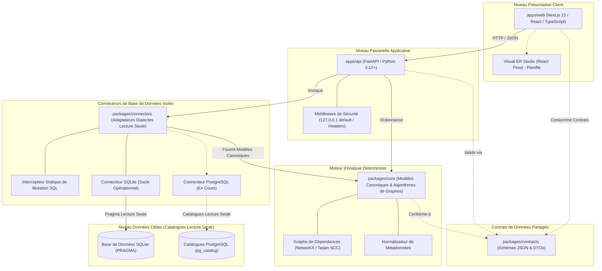

**Lire cette documentation en :** [English (Root)](../../README.md) | [Español](README.es.md) | [Français](README.fr.md) | [Deutsch](README.de.md) | [Português](README.pt.md) | [Italiano](README.it.md) | [日本語](README.ja.md) | [한국어](README.ko.md) | [简体中文](README.zh-CN.md) | [Русский](README.ru.md)

---

<div align="center">

# DERA

### Database Engineering & Reverse Analysis

**Comprenez chaque schéma. Concevez chaque changement.**

Une plateforme open source indépendante et déterministe d'ingénierie et de rétro-ingénierie de bases de données, conçue pour les développeurs, architectes de bases de données et équipes d'ingénierie logicielle.

Explorez les structures de bases de données, reconstituez les relations entre entités, évaluez les risques structurels et planifiez les évolutions de schéma — de manière entièrement déterministe, sans modèles d'intelligence artificielle ni API d'inférence externes.

<br/>

[](../../LICENSE)
[](https://github.com/krishanth7/dera/actions/workflows/ci.yml)
[](https://github.com/krishanth7/dera/actions/workflows/codeql.yml)
[](https://github.com/krishanth7/dera/actions/workflows/documentation.yml)
[](../../pyproject.toml)
[](../../tsconfig.json)
[-orange?style=for-the-badge)](#-architecture-strictement-sans-ia)
[](../../CONTRIBUTING.md)

<br/>

[Présentation](#-présentation) ·
[Matrice des Fonctionnalités](#-matrice-détat-des-fonctionnalités) ·
[Architecture](#-vue-densemble-de-larchitecture) ·
[Structure Monorepo](#-structure-du-dépôt) ·
[Démarrage Rapide](#-démarrage-rapide) ·
[Compatibilité BDD](#-matrice-de-compatibilité-des-bases-de-données) ·
[Sécurité](#-principes-de-sécurité) ·
[Navigation Documentation](#-navigation-dans-la-documentation-développeur) ·
[Feuille de Route](#-feuille-de-route-principale) ·
[Comment Contribuer](#-comment-contribuer) ·
[Communauté](#-communauté)

</div>

---

## 🌍 Support Multilingue

DERA maintient une documentation synchronisée en 10 langues internationales. Le README en anglais fait office de référence faisant autorité conformément à notre [Contrat de Maintenance de la Documentation](../development/README_MAINTENANCE.md).

| Langue | Code | Lien de Documentation | État |
|---|---|---|---|
| 🇬🇧 English | `en` | [English Primary (Root)](../../README.md) · [Synchronized Copy](README.en.md) | **Référence Faisant Autorité** |
| 🇪🇸 Español | `es` | [Documentación en Español](README.es.md) | Traduction Intégrale |
| 🇫🇷 Français | `fr` | [Documentation en Français](README.fr.md) | Traduction Intégrale |
| 🇩🇪 Deutsch | `de` | [Dokumentation auf Deutsch](README.de.md) | Traduction Intégrale |
| 🇵🇹 Português | `pt` | [Documentação em Português](README.pt.md) | Traduction Intégrale |
| 🇮🇹 Italiano | `it` | [Documentazione in Italiano](README.it.md) | Traduction Intégrale |
| 🇯🇵 日本語 | `ja` | [日本語ドキュメント](README.ja.md) | Traduction Intégrale |
| 🇰🇷 한국어 | `ko` | [한국어 문서](README.ko.md) | Traduction Intégrale |
| 🇨🇳 简体中文 | `zh-CN` | [简体中文文档](README.zh-CN.md) | Traduction Intégrale |
| 🇷🇺 Русский | `ru` | [Документация на русском](README.ru.md) | Traduction Intégrale |

---

## 📖 Présentation

Les bases de données relationnelles modernes représentent l'épine dorsale des architectures logicielles. Cependant, comprendre des schémas méconnus, patrimoniaux ou évoluant rapidement pose d'importants défis d'ingénierie :
- **Schémas Complexes :** Les bases de données d'entreprise comptent souvent des centaines de tables, des milliers de colonnes et des relations de clés étrangères non documentées.
- **Dette Architecturale :** Dépendances cycliques de clés étrangères, clés primaires absentes, clés étrangères non indexées et index redondants s'accumulent au fil du temps.
- **Risques de Migration :** Modifier des schémas sans un graphe topologique complet risque d'engendrer des verrous prolongés, des pertes de données et des violations de contraintes en cascade.
- **Sécurité et Confidentialité :** Les entreprises ne peuvent pas se permettre d'exposer leurs identifiants de production ou leurs données applicatives à des services d'IA sur le cloud.

**DERA a été conçu pour résoudre ces problématiques par le déterminisme mathématique.**

DERA fournit une plateforme modulaire et open source qui inspecte les catalogues de bases de données relationnelles, reconstruit les graphes de dépendance, évalue les risques structurels et prévisualise les migrations via des algorithmes vérifiables et reproductibles.

### Principes Fondamentaux d'Ingénierie

1. **Déterministe par Conception :** Chaque instantané de schéma, tri topologique et diagnostic est reproductible et fondé sur l'algèbre relationnelle.
2. **Strictement sans IA :** Zéro IA générative, zéro grand modèle de langage (LLM), zéro base de données vectorielle et zéro API d'inférence externe.
3. **Sécurité en Lecture Seule :** Application rigoureuse du mode lecture seule au niveau de la connexion, blocage statique AST des requêtes de mutation et requêtes limitées aux catalogues de métadonnées.
4. **Zéro Extraction des Données Lignes :** Introspection exclusive des métadonnées (`information_schema`, `pg_catalog`, `sqlite_master`). Les lignes des tables applicatives ne sont jamais interrogées, transmises ni stockées.
5. **Architecture Monorepo Découplée :** Frontières architecturales claires isolant les algorithmes de graphes, les connecteurs dialectaux, la passerelle API et le studio visuel.
6. **Open Source et Permissif :** Logiciel indépendant distribué sous la permissive [Licence MIT](../../LICENSE).

---

## 🧠 Architecture Strictement sans IA

DERA est délibérément développé sans aucun composant d'intelligence artificielle ni d'apprentissage automatique.

```text
┌───────────────────────────────────────────────────────────┐
│            ARCHITECTURE STRICTEMENT SANS IA               │
│                                                           │
│   ❌  Aucun appel à OpenAI, Claude ou Google Gemini       │
│   ❌  Aucune API Groq, DeepSeek ou modèle hébergé         │
│   ❌  Aucun LLM local (Ollama, vLLM, llama.cpp)           │
│   ❌  Aucune prédiction stochastique ni hallucination     │
│   ❌  Aucun embedding vectoriel cloud ni RAG externe      │
│                                                           │
│   ✅  Requêtes natives sur les catalogues système         │
│   ✅  Algorithmes mathématiques de graphe (NetworkX)      │
│   ✅  Analyseurs syntaxiques AST SQL (SQLGlot)            │
│   ✅  Moteurs de règles statiques reproductibles          │
│   ✅  Empreintes cryptographiques de hachage (SHA-256)    │
└───────────────────────────────────────────────────────────┘
```

**Pourquoi DERA est Déterministe :**
- **Auditabilité Mathématique :** Chaque relation, avertissement de cycle et diagnostic repose sur des preuves de catalogues et des algorithmes de graphes formels.
- **Reproductibilité à l'Octet Près :** Exécuter un audit sur un même instantané produit des résultats rigoureusement identiques sur toute machine ou chaîne CI.
- **Souveraineté des Données :** Vos schémas et topologies structurelles ne quittent jamais votre infrastructure vers des fournisseurs d'inférence tiers.
- **Zéro Coût Opérationnel :** Zéro coût de jetons (tokens), aucun quota d'appels et aucune latence réseau liée à l'inférence.

---

## 📊 Matrice d'État des Fonctionnalités

DERA maintient une communication transparente basée sur le code réel implémenté et validé par des tests automatisés :

| Capacité | État | Preuve d'Implémentation | Emplacement Monorepo |
|---|:---:|---|---|
| **Modèles de Schéma Canoniques** | **Implémenté** | Modèles canoniques `Column`, `Table`, `ForeignKey`, `Index` | [`packages/core/src/dera/models.py`](../../packages/core/src/dera/models.py) |
| **Moteur de Graphe de Dépendances** | **Implémenté** | DAG résistant aux cycles et tri topologique (Tarjan SCC) | [`packages/core/src/dera/graph.py`](../../packages/core/src/dera/graph.py) |
| **Intercepteur de Mutation (Read-Only)** | **Implémenté** | Analyse statique AST bloquant le SQL destructeur (`DROP`, `ALTER`, etc.) | [`packages/connectors/src/dera_connectors/base/`](../../packages/connectors/src/dera_connectors/base/connector.py) |
| **Introspection de Catalogue SQLite** | **Implémenté** | Détection des tables, colonnes, PK, FK et index | [`packages/connectors/src/dera_connectors/sqlite/`](../../packages/connectors/src/dera_connectors/sqlite/connector.py) |
| **Inspection de Catalogue PostgreSQL** | **En Cours** | Tests d'intégration sur conteneur PostgreSQL éphémère | [`tests/integration/`](../../tests/integration/) |
| **Passerelle API et Télémétrie** | **Implémenté** | Service FastAPI avec liaison localhost et points de contrôle | [`apps/api/src/dera_api/main.py`](../../apps/api/src/dera_api/main.py) |
| **Socle Applicatif Web Studio** | **Implémenté** | Socle Next.js 15 TypeScript et carte d'état d'architecture | [`apps/web/src/app/page.tsx`](../../apps/web/src/app/page.tsx) |
| **Contrats de Données Partagés** | **Implémenté** | Schémas JSON versionnés et DTOs de sérialisation | [`packages/contracts/schemas/`](../../packages/contracts/schemas/) |
| **Canevas Visuel ER Studio** | Planifié | Canevas interactif basé sur React Flow | Feuille de Route Phase 7 |
| **Matrice de Règles Déterministes** | Planifié | Détecteurs de PK manquantes, FK non indexées et index redondants | Feuille de Route Phase 8 |
| **Moteur Diff d'Instantanés** | Planifié | Comparaison sémantique d'instantanés et aperçu DDL | Feuille de Route Phase 9 |
| **Analyseur de Performance AST SQL** | Planifié | Complexité de requêtes SQLGlot et visualiseur de plans | Feuille de Route Phase 10 |

> **Légende des États :**
> - **`Implémenté`** &mdash; Écrit, vérifié et validé par des tests automatisés en CI.
> - **`En Cours`** &mdash; En cours de développement actif et de tests d'intégration dans le jalon actuel.
> - **`Planifié`** &mdash; Prévu dans la feuille de route de développement en 12 phases.

---

## 🏗️ Vue d'Ensemble de l'Architecture

DERA organise ses fonctionnalités en espaces de travail modulaires conformément à notre [Spécification d'Architecture Monorepo](../architecture/README_ARCHITECTURE.md) :



### Description Textuelle de l'Architecture (Accessibilité)
- **Niveau Présentation Client (`apps/web`) :** Frontend Next.js 15 TypeScript communiquant avec l'API en JSON et hébergeant le canevas de diagrammes ER.
- **Niveau Passerelle Applicative (`apps/api`) :** Backend FastAPI relié par défaut à `127.0.0.1`, hébergeant la télémétrie de santé, les routes d'extraction de catalogue et les middlewares de sécurité.
- **Contrats de Données Partagés (`packages/contracts`) :** Définitions JSON Schema et interfaces TypeScript fixant le format canonique des tables, colonnes, index et instantanés.
- **Moteur Déterministe Central (`packages/core`) :** Bibliothèque en Python pur implémentant les modèles canoniques, les composantes fortement connexes de Tarjan, le tri topologique et la normalisation.
- **Connecteurs de Base de Données Isolés (`packages/connectors`) :** Adaptateurs interrogeant les catalogues système (`sqlite_master`, `pg_catalog`). Bloquent toute tentative de mutation SQL avant son exécution.
- **Niveau Données Cibles (Lecture Seule) :** Les bases de données analysées. DERA s'y connecte exclusivement avec des identifiants non privilégiés en lecture seule.

Pour approfondir les spécifications :
- [Guide et Schéma d'Architecture](../architecture/README_ARCHITECTURE.md)
- [Frontières des Modules et Règles de Dépendance](../architecture/MODULE_BOUNDARIES.md)
- [Structure des Répertoires du Monorepo](../architecture/MONOREPO_STRUCTURE.md)
- [Enregistrement de Décision d'Architecture (ADR 0001)](../architecture/adr/0001-monorepo-architecture.md)

---

## 📁 Structure du Dépôt

L'agencement réel du monorepo DERA est structuré comme suit :

```text
dera/
├── apps/
│   ├── api/                      # Backend FastAPI et points de contrôle de santé
│   │   ├── src/dera_api/         # Routes de passerelle, middlewares et schémas
│   │   └── pyproject.toml        # Spécification d'empaquetage de l'API
│   └── web/                      # Frontend studio Next.js 15 TypeScript
│       ├── src/                  # App router, composants et client API
│       └── package.json          # Configuration de l'espace web
├── packages/
│   ├── core/                     # Modèles canoniques et moteur de traitement de graphes
│   │   └── src/dera_core/        # Modèles de schémas, algorithmes DAG et théorie des graphes
│   ├── connectors/               # Adaptateurs d'extraction de métadonnées
│   │   └── src/dera_connectors/  # Connecteur de base, gardes de mutation et SQLite
│   └── contracts/                # Schémas et contrats JSON partagés
│       └── schemas/              # Contrats versionnés pour l'API et les instantanés
├── tests/
│   ├── architecture/             # Tests de frontières d'importation AST
│   ├── integration/              # Tests d'intégration sur catalogues SQLite et PostgreSQL
│   ├── regression/               # Tests de régression déterministe sur DAG et hachages
│   └── unit/                     # Tests unitaires de modèles, titres et validation
├── scripts/
│   ├── ci/                       # Scripts de validation CI (docs, i18n, préparation PR)
│   └── development/              # Lanceur CLI unifié multiplateforme (dev.py)
├── docs/
│   ├── audit/                    # Audits de dépôt, baselines et rapports de conformité
│   ├── architecture/             # Schéma du monorepo, frontières et ADRs
│   ├── development/              # Guides d'intégration, commandes et flux Git
│   ├── governance/               # Gouvernance, mainteneurs, décisions GAD et licences
│   ├── security/                 # Modèle de menaces, sécurité BDD et vulnérabilités
│   ├── community/                # Hub communautaire, guides et tri des signalements
│   ├── roadmap/                  # Feuille de route principale de développement en 12 phases
│   └── i18n/                     # Documentation technique synchronisée en 10 langues
├── .github/
│   ├── workflows/                # CI/CD d'entreprise, CodeQL et contrôles automatiques
│   ├── ISSUE_TEMPLATE/           # Modèles YAML structurés pour bugs et fonctionnalités
│   ├── PULL_REQUEST_TEMPLATE/    # Modèles de pull request spécialisés
│   ├── CODEOWNERS                # Définition des propriétaires du code
│   └── PULL_REQUEST_TEMPLATE.md  # Modèle standard de qualification des PR
├── pyproject.toml                # Configuration racine Python (PEP 621)
├── package.json                  # Configuration racine npm
├── tsconfig.json                 # Configuration TypeScript en mode strict
├── Makefile                      # Automatisation standard des commandes de développement
├── CONTRIBUTING.md               # Guide complet pour les contributeurs
├── SECURITY.md                   # Politique de divulgation coordonnée des vulnérabilités
└── LICENSE                       # Licence MIT
```

---

## 🚀 Démarrage Rapide

DERA propose un outil CLI multiplateforme unifié (`scripts/development/dev.py`) pour vérifier, tester et exécuter le projet sur Windows, Linux et macOS de façon homogène.

### Prérequis

| Outil | Version Minimale | Version Recommandée | Commande de Vérification |
|---|---|---|---|
| **Python** | `3.12+` | `3.12` ou `3.13` | `python --version` |
| **Node.js** | `20.x LTS` | `20.x` ou `22.x LTS` | `node --version` |
| **Git** | `2.30+` | Dernière version | `git --version` |

### 1. Cloner le Dépôt

```bash
git clone https://github.com/krishanth7/dera.git
cd dera
```

### 2. Configurer l'Environnement

Copiez le modèle d'environnement sécurisé :

```bash
# Windows PowerShell
Copy-Item .env.example .env

# Linux / macOS
cp .env.example .env
```

### 3. Configurer l'Environnement Virtuel Python

```bash
# Linux / macOS
python3 -m venv .venv
source .venv/bin/activate
pip install -e ".[dev]"

# Windows PowerShell
python -m venv .venv
.venv\Scripts\Activate.ps1
pip install -e ".[dev]"
```

### 4. Installer les Dépendances Node.js

```bash
npm install
```

### 5. Exécuter la Suite Complète de Validation

Vérifiez que tous les modules Python, compilateurs TypeScript, tests et liens de documentation sont valides :

```bash
python scripts/development/dev.py all
```

**Résultat Attendu :**
```text
Ran 32 tests in 0.25s
OK (skipped=2)
Validating 69 markdown documentation files...
SUCCESS: All 69 markdown documentation files are valid.
Validating 10 multilingual documentation files in i18n...
SUCCESS: All 10 language documentation files verified with valid navigation and parity.
[SUCCESS]: All development baseline checks passed successfully.
```

### 6. Commandes Fréquentes pour Développeurs

| Tâche | CLI Multiplateforme (`dev.py`) | GNU Make (UNIX / macOS) |
|---|---|---|
| **Exécuter tous les tests** | `python scripts/development/dev.py test` | `make test` |
| **Vérification des types TS** | `python scripts/development/dev.py typecheck` | `make typecheck` |
| **Compilation bytecode Python** | `python scripts/development/dev.py compile` | `make build` |
| **Validation documentation** | `python scripts/development/dev.py validate-docs` | `make lint` |
| **Valider titre de commit / PR** | `python scripts/development/dev.py validate-title "<titre>"` | `make validate-title TITLE="..."` |
| **Lancer le serveur API local** | `python -m uvicorn dera_api.main:app --reload --port 8000` | `make dev-api` |
| **Lancer le frontend web studio** | `npm run dev --workspace=apps/web` | `npm run dev --workspace=apps/web` |

Pour des consignes d'intégration détaillées, consultez le [Guide de Démarrage](../development/GETTING_STARTED.md) et le [Catalogue des Commandes](../development/COMMANDS.md).

---

## 🗄️ Matrice de Compatibilité des Bases de Données

DERA met en œuvre une architecture de connecteurs de bases de données modulaires et isolés :

| Moteur de Base de Données | Versions Prises en Charge | État du Connecteur | Mécanisme d'Introspection | Mesure de Protection Lecture Seule |
|---|:---:|:---:|---|---|
| **SQLite** | 3.35+ | **Implémenté** | `sqlite_master`, `PRAGMA table_info`, `PRAGMA foreign_key_list` | Bloqueur AST statique & `PRAGMA query_only = ON` |
| **PostgreSQL** | 12 – 17 | **En Cours** | `pg_catalog`, `information_schema` | `SET default_transaction_read_only = ON` & rôles lecture seule |
| **Supabase PostgreSQL** | Cloud / Local | **En Cours** | Extraction native des catalogues PostgreSQL | Session lecture seule à la connexion et rôles non privilégiés |
| **MySQL** | 8.0+ | Planifié | `information_schema`, `performance_schema` | Mode de transaction en session de lecture seule |
| **MariaDB** | 10.5+ | Planifié | `information_schema` | Mode de transaction en session de lecture seule |
| **Microsoft SQL Server** | 2019+ | Planifié | `sys.tables`, `INFORMATION_SCHEMA` | Droits d'accès utilisateur en lecture seule |

> [!NOTE]
> Les connecteurs signalés **`En Cours`** sont testés automatiquement avec des conteneurs éphémères en CI. Les connecteurs signalés **`Planifié`** sont programmés dans la phase 5 de la feuille de route.

---

## 🔒 Principes de Sécurité

La sécurité constitue le socle d'ingénierie fondamental de DERA. En interagissant avec des schémas de bases de données, la plateforme applique des contrôles stricts de défense en profondeur :

1. **Intercepteur Statique de Mutations :** Avant d'exécuter une requête SQL, celle-ci traverse un analyseur AST. Toute instruction contenant `DROP`, `ALTER`, `TRUNCATE`, `INSERT`, `UPDATE`, `DELETE`, `GRANT` ou `REVOKE` est immédiatement rejetée.
2. **Extraction Limitée aux Catalogues :** L'analyse porte uniquement sur les métadonnées système (`information_schema`, `pg_catalog`, `sqlite_master`). Les lignes des tables applicatives ne sont jamais interrogées.
3. **Liaison Loopback par Défaut :** Les serveurs de développement et points d'accès API s'associent à `127.0.0.1` par défaut afin de prévenir toute exposition non voulue.
4. **Comptes de Base de Données à Moindres Privilèges :** DERA opère exclusivement au moyen de rôles de base de données non privilégiés en lecture seule.
5. **Zéro Secret Versionné :** Les identifiants ne sont jamais écrits sur disque, suivis dans Git ou imprimés dans les journaux d'exécution.
6. **Divulgation Responsable :** Les vulnérabilités sont prises en charge de façon confidentielle et coordonnée via notre [Politique de Sécurité](../../SECURITY.md).

> [!NOTE]
> DERA applique les meilleures pratiques de sécurité open source (CodeQL, Bandit SAST, détection de secrets). Le projet ne revendique pas de certifications commerciales externes (telles que SOC 2 ou ISO 27001).

Pour consulter la documentation dédiée à la sécurité :
- [**Politique de Sécurité des Bases de Données**](../security/DATABASE_SECURITY.md) — Inspection des catalogues, gestion des identifiants et isolation.
- [**Normes de Développement Sécurisé**](../security/SECURE_DEVELOPMENT.md) — Validation des entrées et points de contrôle DevSecOps.
- [**Processus de Réponse aux Vulnérabilités**](../security/VULNERABILITY_RESPONSE.md) — Démarche de triage en 5 phases et avis privés.
- [**Matrice du Modèle de Menaces**](../security/model.md) — Analyse des vecteurs d'attaque et contre-mesures.

---

## 📚 Navigation dans la Documentation Développeur

Consultez l'ensemble des ressources documentaires de DERA :

| Domaine | Guides Essentiels |
|---|---|
| **Architecture** | [Schéma du Monorepo](../architecture/README_ARCHITECTURE.md) · [Frontières des Modules](../architecture/MODULE_BOUNDARIES.md) · [Structure du Monorepo](../architecture/MONOREPO_STRUCTURE.md) · [ADRs](../architecture/adr/0001-monorepo-architecture.md) |
| **Développement** | [Guide de Démarrage](../development/GETTING_STARTED.md) · [Catalogue des Commandes](../development/COMMANDS.md) · [Configuration de l'Environnement](../development/ENVIRONMENT.md) · [Dépannage](../development/TROUBLESHOOTING.md) |
| **Cycle de Vie Documentaire** | [Contrat de Maintenance](../development/README_MAINTENANCE.md) · [Directives Techniques](../development/README_GUIDELINES.md) |
| **Gouvernance et Gestion** | [Politique des Mainteneurs](../governance/MAINTAINERS.md) · [Décisions de Gouvernance](../governance/GOVERNANCE_DECISIONS.md) · [Licences Tierces](../governance/THIRD_PARTY_LICENSES.md) |
| **Sécurité** | [Politique de Sécurité](../../SECURITY.md) · [Sécurité des Bases de Données](../security/DATABASE_SECURITY.md) · [Développement Sécurisé](../security/SECURE_DEVELOPMENT.md) · [Réponse aux Vulnérabilités](../security/VULNERABILITY_RESPONSE.md) |
| **Communauté et Tri** | [Guide de Contribution](../../CONTRIBUTING.md) · [Guide des Discussions](https://github.com/krishanth7/dera/discussions) · [Tri des Signalements](https://github.com/krishanth7/dera/issues) · [Code de Conduite](../../CODE_OF_CONDUCT.md) |
| **Audits et Vérification** | [Index des Audits](../audit/README.md) · [Audit README Phase 2.1](../audit/PHASE_2_1_README_AUDIT.md) · [Ligne de Base du Dépôt](../audit/BASELINE.md) |
| **Feuille de Route** | [Feuille de Route Principale en 12 Phases](../roadmap/README.md) |

---

## 🗺️ Feuille de Route Principale

DERA réalise un plan de développement méthodique en **12 Phases** afin de bâtir une suite complète d'ingénierie inverse :

- [x] **Phase 1 : Fondations du Dépôt et Gouvernance**
  - [x] Phase 1.1 : Audit complet du dépôt et ligne de base
  - [x] Phase 1.2 : Architecture monorepo d'entreprise (`apps/`, `packages/`)
  - [x] Phase 1.3 : Stratégie de branches Git, Conventional Commits et contrôles de PR
  - [x] Phase 1.4 : README professionnel, identité de marque et diagrammes
  - [x] Phase 1.5 : Politique de sécurité, rapport de vulnérabilité et gouvernance
  - [x] Phase 1.6 : Modèles d'issues structurés, gouvernance des discussions et communauté (PR #20)
- [ ] **Phase 2 : Documentation Multilingue et Expérience Développeur**
  - [x] Phase 2.1 : README anglais faisant autorité et socle documentaire (PR #21)
  - [x] Phase 2.2 : Documentation internationale synchronisée en 9 langues (En Cours)
- [x] **Phase 3 : GitHub Actions, Automatisation CI/CD et DevSecOps**
- [ ] **Phase 4 : Backend et Infrastructure de Plateforme**
- [ ] **Phase 5 : Connecteurs de Bases de Données et Inspection de Métadonnées**
- [ ] **Phase 6 : Moteur Central de Rétro-Ingénierie**
- [ ] **Phase 7 : Frontend et Studio Visuel d'Ingénierie**
- [ ] **Phase 8 : Diagnostics et Analyse Intelligente de Schéma**
- [ ] **Phase 9 : Comparaison de Schémas et Ingénierie de Migration**
- [ ] **Phase 10 : Analyse SQL et Outils d'Ingénierie**
- [ ] **Phase 11 : Sécurité d'Entreprise, Fiabilité et Assurance Qualité**
- [ ] **Phase 12 : Publication, Déploiement et Croissance Open Source**

Pour consulter le détail des jalons et livrables, lisez la [Feuille de Route de Développement](../roadmap/README.md).

---

## 🤝 Comment Contribuer

Nous accueillons avec grand plaisir les contributions des ingénieurs logiciel, administrateurs de bases de données, chercheurs en sécurité et rédacteurs techniques du monde entier !

### Ressources pour les Contributeurs

- **[Guide de Contribution](../../CONTRIBUTING.md) :** Directives complètes et normes de travail.
- **[Flux de Travail de Contribution](../development/CONTRIBUTION_WORKFLOW.md) :** Guide technique pour le développement, les tests et la qualification des PR.
- **[Stratégie de Branches](../development/BRANCHING_STRATEGY.md) :** Développement trunk-based et règles de nommage (`feat/...`, `fix/...`).
- **[Conventions de Commit](../development/COMMIT_CONVENTIONS.md) :** Format Conventional Commits 1.0.0 et correspondance SemVer.
- **[Politique de Revue de Code](../development/CODE_REVIEW_POLICY.md) :** Critères d'approbation et contrôles par les pairs.
- **[Code de Conduite](../../CODE_OF_CONDUCT.md) :** Normes relationnelles et règles d'application.

---

## 💬 Communauté

- [Discussions GitHub](https://github.com/krishanth7/dera/discussions) — Posez vos questions, partagez vos idées et échangez sur la rétro-ingénierie de bases de données.
- [Signalements GitHub](https://github.com/krishanth7/dera/issues) — Déclarez des anomalies ou proposez des évolutions.
- [Pull Requests GitHub](https://github.com/krishanth7/dera/pulls) — Proposez vos contributions de code, de tests ou de documentation.
- [Avis de Sécurité Privés](https://github.com/krishanth7/dera/security/advisories/new) — Signalez des vulnérabilités de manière confidentielle.
- [Décisions de Gouvernance](../governance/GOVERNANCE_DECISIONS.md) — Registre des arbitrages d'architecture et de communauté.

---

## 📜 Licence

DERA est distribué sous la permissive **[Licence MIT](../../LICENSE)**.

```text
Copyright (c) 2026 Krishanth
```

---

## 👨‍💻 Mainteneur

**Krishanth**  
Fondateur et Mainteneur Principal

- GitHub : [@krishanth7](https://github.com/krishanth7)  
- Dépôt : [github.com/krishanth7/dera](https://github.com/krishanth7/dera)  
- Contact : `krishanth.b.2008@gmail.com`

*DERA est un projet open source indépendant maintenu par Krishanth. OVIC Labs est reconnu au titre de l'écosystème d'ingénierie plus large du mainteneur.*

---

<div align="center">

### DERA — Database Engineering & Reverse Analysis

**Comprenez chaque schéma. Concevez chaque changement.**

*Bâti sur le déterminisme mathématique, l'exigence d'ingénierie et la transparence open source.*

© 2026 Contributeurs DERA. Distribué sous Licence MIT.

[Haut de page](#dera)

</div>
