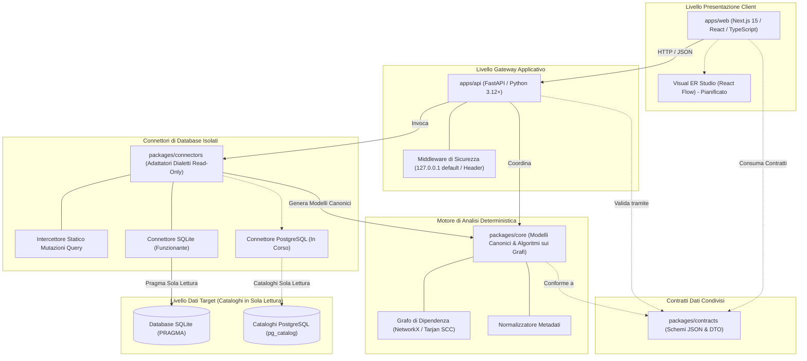

**Leggi questa documentazione in:** [English (Root)](../../README.md) | [Español](README.es.md) | [Français](README.fr.md) | [Deutsch](README.de.md) | [Português](README.pt.md) | [Italiano](README.it.md) | [日本語](README.ja.md) | [한국어](README.ko.md) | [简体中文](README.zh-CN.md) | [Русский](README.ru.md)

---

<div align="center">

# DERA

### Database Engineering & Reverse Analysis

**Comprendi ogni schema. Progetta ogni cambiamento.**

Una piattaforma open source indipendente e deterministica per l'ingegneria e il reverse engineering dei database, progettata per sviluppatori software, architetti di database e team di ingegneria.

Esplora le strutture dei database, ricostruisci le relazioni tra entità, valuta i rischi strutturali e pianifica le modifiche agli schemi — in modo completamente deterministico, senza modelli di intelligenza artificiale né API di inferenza esterne.

<br/>

[](../../LICENSE)
[](https://github.com/krishanth7/dera/actions/workflows/ci.yml)
[](https://github.com/krishanth7/dera/actions/workflows/codeql.yml)
[](https://github.com/krishanth7/dera/actions/workflows/documentation.yml)
[](../../pyproject.toml)
[](../../tsconfig.json)
[-orange?style=for-the-badge)](#-architettura-rigorosamente-senza-ia)
[](../../CONTRIBUTING.md)

<br/>

[Panoramica](#-panoramica) ·
[Matrice delle Funzionalità](#-matrice-dello-stato-delle-funzionalità) ·
[Architettura](#-panoramica-dellarchitettura) ·
[Struttura Monorepo](#-struttura-del-repository) ·
[Guida Introduttiva](#-guida-introduttiva) ·
[Compatibilità Database](#-matrice-di-compatibilità-dei-database) ·
[Sicurezza](#-principi-di-sicurezza) ·
[Hub Documentazione](#-navigazione-della-documentazione-per-sviluppatori) ·
[Roadmap](#-roadmap-principale) ·
[Contribuire](#-come-contribuire) ·
[Community](#-community)

</div>

---

## 🌍 Supporto Multilingue

DERA mantiene la documentazione sincronizzata in 10 lingue internazionali. Il README inglese funge da fonte autoritativa di verità secondo il nostro [Contratto di Manutenzione della Documentazione](../development/README_MAINTENANCE.md).

| Lingua | Codice | Collegamento alla Documentazione | Stato |
|---|---|---|---|
| 🇬🇧 English | `en` | [English Primary (Root)](../../README.md) · [Synchronized Copy](README.en.md) | **Fonte Autoritativa di Verità** |
| 🇪🇸 Español | `es` | [Documentación en Español](README.es.md) | Traduzione Completa |
| 🇫🇷 Français | `fr` | [Documentation en Français](README.fr.md) | Traduzione Completa |
| 🇩🇪 Deutsch | `de` | [Dokumentation auf Deutsch](README.de.md) | Traduzione Completa |
| 🇵🇹 Português | `pt` | [Documentação em Português](README.pt.md) | Traduzione Completa |
| 🇮🇹 Italiano | `it` | [Documentazione in Italiano](README.it.md) | Traduzione Completa |
| 🇯🇵 日本語 | `ja` | [日本語ドキュメント](README.ja.md) | Traduzione Completa |
| 🇰🇷 한국어 | `ko` | [한국어 문서](README.ko.md) | Traduzione Completa |
| 🇨🇳 简体中文 | `zh-CN` | [简体中文文档](README.zh-CN.md) | Traduzione Completa |
| 🇷🇺 Русский | `ru` | [Документация на русском](README.ru.md) | Traduzione Completa |

---

## 📖 Panoramica

I moderni database relazionali costituiscono la colonna vertebrale dell'infrastruttura software. Tuttavia, comprendere schemi complessi, legacy o in rapida evoluzione presenta notevoli sfide ingegneristiche:
- **Schemi Complessi:** I database aziendali comprendono spesso centinaia di tabelle, migliaia di colonne e relazioni di chiave esterna non documentate.
- **Debito Architetturale:** Dipendenze cicliche tra chiavi esterne, chiavi primarie mancanti, chiavi esterne senza indici e indici ridondanti si accumulano silenziosamente nel tempo.
- **Rischi di Migrazione:** Apportare modifiche agli schemi senza un grafo topologico completo rischia escalation di lock, perdita di dati e violazioni a catena dei vincoli di integrità.
- **Privacy e Sicurezza:** Le organizzazioni non possono rischiare di esporre credenziali di database di produzione o righe di dati riservati a servizi di intelligenza artificiale cloud.

**DERA è progettato per risolvere queste sfide attraverso il determinismo matematico.**

DERA offre una piattaforma modulare e open source che esamina i cataloghi dei database relazionali, ricostruisce i grafi di dipendenza, valuta i rischi strutturali e genera anteprime di migrazione attraverso algoritmi verificabili e riproducibili.

### Principi Ingegneristici Fondamentali

1. **Deterministico per Progettazione:** Ogni snapshot dello schema, ordinamento topologico del grafo e riscontro diagnostico è riproducibile e basato sull'algebra relazionale.
2. **Rigorosamente Senza IA:** Zero IA generativa, zero modelli linguistici di grandi dimensioni (LLM), zero database vettoriali e zero API di inferenza esterne.
3. **Sicurezza del Database in Sola Lettura:** Rigida applicazione della sola lettura a livello di connessione, blocco statico delle query di mutazione tramite AST e interrogazioni limitate ai soli cataloghi di sistema.
4. **Zero Estrazione di Righe Dati Utente:** Pura introspezione dei metadati (`information_schema`, `pg_catalog`, `sqlite_master`). Le righe delle tabelle applicative non vengono mai estratte, trasmesse o archiviate.
5. **Architettura Monorepo Disaccoppiata:** Confini architetturali netti che separano gli algoritmi di grafo, i connettori isolati, il gateway API e lo studio visuale.
6. **Open Source e Permissivo:** Software indipendente rilasciato sotto la permissiva [Licenza MIT](../../LICENSE).

---

## 🧠 Architettura Rigorosamente Senza IA

DERA è intenzionalmente sviluppato senza componenti di intelligenza artificiale o machine learning.

```text
┌───────────────────────────────────────────────────────────┐
│          ARCHITETTURA RIGOROSAMENTE SENZA IA              │
│                                                           │
│   ❌  Nessun uso di OpenAI, Anthropic Claude o Gemini     │
│   ❌  Nessuna API Groq, DeepSeek o modelli ospitati       │
│   ❌  Nessun LLM locale (Ollama, vLLM, llama.cpp)         │
│   ❌  Nessuna predizione stocastica o allucinazione       │
│   ❌  Nessun embedding vettoriale cloud o RAG esterno     │
│                                                           │
│   ✅  Query native sui cataloghi (information_schema)     │
│   ✅  Algoritmi matematici sui grafi (NetworkX / Tarjan)  │
│   ✅  Parser SQL basati su Abstract Syntax Tree (SQLGlot) │
│   ✅  Motori a regole statiche riproducibili              │
│   ✅  Impronte crittografiche crittografiche (SHA-256)    │
└───────────────────────────────────────────────────────────┘
```

**Perché DERA è Deterministico:**
- **Verificabilità Matematica:** Ogni relazione, avviso di ciclo e diagnosi cita evidenze concrete di catalogo e algoritmi di grafo riproducibili.
- **Riproducibilità Byte per Byte:** L'esecuzione di un audit sullo stesso snapshot produce sempre risultati identici su qualsiasi ambiente e pipeline CI.
- **Sovranità dei Dati Aziendali:** Gli schemi e le topologie del database non lasciano mai la rete verso provider di inferenza esterni.
- **Zero Costi Operativi:** Zero costi per token, zero limiti di frequenza (rate limiting) e zero latenza di rete dovuta all'inferenza.

---

## 📊 Matrice dello Stato delle Funzionalità

DERA adotta un modello di rendicontazione trasparente basato su evidenze concrete verificate da test automatizzati:

| Funzionalità | Stato | Evidenza di Implementazione | Percorso nel Monorepo |
|---|:---:|---|---|
| **Modelli Core dello Schema** | **Implementato** | Modelli canonici `Column`, `Table`, `ForeignKey`, `Index` | [`packages/core/src/dera/models.py`](../../packages/core/src/dera/models.py) |
| **Motore dei Grafi di Dipendenza** | **Implementato** | DAG resistente ai cicli e ordinamento topologico (Tarjan SCC) | [`packages/core/src/dera/graph.py`](../../packages/core/src/dera/graph.py) |
| **Intercettore di Mutazioni (Read-Only)** | **Implementato** | Analisi statica AST che blocca query distruttive (`DROP`, `ALTER`, ecc.) | [`packages/connectors/src/dera_connectors/base/`](../../packages/connectors/src/dera_connectors/base/connector.py) |
| **Introspezione Catalogo SQLite** | **Implementato** | Rilevamento tabelle, colonne, PK, FK e indici | [`packages/connectors/src/dera_connectors/sqlite/`](../../packages/connectors/src/dera_connectors/sqlite/connector.py) |
| **Ispezione Catalogo PostgreSQL** | **In Corso** | Test di integrazione con container effimeri PostgreSQL | [`tests/integration/`](../../tests/integration/) |
| **API Gateway & Telemetria** | **Implementato** | Servizio FastAPI con binding loopback e endpoint di salute | [`apps/api/src/dera_api/main.py`](../../apps/api/src/dera_api/main.py) |
| **Base dell'Applicazione Web Studio** | **Implementato** | Base Next.js 15 TypeScript e scheda di stato architetturale | [`apps/web/src/app/page.tsx`](../../apps/web/src/app/page.tsx) |
| **Contratti Dati Condivisi** | **Implementato** | Schemi JSON versionati e DTO di serializzazione | [`packages/contracts/schemas/`](../../packages/contracts/schemas/) |
| **Canvas Visuale ER Studio** | Pianificato | Canvas interattivo basato su React Flow | Roadmap Fase 7 |
| **Matrice Regole Deterministiche** | Pianificato | Rilevamento PK mancanti, FK non indicizzate e indici ridondanti | Roadmap Fase 8 |
| **Motore Diff di Snapshot** | Pianificato | Confronto semantico tra snapshot e anteprima DDL | Roadmap Fase 9 |
| **Analizzatore di Prestazioni AST SQL** | Pianificato | Complessità query SQLGlot e visualizzatore piani di esecuzione | Roadmap Fase 10 |

> **Legenda Stati:**
> - **`Implementato`** &mdash; Scritto, verificato e convalidato da test automatizzati in CI.
> - **`In Corso`** &mdash; In fase attiva di sviluppo e test di integrazione nel ciclo corrente.
> - **`Pianificato`** &mdash; Previsto nella roadmap di sviluppo a 12 fasi.

---

## 🏗️ Panoramica dell'Architettura

DERA organizza i propri moduli in aree di lavoro disaccoppiate in conformità con la nostra [Specifica Architetturale del Monorepo](../architecture/README_ARCHITECTURE.md):



### Descrizione Testuale dell'Architettura (Accessibilità)
- **Livello Presentazione Client (`apps/web`):** Frontend Next.js 15 TypeScript che dialoga con l'API via JSON e ospiterà l'interfaccia interattiva del diagramma ER.
- **Livello Gateway Applicativo (`apps/api`):** Backend FastAPI vincolato a `127.0.0.1` per impostazione predefinita, che gestisce telemetria di salute, estrazione cataloghi e middleware di sicurezza.
- **Contratti Dati Condivisi (`packages/contracts`):** Definizioni JSON Schema e interfacce TypeScript che definiscono il formato canonico per tabelle, colonne, indici, vincoli e snapshot.
- **Motore Core Deterministico (`packages/core`):** Libreria Python pura che implementa modelli di dominio canonici, componenti fortemente connesse di Tarjan, ordinamento topologico e normalizzazione dei metadati.
- **Connettori Database Isolati (`packages/connectors`):** Adattatori modulari che interrogano esclusivamente i cataloghi (`sqlite_master`, `pg_catalog`). Intercettano e bloccano qualsiasi operazione di mutazione SQL prima dell'esecuzione.
- **Livello Dati Target (Sola Lettura):** I database esaminati. DERA si connette esclusivamente con credenziali non privilegiate in sola lettura.

Per approfondimenti architetturali:
- [Guida e Blueprint Architetturale](../architecture/README_ARCHITECTURE.md)
- [Confini dei Moduli e Regole di Dipendenza](../architecture/MODULE_BOUNDARIES.md)
- [Struttura delle Directory del Monorepo](../architecture/MONOREPO_STRUCTURE.md)
- [Registro delle Decisioni Architetturali (ADR 0001)](../architecture/adr/0001-monorepo-architecture.md)

---

## 📁 Struttura del Repository

La struttura effettiva del monorepo DERA è organizzata come segue:

```text
dera/
├── apps/
│   ├── api/                      # Backend FastAPI ed endpoint di stato
│   │   ├── src/dera_api/         # Router del gateway, middleware e schemi
│   │   └── pyproject.toml        # Specifica di packaging dell'API
│   └── web/                      # Frontend studio Next.js 15 TypeScript
│       ├── src/                  # App router, componenti e client API
│       └── package.json          # Configurazione workspace web
├── packages/
│   ├── core/                     # Modelli canonici ed elaborazione grafi
│   │   └── src/dera_core/        # Modelli di schema, algoritmi DAG e teoria dei grafi
│   ├── connectors/               # Adattatori di estrazione metadati per database
│   │   └── src/dera_connectors/  # Connettore base, guardie di mutazione e SQLite
│   └── contracts/                # Contratti e schemi JSON condivisi
│       └── schemas/              # Contratti versionati per API e snapshot
├── tests/
│   ├── architecture/             # Test sui confini di importazione AST
│   ├── integration/              # Test di integrazione su cataloghi SQLite e PostgreSQL
│   ├── regression/               # Test di regressione deterministica su DAG e hash
│   └── unit/                     # Test unitari su modelli, titoli PR e readiness
├── scripts/
│   ├── ci/                       # Script di validazione CI (docs, i18n, PR readiness)
│   └── development/              # Runner CLI unificato multipiattaforma (dev.py)
├── docs/
│   ├── audit/                    # Audit di repository, baseline e report di conformità
│   ├── architecture/             # Blueprint monorepo, confini e decisioni ADR
│   ├── development/              # Guide onboarding, comandi e workflow Git
│   ├── governance/               # Gestione, maintainer, decisioni GAD e licenze
│   ├── security/                 # Threat model, sicurezza database e risposta vulnerabilità
│   ├── community/                # Hub community, linee guida e triage issue
│   ├── roadmap/                  # Roadmap principale di sviluppo a 12 fasi
│   └── i18n/                     # Documentazione tecnica sincronizzata in 10 lingue
├── .github/
│   ├── workflows/                # CI/CD enterprise, CodeQL e gate automatici
│   ├── ISSUE_TEMPLATE/           # Modelli YAML strutturati per bug, feature e connettori
│   ├── PULL_REQUEST_TEMPLATE/    # Modelli di pull request specializzati
│   ├── CODEOWNERS                # Definizione dei proprietari del codice
│   └── PULL_REQUEST_TEMPLATE.md  # Modello standard per la qualifica delle PR
├── pyproject.toml                # Configurazione workspace Python principale (PEP 621)
├── package.json                  # Configurazione workspace npm principale
├── tsconfig.json                 # Configurazione TypeScript con strict mode
├── Makefile                      # Automazione standard comandi di sviluppo
├── CONTRIBUTING.md               # Guida esaustiva per i contributori
├── SECURITY.md                   # Politica di divulgazione coordinata delle vulnerabilità
└── LICENSE                       # Licenza MIT
```

---

## 🚀 Guida Introduttiva

DERA include una CLI unificata multipiattaforma (`scripts/development/dev.py`) per verificare, testare ed eseguire il monorepo su Windows, Linux e macOS in modo consistente.

### Prerequisiti

| Strumento | Versione Minima | Versione Consigliata | Comando di Verifica |
|---|---|---|---|
| **Python** | `3.12+` | `3.12` o `3.13` | `python --version` |
| **Node.js** | `20.x LTS` | `20.x` o `22.x LTS` | `node --version` |
| **Git** | `2.30+` | Più recente | `git --version` |

### 1. Clonare il Repository

```bash
git clone https://github.com/krishanth7/dera.git
cd dera
```

### 2. Configurare l'Ambiente

Copia il modello di ambiente sicuro:

```bash
# Windows PowerShell
Copy-Item .env.example .env

# Linux / macOS
cp .env.example .env
```

### 3. Configurare l'Ambiente Virtuale Python

```bash
# Linux / macOS
python3 -m venv .venv
source .venv/bin/activate
pip install -e ".[dev]"

# Windows PowerShell
python -m venv .venv
.venv\Scripts\Activate.ps1
pip install -e ".[dev]"
```

### 4. Installare le Dipendenze Node.js

```bash
npm install
```

### 5. Eseguire la Suite Completa di Validazione

Verifica che tutti i pacchetti Python, compilatori TypeScript, suite di test e collegamenti alla documentazione siano validi:

```bash
python scripts/development/dev.py all
```

**Risultato Atteso:**
```text
Ran 32 tests in 0.25s
OK (skipped=2)
Validating 69 markdown documentation files...
SUCCESS: All 69 markdown documentation files are valid.
Validating 10 multilingual documentation files in i18n...
SUCCESS: All 10 language documentation files verified with valid navigation and parity.
[SUCCESS]: All development baseline checks passed successfully.
```

### 6. Riferimento Comandi per Sviluppatori

| Attività | CLI Multipiattaforma (`dev.py`) | GNU Make (UNIX / macOS) |
|---|---|---|
| **Esegui tutti i test** | `python scripts/development/dev.py test` | `make test` |
| **Verifica tipi TypeScript** | `python scripts/development/dev.py typecheck` | `make typecheck` |
| **Compilazione bytecode Python** | `python scripts/development/dev.py compile` | `make build` |
| **Validazione documentazione** | `python scripts/development/dev.py validate-docs` | `make lint` |
| **Valida titolo PR / commit** | `python scripts/development/dev.py validate-title "<titolo>"` | `make validate-title TITLE="..."` |
| **Avvia server API locale** | `python -m uvicorn dera_api.main:app --reload --port 8000` | `make dev-api` |
| **Avvia frontend studio web** | `npm run dev --workspace=apps/web` | `npm run dev --workspace=apps/web` |

Per istruzioni dettagliate consultare la [Guida Introduttiva](../development/GETTING_STARTED.md) e il [Catalogo Comandi](../development/COMMANDS.md).

---

## 🗄️ Matrice di Compatibilità dei Database

DERA adotta un'architettura di connettori isolata e modulare. I livelli di supporto riflettono codice funzionante e copertura di test automatizzata:

| Motore Database | Versioni Supportate | Stato Connettore | Meccanismo di Introspezione | Protezione Read-Only Applicata |
|---|:---:|:---:|---|---|
| **SQLite** | 3.35+ | **Implementato** | `sqlite_master`, `PRAGMA table_info`, `PRAGMA foreign_key_list` | Blocco AST statico & `PRAGMA query_only = ON` |
| **PostgreSQL** | 12 – 17 | **In Corso** | `pg_catalog`, `information_schema` | `SET default_transaction_read_only = ON` & ruoli di sola lettura |
| **Supabase PostgreSQL** | Cloud / Locale | **In Corso** | Estrazione cataloghi nativa PostgreSQL | Sessione read-only a livello di connessione e ruoli non privilegiati |
| **MySQL** | 8.0+ | Pianificato | `information_schema`, `performance_schema` | Modalità transazione di sola lettura |
| **MariaDB** | 10.5+ | Pianificato | `information_schema` | Modalità transazione di sola lettura |
| **Microsoft SQL Server** | 2019+ | Pianificato | `sys.tables`, `INFORMATION_SCHEMA` | Permessi utente in sola lettura |

> [!NOTE]
> I connettori indicati come **`In Corso`** sono sottoposti a test automatizzati su container effimeri in CI. I connettori indicati come **`Pianificato`** sono programmati nella roadmap di Fase 5.

---

## 🔒 Principi di Sicurezza

La sicurezza è il pilastro ingegneristico primario di DERA. Interagendo con architetture di database, la piattaforma applica controlli rigorosi di difesa in profondità:

1. **Intercettore Statico delle Mutazioni:** Prima di eseguire qualsiasi istruzione SQL sul database target, le query vengono verificate tramite un parser AST. Dichiarazioni contenenti `DROP`, `ALTER`, `TRUNCATE`, `INSERT`, `UPDATE`, `DELETE`, `GRANT` o `REVOKE` vengono bloccate istantaneamente.
2. **Estrazione Limitata ai Cataloghi:** L'analisi è confinata esclusivamente ai metadati di sistema (`information_schema`, `pg_catalog`, `sqlite_master`). Le righe applicative delle tabelle non vengono mai interrogate.
3. **Binding Loopback Predefinito:** I server di sviluppo e gli endpoint API si collegano a `127.0.0.1` per evitare esposizioni involontarie su reti esterne.
4. **Account Database con Privilegi Minimi:** DERA opera esclusivamente mediante ruoli di database non privilegiati in sola lettura, privi di privilegi di amministrazione.
5. **Zero Credenziali Versionate:** Le credenziali non vengono mai scritte su disco, tracciate nel controllo versione o stampate nei log applicativi.
6. **Divulgazione Responsabile:** Le vulnerabilità di sicurezza vengono gestite tramite segnalazione coordinata privata attraverso la nostra [Politica di Sicurezza](../../SECURITY.md).

> [!NOTE]
> DERA adotta le migliori pratiche aperte di sicurezza software (CodeQL, Bandit SAST, rilevamento segreti). Non dichiara certificazioni commerciali terze (quali SOC 2 o ISO 27001).

Per le politiche specializzate di sicurezza:
- [**Politica di Sicurezza dei Database**](../security/DATABASE_SECURITY.md) — Ispezione cataloghi, gestione credenziali e isolamento sessioni.
- [**Standard di Sviluppo Sicuro**](../security/SECURE_DEVELOPMENT.md) — Validazione input, parametrizzazione e gate DevSecOps.
- [**Processo di Risposta alle Vulnerabilità**](../security/VULNERABILITY_RESPONSE.md) — Workflow di triage a 5 stadi e advisory private.
- [**Matrice del Threat Model**](../security/model.md) — Analisi dei vettori di attacco e mitigazioni.

---

## 📚 Navigazione della Documentazione per Sviluppatori

Esplora la suite completa di documentazione di DERA:

| Ambito | Guide Principali |
|---|---|
| **Architettura** | [Blueprint Monorepo](../architecture/README_ARCHITECTURE.md) · [Confini Moduli](../architecture/MODULE_BOUNDARIES.md) · [Struttura Monorepo](../architecture/MONOREPO_STRUCTURE.md) · [ADR](../architecture/adr/0001-monorepo-architecture.md) |
| **Sviluppo** | [Guida Introduttiva](../development/GETTING_STARTED.md) · [Catalogo Comandi](../development/COMMANDS.md) · [Setup Ambiente](../development/ENVIRONMENT.md) · [Risoluzione Problemi](../development/TROUBLESHOOTING.md) |
| **Ciclo di Vita della Documentazione** | [Contratto di Manutenzione](../development/README_MAINTENANCE.md) · [Linee Guida Tecniche](../development/README_GUIDELINES.md) |
| **Governance & Gestione** | [Politica Maintainer](../governance/MAINTAINERS.md) · [Decisioni di Governance](../governance/GOVERNANCE_DECISIONS.md) · [Licenze Terze Parti](../governance/THIRD_PARTY_LICENSES.md) |
| **Sicurezza** | [Politica di Sicurezza](../../SECURITY.md) · [Sicurezza Database](../security/DATABASE_SECURITY.md) · [Sviluppo Sicuro](../security/SECURE_DEVELOPMENT.md) · [Risposta Vulnerabilità](../security/VULNERABILITY_RESPONSE.md) |
| **Community & Triage** | [Guida ai Contributi](../../CONTRIBUTING.md) · [Guida Discussioni](https://github.com/krishanth7/dera/discussions) · [Triage Issue](https://github.com/krishanth7/dera/issues) · [Codice di Condotta](../../CODE_OF_CONDUCT.md) |
| **Audit & Verifica** | [Indice Audit di Repository](../audit/README.md) · [Audit README Fase 2.1](../audit/PHASE_2_1_README_AUDIT.md) · [Baseline di Repository](../audit/BASELINE.md) |
| **Roadmap** | [Roadmap Principale a 12 Fasi](../roadmap/README.md) |

---

## 🗺️ Roadmap Principale

DERA sta completando un piano di sviluppo strutturato in **12 Fasi** per creare una piattaforma avanzata di ingegneria inversa dei database:

- [x] **Fase 1: Fondamenta del Repository e Governance**
  - [x] Fase 1.1: Audit completo del repository e baseline
  - [x] Fase 1.2: Architettura a cartelle monorepo enterprise (`apps/`, `packages/`)
  - [x] Fase 1.3: Strategia di branching Git, Conventional Commits e gate PR
  - [x] Fase 1.4: README professionale, identità del progetto e diagrammi architetturali
  - [x] Fase 1.5: Politica di sicurezza, segnalazione vulnerabilità e governance dei maintainer
  - [x] Fase 1.6: Modelli strutturati di issue, governance discussioni e operazioni community (PR #20)
- [ ] **Fase 2: Documentazione Multilingue & Esperienza Sviluppatore**
  - [x] Fase 2.1: README inglese primario autorevole e fondazione tecnica (PR #21)
  - [x] Fase 2.2: Documentazione internazionale sincronizzata in 9 lingue (In Corso)
- [x] **Fase 3: GitHub Actions, Automazione CI/CD e DevSecOps**
- [ ] **Fase 4: Backend e Infrastruttura della Piattaforma**
- [ ] **Fase 5: Connettori di Database e Ispezione Metadati**
- [ ] **Fase 6: Motore Core di Reverse Engineering**
- [ ] **Fase 7: Frontend e Studio Visuale di Ingegneria**
- [ ] **Fase 8: Diagnostica e Intelligenza dello Schema**
- [ ] **Fase 9: Confronto Schemi e Ingegneria delle Migrazioni**
- [ ] **Fase 10: Analisi SQL e Strumenti di Ingegneria**
- [ ] **Fase 11: Sicurezza Enterprise, Affidabilità e QA su Larga Scala**
- [ ] **Fase 12: Rilascio, Deployment e Crescita Open Source**

Per dettagli completi su milestone, scadenze e deliverable, consultare la [Roadmap Principale di Sviluppo](../roadmap/README.md).

---

## 🤝 Come Contribuire

Accogliamo con entusiasmo contributi da ingegneri del software, amministratori di database, ricercatori di sicurezza e scrittori tecnici da tutto il mondo!

### Risorse per i Contributori

- **[Guida ai Contributi](../../CONTRIBUTING.md):** Istruzioni e standard completi per ogni fase del contributo.
- **[Workflow di Contribuzione](../development/CONTRIBUTION_WORKFLOW.md):** Guida tecnica per sviluppo, test e qualifica delle PR.
- **[Strategia di Branching](../development/BRANCHING_STRATEGY.md):** Sviluppo trunk-based e convenzioni di denominazione (`feat/...`, `fix/...`).
- **[Convenzioni di Commit](../development/COMMIT_CONVENTIONS.md):** Specifica formato Conventional Commits 1.0.0 e mapping SemVer.
- **[Politica di Revisione del Codice](../development/CODE_REVIEW_POLICY.md):** Criteri di peer review, approvazione code owner e gate di verifica.
- **[Codice di Condotta](../../CODE_OF_CONDUCT.md):** Standard comunitari, comportamenti positivi e linee guida di applicazione.

---

## 💬 Community

- [Discussioni GitHub](https://github.com/krishanth7/dera/discussions) — Poni domande, condividi idee e discuti di reverse engineering dei database.
- [Issue GitHub](https://github.com/krishanth7/dera/issues) — Segnala bug o proponi nuove funzionalità.
- [Pull Request GitHub](https://github.com/krishanth7/dera/pulls) — Invia contributi di codice, test o documentazione.
- [Advisory di Sicurezza Private](https://github.com/krishanth7/dera/security/advisories/new) — Segnala vulnerabilità in modo sicuro e confidenziale.
- [Decisioni di Governance](../governance/GOVERNANCE_DECISIONS.md) — Registri delle decisioni architetturali e direttive della community.

---

## 📜 Licenza

DERA è distribuito sotto la permissiva **[Licenza MIT](../../LICENSE)**.

```text
Copyright (c) 2026 Krishanth
```

---

## 👨‍💻 Maintainer

**Krishanth**  
Fondatore e Lead Maintainer

- GitHub: [@krishanth7](https://github.com/krishanth7)  
- Repository: [github.com/krishanth7/dera](https://github.com/krishanth7/dera)  
- Contatto: `krishanth.b.2008@gmail.com`

*DERA è un progetto open source indipendente gestito da Krishanth. OVIC Labs è riconosciuto quale parte del più ampio ecosistema ingegneristico del maintainer.*

---

<div align="center">

### DERA — Database Engineering & Reverse Analysis

**Comprendi ogni schema. Progetta ogni cambiamento.**

*Costruito con determinismo matematico, precisione ingegneristica e trasparenza open source.*

© 2026 Contributori DERA. Distribuito sotto Licenza MIT.

[Torna all'inizio](#dera)

</div>
