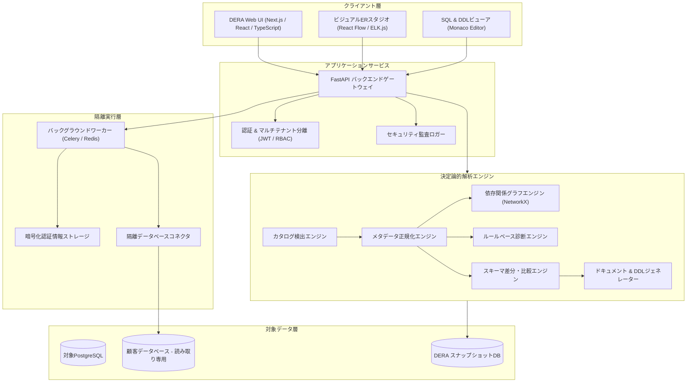
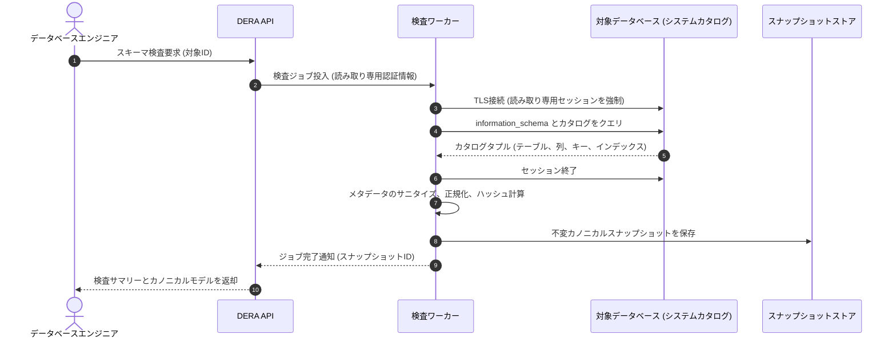
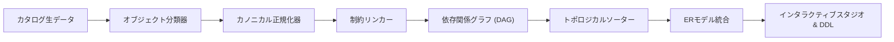
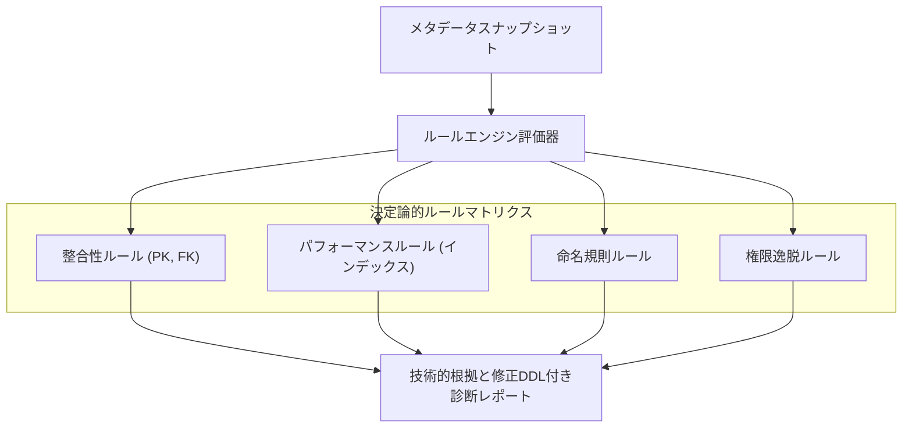
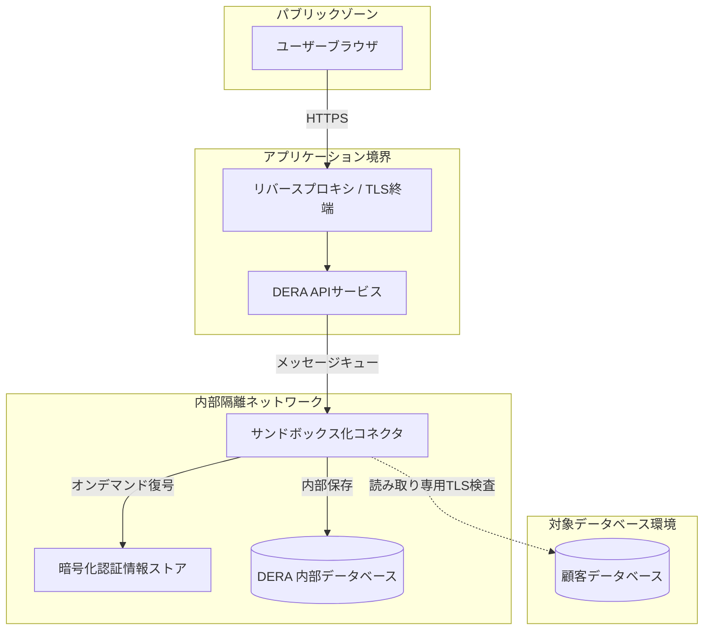
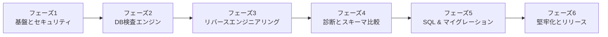

**このドキュメントの言語:** [English](../../README.md) | [Español](README.es.md) | [Français](README.fr.md) | [Deutsch](README.de.md) | [Português](README.pt.md) | [日本語](README.ja.md) | [한국어](README.ko.md) | [简体中文](README.zh-CN.md) | [العربية](README.ar.md) | [Русский](README.ru.md)

---

<div align="center">

# DERA

### Database Engineering & Reverse Analysis

**すべてのスキーマを理解する。すべての変更をエンジニアリングする。**

開発者、データベースエンジニア、アーキテクト、およびエンジニアリングチームのための、オープンソースで決定論的なデータベースリバースエンジニアリングプラットフォーム。

AIモデルや外部AI推論APIを一切使用せず、完全に決定論的なアプローチで、データベース構造の探索、リレーションシップの可視化、スキーマの分析、構造的リスクの特定、エンジニアリングドキュメントの生成を実現します。

<br/>

[](https://github.com/krishanth7/dera/stargazers)
[](https://github.com/krishanth7/dera/forks)
[](https://github.com/krishanth7/dera/issues)
[](https://github.com/krishanth7/dera/blob/main/LICENSE)
[](https://github.com/krishanth7/dera/releases)
[](https://github.com/krishanth7/dera/actions/workflows/codeql.yml)
[](https://github.com/krishanth7/dera/graphs/contributors)
[](https://github.com/sponsors/krishanth7)

<br/>

[概要](#-概要) ·
[主な機能](#-主な機能) ·
[アーキテクチャ](#-アーキテクチャ) ·
[ビジュアルパイプライン](#-ビジュアルパイプライン) ·
[セキュリティ](#-セキュリティ原則) ·
[技術スタック](#-技術スタック) ·
[ロードマップ](#-開発ロードマップ) ·
[コントリビューション](#-コントリビューション) ·
[コミュニティ](#-コミュニティ)

</div>

---

## 🌍 言語サポート

DERAは世界10言語で包括的なドキュメントを提供しています。以下の表または上部のナビゲーションバーから各国語のドキュメントにアクセスできます。

| 言語 | コード | ドキュメントリンク | ステータス |
|---|---|---|---|
| 🇬🇧 English | `en` | [English Primary (Root)](../../README.md) · [Synchronized Copy](README.en.md) | プライマリリファレンス |
| 🇪🇸 Español | `es` | [Documentación en Español](README.es.md) | 完全翻訳 |
| 🇫🇷 Français | `fr` | [Documentation en Français](README.fr.md) | 完全翻訳 |
| 🇩🇪 Deutsch | `de` | [Dokumentation auf Deutsch](README.de.md) | 完全翻訳 |
| 🇵🇹 Português | `pt` | [Documentação em Português](README.pt.md) | 完全翻訳 |
| 🇯🇵 日本語 | `ja` | [日本語ドキュメント](README.ja.md) | 完全翻訳 |
| 🇰🇷 한국어 | `ko` | [한국어 문서](README.ko.md) | 完全翻訳 |
| 🇨🇳 简体中文 | `zh-CN` | [简体中文文档](README.zh-CN.md) | 完全翻訳 |
| 🇸🇦 العربية | `ar` | [الوثائق باللغة العربية](README.ar.md) | 完全翻訳 |
| 🇷🇺 Русский | `ru` | [Документация на русском](README.ru.md) | 完全翻訳 |

---

## 📖 概要

リレーショナルデータベースは現代のソフトウェアインフラの基盤ですが、進化し続ける大規模で未知のスキーマを正確に把握することは容易ではありません。エンタープライズシステムでは、数百のテーブル、数千のカラム、複雑な外部キー関係、インデックス、制約、ビュー、およびオブジェクト間の依存関係が絡み合っています。

これらを手作業で調査・監査するには膨大なエンジニアリング時間を要し、人為的ミスのリスクが常に伴います。

**DERAはこの課題を根本から解決するために設計されました。**

DERAは、決定論的アルゴリズムを通じて、データベースアーキテクチャの探索、エンティティ関係の再構築、構造的リスクの評価、エンジニアリングドキュメントの自動生成を行うための統合されたセキュアなワークスペースを提供します。

### 私たちのミッション

データベースのリバースエンジニアリングを、すべての開発者、DBA、ソフトウェアアーキテクトにとって、アクセシブルで透明性が高く、再現性と信頼性のあるものにすること。

### 設計思想

- **設計による決定論 (Deterministic by Design)** — グラフ理論と静的ルールに基づく再現可能な解析。
- **生成AIの完全不使用** — LLM、機械学習モデル、外部AI推論APIは一切不使用。
- **プライバシー最優先** — 純粋な構造メタデータの解析に限定。顧客のデータ行はデフォルトで一切取得しません。
- **オープンソース** — 自由度の高いMITライセンスによる透明性のある協調開発。
- **開発者ファースト** — ソフトウェアエンジニアやDBAの日常のワークフローに即した実用的なツール。
- **徹底したセキュリティ** — 読み取り専用セッションの強制、認証情報の暗号化、隔離されたワーカー実行。
- **エンジニアリングの正確性** — 生成AIのハルシネーション（幻覚）ではなく、カタログ情報に裏付けられた確実な証拠に基づく診断。

---

## ✨ 主な機能

以下はDERAプラットフォームの計画された機能です。提供状況は開発フェーズおよび公開リリースに対応します。

| 機能領域 | ステータス | 概要 |
|---|---|---|
| **データベース検出** | 計画中 | テーブル、カラム、制約、インデックスのネイティブメタデータ抽出 |
| **リバースエンジニアリングコア** | 計画中 | カノニカルスキーマモデリング、オブジェクト分類、依存関係の解決 |
| **ビジュアルERスタジオ** | 計画中 | インタラクティブER図、自動レイアウト、フィルタリング、エクスポート |
| **決定論的診断エンジン** | 計画中 | 欠落主キー、冗長インデックス、命名不備を検出する静的ルール評価 |
| **スナップショットと差分比較** | 計画中 | バージョン管理されたスキーマスナップショットと構造変更の影響分析 |
| **SQLパフォーマンス工学** | 計画中 | クエリ検査、実行プランの可視化、インデックス最適化の推奨 |
| **ドキュメントジェネレーター** | 計画中 | Markdown、HTML、JSON、SQL DDL、SVGダイアグラムへの自動出力 |
| **セキュリティアーキテクチャ** | 計画中 | ロールベースアクセス制御、読み取り専用保証、隔離ワーカー |

### 🔍 データベース検出

サポート対象のデータベースエンジンを検査し、システムカタログの構造情報を抽出します。

- データベース、スキーマ、拡張機能
- テーブル、パーティション、ビュー
- カラム、データ型、NULL許容性、デフォルト式
- 主キー、外部キー、参照アクション（`CASCADE`、`RESTRICT`）
- UNIQUE制約、CHECK制約、排他制約
- インデックス（B-tree、Hash、GIN、GiST）、ユニークインデックス、部分インデックス
- シーケンス、IDカラム、トリガー

### 🧬 リバースエンジニアリングコア

ネイティブのカタログクエリと決定論的アルゴリズムを使用してスキーマモデルを再構築します。

- エンジンに依存しないカノニカル（標準的）なスキーマ表現
- 構造メタデータの正規化
- 有向非巡回グラフ（DAG）による依存関係の構築
- 単一および複合外部キーリレーションシップのマッピング
- 暗号化署名付きの不変スキーマスナップショット生成
- 決定論的なSQL DDLステートメントの再構築

### 🕸️ ビジュアルERスタジオ

インタラクティブなエンティティリレーションシップインターフェースでスキーマのトポロジーを探索します。

- カラム、型、制約を表示するインタラクティブなテーブルノード
- 多重度（カーディナリティ）を示す視覚的な外部キーコネクタ
- 決定論的な自動レイアウトアルゴリズム（階層型および力学モデル）
- スキーマ単位のグループ化、タグ付け、ドメイン別のサブグラフ表示
- インタラクティブな検索、型フィルタリング、依存関係パスの追跡
- 高解像度のSVGベクターおよびPNG画像エクスポート

### 🛡️ 決定論的データベース診断

スキーマメタデータを設定可能なエンジニアリングルールに照らして分析し、設計リスクを特定します。

| 診断ルール | カテゴリ | 説明 |
|---|---|---|
| **主キーの欠落** | 整合性 | 明示的な主キー制約が定義されていないテーブルを特定 |
| **冗長なインデックスの可能性** | パフォーマンス | インデックス列の接頭辞が重複または包含されているものを検出 |
| **インデックスのない外部キー** | パフォーマンス | 適切なインデックスでカバーされていない外部キー列を警告 |
| **ポリモーフィックアンチパターン** | 整合性 | 外部キー制約を持たない暗黙のリレーションシップを検出 |
| **NULL許容性とデフォルトの異常** | 一貫性 | 適切なデフォルト値のないNOT NULL列を指摘 |
| **命名規則の監査** | 標準化 | 大文字小文字の不整合やアーキテクチャガイドラインからの逸脱を検出 |
| **権限逸脱の監査** | セキュリティ | カタログオブジェクトに対する過剰なアクセス権限の付与を特定 |

*すべての診断結果は、具体的な技術的根拠と修正用DDLスクリプトを伴うエビデンスベースの推奨事項です。*

### 🔄 スキーマ比較と差分エンジン

環境間（開発、ステージング、本番）またはマイグレーションリビジョン間でスナップショットを比較します。

- テーブルとカラムの追加、変更、削除
- データ型の変更、サイズ変更、NULL許容性の変更
- インデックスの追加、削除、定義の調整
- 制約の変更と参照整合性ルールの調整
- 破壊的変更（安全な変更 vs 潜在的に破壊的な変更）の分類
- 依存関係を考慮したトポロジカル順序によるマイグレーションプレビュー

---

## 🧠 AIなし。純粋なエンジニアリング。

DERAは、人工知能や機械学習モデルを意図的に一切排除して設計されています。

```text
┌───────────────────────────────────────────────────────────┐
│                 厳格な非AIアーキテクチャ                  │
│                                                           │
│   ❌  OpenAI、Anthropic Claude、Google Geminiは不使用     │
│   ❌  Groq、DeepSeekなどのホステッドモデルAPIは不使用     │
│   ❌  ローカルLLM (Ollama、vLLM、llama.cpp) は不使用      │
│   ❌  非決定論的なハルシネーション（幻覚）の完全排除      │
│                                                           │
│   ✅  ネイティブシステムカタログクエリ (information_schema)│
│   ✅  決定論的グラフアルゴリズム (NetworkX)               │
│   ✅  厳密なSQL ASTパーサー (SQLGlot)                     │
│   ✅  再現可能な静的ルールエンジン                        │
│   ✅  数学的なスキーマ差分比較アルゴリズム                │
└───────────────────────────────────────────────────────────┘
```

**DERAが決定論的である理由:**
1. **予測可能性:** 同じスキーマスナップショットと同じルール設定からは、常に寸分違わぬ同一の診断結果が得られます。
2. **監査性:** すべての警告、リレーションシップ、グラフレイヤーのエッジは、システムカタログの具体的証拠に直接リンクしています。
3. **データ主権:** 企業のデータベーススキーマやメタデータが、外部のモデル推論プロバイダーに送信されることは一切ありません。
4. **性能とコスト:** 推論レイテンシゼロ、トークン課金ゼロ、APIレート制限ゼロ、外部クラウド障害への依存ゼロ。

---

## 🏗️ アーキテクチャ

DERAは、保守性、拡張性、安全なデータベースアクセスを両立するモジュラーモノリスアーキテクチャを採用しています。



---

## 🔬 ビジュアルパイプライン

DERAは、メタデータ検査、リレーションシップ統合、セキュリティ検証のための監査可能な決定論的パイプラインを実行します。

### 1. データベース検査フロー



### 2. スキーマリバースエンジニアリングパイプライン



### 3. メタデータ処理と診断パイプライン



### 4. セキュリティ境界とネットワーク分離



### 5. 計画された開発ライフサイクル



---

## 🔒 セキュリティ原則

DERAは基幹データベースに接続するため、セキュリティをアーキテクチャの根幹として設計しています。

- **読み取り専用モードの強制:** 接続セッションはトランザクションを読み取り専用として厳格に強制します（`SET SESSION CHARACTERISTICS AS TRANSACTION READ ONLY`）。
- **ユーザーデータ行の完全非取得:** システムカタログ（`information_schema`、`pg_catalog`）のみを対象とします。顧客データ行を照会または保存することは絶対にありません。
- **コード内のシークレットゼロ:** 認証情報はAES-256-GCMで保存時に暗号化され、ログ出力、エクスポート、コミットされることはありません。
- **SSRF防止:** 接続先ホストを厳密に検証し、内部ネットワークのスキャンやクラウドメタデータサービスへの不正アクセスを遮断します。
- **最小特権のデータベースアカウント:** 管理者権限を持たない、監査用の読み取り専用ロールのプロビジョニング手順を提供します。
- **完全な監査ロギング:** すべての検査、エクスポート、設定変更に対して不変の監査ログを記録します。

*脆弱性報告手順および詳細なガイドラインについては、[SECURITY.md](../../SECURITY.md) をご参照ください。*

---

## 🛠️ 技術スタック

| レイヤー | コンポーネント | 採用技術 | 用途 | ステータス |
|---|---|---|---|---|
| **フロントエンド** | フレームワーク | Next.js, React, TypeScript | インタラクティブWebアプリケーション | 計画中 |
| | スタイリング | Tailwind CSS | 一貫性のあるレスポンシブデザイン | 計画中 |
| | UIコンポーネント | shadcn/ui | アクセシブルなUI部品群 | 計画中 |
| | ER可視化 | React Flow, ELK.js | グラフレンダリング & 自動レイアウト | 計画中 |
| | コードエディタ | Monaco Editor | SQL構文ハイライトとDDL表示 | 計画中 |
| **バックエンド** | APIフレームワーク | Python 3.12+, FastAPI | 高性能な非同期APIサービス | 計画中 |
| | カタログ検査 | SQLAlchemy, psycopg | メタデータ抽出とコネクションプール | 計画中 |
| | SQLパーサー | SQLGlot | エンジン非依存のSQL AST生成 | 計画中 |
| | グラフ処理 | NetworkX | 依存関係解決とトポロジカルソート | 計画中 |
| | タスクキュー | Celery, Redis | 隔離された非同期検査ワーカー | 計画中 |
| **データストレージ** | DERAデータベース | PostgreSQL | スナップショット、セッション、監査ログ | 計画中 |
| | マイグレーション | Alembic | DERA独自データベースのスキーマ管理 | 計画中 |
| **DevOps & QA** | コンテナ | Docker, Docker Compose | 再現可能な開発・デプロイ環境 | 計画中 |
| | SAST & セキュリティ | CodeQL, Dependabot | 静的コード解析と依存関係監査 | 実装済み |
| | テスト | Pytest, Playwright | バックエンド単体テストおよびE2Eテスト | 計画中 |

---

## 🗄️ データベース互換性

DERAは、最新のリレーショナルデータベースをサポートするためのプラグイン型コネクタアーキテクチャを採用しています。

| データベースエンジン | コネクタステータス | カタログソース | 目標タイムライン |
|---|---|---|---|
| **PostgreSQL** (v12 - v17) | 開発中 | `pg_catalog`, `information_schema` | フェーズ2 (MVP) |
| **Supabase PostgreSQL** | 開発中 | PostgreSQLネイティブコネクタ | フェーズ2 (MVP) |
| **MySQL** (v8.0+) | 計画中 | `information_schema`, `performance_schema` | フェーズ5 |
| **SQLite** (v3.35+) | 計画中 | `sqlite_master`, `PRAGMA`コマンド | フェーズ5 |
| **MariaDB** (v10.5+) | 計画中 | `information_schema` | フェーズ5 |
| **Microsoft SQL Server** | 計画中 | `sys.tables`, `INFORMATION_SCHEMA` | フェーズ5 |
| **Oracle Database** | 検討中 | データディクショナリビュー (`ALL_*`, `DBA_*`) | 将来の評価 |

---

## 🚀 はじめ方

DERAは現在、基盤およびアーキテクチャの初期開発フェーズにあります。正式な本番環境向けの導入手順は各マイルストーンの達成に伴い公開されます。

### 前提条件（計画）

- Python 3.12 以降
- Node.js LTS (v20+)
- PostgreSQL 15+
- Docker および Docker Compose
- Git

### リポジトリのクローン

```bash
git clone https://github.com/krishanth7/dera.git
cd dera
```

### ローカル開発環境の起動（計画）

```bash
# 環境設定ファイルの準備
cp .env.example .env

# Docker Composeで開発スタックを起動
docker compose -f infrastructure/docker/docker-compose.dev.yml up --build
```

> **注記:** アプリケーションコードベースは活発に開発中です。進捗については [開発ロードマップ](#-開発ロードマップ) をご確認ください。

---

## 📁 リポジトリ構造

```text
dera/
├── .github/
│   ├── ISSUE_TEMPLATE/           # 構造化されたGitHub Issueテンプレート
│   ├── workflows/                # CodeQL、依存関係レビュー、CIワークフロー
│   ├── PULL_REQUEST_TEMPLATE.md  # 標準化されたプルリクエストテンプレート
│   ├── dependabot.yml            # Dependabot自動更新設定
│   └── FUNDING.yml               # スポンサー設定ファイル
├── docs/
│   ├── README.md                 # 総合ドキュメントインデックス
│   ├── i18n/                     # 同期された多言語ドキュメント
│   │   ├── README.en.md          # 英語リファレンスコピー
│   │   ├── README.es.md          # スペイン語ドキュメント
│   │   ├── README.fr.md          # フランス語ドキュメント
│   │   ├── README.de.md          # ドイツ語ドキュメント
│   │   ├── README.pt.md          # ポルトガル語ドキュメント
│   │   ├── README.ja.md          # 日本語ドキュメント
│   │   ├── README.ko.md          # 韓国語ドキュメント
│   │   ├── README.zh-CN.md       # 中国語（簡体字）ドキュメント
│   │   ├── README.ar.md          # アラビア語ドキュメント（RTL対応）
│   │   └── README.ru.md          # ロシア語ドキュメント
│   ├── architecture/             # アーキテクチャ仕様書
│   ├── development/              # セットアップガイドとエンジニアリング標準
│   ├── security/                 # 脅威モデルとセキュリティ方針
│   └── contributing/             # コントリビューター向けドキュメント
├── CODE_OF_CONDUCT.md            # Contributor Covenant 行動規範
├── CONTRIBUTING.md               # コントリビューションガイドライン
├── LICENSE                       # MITライセンス
├── README.md                     # リポジトリのメインランディングページ
├── SECURITY.md                   # 包括的セキュリティポリシー
└── .gitignore                    # Git除外設定
```

---

## 🗺️ 開発ロードマップ

### フェーズ1 — 基盤とセキュリティ
- [x] 正式なプロジェクトアイデンティティとライセンス（MIT）の確立
- [x] CodeQLによる静的セキュリティ解析（SAST）の設定
- [x] 行動規範およびセキュリティポリシーの策定
- [x] 10言語による国際化ドキュメント体系の構築
- [ ] モノレポ構造の初期化（`apps/web`、`apps/api`）
- [ ] Docker開発環境およびベースラインCIの構築

### フェーズ2 — データベース検査エンジン
- [ ] PostgreSQLネイティブメタデータコネクタの実装
- [ ] テーブル、カラム、制約、インデックス、ビューの抽出
- [ ] カノニカルスキーマ正規化モデルの構築
- [ ] 暗号署名付き不変スナップショットストレージの実装
- [ ] 読み取り専用セッションの強制およびクエリタイムアウト保護

### フェーズ3 — リバースエンジニアリングスタジオ
- [ ] React Flowを使用したインタラクティブERスタジオの開発
- [ ] 自動階層レイアウトアルゴリズムの実装
- [ ] スキーマフィルタリング、検索、ドメイングループ化機能
- [ ] 依存関係グラフ（DAG）の走査および可視化
- [ ] 高解像度SVGおよびPNGダイアグラムエクスポート

### フェーズ4 — 診断とスキーマ比較
- [ ] 決定論的ルールベース診断エンジンの実装
- [ ] ルール構築：欠落PK、冗長インデックス、未インデックスFK
- [ ] スキーマスナップショット差分比較アルゴリズムの実装
- [ ] 構造化されたDDLマイグレーションプレビューの生成
- [ ] Markdown、JSON、HTML形式での診断レポートエクスポート

### フェーズ5 — 高度なエンジニアリングとコネクタ拡充
- [ ] SQLGlotを用いたSQL ASTクエリ検査および複雑度メトリクスの導入
- [ ] 実行プラン可視化ツールの開発（`EXPLAIN ANALYZE`）
- [ ] MySQLおよびSQLite用コネクタの開発
- [ ] 依存関係順序に基づくマイグレーションDDL自動生成

### フェーズ6 — 本番運用の堅牢化
- [ ] 包括的なセキュリティテストおよび脆弱性監査の実施
- [ ] 大規模スキーマ（1,000テーブル以上）に対する性能ベンチマーク
- [ ] マルチテナント分離および監査ログの完全性検証
- [ ] 正式なv1.0.0コンテナイメージおよびデプロイガイドの公開

---

## 🧪 テストと品質管理戦略

DERAは、再現可能な自動テストによって高いエンジニアリング基準を維持します。

- **単体テスト:** 合成テストデータを使用して、メタデータのパース、グラフの閉路検出、診断ルールを網羅。
- **結合テスト:** コンテナ化されたPostgreSQL、MySQL、SQLiteに対してコネクタの動作を検証。
- **決定論的検証:** 同一のスキーマスナップショットからは常に同一のハッシュ値と診断結果が生成されることを保証。
- **セキュリティテスト:** CodeQLによる継続的静的解析、依存関係脆弱性スキャン、認証情報漏洩チェック。
- **エンドツーエンドテスト:** Playwrightによるブラウザテストで、ダイアグラム操作とUIレスポンスを検証。

---

## 🤝 コントリビューション

世界中のエンジニア、データベース専門家、テクニカルライター、セキュリティ研究者からの貢献を心より歓迎します。

プルリクエストを送信する前に、[CONTRIBUTING.md](../../CONTRIBUTING.md) および [行動規範](../../CODE_OF_CONDUCT.md) を必ずご確認ください。

### 開発ワークフロー

1. GitHubでリポジトリをフォークします。
2. 作業用ブランチを作成します: `git checkout -b feat/your-feature-name`
3. [Conventional Commits](../../CONTRIBUTING.md#commit-message-guidelines) のコミット規約に従います。
4. 対応する単体テストまたは結合テストを追加します。
5. CodeQL解析およびドキュメント検証チェックが成功することを確認します。
6. `main` ブランチに対してプルリクエストを作成し、レビューを依頼します。

---

## 💬 コミュニティ

- [GitHub Discussions](https://github.com/krishanth7/dera/discussions) — 質問、アイデアの提案、データベース工学に関する議論。
- [GitHub Issues](https://github.com/krishanth7/dera/issues) — バグ報告や新機能の提案。
- [GitHub Pull Requests](https://github.com/krishanth7/dera/pulls) — コードやドキュメントのコントリビューション。
- [Releases](https://github.com/krishanth7/dera/releases) — 公式リリースの確認。

---

## ❤️ プロジェクトを支援する

DERAは独立したオープンソースエンジニアリングの取り組みです。以下の方法で開発を支援できます。

- GitHubリポジトリにスターを付ける
- エンジニアコミュニティにプロジェクトを共有する
- コネクタ、診断ルール、ドキュメントの改善に貢献する
- [GitHub Sponsorsでプロジェクトを支援する](https://github.com/sponsors/krishanth7)

---

## 📜 ライセンス

DERAは **[MITライセンス](../../LICENSE)** に基づいて配布されています。

```text
Copyright (c) 2026 Krishanth
```

---

## 👨‍💻 メンテナー

**Bunga Krishanth**  
創設者 & リードメンテナー

- GitHub: [@krishanth7](https://github.com/krishanth7)  
- リポジトリ: [github.com/krishanth7/dera](https://github.com/krishanth7/dera)  
- 連絡先: `krishanth.b.2008@gmail.com`

*DERAはBunga Krishanthによって維持管理されている独立したオープンソースプロジェクトです。OVIC Labsはメンテナーの広範なエンジニアリングエコシステムの一環として認識されています。*

---

<div align="center">

### DERA — Database Engineering & Reverse Analysis

**すべてのスキーマを理解する。すべての変更をエンジニアリングする。**

*工学的精度、数学的決定論、そしてオープンソースの透明性とともに構築されています。*

© 2026 DERA コントリビューター. Distributed under the MIT License.

[トップに戻る](#dera)

</div>
