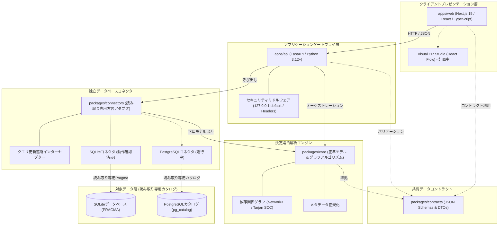

**このドキュメントの言語:** [English (Root)](../../README.md) | [Español](README.es.md) | [Français](README.fr.md) | [Deutsch](README.de.md) | [Português](README.pt.md) | [Italiano](README.it.md) | [日本語](README.ja.md) | [한국어](README.ko.md) | [简体中文](README.zh-CN.md) | [Русский](README.ru.md)

---

<div align="center">

# DERA

### Database Engineering & Reverse Analysis

**すべてのスキーマを理解し、すべての変更を設計する。**

ソフトウェアエンジニア、データベースアーキテクト、エンジニアリングチーム向けに設計された、独立したオープンソースの決定論的データベースエンジニアリングおよびリバースエンジニアリングプラットフォーム。

データベース構造の探索、エンティティ関係の再構築、構造的リスクの評価、スキーマ変更の計画を、AIモデルや外部推論APIに一切依存せず、完全に決定論的に実行します。

<br/>

[](../../LICENSE)
[](https://github.com/krishanth7/dera/actions/workflows/ci.yml)
[](https://github.com/krishanth7/dera/actions/workflows/codeql.yml)
[](https://github.com/krishanth7/dera/actions/workflows/documentation.yml)
[](../../pyproject.toml)
[](../../tsconfig.json)
[-orange?style=for-the-badge)](#-厳格な非aiアーキテクチャ)
[](../../CONTRIBUTING.md)

<br/>

[概要](#-概要) ·
[機能ステータスマトリクス](#-機能ステータスマトリクス) ·
[アーキテクチャ概要](#-アーキテクチャ概要) ·
[モノレポ構造](#-リポジトリ構造) ·
[クイックスタート](#-クイックスタート) ·
[データベース互換性](#-データベース互換性マトリクス) ·
[セキュリティ原則](#-セキュリティ原則) ·
[開発者ドキュメントナビゲーション](#-開発者ドキュメントナビゲーション) ·
[マスターロードマップ](#-マスターロードマップ) ·
[コントリビューション](#-コントリビューション) ·
[コミュニティ](#-コミュニティ)

</div>

---

## 🌍 多言語ドキュメント対応

DERAは10の国際言語で同期されたドキュメントを提供しています。英語のREADMEは、[ドキュメント保守規約](../development/README_MAINTENANCE.md)に基づく公式な信頼できる情報源です。

| 言語 | 言語コード | ドキュメントリンク | ステータス |
|---|---|---|---|
| 🇬🇧 English | `en` | [English Primary (Root)](../../README.md) · [Synchronized Copy](README.en.md) | **公式信頼源 (Authoritative)** |
| 🇪🇸 Español | `es` | [Documentación en Español](README.es.md) | 完全翻訳 |
| 🇫🇷 Français | `fr` | [Documentation en Français](README.fr.md) | 完全翻訳 |
| 🇩🇪 Deutsch | `de` | [Dokumentation auf Deutsch](README.de.md) | 完全翻訳 |
| 🇵🇹 Português | `pt` | [Documentação em Português](README.pt.md) | 完全翻訳 |
| 🇮🇹 Italiano | `it` | [Documentazione in Italiano](README.it.md) | 完全翻訳 |
| 🇯🇵 日本語 | `ja` | [日本語ドキュメント](README.ja.md) | 完全翻訳 |
| 🇰🇷 한국어 | `ko` | [한국어 문서](README.ko.md) | 完全翻訳 |
| 🇨🇳 简体中文 | `zh-CN` | [简体中文文档](README.zh-CN.md) | 完全翻訳 |
| 🇷🇺 Русский | `ru` | [Документация на русском](README.ru.md) | 完全翻訳 |

---

## 📖 概要

最新のリレーショナルデータベースは、あらゆるソフトウェアインフラストラクチャの基盤です。しかし、馴染みのないスキーマや大規模なレガシースキーマを理解することは、エンジニアリング上の大きな課題です：
- **複雑なスキーマ:** 企業内データベースは往々にして数百のテーブル、数千のカラム、およびドキュメント化されていない外部キー関係で構成されています。
- **アーキテクチャの負債:** 循環外部キー参照、未設定の主キー、インデックスのない外部キー、冗長なインデックスが気付かぬうちに蓄積します。
- **マイグレーションの危険性:** 完全なトポロジカルグラフなしでスキーマ変更を行うと、ロックの連鎖、データ破損、制約違反の危険を伴います。
- **セキュリティと機密性:** 本番データベースの資格情報や顧客データをクラウドAIサービスに外部送信することは、コンプライアンス上許容されません。

**DERAは、数学的決定論によってこれらの課題を解決するために設計されました。**

DERAは、リレーショナルデータベースのシステムカタログを検査し、依存関係グラフを再構築し、構造的リスクを評価し、検証可能で再現性のあるアルゴリズムによってマイグレーションプレビューを生成するオープンソースプラットフォームです。

### 基本エンジニアリング原則

1. **設計による決定論 (Deterministic by Design):** すべてのスキーマスナップショット、トポロジカルソート、診断結果は再現可能であり、リレーショナル代数に基づきます。
2. **厳格な非AI設計 (Strictly Non-AI):** 生成AI、大規模言語モデル (LLM)、ベクトルデータベース、外部推論APIは一切使用しません。
3. **読み取り専用データベースセキュリティ:** 接続レベルでの強制的な読み取り専用実行、ASTによるSQL更新命令の静的遮断、システムカタログクエリへの厳密な限定。
4. **顧客データ行の抽出ゼロ:** 純粋なメタデータイントロスペクション (`information_schema`, `pg_catalog`, `sqlite_master`) のみを実施。業務テーブルのレコードは一切取得・送信・保存しません。
5. **疎結合モノレポアーキテクチャ:** グラフアルゴリズム、データベースコネクタ、APIゲートウェイ、ビジュアルスタジオを明確な境界で分離。
6. **オープンソース＆寛容なライセンス:** 自由度の高い [MITライセンス](../../LICENSE) に基づいて公開。

---

## 🧠 厳格な非AIアーキテクチャ

DERAは、人工知能や機械学習コンポーネントを意図的に完全に排除して設計されています。

```text
┌───────────────────────────────────────────────────────────┐
│               厳格な非AIアーキテクチャ                    │
│                                                           │
│   ❌  OpenAI、Anthropic Claude、Google Gemini の不使用    │
│   ❌  Groq、DeepSeek 等の外部モデルAPI 不使用             │
│   ❌  ローカルLLM (Ollama, vLLM, llama.cpp) 不使用        │
│   ❌  確率的推測やハルシネーションの完全排除              │
│   ❌  クラウドベクトル埋め込みや外部RAGの不使用          │
│                                                           │
│   ✅  システムカタログのネイティブ直接参照               │
│   ✅  数学的グラフ理論アルゴリズム (NetworkX / Tarjan)    │
│   ✅  抽象構文木 (AST) SQLパーサー (SQLGlot)              │
│   ✅  決定論的・再現可能な静的ルールエンジン              │
│   ✅  暗号学的ハッシュフィンガープリント (SHA-256)        │
└───────────────────────────────────────────────────────────┘
```

**DERAが決定論的である理由:**
- **数学的監査性:** すべてのリレーションシップ、循環警告、診断結果はカタログの具体的な根拠と確定的なグラフアルゴリズムに基づきます。
- **完全な再現性:** 同一のスキーマスナップショットに対する監査は、すべての開発環境およびCIパイプラインで常に完全に同一の結果を生成します。
- **企業のデータ主権:** スキーマ構造やトポロジーが外部モデル推論プロバイダに送信されることは決してありません。
- **運用オーバーヘッドゼロ:** トークン課金、レート制限、外部推論に伴うネットワーク遅延が一切発生しません。

---

## 📊 機能ステータスマトリクス

DERAは、自動テストスイートによって検証されたリポジトリ内の実コードに基づき、透明性のあるステータスを公開しています：

| 機能・機能群 | ステータス | 実装の根拠 | モノレポ内の配置 |
|---|:---:|---|---|
| **コアスキーマモデル** | **実装済み** | 正準 `Column`, `Table`, `ForeignKey`, `Index` モデル | [`packages/core/src/dera/models.py`](../../packages/core/src/dera/models.py) |
| **依存関係グラフエンジン** | **実装済み** | 循環耐性DAGおよびTarjan SCCトポロジカルソート | [`packages/core/src/dera/graph.py`](../../packages/core/src/dera/graph.py) |
| **更新遮断インターセプター (Read-Only)** | **実装済み** | 破壊的SQL (`DROP`, `ALTER` 等) を静的に遮断するAST検査 | [`packages/connectors/src/dera_connectors/base/`](../../packages/connectors/src/dera_connectors/base/connector.py) |
| **SQLiteカタログイントロスペクション** | **実装済み** | テーブル、カラム、PK、FK、インデックスの自動検出 | [`packages/connectors/src/dera_connectors/sqlite/`](../../packages/connectors/src/dera_connectors/sqlite/connector.py) |
| **PostgreSQLカタログ検査** | **進行中** | 一時的PostgreSQLコンテナに対する統合テスト | [`tests/integration/`](../../tests/integration/) |
| **APIゲートウェイとテレメトリ** | **実装済み** | ループバック設定済みのFastAPIサービスと健全性エンドポイント | [`apps/api/src/dera_api/main.py`](../../apps/api/src/dera_api/main.py) |
| **Webスタジオアプリケーション基盤** | **実装済み** | Next.js 15 TypeScript基盤とアーキテクチャカード | [`apps/web/src/app/page.tsx`](../../apps/web/src/app/page.tsx) |
| **共有データコントラクト** | **実装済み** | バージョン管理されたJSONスキーマとシリアライゼーションDTO | [`packages/contracts/schemas/`](../../packages/contracts/schemas/) |
| **ビジュアルERスタジオキャンバス** | 計画中 | React Flowベースのインタラクティブ図描画キャンバス | フェーズ7 ロードマップ |
| **決定論的ルールマトリクス** | 計画中 | 未設定PK、未インデックスFK、冗長インデックスの検知 | フェーズ8 ロードマップ |
| **スキーマスナップショットDiffエンジン** | 計画中 | セマンティックスナップショット比較とDDL差分プレビュー | フェーズ9 ロードマップ |
| **SQL ASTパフォーマンスアナライザー** | 計画中 | SQLGlotクエリ複雑度測定と実行計画ビジュアライザー | フェーズ10 ロードマップ |

> **ステータス凡例:**
> - **`実装済み`** &mdash; コーディングが完了し、CIの自動テストで検証済み。
> - **`進行中`** &mdash; 現在のマイルストーンで開発中および統合テスト中。
> - **`計画中`** &mdash; 全12フェーズのマスターロードマップでスケジュール済み。

---

## 🏗️ アーキテクチャ概要

DERAは、[モノレポアーキテクチャ仕様](../architecture/README_ARCHITECTURE.md) に従って疎結合なワークスペースで構成されています：



### アーキテクチャの解説（アクセシビリティ対応）
- **クライアントプレゼンテーション層 (`apps/web`):** JSONを介してAPIと通信し、将来的にインタラクティブなER図キャンバスを表示するNext.js 15 TypeScriptフロントエンド。
- **アプリケーションゲートウェイ層 (`apps/api`):** デフォルトで `127.0.0.1` にバインドし、健全性テレメトリ、カタログ抽出ルート、セキュリティミドルウェアを提供するFastAPIバックエンド。
- **共有データコントラクト (`packages/contracts`):** テーブル、カラム、インデックス、関係性の正準仕様を定義するJSONスキーマおよびTypeScriptインターフェース。
- **決定論的コアエンジン (`packages/core`):** 正準ドメインモデル、Tarjanアルゴリズム、トポロジカルソート、メタデータ正規化を提供する純粋なPythonライブラリ。
- **独立データベースコネクタ (`packages/connectors`):** システムカタログ (`sqlite_master`, `pg_catalog`) を安全に参照するアダプタ群。実行前にAST検査で更新命令を確実に遮断。
- **対象データ層（読み取り専用）:** ユーザーが接続する検査対象データベース。DERAは管理者権限を持たない非特権の読み取り専用アカウントでのみ接続します。

詳細な仕様ドキュメント：
- [アーキテクチャ概要・ブループリント](../architecture/README_ARCHITECTURE.md)
- [モジュール境界および依存性ルール](../architecture/MODULE_BOUNDARIES.md)
- [モノレポディレクトリ構造詳細](../architecture/MONOREPO_STRUCTURE.md)
- [アーキテクチャ決定記録 (ADR 0001)](../architecture/adr/0001-monorepo-architecture.md)

---

## 📁 リポジトリ構造

DERAモノレポの実構造は以下の通りです：

```text
dera/
├── apps/
│   ├── api/                      # FastAPIバックエンドと健全性エンドポイント
│   │   ├── src/dera_api/         # ルート、ミドルウェア、スキーマ
│   │   └── pyproject.toml        # APIパッケージ仕様
│   └── web/                      # Next.js 15 TypeScriptフロントエンドスタジオ
│       ├── src/                  # Appルーター、コンポーネント、APIクライアント
│       └── package.json          # Webワークスペース設定
├── packages/
│   ├── core/                     # 正準モデルとグラフ処理エンジン
│   │   └── src/dera_core/        # スキーマモデル、DAGアルゴリズム、グラフ理論
│   ├── connectors/               # データベース別メタデータ抽出アダプタ
│   │   └── src/dera_connectors/  # 基本コネクタ、更新ガード、SQLite実装
│   └── contracts/                # 共有JSONスキーマとシリアライゼーション
│       └── schemas/              # APIおよびスナップショット契約定義
├── tests/
│   ├── architecture/             # ASTインポート境界・依存関係テスト
│   ├── integration/              # 実SQLite・PostgreSQLカタログ統合テスト
│   ├── regression/               # DAGおよびハッシュ決定論回帰テスト
│   └── unit/                     # モデル、PRタイトル、Ready状態の単体テスト
├── scripts/
│   ├── ci/                       # CI検証スクリプト (docs, i18n, PR readiness)
│   └── development/              # 統合クロスプラットフォームCLIランナー (dev.py)
├── docs/
│   ├── audit/                    # リポジトリ監査、ベースライン、適合性報告
│   ├── architecture/             # ブループリント、モジュール境界、ADR
│   ├── development/              # オンボーディング、コマンド、Gitワークフロー
│   ├── governance/               # ガバナンス、メンテナー、決定記録、ライセンス
│   ├── security/                 # 脅威モデル、DBセキュリティ、脆弱性対応
│   ├── community/                # コミュニティハブ、ガイドライン、Issueトリアージ
│   ├── roadmap/                  # 12フェーズマスターロードマップ
│   └── i18n/                     # 10言語同期技術ドキュメント
├── .github/
│   ├── workflows/                # エンタープライズCI/CD、CodeQL、自動検査
│   ├── ISSUE_TEMPLATE/           # 不具合報告・要望用構造化YAMLテンプレート
│   ├── PULL_REQUEST_TEMPLATE/    # 専門ドメイン別PRテンプレート
│   ├── CODEOWNERS                # コードオーナー定義
│   └── PULL_REQUEST_TEMPLATE.md  # PR標準適格性チェックリスト
├── pyproject.toml                # ルートPython設定 (PEP 621)
├── package.json                  # ルートnpm設定
├── tsconfig.json                 # 厳格モードTypeScript設定
├── Makefile                      # 標準コマンド自動化スクリプト
├── CONTRIBUTING.md               # 包括的コントリビューターガイド
├── SECURITY.md                   # 協調的脆弱性開示ポリシー
└── LICENSE                       # MITライセンス
```

---

## 🚀 クイックスタート

DERAは、Windows、Linux、macOSで一貫したテストと実行を行えるクロスプラットフォームCLIツール (`scripts/development/dev.py`) を備えています。

### 前提条件

| ツール | 最小バージョン | 推奨バージョン | バージョン確認コマンド |
|---|---|---|---|
| **Python** | `3.12+` | `3.12` または `3.13` | `python --version` |
| **Node.js** | `20.x LTS` | `20.x` または `22.x LTS` | `node --version` |
| **Git** | `2.30+` | 最新版 | `git --version` |

### 1. リポジトリのクローン

```bash
git clone https://github.com/krishanth7/dera.git
cd dera
```

### 2. 環境設定

安全な開発用環境テンプレートをコピーします：

```bash
# Windows PowerShell
Copy-Item .env.example .env

# Linux / macOS
cp .env.example .env
```

### 3. Python仮想環境のセットアップ

```bash
# Linux / macOS
python3 -m venv .venv
source .venv/bin/activate
pip install -e ".[dev]"

# Windows PowerShell
python -m venv .venv
.venv\Scripts\Activate.ps1
pip install -e ".[dev]"
```

### 4. Node.js依存パッケージのインストール

```bash
npm install
```

### 5. フル検証スイートの実行

すべてのPythonパッケージ、TypeScriptコンパイラ、自動テスト、ドキュメントリンクを一度に検証します：

```bash
python scripts/development/dev.py all
```

**期待される出力例:**
```text
Ran 32 tests in 0.25s
OK (skipped=2)
Validating 69 markdown documentation files...
SUCCESS: All 69 markdown documentation files are valid.
Validating 10 multilingual documentation files in i18n...
SUCCESS: All 10 language documentation files verified with valid navigation and parity.
[SUCCESS]: All development baseline checks passed successfully.
```

### 6. 主な開発者コマンドリファレンス

| タスク | クロスプラットフォームCLI (`dev.py`) | GNU Make (UNIX / macOS) |
|---|---|---|
| **全テストの実行** | `python scripts/development/dev.py test` | `make test` |
| **TypeScript型チェック** | `python scripts/development/dev.py typecheck` | `make typecheck` |
| **Pythonバイトコードコンパイル** | `python scripts/development/dev.py compile` | `make build` |
| **ドキュメントリンク検証** | `python scripts/development/dev.py validate-docs` | `make lint` |
| **コミット/PRタイトル検証** | `python scripts/development/dev.py validate-title "<title>"` | `make validate-title TITLE="..."` |
| **ローカルAPIサーバー起動** | `python -m uvicorn dera_api.main:app --reload --port 8000` | `make dev-api` |
| **Webスタジオ起動** | `npm run dev --workspace=apps/web` | `npm run dev --workspace=apps/web` |

詳細な手順については、[クイックスタートガイド](../development/GETTING_STARTED.md) および [コマンドカタログ](../development/COMMANDS.md) を参照してください。

---

## 🗄️ データベース互換性マトリクス

DERAは、独立したプラグイン型コネクタアーキテクチャを採用しています。サポートレベルは実際の実装コードと自動テストに基づいています：

| データベースエンジン | 対応バージョン | コネクタステータス | イントロスペクション機構 | 読み取り専用保護策 |
|---|:---:|:---:|---|---|
| **SQLite** | 3.35+ | **実装済み** | `sqlite_master`, `PRAGMA table_info`, `PRAGMA foreign_key_list` | 静的AST遮断および `PRAGMA query_only = ON` |
| **PostgreSQL** | 12 – 17 | **進行中** | `pg_catalog`, `information_schema` | `SET default_transaction_read_only = ON` と読み取り専用ロール |
| **Supabase PostgreSQL** | Cloud / Local | **進行中** | ネイティブPostgreSQLカタログ抽出 | 接続レベルでの読み取り専用セッションおよび非特権ロール |
| **MySQL** | 8.0+ | 計画中 | `information_schema`, `performance_schema` | 読み取り専用セッショントランザクションモード |
| **MariaDB** | 10.5+ | 計画中 | `information_schema` | 読み取り専用セッショントランザクションモード |
| **Microsoft SQL Server** | 2019+ | 計画中 | `sys.tables`, `INFORMATION_SCHEMA` | 読み取り専用ユーザー権限 |

> [!NOTE]
> **`進行中`** とマークされたコネクタは、CI上の使い捨てテストコンテナでテストされています。**`計画中`** のコネクタはフェーズ5で開発が予定されています。

---

## 🔒 セキュリティ原則

セキュリティはDERAの最重要の柱です。データベースアーキテクチャと直接対話するため、多層防御コントロールを徹底しています：

1. **静的クエリ更新遮断インターセプター:** 対象データベースでSQLを実行する前に、構文木 (AST) で検査します。`DROP`, `ALTER`, `TRUNCATE`, `INSERT`, `UPDATE`, `DELETE`, `GRANT`, `REVOKE` などのキーワードを含む文は即座に遮断されます。
2. **システムカタログ限定の抽出:** 検査はシステムメタデータカタログ (`information_schema`, `pg_catalog`, `sqlite_master`) に限定されます。業務テーブルのレコードを参照することはありません。
3. **デフォルトループバックバインド:** 開発サーバーおよびAPIはデフォルトで `127.0.0.1` にのみバインドし、意図せぬ外部公開を防ぎます。
4. **最小特権データベースアカウント:** DERAは管理者権限を必要とせず、非特権の読み取り専用ロールのみで動作します。
5. **認証情報の非保存:** パスワードやトークンがディスクに書き込まれたり、バージョン管理やログに出力されることはありません。
6. **責任ある開示:** セキュリティの脆弱性は、[セキュリティポリシー](../../SECURITY.md) に従って非公開で協調的に報告・処理されます。

> [!NOTE]
> DERAは厳格なオープンソースセキュリティプラクティス (CodeQL, Bandit SAST, シークレット検出) を実践しています。SOC 2やISO 27001などの商業的第三者認証を取得しているわけではありません。

専門ドキュメント：
- [**データベースセキュリティポリシー**](../security/DATABASE_SECURITY.md) — カタログ検査とセッション分離。
- [**セキュア開発標準**](../security/SECURE_DEVELOPMENT.md) — 入力値検証とDevSecOpsゲート。
- [**脆弱性対応プロセス**](../security/VULNERABILITY_RESPONSE.md) — 5段階のトリアージとセキュリティアドバイザリ。
- [**脅威モデルマトリクス**](../security/model.md) — 攻撃経路と防御策。

---

## 📚 開発者ドキュメントナビゲーション

DERAの各種ドキュメント一覧：

| 分野 | 主なガイド |
|---|---|
| **アーキテクチャ** | [モノレポブループリント](../architecture/README_ARCHITECTURE.md) · [モジュール境界](../architecture/MODULE_BOUNDARIES.md) · [ディレクトリ構造](../architecture/MONOREPO_STRUCTURE.md) · [ADRs](../architecture/adr/0001-monorepo-architecture.md) |
| **開発** | [クイックスタート](../development/GETTING_STARTED.md) · [コマンドカタログ](../development/COMMANDS.md) · [環境構築](../development/ENVIRONMENT.md) · [トラブルシューティング](../development/TROUBLESHOOTING.md) |
| **ドキュメントライフサイクル** | [保守規約](../development/README_MAINTENANCE.md) · [技術ガイドライン](../development/README_GUIDELINES.md) |
| **ガバナンスと管理** | [メンテナーポリシー](../governance/MAINTAINERS.md) · [ガバナンス決定記録](../governance/GOVERNANCE_DECISIONS.md) · [サードパーティライセンス](../governance/THIRD_PARTY_LICENSES.md) |
| **セキュリティ** | [セキュリティポリシー](../../SECURITY.md) · [DBセキュリティ](../security/DATABASE_SECURITY.md) · [セキュア開発](../security/SECURE_DEVELOPMENT.md) · [脆弱性対応](../security/VULNERABILITY_RESPONSE.md) |
| **コミュニティ・トリアージ** | [コントリビューションガイド](../../CONTRIBUTING.md) · [ディスカッションガイド](https://github.com/krishanth7/dera/discussions) · [Issueトリアージ](https://github.com/krishanth7/dera/issues) · [行動規範](../../CODE_OF_CONDUCT.md) |
| **監査と検証** | [監査インデックス](../audit/README.md) · [フェーズ2.1 README監査](../audit/PHASE_2_1_README_AUDIT.md) · [リポジトリベースライン](../audit/BASELINE.md) |
| **ロードマップ** | [12フェーズマスターロードマップ](../roadmap/README.md) |

---

## 🗺️ マスターロードマップ

DERAは、包括的なデータベースリバースエンジニアリング環境を構築するため、**12段階のフェーズ** に沿って開発を進めています：

- [x] **フェーズ1: リポジトリ基盤とガバナンス**
  - [x] フェーズ1.1: リポジトリの監査とベースライン確立
  - [x] フェーズ1.2: エンタープライズモノレポ構造 (`apps/`, `packages/`)
  - [x] フェーズ1.3: Gitブランチ戦略、Conventional Commits、PRゲート
  - [x] フェーズ1.4: プロフェッショナルREADME、ブランドアイデンティティ、設計図
  - [x] フェーズ1.5: セキュリティポリシー、脆弱性報告手順、メンテナーガバナンス
  - [x] フェーズ1.6: 構造化Issueテンプレート、ディスカッション運用、コミュニティ (PR #20)
- [ ] **フェーズ2: 多言語ドキュメントと開発者体験**
  - [x] フェーズ2.1: 権威ある英語READMEと技術的基盤の確立 (PR #21)
  - [x] フェーズ2.2: 9言語の国際README同期 (進行中)
- [x] **フェーズ3: GitHub Actions、CI/CD自動化、DevSecOps**
- [ ] **フェーズ4: バックエンドおよびプラットフォーム基盤**
- [ ] **フェーズ5: データベースコネクタとメタデータ検査**
- [ ] **フェーズ6: リバースエンジニアリングコアエンジン**
- [ ] **フェーズ7: フロントエンドとビジュアルエンジニアリングスタジオ**
- [ ] **フェーズ8: 診断とスキーマインテリジェンス**
- [ ] **フェーズ9: スキーマ比較とマイグレーションエンジニアリング**
- [ ] **フェーズ10: SQL解析とエンジニアリングツール**
- [ ] **フェーズ11: エンタープライズセキュリティ、信頼性と大規模QA**
- [ ] **フェーズ12: リリース、デプロイ、オープンソース普及**

各マイルストーンの詳細は [開発ロードマップ](../roadmap/README.md) をご覧ください。

---

## 🤝 コントリビューション

世界中のソフトウェアエンジニア、データベース管理者、セキュリティ研究者、テクニカルライターの皆様からの貢献を心よりお待ちしております！

### コントリビューター向け資料

- **[コントリビューションガイド](../../CONTRIBUTING.md):** 参加手順と品質標準の全体像。
- **[貢献ワークフロー](../development/CONTRIBUTION_WORKFLOW.md):** 開発、テスト、PR適格性確認の手順書。
- **[ブランチ戦略](../development/BRANCHING_STRATEGY.md):** トランクベース開発と命名規則 (`feat/...`, `fix/...`)。
- **[コミット規約](../development/COMMIT_CONVENTIONS.md):** Conventional Commits 1.0.0 仕様とSemVerマッピング。
- **[コードレビューポリシー](../development/CODE_REVIEW_POLICY.md):** ピアレビュー基準とコードオーナー承認要件。
- **[行動規範](../../CODE_OF_CONDUCT.md):** コミュニティ規範と適用ガイドライン。

---

## 💬 コミュニティ

- [GitHub Discussions](https://github.com/krishanth7/dera/discussions) — 質問、アイデアの共有、データベースリバースエンジニアリングに関する議論。
- [GitHub Issues](https://github.com/krishanth7/dera/issues) — バグの報告や新機能の提案。
- [GitHub Pull Requests](https://github.com/krishanth7/dera/pulls) — コード、テスト、ドキュメントの改善提案。
- [非公開セキュリティアドバイザリ](https://github.com/krishanth7/dera/security/advisories/new) — 脆弱性の非公開報告窓口。
- [ガバナンス決定記録](../governance/GOVERNANCE_DECISIONS.md) — アーキテクチャおよびコミュニティ運営記録。

---

## 📜 ライセンス

DERAは自由度の高い **[MITライセンス](../../LICENSE)** のもとで配布されています。

```text
Copyright (c) 2026 Krishanth
```

---

## 👨‍💻 メンテナー

**Krishanth**  
ファウンダー ＆ リードメンテナー

- GitHub: [@krishanth7](https://github.com/krishanth7)  
- リポジトリ: [github.com/krishanth7/dera](https://github.com/krishanth7/dera)  
- 連絡先: `krishanth.b.2008@gmail.com`

*DERAはKrishanthによって維持されている独立したオープンソースプロジェクトです。OVIC Labsはメンテナーの広範なエンジニアリングエコシステムの一環として認識されています。*

---

<div align="center">

### DERA — Database Engineering & Reverse Analysis

**すべてのスキーマを理解し、すべての変更を設計する。**

*数学的決定論、エンジニアリングの厳格さ、そしてオープンソースの透明性に基づいて構築されています。*

© 2026 DERA Contributors. Distributed under the MIT License.

[先頭に戻る](#dera)

</div>
