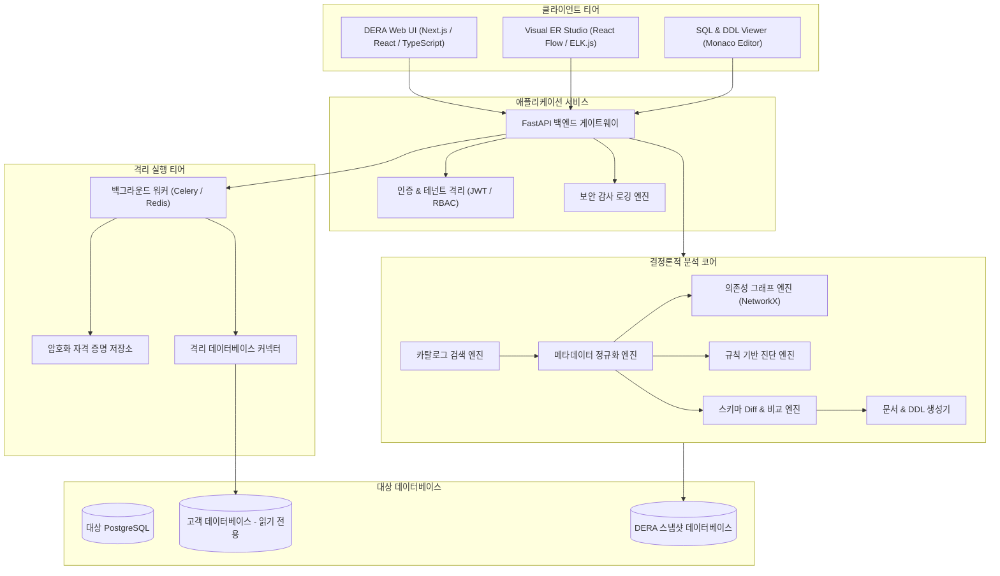
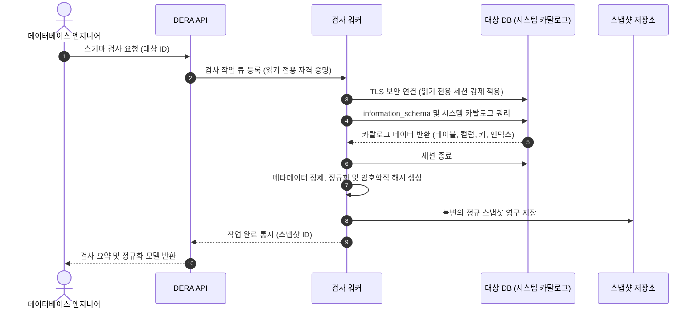
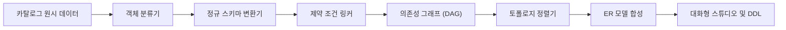
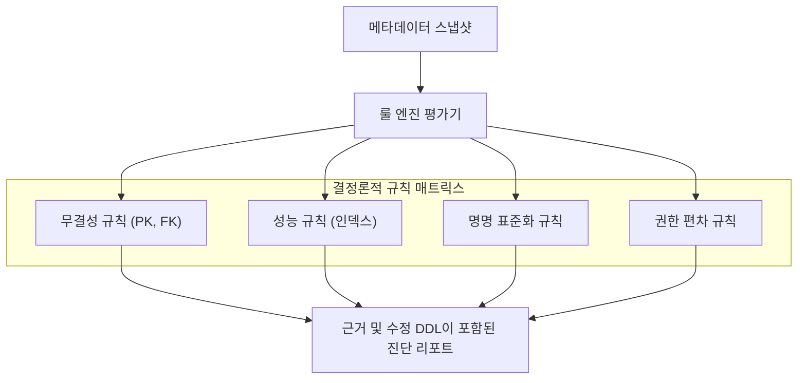
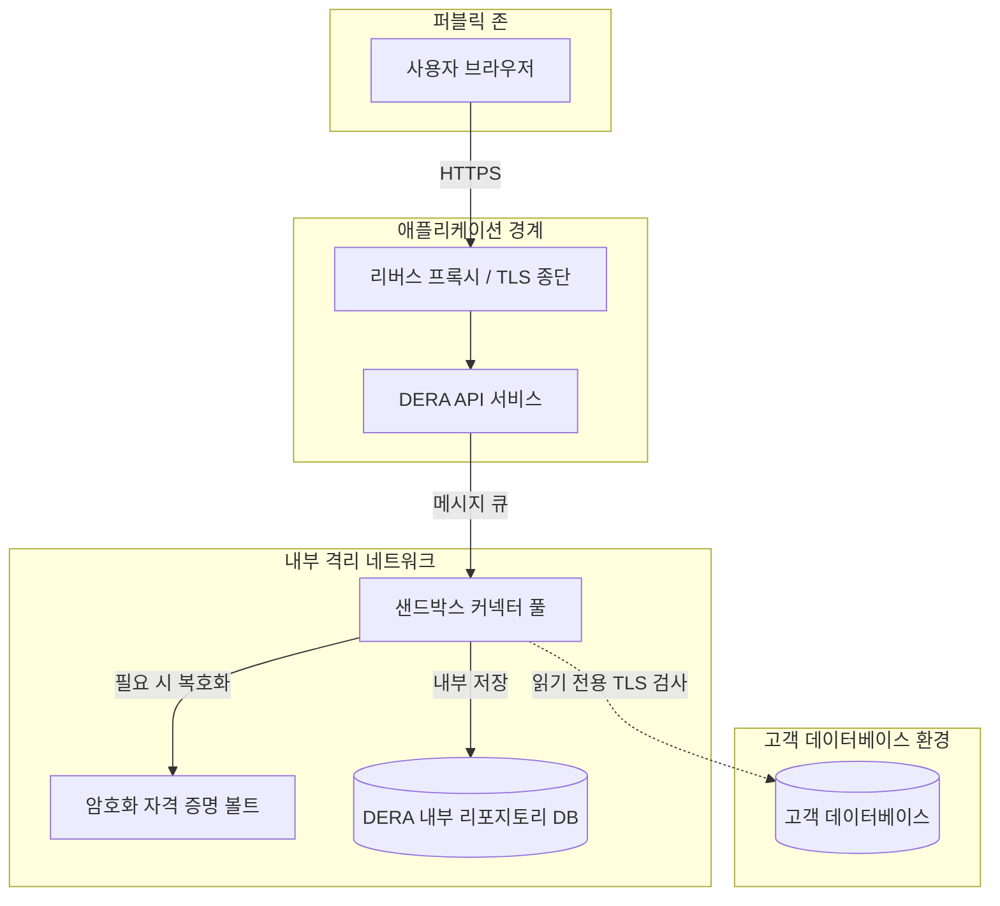
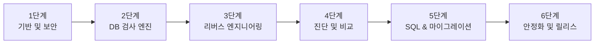

**다음 언어로 문서 읽기:** [English](../../README.md) | [Español](README.es.md) | [Français](README.fr.md) | [Deutsch](README.de.md) | [Português](README.pt.md) | [日本語](README.ja.md) | [한국어](README.ko.md) | [简体中文](README.zh-CN.md) | [العربية](README.ar.md) | [Русский](README.ru.md)

---

<div align="center">

# DERA

### Database Engineering & Reverse Analysis

**모든 스키마를 이해하고, 모든 변경을 엔지니어링합니다.**

개발자, 데이터베이스 엔지니어, 아키텍트 및 엔지니어링 팀을 위한 오픈 소스 결정론적 데이터베이스 리버스 엔지니어링 플랫폼.

인공지능 모델이나 외부 AI 추론 API 없이, 데이터베이스 구조 탐색, 엔티티 관계 시각화, 스키마 정밀 분석, 구조적 위험 감지 및 엔지니어링 문서 생성을 완전히 결정론적인 방식으로 수행합니다.

<br/>

[](https://github.com/krishanth7/dera/stargazers)
[](https://github.com/krishanth7/dera/forks)
[](https://github.com/krishanth7/dera/issues)
[](https://github.com/krishanth7/dera/blob/main/LICENSE)
[](https://github.com/krishanth7/dera/releases)
[](https://github.com/krishanth7/dera/actions/workflows/codeql.yml)
[](https://github.com/krishanth7/dera/graphs/contributors)
[](https://github.com/sponsors/krishanth7)

<br/>

[개요](#-개요) ·
[주요 기능](#-주요-기능) ·
[아키텍처](#-아키텍처) ·
[시각적 파이프라인](#-시각적-파이프라인) ·
[보안 원칙](#-보안-원칙) ·
[기술 스택](#-기술-스택) ·
[로드맵](#-개발-로드맵) ·
[기여 방법](#-기여-방법) ·
[커뮤니티](#-커뮤니티)

</div>

---

## 🌍 다국어 지원

DERA는 전 세계 10개 언어로 문서를 지원합니다. 아래 표 또는 상단 내비게이션 바를 통해 각 언어별 문서에 접근할 수 있습니다:

| 언어 | 코드 | 문서 링크 | 상태 |
|---|---|---|---|
| 🇬🇧 English | `en` | [English Primary (Root)](../../README.md) · [Synchronized Copy](README.en.md) | 기본 참조 문서 |
| 🇪🇸 Español | `es` | [Documentación en Español](README.es.md) | 전체 번역 완료 |
| 🇫🇷 Français | `fr` | [Documentation en Français](README.fr.md) | 전체 번역 완료 |
| 🇩🇪 Deutsch | `de` | [Dokumentation auf Deutsch](README.de.md) | 전체 번역 완료 |
| 🇵🇹 Português | `pt` | [Documentação em Português](README.pt.md) | 전체 번역 완료 |
| 🇯🇵 日本語 | `ja` | [日本語ドキュメント](README.ja.md) | 전체 번역 완료 |
| 🇰🇷 한국어 | `ko` | [한국어 문서](README.ko.md) | 전체 번역 완료 |
| 🇨🇳 简体中文 | `zh-CN` | [简体中文文档](README.zh-CN.md) | 전체 번역 완료 |
| 🇸🇦 العربية | `ar` | [الوثائق باللغة العربية](README.ar.md) | 전체 번역 완료 |
| 🇷🇺 Русский | `ru` | [Документация на русском](README.ru.md) | 전체 번역 완료 |

---

## 📖 개요

관계형 데이터베이스는 현대 소프트웨어 인프라의 핵심 축이지만, 복잡하고 끊임없이 변화하는 스키마를 완벽히 파악하는 것은 결코 쉬운 일이 아닙니다. 엔터프라이즈 환경에서는 수백 개의 테이블, 수만 개의 컬럼, 복잡한 외래 키 관계, 인덱스, 제약 조건, 뷰, 그리고 상호 의존성이 얽혀 있습니다.

이를 수작업으로 파악하고 감사하는 데에는 과도한 시간과 비용이 소모되며, 휴먼 에러의 위험이 따릅니다.

**DERA는 이러한 엔지니어링 문제를 해결하기 위해 설계되었습니다.**

DERA는 결정론적 알고리즘을 기반으로 데이터베이스 아키텍처를 탐색하고, 엔티티 관계를 재구성하며, 구조적 결함을 검사하고 엔지니어링 문서를 생성하는 통합된 보안 작업 공간을 제공합니다.

### 우리의 사명

모든 개발자, DBA 및 소프트웨어 아키텍트가 데이터베이스 리버스 엔지니어링을 투명하고 재현 가능하며 신뢰할 수 있게 활용할 수 있도록 돕는 것입니다.

### 핵심 설계 철학

- **태생적 결정론 (Deterministic by Design)** — 수학적 그래프 알고리즘과 정적 규칙에 기반한 완벽히 재현 가능한 분석.
- **생성형 AI 전면 배제** — LLM, 머신러닝 추론 모델, 외부 AI API 일체 미사용.
- **프라이버시 우선주의** — 순수 메타데이터 카탈로그만 분석. 고객의 실제 레코드 데이터는 기본적으로 수집하지 않습니다.
- **오픈 소스** — 유연한 MIT 라이선스 기반의 투명한 엔지니어링 및 커뮤니티 협업.
- **개발자 중심 워크플로** — 소프트웨어 엔지니어와 데이터베이스 관리자를 위한 실질적인 기능 구현.
- **보안 중심 설계** — 강제된 읽기 전용 세션, 자격 증명 암호화, 격리된 워커 프로세스 실행.
- **엔지니어링 정밀성** — AI의 환각(Hallucination)이 아닌, 시스템 카탈로그의 구체적인 증거에 입각한 진단.

---

## ✨ 주요 기능

다음은 DERA 플랫폼의 주요 계획 기능입니다. 지원 범위는 개발 단계 및 배포 버전에 따라 순차적으로 확장됩니다.

| 기능 영역 | 상태 | 설명 |
|---|---|---|
| **데이터베이스 검색** | 계획됨 | 테이블, 컬럼, 제약 조건, 인덱스 정보의 네이티브 메타데이터 추출 |
| **리버스 엔지니어링 코어** | 계획됨 | 정규화된 스키마 모델링, 객체 분류 및 의존성 토폴로지 분석 |
| **비주얼 ER 스튜디오** | 계획됨 | 인터랙티브 엔티티-관계 다이어그램, 자동 레이아웃, 필터링 및 내보내기 |
| **결정론적 진단 엔진** | 계획됨 | 기본 키 누락, 중복 인덱스, 명명 불일치를 감지하는 정적 규칙 평가 |
| **스키마 스냅샷 및 비교** | 계획됨 | 버전 관리 스키마 스냅샷 및 구조적 변경 영향도 분석 |
| **SQL 성능 엔지니어링** | 계획됨 | 쿼리 구조 분석, 실행 계획 시각화 및 최적의 인덱스 추천 |
| **문서 자동 생성기** | 계획됨 | Markdown, HTML, JSON, SQL DDL 및 SVG 다이어그램 자동 출력 |
| **보안 아키텍처** | 계획됨 | 역할 기반 접근 제어(RBAC), 읽기 전용 세션 보장, 격리된 컨테이너 실행 |

### 🔍 데이터베이스 검색

지원되는 데이터베이스 엔진을 검사하고 시스템 카탈로그의 구조 정보를 추출합니다:

- 데이터베이스, 스키마 및 확장 기능(Extensions)
- 테이블, 파티션 및 뷰
- 컬럼, 데이터 타입, NULL 허용 여부 및 기본값(Default) 표현식
- 기본 키(PK), 외래 키(FK) 및 참조 동작 (`CASCADE`, `RESTRICT`)
- UNIQUE 제약 조건, CHECK 제약 조건 및 배타 제약 조건
- 인덱스 (B-tree, Hash, GIN, GiST), 유니크 인덱스 및 부분 인덱스 조건
- 시퀀스, 아이덴티티 컬럼 및 트리거

### 🧬 리버스 엔지니어링 코어

네이티브 카탈로그 쿼리와 결정론적 알고리즘을 사용하여 스키마 모델을 재구성합니다:

- 특정 데이터베이스 엔진에 종속되지 않는 표준 정규화 모델
- 구조 메타데이터의 표준화 및 정제
- 방향성 비순환 그래프(DAG) 기반의 의존성 계층 구조 구축
- 단일 및 복합 외래 키 관계의 정확한 매핑
- 암호학적 해시가 적용된 불변 스냅샷 생성
- 결정론적 SQL DDL 스크립트 재구성

### 🕸️ 비주얼 ER 스튜디오

대화형 엔티티-관계 인터페이스를 통해 스키마 토폴로지를 탐색합니다:

- 컬럼, 타입, 제약 조건을 직관적으로 표시하는 인터랙티브 테이블 노드
- 카디널리티가 명확히 표현된 외래 키 관계 커넥터
- 결정론적 자동 배치 알고리즘 (계층형 및 힘 지향형 레이아웃)
- 스키마별 그룹화, 태그 지정 및 도메인 단위의 서브그래프 분리
- 대화형 검색, 타입 필터링 및 의존성 경로 추적
- 고해상도 SVG 벡터 및 PNG 래스터 이미지 내보내기

### 🛡️ 결정론적 데이터베이스 진단

구성 가능한 엔지니어링 규칙을 기반으로 스키마 메타데이터를 분석하여 구조적 결함을 진단합니다:

| 진단 규칙 | 분류 | 설명 |
|---|---|---|
| **기본 키 누락** | 무결성 | 명시적 기본 키 제약 조건이 없는 테이블 감지 |
| **잠재적 중복 인덱스** | 성능 | 인덱스 컬럼의 접두사가 겹치거나 중복된 인덱스 탐지 |
| **인덱스 미지정 외래 키** | 성능 | 적절한 인덱스로 커버되지 않은 외래 키 컬럼 식별 |
| **다형성 안티패턴** | 무결성 | 참조 제약 조건 없이 느슨하게 결합된 외래 키 관계 감지 |
| **NULL 허용 및 기본값 이상** | 일관성 | 합리적인 기본값 없이 지정된 NOT NULL 컬럼 플래그 |
| **명명 규칙 감사** | 표준화 | 대소문자 불일치 및 프로젝트 아키텍처 규칙 위반 탐지 |
| **권한 설정 편차** | 보안 | 카탈로그 객체에 부여된 과도한 권한 설정 식별 |

*모든 진단 결과는 근거 데이터와 함께 구체적인 DDL 수정 가이드를 제공합니다.*

### 🔄 스키마 비교 및 차이 분석 엔진

개발, 검증, 운영 환경 또는 마이그레이션 변경 이력 간의 스냅샷을 정밀 비교합니다:

- 추가, 수정, 삭제된 테이블 및 컬럼
- 데이터 타입 변경, 크기 조정 및 NULL 허용성 변경
- 인덱스 추가, 삭제 및 정의 변경
- 제약 조건 수정 및 외래 키 참조 관계 변화
- 호환성을 깨뜨리는 변경(안전한 변경 vs 파괴적 변경)의 자동 분류
- 의존성을 고려한 토폴로지 정렬 기반의 마이그레이션 DDL 프리뷰

---

## 🧠 AI 배제. 오직 엔지니어링.

DERA는 인공지능 모델이나 기계 학습을 의도적으로 배제하고 설계되었습니다.

```text
┌───────────────────────────────────────────────────────────┐
│                 엄격한 비AI (Non-AI) 아키텍처             │
│                                                           │
│   ❌  OpenAI, Anthropic Claude, Google Gemini 일체 배제   │
│   ❌  Groq, DeepSeek 등 호스팅 추론 API 미사용            │
│   ❌  로컬 LLM (Ollama, vLLM, llama.cpp) 미사용           │
│   ❌  비결정론적 환각(Hallucination) 원천 차단            │
│                                                           │
│   ✅  네이티브 시스템 카탈로그 쿼리 (information_schema)  │
│   ✅  결정론적 그래프 알고리즘 (NetworkX)                 │
│   ✅  정밀한 SQL AST 파서 (SQLGlot)                       │
│   ✅  재현 가능한 정적 룰 엔진                            │
│   ✅  수학적 스키마 차이 비교 알고리즘                    │
└───────────────────────────────────────────────────────────┘
```

**DERA가 결정론을 고수하는 이유:**
1. **예측 가능성:** 동일한 스키마 스냅샷과 규칙 설정은 언제나 100% 동일한 진단 결과를 보장합니다.
2. **감사 가능성:** 모든 경고, 관계 및 그래프 간선은 카탈로그의 실제 데이터에 투명하게 연결됩니다.
3. **데이터 주권:** 기업의 데이터베이스 스키마와 구조 메타데이터가 외부 AI 서비스로 유출되지 않습니다.
4. **고성능 및 무비용:** 추론 지연 시간, 토큰 비용, API 호출 제한이 없으며 외부 네트워크 장애에 영향을 받지 않습니다.

---

## 🏗️ 아키텍처

DERA는 유지보수성, 확장성 및 안전한 데이터베이스 접근을 고려한 모듈형 구조를 따릅니다.



---

## 🔬 시각적 파이프라인

DERA는 메타데이터 검사, 관계 합성 및 보안 검증을 위해 감사 가능한 결정론적 파이프라인을 실행합니다.

### 1. 데이터베이스 검사 플로우



### 2. 스키마 리버스 엔지니어링 파이프라인



### 3. 메타데이터 처리 및 진단 파이프라인



### 4. 보안 경계 및 네트워크 격리



### 5. 계획된 개발 라이프사이클



---

## 🔒 보안 원칙

DERA는 기업의 핵심 데이터베이스와 직접 통신하므로, 보안은 아키텍처의 가장 중요한 기준입니다.

- **강제된 읽기 전용 모드:** 모든 연결 세션은 트랜잭션을 읽기 전용으로 강제합니다 (`SET SESSION CHARACTERISTICS AS TRANSACTION READ ONLY`).
- **고객 데이터 행(Row) 미추출:** 시스템 카탈로그(`information_schema`, `pg_catalog`)만 조회합니다. 애플리케이션의 실제 레코드 데이터는 쿼리하거나 저장하지 않습니다.
- **코드 내 자격 증명 금지:** 자격 증명은 AES-256-GCM 알고리즘으로 안전하게 암호화되어 보관되며 로그, 내보내기 파일, 깃 커밋에 노출되지 않습니다.
- **SSRF 공격 방지:** 대상 호스트 주소를 엄격히 검증하여 내부 사설망 스캔이나 클라우드 인스턴스 메타데이터 접근을 원천 차단합니다.
- **최소 권한의 원칙:** 관리자 권한이 배제된 읽기 전용 감사 계정을 프로비저닝할 수 있도록 보안 가이드를 제공합니다.
- **완전한 감사 로깅:** 모든 검사, 내보내기, 설정 변경 작업은 변조 불가능한 보안 감사 로그로 기록됩니다.

*취약점 제보 절차 및 상세 보안 정책은 [SECURITY.md](../../SECURITY.md)를 참조하십시오.*

---

## 🛠️ 기술 스택

| 계층 | 구성 요소 | 선정 기술 | 용도 | 상태 |
|---|---|---|---|---|
| **프론트엔드** | 프레임워크 | Next.js, React, TypeScript | 반응형 대화형 웹 애플리케이션 | 계획됨 |
| | 스타일링 | Tailwind CSS | 일관성 있는 모던 디자인 시스템 | 계획됨 |
| | UI 컴포넌트 | shadcn/ui | 접근성이 보장된 UI 컴포넌트 | 계획됨 |
| | ER 시각화 | React Flow, ELK.js | 그래프 렌더링 및 자동 레이아웃 | 계획됨 |
| | 코드 에디터 | Monaco Editor | SQL 구문 강조 및 DDL 뷰어 | 계획됨 |
| **백엔드** | API 프레임워크 | Python 3.12+, FastAPI | 고성능 비동기 API 서비스 | 계획됨 |
| | 카탈로그 검사 | SQLAlchemy, psycopg | 메타데이터 추출 및 연결 풀 관리 | 계획됨 |
| | SQL 파서 | SQLGlot | 엔진 독립적 SQL AST 생성 및 분석 | 계획됨 |
| | 그래프 처리 | NetworkX | 의존성 그래프 탐색 및 위상 정렬 | 계획됨 |
| | 작업 큐 | Celery, Redis | 격리된 비동기 검사 워커 프로세스 | 계획됨 |
| **데이터 저장소** | DERA DB | PostgreSQL | 스냅샷, 사용자 세션, 감사 로그 저장 | 계획됨 |
| | 마이그레이션 | Alembic | DERA 플랫폼 데이터베이스 스키마 관리 | 계획됨 |
| **데브옵스 & QA** | 컨테이너 | Docker, Docker Compose | 재현 가능한 개발 및 배포 환경 | 계획됨 |
| | 정적 분석 & 보안 | CodeQL, Dependabot | 소스 코드 취약점 및 종속성 보안 검사 | 구현 완료 |
| | 테스트 | Pytest, Playwright | 백엔드 단위 테스트 및 E2E 브라우저 테스트 | 계획됨 |

---

## 🗄️ 데이터베이스 호환성

DERA는 현대의 다양한 관계형 및 분산 데이터베이스를 지원하기 위해 플러그형 커넥터 아키텍처로 구축됩니다:

| 데이터베이스 엔진 | 커넥터 상태 | 카탈로그 소스 | 목표 일정 |
|---|---|---|---|
| **PostgreSQL** (v12 - v17) | 개발 중 | `pg_catalog`, `information_schema` | 2단계 (MVP) |
| **Supabase PostgreSQL** | 개발 중 | PostgreSQL 네이티브 커넥터 | 2단계 (MVP) |
| **MySQL** (v8.0+) | 계획됨 | `information_schema`, `performance_schema` | 5단계 |
| **SQLite** (v3.35+) | 계획됨 | `sqlite_master`, `PRAGMA` 테이블 정보 | 5단계 |
| **MariaDB** (v10.5+) | 계획됨 | `information_schema` | 5단계 |
| **Microsoft SQL Server** | 계획됨 | `sys.tables`, `INFORMATION_SCHEMA` | 5단계 |
| **Oracle Database** | 검토 중 | 데이터 딕셔너리 뷰 (`ALL_*`, `DBA_*`) | 향후 평가 |

---

## 🚀 시작하기

DERA는 현재 아키텍처 설계 및 기반 구현 단계에 있습니다. 정식 배포 안내서는 릴리스 일정에 따라 순차적으로 안내될 예정입니다.

### 사전 요구사항 (계획)

- Python 3.12 이상
- Node.js LTS (v20+)
- PostgreSQL 15+
- Docker 및 Docker Compose
- Git

### 리포지토리 복제

```bash
git clone https://github.com/krishanth7/dera.git
cd dera
```

### 로컬 개발 환경 실행 (계획)

```bash
# 환경 설정 파일 복사
cp .env.example .env

# Docker Compose를 사용하여 개발 스택 실행
docker compose -f infrastructure/docker/docker-compose.dev.yml up --build
```

> **참고:** 현재 핵심 애플리케이션 코드가 활발히 구현되고 있습니다. 진행 상황은 [개발 로드맵](#-개발-로드맵)을 확인해 주십시오.

---

## 📁 리포지토리 디렉터리 구조

```text
dera/
├── .github/
│   ├── ISSUE_TEMPLATE/           # 구조화된 GitHub 이슈 템플릿
│   ├── workflows/                # CodeQL, 종속성 검사, CI 워크플로
│   ├── PULL_REQUEST_TEMPLATE.md  # 표준 풀 리퀘스트 템플릿
│   ├── dependabot.yml            # Dependabot 자동 업데이트 설정
│   └── FUNDING.yml               # 메인테이너 후원 설정
├── docs/
│   ├── README.md                 # 전체 문서 인덱스 허브
│   ├── i18n/                     # 다국어 동기화 문서 디렉터리
│   │   ├── README.en.md          # 영문 동기화 참조 사본
│   │   ├── README.es.md          # 스페인어 문서
│   │   ├── README.fr.md          # 프랑스어 문서
│   │   ├── README.de.md          # 독일어 문서
│   │   ├── README.pt.md          # 포르투갈어 문서
│   │   ├── README.ja.md          # 일본어 문서
│   │   ├── README.ko.md          # 한국어 문서
│   │   ├── README.zh-CN.md       # 중국어 간체 문서
│   │   ├── README.ar.md          # 아랍어 문서 (RTL 호환)
│   │   └── README.ru.md          # 러시아어 문서
│   ├── architecture/             # 아키텍처 명세서
│   ├── development/              # 개발 환경 설정 및 코딩 표준
│   ├── security/                 # 위협 모델 및 보안 지침
│   └── contributing/             # 기여자를 위한 상세 안내
├── CODE_OF_CONDUCT.md            # Contributor Covenant 행동 강령
├── CONTRIBUTING.md               # 상세 기여 가이드라인
├── LICENSE                       # MIT 라이선스
├── README.md                     # 메인 리포지토리 홈
├── SECURITY.md                   # 종합 보안 정책
└── .gitignore                    # Git 무시 규칙
```

---

## 🗺️ 개발 로드맵

### 1단계 — 기반 및 보안
- [x] 공식 프로젝트 아이덴티티 및 MIT 라이선스 확립
- [x] CodeQL 정적 애플리케이션 보안 테스트(SAST) 워크플로 구성
- [x] 행동 강령(Code of Conduct) 및 보안 정책(Security Policy) 수립
- [x] 10개 언어 지원 다국어 문서 아키텍처 구축
- [ ] 모노레포 구조 초기화 (`apps/web`, `apps/api`)
- [ ] Docker 기반 개발 환경 및 기본 CI 파이프라인 구성

### 2단계 — 데이터베이스 검사 엔진
- [ ] PostgreSQL 네이티브 메타데이터 커넥터 구현
- [ ] 테이블, 컬럼, 제약 조건, 인덱스, 뷰 정보 추출
- [ ] 데이터베이스 독립적 표준 정규화 모델 구축
- [ ] 암호학적 서명이 적용된 불변 스냅샷 저장소 구현
- [ ] 읽기 전용 연결 강제 적용 및 쿼리 타임아웃 보호 장치 구축

### 3단계 — 리버스 엔지니어링 스튜디오
- [ ] React Flow 기반의 대화형 ER 다이어그램 스튜디오 개발
- [ ] 자동 계층 배치 알고리즘 구현
- [ ] 스키마 필터링, 검색 및 도메인 단위 그룹화 기능
- [ ] 의존성 그래프(DAG) 탐색 및 시각화 기능
- [ ] 고해상도 SVG 및 PNG 다이어그램 내보내기 지원

### 4단계 — 진단 및 스키마 비교
- [ ] 결정론적 규칙 기반 정적 진단 엔진 구현
- [ ] 진단 규칙 구축: 기본 키 누락, 중복 인덱스, 미인덱스 외래 키
- [ ] 스키마 스냅샷 차이 비교(Diff) 알고리즘 구현
- [ ] DDL 마이그레이션 변경 사항에 대한 구조화된 프리뷰 생성
- [ ] Markdown, JSON, HTML 형식의 진단 보고서 내보내기

### 5단계 — 고급 엔지니어링 및 커넥터 확장
- [ ] SQLGlot 기반의 쿼리 AST 파싱 및 복잡도 메트릭 도입
- [ ] 실행 계획 시각화 도구 개발 (`EXPLAIN ANALYZE`)
- [ ] MySQL 및 SQLite 데이터베이스 커넥터 개발
- [ ] 의존성 순서가 보장된 마이그레이션 DDL 스크립트 생성

### 6단계 — 엔터프라이즈 안정화
- [ ] 종합 보안 침투 테스트 및 취약점 점검 실시
- [ ] 1,000개 이상의 테이블을 가진 대규모 스키마 성능 벤치마크
- [ ] 멀티테넌트 완벽 격리 및 감사 로깅 무결성 검증
- [ ] 공식 v1.0.0 컨테이너 이미지 및 엔터프라이즈 배포 가이드 발행

---

## 🧪 테스트 및 품질 보증 전략

DERA는 반복 가능하고 자동화된 테스트 파이프라인을 통해 높은 엔지니어링 표준을 유지합니다:

- **단위 테스트:** 모의 카탈로그 데이터를 사용하여 메타데이터 정규화, 그래프 순환 탐지, 진단 규칙을 철저히 검증합니다.
- **통합 테스트:** 컨테이너로 격리된 실제 PostgreSQL, MySQL, SQLite 인스턴스를 대상으로 커넥터의 신뢰성을 검증합니다.
- **결정론 검증:** 동일한 스키마 스냅샷이 언제나 100% 동일한 암호학적 해시값과 진단 결과를 산출하는지 확인합니다.
- **보안 검사:** CodeQL 정적 분석, 의존성 취약점 자동 점검, 코드베이스 내 시크릿 누출 검사를 지속적으로 수행합니다.
- **E2E 테스트:** Playwright를 활용하여 브라우저 환경에서 다이어그램 조작 성능과 반응형 UI를 검증합니다.

---

## 🤝 기여 방법

전 세계의 소프트웨어 엔지니어, 데이터베이스 전문가, 테크니컬 라이터 및 보안 연구원의 기여를 환영합니다.

풀 리퀘스트를 제출하기 전에 [CONTRIBUTING.md](../../CONTRIBUTING.md) 및 [행동 강령](../../CODE_OF_CONDUCT.md)을 반드시 검토해 주시기 바랍니다.

### 개발 워크플로

1. GitHub에서 리포지토리를 포크(Fork)합니다.
2. 기능별 브랜치를 생성합니다: `git checkout -b feat/your-feature-name`
3. [Conventional Commits](../../CONTRIBUTING.md#commit-message-guidelines) 커밋 메시지 규칙을 준수합니다.
4. 해당 기능에 대한 단위 테스트 및 통합 테스트를 작성합니다.
5. CodeQL 보안 검사 및 문서 검증 테스트를 통과하는지 확인합니다.
6. `main` 브랜치로 풀 리퀘스트를 생성하여 메인테이너의 검토를 받습니다.

---

## 💬 커뮤니티

- [GitHub Discussions](https://github.com/krishanth7/dera/discussions) — 질문, 아이디어 제안 및 데이터베이스 엔지니어링 토론.
- [GitHub Issues](https://github.com/krishanth7/dera/issues) — 버그 리포트 및 새로운 기능 제안.
- [GitHub Pull Requests](https://github.com/krishanth7/dera/pulls) — 코드 및 문서 개선 기여.
- [Releases](https://github.com/krishanth7/dera/releases) — 공식 릴리스 정보 및 변경 이력.

---

## ❤️ 프로젝트 후원

DERA는 독립적인 오픈 소스 소프트웨어 엔지니어링 프로젝트입니다. 다음과 같은 방법으로 성장을 지원할 수 있습니다:

- GitHub 리포지토리에 Star를 눌러주세요.
- 엔지니어링 네트워크 및 커뮤니티에 프로젝트를 공유해 주세요.
- 새로운 커넥터, 진단 규칙 또는 문서 번역에 참여해 주세요.
- [GitHub Sponsors를 통해 후원에 참여해 주세요](https://github.com/sponsors/krishanth7).

---

## 📜 라이선스

DERA는 **[MIT License](../../LICENSE)** 에 따라 배포됩니다.

```text
Copyright (c) 2026 Krishanth
```

---

## 👨‍💻 메인테이너

**Krishanth**  
창립자 및 리드 메인테이너

- GitHub: [@krishanth7](https://github.com/krishanth7)  
- Repository: [github.com/krishanth7/dera](https://github.com/krishanth7/dera)  
- Contact: `krishanth.b.2008@gmail.com`

*DERA는 Krishanth에 의해 독립적으로 유지보수되는 오픈 소스 프로젝트입니다. OVIC Labs는 메인테이너의 광범위한 엔지니어링 생태계의 일부로 인정됩니다.*

---

<div align="center">

### DERA — Database Engineering & Reverse Analysis

**모든 스키마를 이해하고, 모든 변경을 엔지니어링합니다.**

*엔지니어링의 정밀함, 수학적 결정론, 그리고 오픈 소스의 투명성으로 구축되었습니다.*

© 2026 DERA 기여자 일동. Distributed under the MIT License.

[맨 위로 이동](#dera)

</div>
