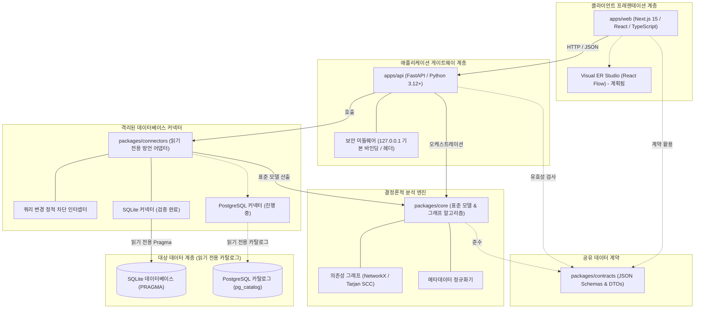

<!-- DERA:I18N_NAV:START -->
[English](../../README.md) | [Español](README.es.md) | [Français](README.fr.md) | [Deutsch](README.de.md) | [Português](README.pt.md) | [Italiano](README.it.md) | [日本語](README.ja.md) | **한국어** | [简体中文](README.zh-CN.md) | [Русский](README.ru.md)
<!-- DERA:I18N_NAV:END -->

---

<div align="center">

# DERA

### Database Engineering & Reverse Analysis

**모든 스키마를 이해하고, 모든 변경을 엔지니어링하십시오.**

소프트웨어 엔지니어, 데이터베이스 아키텍트, 엔지니어링 팀을 위해 설계된 독립형 오픈 소스 결정론적 데이터베이스 엔지니어링 및 역공학 플랫폼.

AI 모델이나 외부 추론 API 없이, 순수 수학적 결정론에 기반하여 데이터베이스 구조를 탐색하고 엔티티 관계를 재구성하며 구조적 위험을 평가하고 스키마 변경을 안전하게 계획합니다.

<br/>

[](../../LICENSE)
[](https://github.com/krishanth7/dera/actions/workflows/ci.yml)
[](https://github.com/krishanth7/dera/actions/workflows/codeql.yml)
[](https://github.com/krishanth7/dera/actions/workflows/documentation.yml)
[](../../pyproject.toml)
[](../../tsconfig.json)
[-orange?style=for-the-badge)](#-엄격한-비ai-아키텍처)
[](../../CONTRIBUTING.md)

<br/>

[개요](#-개요) ·
[기능 현황 매트릭스](#-기능-현황-매트릭스) ·
[아키텍처 개요](#-아키텍처-개요) ·
[모노레포 구조](#-저장소-디렉터리-구조) ·
[빠른 시작](#-빠른-시작) ·
[데이터베이스 호환성](#-데이터베이스-호환성-매트릭스) ·
[보안 원칙](#-보안-원칙) ·
[개발자 문서 허브](#-개발자-문서-내비게이션) ·
[로드맵](#-마스터-로드맵) ·
[기여하기](#-기여하기) ·
[커뮤니티](#-커뮤니티)

</div>

---

## 🌍 다국어 지원

DERA는 10개 국제 언어로 동기화된 문서를 제공합니다. 영어 README는 [문서 유지 관리 계약](../development/README_MAINTENANCE.md)에 따라 공식 기준 문서로 동작합니다.

| 언어 | 코드 | 문서 링크 | 상태 |
|---|---|---|---|
| 🇬🇧 English | `en` | [English Primary (Root)](../../README.md) · [Synchronized Copy](README.en.md) | **공식 기준 문서 (Authoritative)** |
| 🇪🇸 Español | `es` | [Documentación en Español](README.es.md) | 전체 번역 완료 |
| 🇫🇷 Français | `fr` | [Documentation en Français](README.fr.md) | 전체 번역 완료 |
| 🇩🇪 Deutsch | `de` | [Dokumentation auf Deutsch](README.de.md) | 전체 번역 완료 |
| 🇵🇹 Português | `pt` | [Documentação em Português](README.pt.md) | 전체 번역 완료 |
| 🇮🇹 Italiano | `it` | [Documentazione in Italiano](README.it.md) | 전체 번역 완료 |
| 🇯🇵 日本語 | `ja` | [日本語ドキュメント](README.ja.md) | 전체 번역 완료 |
| 🇰🇷 한국어 | `ko` | [한국어 문서](README.ko.md) | 전체 번역 완료 |
| 🇨🇳 简体中文 | `zh-CN` | [简体中文文档](README.zh-CN.md) | 전체 번역 완료 |
| 🇷🇺 Русский | `ru` | [Документация на русском](README.ru.md) | 전체 번역 완료 |

---

## 📖 개요

현대 관계형 데이터베이스는 소프트웨어 인프라의 핵심 근간입니다. 그러나 복잡하고 거대하며 빠르게 변경되는 스키마를 이해하는 일은 매우 중대한 엔지니어링 과제입니다:
- **복잡한 스키마:** 엔터프라이즈 데이터베이스는 종종 수백 개의 테이블, 수천 개의 컬럼, 문서화되지 않은 외래 키 관계로 얽혀 있습니다.
- **아키텍처 부채:** 순환 외래 키 의존성, 누락된 기본 키, 인덱스가 없는 외래 키, 중복 인덱스가 시간이 흐르며 조용히 누적됩니다.
- **마이그레이션 위험:** 완전한 위상 수학 그래프 없이 스키마를 변경하면 잠금 확대, 데이터 유실, 연쇄 제약 조건 위반 위험이 발생합니다.
- **보안 및 개인정보:** 기업은 운영 데이터베이스 자격 증명이나 고객 데이터 행을 외부 클라우드 AI 서비스에 노출할 수 없습니다.

**DERA는 수학적 결정론을 통해 이러한 문제를 해결하도록 설계되었습니다.**

DERA는 관계형 데이터베이스 카탈로그를 안전하게 검사하고, 의존성 그래프를 재구성하며, 구조적 위험을 평가하고, 검증 가능하며 재현 가능한 알고리즘으로 마이그레이션 미리보기를 생성하는 오픈 소스 플랫폼입니다.

### 핵심 엔지니어링 원칙

1. **설계상 결정론 (Deterministic by Design):** 모든 스키마 스냅샷, 위상 정렬, 진단 결과는 관계 대수와 그래프 이론에 기반하여 완전히 재현 가능합니다.
2. **엄격한 비AI 설계 (Strictly Non-AI):** 생성형 AI, 거대 언어 모델 (LLM), 벡터 데이터베이스, 외부 추론 API를 일절 사용하지 않습니다.
3. **읽기 전용 데이터베이스 안전성:** 연결 수준에서의 읽기 전용 강제, AST 기반 SQL 변경 명령 정적 차단, 시스템 카탈로그 쿼리 제한.
4. **고객 데이터 행 추출 제로:** 순수 메타데이터 인트로스펙션 (`information_schema`, `pg_catalog`, `sqlite_master`)만 수행합니다. 비즈니스 테이블 레코드는 일절 조회·전송·저장되지 않습니다.
5. **분리된 모노레포 아키텍처:** 그래프 알고리즘 코어, 격리된 데이터베이스 커넥터, API 게이트웨이, 시각화 스튜디오를 명확한 경계로 분리.
6. **오픈 소스 및 허용적 라이선스:** 자유로운 사용이 가능한 [MIT 라이선스](../../LICENSE) 기반 공개.

---

## 🧠 엄격한 비AI 아키텍처

DERA는 인공지능이나 머신러닝 구성 요소를 의도적으로 완전히 배제하여 구축되었습니다.

```text
┌───────────────────────────────────────────────────────────┐
│               엄격한 비AI 결정론적 아키텍처               │
│                                                           │
│   ❌  OpenAI, Anthropic Claude, Google Gemini 미사용      │
│   ❌  Groq, DeepSeek 등 호스팅 모델 API 미사용            │
│   ❌  로컬 LLM (Ollama, vLLM, llama.cpp) 미사용           │
│   ❌  확률적 추정 및 환각(Hallucination) 원천 배제        │
│   ❌  클라우드 벡터 임베딩 및 외부 RAG 미사용             │
│                                                           │
│   ✅  네이티브 시스템 카탈로그 직접 조회                  │
│   ✅  수학적 그래프 이론 알고리즘 (NetworkX / Tarjan)     │
│   ✅  추상 구문 트리 (AST) SQL 파서 (SQLGlot)             │
│   ✅  재현 가능한 결정론적 정적 규칙 엔진                 │
│   ✅  암호학적 해시 핑거프린트 (SHA-256)                  │
└───────────────────────────────────────────────────────────┘
```

**DERA가 결정론적인 이유:**
- **수학적 감사 가능성:** 모든 관계 분석, 순환 경고, 진단 결과는 구체적인 카탈로그 증거와 검증된 그래프 알고리즘에 기초합니다.
- **바이트 단위 재현성:** 동일한 스키마 스냅샷에 대한 검사는 어떤 개발 머신이나 CI 파이프라인에서도 항상 완전히 동일한 결과를 도출합니다.
- **기업 데이터 주권:** 스키마 구조 및 토폴로지가 외부 모델 제공업체로 전송되지 않습니다.
- **운영 비용 제로:** 토큰 비용, 속도 제한 (Rate limit), 네트워크 추론 지연이 발생하지 않습니다.

---

## 📊 기능 현황 매트릭스

DERA는 리포지토리에 실제 구현되고 자동화 테스트로 검증된 코드를 투명하게 공개합니다:

| 기능 및 역량 | 상태 | 구현 증거 | 모노레포 위치 |
|---|:---:|---|---|
| **핵심 스키마 모델** | **구현됨** | 표준 `Column`, `Table`, `ForeignKey`, `Index` 도메인 모델 | [`packages/core/src/dera/models.py`](../../packages/core/src/dera/models.py) |
| **의존성 그래프 엔진** | **구현됨** | 순환 방지 DAG 및 Tarjan SCC 기반 위상 정렬 | [`packages/core/src/dera/graph.py`](../../packages/core/src/dera/graph.py) |
| **변경 차단 인터셉터 (Read-Only)** | **구현됨** | 파괴적 SQL (`DROP`, `ALTER` 등)을 정적으로 차단하는 AST 검사 | [`packages/connectors/src/dera_connectors/base/`](../../packages/connectors/src/dera_connectors/base/connector.py) |
| **SQLite 카탈로그 인트로스펙션** | **구현됨** | 테이블, 컬럼, PK, FK, 인덱스 자동 검색 | [`packages/connectors/src/dera_connectors/sqlite/`](../../packages/connectors/src/dera_connectors/sqlite/connector.py) |
| **PostgreSQL 카탈로그 검사** | **진행 중** | 임시 컨테이너 대상 PostgreSQL 라이브 통합 테스트 | [`tests/integration/`](../../tests/integration/) |
| **API 게이트웨이 및 원격 측정** | **구현됨** | 루프백 기본 바인딩 및 헬스체크 엔드포인트를 갖춘 FastAPI | [`apps/api/src/dera_api/main.py`](../../apps/api/src/dera_api/main.py) |
| **웹 스튜디오 애플리케이션 베이스** | **구현됨** | Next.js 15 TypeScript 기본 구조 및 아키텍처 상태 카드 | [`apps/web/src/app/page.tsx`](../../apps/web/src/app/page.tsx) |
| **공유 데이터 계약** | **구현됨** | 버전 관리되는 JSON 스키마 및 직렬화 DTO | [`packages/contracts/schemas/`](../../packages/contracts/schemas/) |
| **시각적 ER 스튜디오 캔버스** | 계획됨 | React Flow 기반의 대화형 다이어그램 캔버스 | 로드맵 7단계 |
| **결정론적 규칙 매트릭스** | 계획됨 | 누락된 PK, 인덱스 없는 FK, 중복 인덱스 감지 | 로드맵 8단계 |
| **스냅샷 Diff 엔진** | 계획됨 | 시맨틱 스키마 스냅샷 비교 및 DDL 변경 미리보기 | 로드맵 9단계 |
| **SQL AST 성능 분석기** | 계획됨 | SQLGlot 쿼리 복잡도 계산 및 실행 계획 시각화 | 로드맵 10단계 |

> **상태 범례:**
> - **`구현됨`** &mdash; 코드 작성 완료, 검증 완료, CI 자동 테스트 통과.
> - **`진행 중`** &mdash; 현재 마일스톤에서 활발히 개발 및 통합 테스트 중.
> - **`계획됨`** &mdash; 12단계 마스터 로드맵에 배정 완료.

---

## 🏗️ 아키텍처 개요

DERA는 [모노레포 아키텍처 규격](../architecture/README_ARCHITECTURE.md)에 따라 모듈을 분리하여 구성합니다:



### 아키텍처 텍스트 설명 (접근성 지원)
- **클라이언트 프레젠테이션 계층 (`apps/web`):** JSON을 통해 API와 통신하며 대화형 ER 다이어그램 캔버스를 호스팅할 Next.js 15 TypeScript 프론트엔드.
- **애플리케이션 게이트웨이 계층 (`apps/api`):** 기본적으로 `127.0.0.1`에 바인딩되며 헬스체크 원격 측정, 카탈로그 추출 경로, 보안 미들웨어를 제공하는 FastAPI 백엔드.
- **공유 데이터 계약 (`packages/contracts`):** 테이블, 컬럼, 인덱스, 관계 및 스냅샷의 표준 형식을 규정하는 JSON 스키마와 TypeScript 인터페이스.
- **결정론적 코어 엔진 (`packages/core`):** 표준 도메인 모델, Tarjan 알고리즘, 위상 정렬, 메타데이터 정규화를 구현하는 순수 Python 라이브러리.
- **격리된 데이터베이스 커넥터 (`packages/connectors`):** 시스템 카탈로그 (`sqlite_master`, `pg_catalog`)를 안전하게 조회하는 플러그형 어댑터. 쿼리 실행 전 AST 검사로 변경 명령 차단.
- **대상 데이터 계층 (읽기 전용):** 검사 대상 데이터베이스. DERA는 관리자 권한 없이 최소 권한의 읽기 전용 계정으로만 접속합니다.

세부 기술 명세:
- [아키텍처 및 블루프린트 가이드](../architecture/README_ARCHITECTURE.md)
- [모듈 경계 및 의존성 규칙](../architecture/MODULE_BOUNDARIES.md)
- [모노레포 디렉터리 레이아웃](../architecture/MONOREPO_STRUCTURE.md)
- [아키텍처 결정 기록 (ADR 0001)](../architecture/adr/0001-monorepo-architecture.md)

---

## 📁 저장소 디렉터리 구조

DERA 모노레포의 실제 구조는 다음과 같습니다:

```text
dera/
├── apps/
│   ├── api/                      # FastAPI 백엔드 애플리케이션 및 헬스 엔드포인트
│   │   ├── src/dera_api/         # 게이트웨이 라우트, 미들웨어, 스키마
│   │   └── pyproject.toml        # API 패키징 명세
│   └── web/                      # Next.js 15 TypeScript 프론트엔드 스튜디오
│       ├── src/                  # App 라우터, 컴포넌트, API 클라이언트
│       └── package.json          # 웹 워크스페이스 구성
├── packages/
│   ├── core/                     # 표준 스키마 모델 및 그래프 처리 엔진
│   │   └── src/dera_core/        # 스키마 모델, DAG 알고리즘, 그래프 이론
│   ├── connectors/               # 데이터베이스 메타데이터 추출 어댑터
│   │   └── src/dera_connectors/  # 기본 커넥터, 변경 가드, SQLite 어댑터
│   └── contracts/                # 공유 JSON 스키마 및 직렬화 계약
│       └── schemas/              # 버전 관리 스냅샷 및 API 계약
├── tests/
│   ├── architecture/             # AST 임포트 경계 및 의존성 테스트
│   ├── integration/              # 실제 SQLite 및 PostgreSQL 카탈로그 테스트
│   ├── regression/               # 결정론적 DAG 및 해시 회귀 테스트
│   └── unit/                     # 모델, PR 제목, 준비 상태 단위 테스트
├── scripts/
│   ├── ci/                       # CI 검증 스크립트 (docs, i18n, PR readiness)
│   └── development/              # 통합 크로스 플랫폼 CLI 러너 (dev.py)
├── docs/
│   ├── audit/                    # 저장소 감사, 베이스라인, 규정 준수 보고서
│   ├── architecture/             # 모노레포 블루프린트, 경계, ADRs
│   ├── development/              # 온보딩, 명령어, Git 워크플로 가이드
│   ├── governance/               # 거버넌스, 메인테이너, 결정 기록, 라이선스
│   ├── security/                 # 위협 모델, DB 보안, 취약점 대응 절차
│   ├── community/                # 커뮤니티 허브, 가이드라인, 이슈 트리아지
│   ├── roadmap/                  # 12단계 마스터 개발 로드맵
│   └── i18n/                     # 10개 언어 동기화 기술 문서
├── .github/
│   ├── workflows/                # 엔터프라이즈 CI/CD, CodeQL, 자동 게이트
│   ├── ISSUE_TEMPLATE/           # 구조화된 YAML 이슈 템플릿
│   ├── PULL_REQUEST_TEMPLATE/    # 전문 PR 템플릿
│   ├── CODEOWNERS                # 코드 소유권 정의
│   └── PULL_REQUEST_TEMPLATE.md  # PR 표준 자격 검증 템플릿
├── pyproject.toml                # 루트 Python 워크스페이스 설정 (PEP 621)
├── package.json                  # 루트 npm 워크스페이스 설정
├── tsconfig.json                 # 엄격 모드 TypeScript 설정
├── Makefile                      # 표준 명령어 자동화 스크립트
├── CONTRIBUTING.md               # 포괄적 기여자 가이드
├── SECURITY.md                   # 협력적 취약점 공개 정책
└── LICENSE                       # MIT 라이선스
```

---

## 🚀 빠른 시작

DERA는 Windows, Linux, macOS에서 일관되게 모노레포를 검증, 테스트 및 실행할 수 있는 크로스 플랫폼 CLI 도구 (`scripts/development/dev.py`)를 제공합니다.

### 사전 요구 사항

| 도구 | 최소 버전 | 권장 버전 | 버전 확인 명령어 |
|---|---|---|---|
| **Python** | `3.12+` | `3.12` 또는 `3.13` | `python --version` |
| **Node.js** | `20.x LTS` | `20.x` 또는 `22.x LTS` | `node --version` |
| **Git** | `2.30+` | 최신 버전 | `git --version` |

### 1. 저장소 클론

```bash
git clone https://github.com/krishanth7/dera.git
cd dera
```

### 2. 환경 설정

안전한 개발 환경 템플릿을 복사합니다:

```bash
# Windows PowerShell
Copy-Item .env.example .env

# Linux / macOS
cp .env.example .env
```

### 3. Python 가상 환경 설정

```bash
# Linux / macOS
python3 -m venv .venv
source .venv/bin/activate
pip install -e ".[dev]"

# Windows PowerShell
python -m venv .venv
.venv\Scripts\Activate.ps1
pip install -e ".[dev]"
```

### 4. Node.js 의존성 설치

```bash
npm install
```

### 5. 전체 검증 스위트 실행

모든 Python 패키지, TypeScript 컴파일러, 자동 테스트, 문서 링크가 유효한지 확인합니다:

```bash
python scripts/development/dev.py all
```

**예상 출력 결과:**
```text
Ran 32 tests in 0.25s
OK (skipped=2)
Validating 69 markdown documentation files...
SUCCESS: All 69 markdown documentation files are valid.
Validating 10 multilingual documentation files in i18n...
SUCCESS: All 10 language documentation files verified with valid navigation and parity.
[SUCCESS]: All development baseline checks passed successfully.
```

### 6. 주요 개발자 명령어 참조

| 작업 | 크로스 플랫폼 CLI (`dev.py`) | GNU Make (UNIX / macOS) |
|---|---|---|
| **전체 테스트 실행** | `python scripts/development/dev.py test` | `make test` |
| **TypeScript 타입 검사** | `python scripts/development/dev.py typecheck` | `make typecheck` |
| **Python 바이트코드 컴파일** | `python scripts/development/dev.py compile` | `make build` |
| **문서 링크 검증** | `python scripts/development/dev.py validate-docs` | `make lint` |
| **커밋 / PR 제목 검증** | `python scripts/development/dev.py validate-title "<title>"` | `make validate-title TITLE="..."` |
| **로컬 API 서버 실행** | `python -m uvicorn dera_api.main:app --reload --port 8000` | `make dev-api` |
| **웹 스튜디오 프론트엔드 실행** | `npm run dev --workspace=apps/web` | `npm run dev --workspace=apps/web` |

자세한 온보딩 정보는 [시작 가이드](../development/GETTING_STARTED.md) 및 [명령어 카탈로그](../development/COMMANDS.md)를 참조하십시오.

---

## 🗄️ 데이터베이스 호환성 매트릭스

DERA는 모듈식의 격리된 커넥터 아키텍처를 적용합니다. 지원 수준은 실제 코드와 자동화 테스트에 기반합니다:

| 데이터베이스 엔진 | 지원 버전 | 커넥터 상태 | 인트로스펙션 메커니즘 | 읽기 전용 보호 조치 |
|---|:---:|:---:|---|---|
| **SQLite** | 3.35+ | **구현됨** | `sqlite_master`, `PRAGMA table_info`, `PRAGMA foreign_key_list` | 정적 AST 차단 및 `PRAGMA query_only = ON` |
| **PostgreSQL** | 12 – 17 | **진행 중** | `pg_catalog`, `information_schema` | `SET default_transaction_read_only = ON` 및 읽기 전용 롤 |
| **Supabase PostgreSQL** | Cloud / Local | **진행 중** | 네이티브 PostgreSQL 카탈로그 추출 | 연결 수준 읽기 전용 세션 및 비특권 롤 |
| **MySQL** | 8.0+ | 계획됨 | `information_schema`, `performance_schema` | 읽기 전용 세션 트랜잭션 모드 |
| **MariaDB** | 10.5+ | 계획됨 | `information_schema` | 읽기 전용 세션 트랜잭션 모드 |
| **Microsoft SQL Server** | 2019+ | 계획됨 | `sys.tables`, `INFORMATION_SCHEMA` | 읽기 전용 사용자 권한 |

> [!NOTE]
> **`진행 중`** 으로 표시된 커넥터는 CI의 임시 컨테이너에서 지속적으로 검증됩니다. **`계획됨`** 으로 표시된 커넥터는 로드맵 5단계에 배정되어 있습니다.

---

## 🔒 보안 원칙

보안은 DERA의 가장 중요한 엔지니어링 원칙입니다. 데이터베이스 구조를 다루므로 다층적 심층 방어 제어를 철저히 이행합니다:

1. **정적 쿼리 변경 차단 인터셉터:** SQL 쿼리를 실행하기 전에 AST 구문 분석을 거칩니다. `DROP`, `ALTER`, `TRUNCATE`, `INSERT`, `UPDATE`, `DELETE`, `GRANT`, `REVOKE` 문은 즉각 차단됩니다.
2. **시스템 카탈로그 한정 추출:** 검사는 시스템 메타데이터 카탈로그 (`information_schema`, `pg_catalog`, `sqlite_master`)에만 한정됩니다. 비즈니스 테이블 레코드는 조회되지 않습니다.
3. **루프백 주소 기본 바인딩:** 개발 서버 및 API는 의도치 않은 외부 노출을 방지하기 위해 기본적으로 `127.0.0.1`에만 바인딩됩니다.
4. **최소 권한 데이터베이스 계정:** DERA는 관리자 권한 없이 비특권 읽기 전용 역할로만 작동합니다.
5. **자격 증명 비저장 원칙:** 암호나 토큰이 디스크에 기록되거나 Git, 로그에 저장되지 않습니다.
6. **책임 있는 공개:** 보안 취약점은 [보안 정책](../../SECURITY.md)에 따라 비공개로 안전하게 접수 및 처리됩니다.

> [!NOTE]
> DERA는 엄격한 오픈 소스 보안 관행 (CodeQL, Bandit SAST, 비밀값 탐지)을 준수합니다. SOC 2나 ISO 27001 등 상업적 제3자 인증을 주장하지 않습니다.

전문 보안 문서:
- [**데이터베이스 보안 정책**](../security/DATABASE_SECURITY.md) — 카탈로그 검사 및 세션 격리.
- [**보안 개발 표준**](../security/SECURE_DEVELOPMENT.md) — 입력 유효성 검사 및 DevSecOps 게이트.
- [**취약점 대응 절차**](../security/VULNERABILITY_RESPONSE.md) — 5단계 트리아지 및 비공개 보안 권고.
- [**위협 모델 매트릭스**](../security/model.md) — 공격 경로 분석 및 방어 조치.

---

## 📚 개발자 문서 내비게이션

DERA의 체계화된 문서 안내:

| 분야 | 핵심 가이드 |
|---|---|
| **아키텍처** | [모노레포 블루프린트](../architecture/README_ARCHITECTURE.md) · [모듈 경계](../architecture/MODULE_BOUNDARIES.md) · [디렉터리 구조](../architecture/MONOREPO_STRUCTURE.md) · [ADRs](../architecture/adr/0001-monorepo-architecture.md) |
| **개발** | [시작 가이드](../development/GETTING_STARTED.md) · [명령어 카탈로그](../development/COMMANDS.md) · [환경 설정](../development/ENVIRONMENT.md) · [문제 해결](../development/TROUBLESHOOTING.md) |
| **문서 라이프사이클** | [유지 관리 계약](../development/README_MAINTENANCE.md) · [기술 지침](../development/README_GUIDELINES.md) |
| **거버넌스 및 관리** | [메인테이너 정책](../governance/MAINTAINERS.md) · [거버넌스 결정 기록](../governance/GOVERNANCE_DECISIONS.md) · [서드파티 라이선스](../governance/THIRD_PARTY_LICENSES.md) |
| **보안** | [보안 정책](../../SECURITY.md) · [DB 보안 정책](../security/DATABASE_SECURITY.md) · [보안 개발 표준](../security/SECURE_DEVELOPMENT.md) · [취약점 대응 절차](../security/VULNERABILITY_RESPONSE.md) |
| **커뮤니티 및 트리아지** | [기여자 가이드](../../CONTRIBUTING.md) · [디스커션 가이드](https://github.com/krishanth7/dera/discussions) · [이슈 트리아지](https://github.com/krishanth7/dera/issues) · [행동 강령](../../CODE_OF_CONDUCT.md) |
| **감사 및 검증** | [감사 인덱스](../audit/README.md) · [2.1단계 README 감사](../audit/PHASE_2_1_README_AUDIT.md) · [저장소 베이스라인](../audit/BASELINE.md) |
| **로드맵** | [12단계 마스터 로드맵](../roadmap/README.md) |

---

## 🗺️ 마스터 로드맵

DERA는 완전한 데이터베이스 역공학 플랫폼을 구축하기 위해 체계적인 **12단계 개발 로드맵**을 실행하고 있습니다:

- [x] **1단계: 저장소 기반 및 거버넌스**
  - [x] 1.1단계: 전체 저장소 감사 및 베이스라인 확립
  - [x] 1.2단계: 엔터프라이즈 모노레포 구조 (`apps/`, `packages/`)
  - [x] 1.3단계: Git 브랜치 전략, Conventional Commits, PR 게이트
  - [x] 1.4단계: 전문 README, 프로젝트 브랜드 정체성 및 다이어그램
  - [x] 1.5단계: 보안 정책, 취약점 보고 절차, 메인테이너 거버넌스
  - [x] 1.6단계: 구조화된 이슈 템플릿, 디스커션 운영 규칙, 커뮤니티 (PR #20)
- [ ] **2단계: 다국어 문서화 및 개발자 경험**
  - [x] 2.1단계: 공식 영어 README 및 기술 문서 기반 확립 (PR #21)
  - [x] 2.2단계: 9개 국제어 README 동기화 (진행 중)
- [x] **3단계: GitHub Actions, CI/CD 자동화 및 DevSecOps**
- [ ] **4단계: 백엔드 및 플랫폼 인프라**
- [ ] **5단계: 데이터베이스 커넥터 및 메타데이터 검사**
- [ ] **6단계: 리버스 엔지니어링 코어 엔진**
- [ ] **7단계: 프론트엔드 및 시각적 엔지니어링 스튜디오**
- [ ] **8단계: 진단 및 스키마 인텔리전스**
- [ ] **9단계: 스키마 비교 및 마이그레이션 엔지니어링**
- [ ] **10단계: SQL 분석 및 엔지니어링 도구**
- [ ] **11단계: 엔터프라이즈 보안, 신뢰성 및 대규모 QA**
- [ ] **12단계: 릴리스, 배포 및 오픈 소스 확장**

세부 마일스톤과 일정은 [개발 로드맵](../roadmap/README.md)을 참조하십시오.

---

## 🤝 기여하기

전 세계 소프트웨어 엔지니어, 데이터베이스 관리자, 보안 연구원, 테크니컬 라이터 여러분의 기여를 진심으로 환영합니다!

### 기여자 자료

- **[기여자 가이드](../../CONTRIBUTING.md):** 참여 방법 및 엔지니어링 표준.
- **[기여 워크플로](../development/CONTRIBUTION_WORKFLOW.md):** 개발, 테스트 및 PR 자격 검증 절차.
- **[브랜치 전략](../development/BRANCHING_STRATEGY.md):** 트렁크 기반 개발 및 명명 규칙 (`feat/...`, `fix/...`).
- **[커밋 규약](../development/COMMIT_CONVENTIONS.md):** Conventional Commits 1.0.0 명세 및 SemVer 매핑.
- **[코드 리뷰 정책](../development/CODE_REVIEW_POLICY.md):** 동료 검토 기준 및 코드 소유자 승인 요건.
- **[행동 강령](../../CODE_OF_CONDUCT.md):** 커뮤니티 표준 및 집행 지침.

---

## 💬 커뮤니티

- [GitHub Discussions](https://github.com/krishanth7/dera/discussions) — 질문, 아이디어 공유, 데이터베이스 역공학 관련 토론.
- [GitHub Issues](https://github.com/krishanth7/dera/issues) — 버그 보고 및 신규 기능 제안.
- [GitHub Pull Requests](https://github.com/krishanth7/dera/pulls) — 코드, 테스트, 문서 개선 기여 제출.
- [비공개 보안 권고](https://github.com/krishanth7/dera/security/advisories/new) — 보안 취약점 비공개 제보.
- [거버넌스 결정 기록](../governance/GOVERNANCE_DECISIONS.md) — 아키텍처 및 커뮤니티 운영 결정 기록.

---

## 📜 라이선스

DERA는 자유로운 오픈 소스 라이선스인 **[MIT 라이선스](../../LICENSE)**에 따라 배포됩니다.

```text
Copyright (c) 2026 Krishanth
```

---

## 👨‍💻 메인테이너

**Krishanth**  
설립자 및 리드 메인테이너

- GitHub: [@krishanth7](https://github.com/krishanth7)  
- 저장소: [github.com/krishanth7/dera](https://github.com/krishanth7/dera)  
- 연락처: `krishanth.b.2008@gmail.com`

*DERA는 Krishanth가 유지 관리하는 독립적인 오픈 소스 프로젝트입니다. OVIC Labs는 메인테이너의 광범위한 엔지니어링 생태계의 일부로 인정됩니다.*

---

<div align="center">

### DERA — Database Engineering & Reverse Analysis

**모든 스키마를 이해하고, 모든 변경을 엔지니어링하십시오.**

*수학적 결정론, 엔지니어링의 엄밀함, 그리고 오픈 소스의 투명성을 바탕으로 제작되었습니다.*

© 2026 DERA 기여자 일동. MIT 라이선스에 따라 배포됩니다.

[맨 위로 이동](#dera)

</div>
