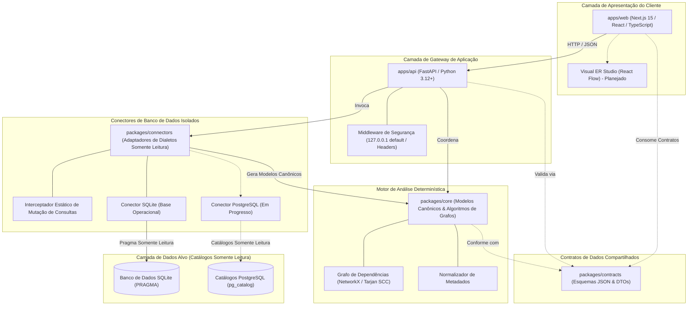

**Leia esta documentação em:** [English (Root)](../../README.md) | [Español](README.es.md) | [Français](README.fr.md) | [Deutsch](README.de.md) | [Português](README.pt.md) | [Italiano](README.it.md) | [日本語](README.ja.md) | [한국어](README.ko.md) | [简体中文](README.zh-CN.md) | [Русский](README.ru.md)

---

<div align="center">

# DERA

### Database Engineering & Reverse Analysis

**Compreenda cada esquema. Projete cada mudança.**

Uma plataforma independente e de código aberto para engenharia e engenharia reversa de bancos de dados, projetada para desenvolvedores, arquitetos de bancos de dados e equipes de engenharia.

Explore estruturas de bancos de dados, reconstrua relacionamentos entre entidades, avalie riscos estruturais e planeje alterações de esquema — de forma completamente determinística, sem modelos de inteligência artificial nem APIs externas de inferência.

<br/>

[](../../LICENSE)
[](https://github.com/krishanth7/dera/actions/workflows/ci.yml)
[](https://github.com/krishanth7/dera/actions/workflows/codeql.yml)
[](https://github.com/krishanth7/dera/actions/workflows/documentation.yml)
[](../../pyproject.toml)
[](../../tsconfig.json)
[-orange?style=for-the-badge)](#-arquitetura-estritamente-sem-ia)
[](../../CONTRIBUTING.md)

<br/>

[Visão Geral](#-visão-geral) ·
[Matriz de Funcionalidades](#-matriz-de-status-das-funcionalidades) ·
[Arquitetura](#-visão-geral-da-arquitetura) ·
[Estrutura Monorepo](#-estrutura-do-repositório) ·
[Primeiros Passos](#-primeiros-passos) ·
[Compatibilidade de Bancos de Dados](#-matriz-de-compatibilidade-de-bancos-de-dados) ·
[Segurança](#-princípios-de-segurança) ·
[Navegação de Documentação](#-navegação-da-documentação-para-desenvolvedores) ·
[Roteiro](#-roteiro-principal) ·
[Como Contribuir](#-como-contribuir) ·
[Comunidade](#-comunidade)

</div>

---

## 🌍 Suporte Multilíngue

O DERA mantém documentação sincronizada em 10 idiomas internacionais. O README em inglês atua como a fonte autoritativa de verdade de acordo com nosso [Contrato de Manutenção da Documentação](../development/README_MAINTENANCE.md).

| Idioma | Código | Link da Documentação | Status |
|---|---|---|---|
| 🇬🇧 English | `en` | [English Primary (Root)](../../README.md) · [Synchronized Copy](README.en.md) | **Fonte Autoritativa de Verdade** |
| 🇪🇸 Español | `es` | [Documentación en Español](README.es.md) | Tradução Completa |
| 🇫🇷 Français | `fr` | [Documentation en Français](README.fr.md) | Tradução Completa |
| 🇩🇪 Deutsch | `de` | [Dokumentation auf Deutsch](README.de.md) | Tradução Completa |
| 🇵🇹 Português | `pt` | [Documentação em Português](README.pt.md) | Tradução Completa |
| 🇮🇹 Italiano | `it` | [Documentazione in Italiano](README.it.md) | Tradução Completa |
| 🇯🇵 日本語 | `ja` | [日本語ドキュメント](README.ja.md) | Tradução Completa |
| 🇰🇷 한국어 | `ko` | [한국어 문서](README.ko.md) | Tradução Completa |
| 🇨🇳 简体中文 | `zh-CN` | [简体中文文档](README.zh-CN.md) | Tradução Completa |
| 🇷🇺 Русский | `ru` | [Документация на русском](README.ru.md) | Tradução Completa |

---

## 📖 Visão Geral

Bancos de dados relacionais modernos representam a espinha dorsal da infraestrutura de software. No entanto, compreender esquemas desconhecidos, legados ou em rápida evolução apresenta consideráveis desafios de engenharia:
- **Esquemas Complexos:** Bancos de dados corporativos costumam conter centenas de tabelas, milhares de colunas e relacionamentos de chave estrangeira não documentados.
- **Débito Arquitetural:** Dependências circulares de chave estrangeira, chaves primárias ausentes, chaves estrangeiras sem índices e índices redundantes acumulam-se silenciosamente ao longo do tempo.
- **Riscos de Migração:** Fazer alterações de esquema sem um grafo topológico completo gera riscos de travamento em cascata, perda de dados e violações de restrições de integridade.
- **Privacidade e Segurança:** Organizações não podem se dar ao luxo de expor credenciais de produção ou linhas de dados confidenciais a serviços externos de IA em nuvem.

**O DERA foi projetado para solucionar esses desafios por meio do determinismo matemático.**

O DERA oferece uma plataforma modular e de código aberto que inspeciona catálogos de bancos de dados relacionais, reconstrói grafos de dependência, avalia riscos estruturais e pré-visualiza migrações por meio de algoritmos verificáveis e reproduzíveis.

### Princípios Fundamentais de Engenharia

1. **Determinístico por Projeto:** Cada instantâneo de esquema, ordenação topológica e diagnóstico é reproduzível e fundamentado na álgebra relacional.
2. **Estritamente sem IA:** Zero IA generativa, zero grandes modelos de linguagem (LLMs), zero bancos de dados vetoriais e zero APIs externas de inferência.
3. **Segurança de Banco de Dados Somente Leitura:** Aplicação rígida de conexão em somente leitura, bloqueio estático de mutações SQL via AST e consultas exclusivas aos catálogos de metadados.
4. **Zero Extração de Dados de Linhas de Clientes:** Pura introspecção de metadatos (`information_schema`, `pg_catalog`, `sqlite_master`). Registros das tabelas de aplicação nunca são extraídos, transmitidos ou armazenados.
5. **Arquitetura Monorepo Desacoplada:** Fronteiras arquiteturais nítidas que isolam os algoritmos de grafos, os conectores de banco de dados, o gateway da API e o estúdio visual.
6. **Código Aberto e Permissivo:** Software independente distribuído sob a permissiva [Licença MIT](../../LICENSE).

---

## 🧠 Arquitetura Estritamente sem IA

O DERA é intencionalmente concebido sem componentes de inteligência artificial ou aprendizado de máquina.

```text
┌───────────────────────────────────────────────────────────┐
│            ARQUITETURA ESTRITAMENTE SEM IA                │
│                                                           │
│   ❌  Sem OpenAI, Anthropic Claude ou Google Gemini       │
│   ❌  Sem APIs Groq, DeepSeek ou modelos hospedados       │
│   ❌  Sem LLMs locais (Ollama, vLLM, llama.cpp)           │
│   ❌  Sem previsões estocásticas ou alucinações           │
│   ❌  Sem embeddings vetoriais na nuvem ou RAG externo    │
│                                                           │
│   ✅  Consultas nativas a catálogos (information_schema)  │
│   ✅  Algoritmos matemáticos de grafos (NetworkX/Tarjan)  │
│   ✅  Analisadores sintáticos AST SQL (SQLGlot)           │
│   ✅  Motores de regras estáticas reproduzíveis           │
│   ✅  Impressões digitais criptográficas hash (SHA-256)   │
└───────────────────────────────────────────────────────────┘
```

**Por que o DERA é Determinístico:**
- **Auditabilidade Matemática:** Cada relação, aviso de ciclo e diagnóstico cita evidências de catálogo concretas e algoritmos formais de grafos.
- **Reprodutibilidade Byte a Byte:** Executar uma auditoria sobre o mesmo instantâneo gera resultados idênticos em qualquer ambiente ou pipeline de CI.
- **Soberania dos Dados:** Os esquemas e topologias estruturais jamais deixam sua rede em direção a provedores de modelos terceirizados.
- **Zero Custo Operacional:** Sem custos por token, sem limites de taxa (rate limits) e sem latência de rede decorrente de inferência.

---

## 📊 Matriz de Status das Funcionalidades

O DERA mantém relatórios transparentes baseados no código real implementado no repositório e testado automaticamente:

| Funcionalidade | Status | Evidência de Implementação | Localização no Monorepo |
|---|:---:|---|---|
| **Modelos de Esquema Base** | **Implementado** | Modelos canônicos `Column`, `Table`, `ForeignKey`, `Index` | [`packages/core/src/dera/models.py`](../../packages/core/src/dera/models.py) |
| **Motor de Grafo de Dependências** | **Implementado** | DAG resistente a ciclos e ordenação topológica (Tarjan SCC) | [`packages/core/src/dera/graph.py`](../../packages/core/src/dera/graph.py) |
| **Interceptador de Mutação (Read-Only)** | **Implementado** | Análise estática AST bloqueando SQL destrutivo (`DROP`, `ALTER`, etc.) | [`packages/connectors/src/dera_connectors/base/`](../../packages/connectors/src/dera_connectors/base/connector.py) |
| **Introspecção de Catálogo SQLite** | **Implementado** | Descoberta de tabelas, colunas, PK, FK e índices | [`packages/connectors/src/dera_connectors/sqlite/`](../../packages/connectors/src/dera_connectors/sqlite/connector.py) |
| **Inspeção de Catálogo PostgreSQL** | **Em Progresso** | Testes de integração em contêiner efêmero de PostgreSQL | [`tests/integration/`](../../tests/integration/) |
| **Gateway da API e Telemetria** | **Implementado** | Serviço FastAPI com ligação a localhost e endpoints de integridade | [`apps/api/src/dera_api/main.py`](../../apps/api/src/dera_api/main.py) |
| **Base do Aplicativo Web Studio** | **Implementado** | Base Next.js 15 TypeScript e cartão de status arquitetural | [`apps/web/src/app/page.tsx`](../../apps/web/src/app/page.tsx) |
| **Contratos de Dados Compartilhados** | **Implementado** | Esquemas JSON versionados e DTOs de serialização | [`packages/contracts/schemas/`](../../packages/contracts/schemas/) |
| **Canvas Visual ER Studio** | Planejado | Canvas interativo baseado em React Flow | Roteiro Fase 7 |
| **Matriz de Regras Determinísticas** | Planejado | Detectores de PK ausente, FK sem índice e índices redundantes | Roteiro Fase 8 |
| **Motor Diff de Instantâneos** | Planejado | Comparação semântica de instantâneos e prévia DDL | Roteiro Fase 9 |
| **Analisador de Desempenho AST SQL** | Planejado | Complexidade de consultas SQLGlot e visualizador de planos | Roteiro Fase 10 |

> **Legenda de Status:**
> - **`Implementado`** &mdash; Desenvolvido, verificado e coberto por testes automatizados em CI.
> - **`Em Progresso`** &mdash; Em desenvolvimento ativo e testes de integração no ciclo atual.
> - **`Planejado`** &mdash; Programado no roteiro mestre de desenvolvimento de 12 fases.

---

## 🏗️ Visão Geral da Arquitetura

O DERA organiza suas capacidades em espaços de trabalho desacoplados de acordo com nossa [Especificação Arquitetural de Monorepo](../architecture/README_ARCHITECTURE.md):



### Detalhamento Textual da Arquitetura (Acessibilidade)
- **Camada de Apresentação do Cliente (`apps/web`):** Frontend Next.js 15 TypeScript que se comunica com a API via JSON e abrigará o canvas visual de diagramas ER.
- **Camada de Gateway de Aplicação (`apps/api`):** Backend FastAPI vinculado a `127.0.0.1` por padrão, contendo rotas de telemetria de saúde, extração de catálogo e middleware de segurança.
- **Contratos de Dados Compartilhados (`packages/contracts`):** Definições JSON Schema e interfaces TypeScript que determinam o formato canônico para tabelas, colunas, índices e relacionamentos.
- **Motor Central Determinístico (`packages/core`):** Biblioteca em Python puro que implementa modelos canônicos, componentes fortemente conexas de Tarjan, ordenação topológica e normalização.
- **Conectores de Banco de Dados Isolados (`packages/connectors`):** Adaptadores conectáveis que consultam catálogos de metadados (`sqlite_master`, `pg_catalog`). Interceptam e bloqueiam mutações SQL antes da execução.
- **Camada de Dados Alvo (Somente Leitura):** Os bancos de dados examinados. O DERA conecta-se exclusivamente com credenciais de somente leitura sem privilégios administrativos.

Para especificações técnicas complementares:
- [Guia Arquitetural e Blueprint](../architecture/README_ARCHITECTURE.md)
- [Fronteiras de Módulos e Regras de Dependência](../architecture/MODULE_BOUNDARIES.md)
- [Estrutura de Diretórios do Monorepo](../architecture/MONOREPO_STRUCTURE.md)
- [Registro de Decisões de Arquitetura (ADR 0001)](../architecture/adr/0001-monorepo-architecture.md)

---

## 📁 Estrutura do Repositório

O layout real do monorepo DERA está estruturado da seguinte forma:

```text
dera/
├── apps/
│   ├── api/                      # Backend FastAPI e endpoints de integridade
│   │   ├── src/dera_api/         # Rotas do gateway, middleware e esquemas
│   │   └── pyproject.toml        # Especificação de empacotamento da API
│   └── web/                      # Frontend studio Next.js 15 TypeScript
│       ├── src/                  # App router, componentes e cliente da API
│       └── package.json          # Configuração do workspace web
├── packages/
│   ├── core/                     # Modelos canônicos e motor de processamento de grafos
│   │   └── src/dera_core/        # Modelos de esquema, algoritmos DAG e teoria de grafos
│   ├── connectors/               # Adaptadores de extração de metadados
│   │   └── src/dera_connectors/  # Conector base, guardas de mutação e SQLite
│   └── contracts/                # Contratos e esquemas JSON compartilhados
│       └── schemas/              # Contratos versionados para API e instantâneos
├── tests/
│   ├── architecture/             # Testes de limites de importação AST
│   ├── integration/              # Testes de integração em catálogos SQLite e PostgreSQL
│   ├── regression/               # Testes de regressão determinística em DAGs e hashes
│   └── unit/                     # Testes unitários de modelos, títulos e readiness
├── scripts/
│   ├── ci/                       # Scripts de validação CI (docs, i18n, PR readiness)
│   └── development/              # Runner CLI unificado multiplataforma (dev.py)
├── docs/
│   ├── audit/                    # Auditorias de repositório, baselines e conformidades
│   ├── architecture/             # Blueprint do monorepo, fronteiras e ADRs
│   ├── development/              # Guias de onboarding, comandos e fluxos Git
│   ├── governance/               # Governança, mantenedores, decisões GAD e licenças
│   ├── security/                 # Modelo de ameaças, segurança de BD e vulnerabilidades
│   ├── community/                # Hub da comunidade, guias e triagem de issues
│   ├── roadmap/                  # Roteiro mestre de desenvolvimento de 12 fases
│   └── i18n/                     # Documentação técnica sincronizada em 10 idiomas
├── .github/
│   ├── workflows/                # CI/CD corporativo, CodeQL e gates automáticos
│   ├── ISSUE_TEMPLATE/           # Modelos YAML estruturados para bugs e melhorias
│   ├── PULL_REQUEST_TEMPLATE/    # Modelos de pull request especializados
│   ├── CODEOWNERS                # Definição dos proprietários do código
│   └── PULL_REQUEST_TEMPLATE.md  # Modelo padrão de qualificação de PR
├── pyproject.toml                # Configuração raiz Python do workspace (PEP 621)
├── package.json                  # Configuração raiz npm do workspace
├── tsconfig.json                 # Configuração TypeScript estrita
├── Makefile                      # Automação padrão de comandos de desenvolvimento
├── CONTRIBUTING.md               # Guia exaustivo para contribuidores
├── SECURITY.md                   # Política de divulgação coordenada de vulnerabilidades
└── LICENSE                       # Licença MIT
```

---

## 🚀 Primeiros Passos

O DERA fornece uma ferramenta CLI multiplataforma (`scripts/development/dev.py`) para verificar, testar e executar o monorepo no Windows, Linux e macOS sem atritos.

### Pré-requisitos

| Ferramenta | Versão Mínima | Versão Recomendada | Comando de Verificação |
|---|---|---|---|
| **Python** | `3.12+` | `3.12` ou `3.13` | `python --version` |
| **Node.js** | `20.x LTS` | `20.x` ou `22.x LTS` | `node --version` |
| **Git** | `2.30+` | Mais recente | `git --version` |

### 1. Clonar o Repositório

```bash
git clone https://github.com/krishanth7/dera.git
cd dera
```

### 2. Configurar o Ambiente

Copie o modelo de ambiente seguro:

```bash
# Windows PowerShell
Copy-Item .env.example .env

# Linux / macOS
cp .env.example .env
```

### 3. Configurar o Ambiente Virtual Python

```bash
# Linux / macOS
python3 -m venv .venv
source .venv/bin/activate
pip install -e ".[dev]"

# Windows PowerShell
python -m venv .venv
.venv\Scripts\Activate.ps1
pip install -e ".[dev]"
```

### 4. Instalar Dependências do Node.js

```bash
npm install
```

### 5. Executar a Suite Completa de Validação

Verifique se todos os pacotes Python, compiladores TypeScript, testes e links de documentação são válidos:

```bash
python scripts/development/dev.py all
```

**Resultado Esperado:**
```text
Ran 32 tests in 0.25s
OK (skipped=2)
Validating 69 markdown documentation files...
SUCCESS: All 69 markdown documentation files are valid.
Validating 10 multilingual documentation files in i18n...
SUCCESS: All 10 language documentation files verified with valid navigation and parity.
[SUCCESS]: All development baseline checks passed successfully.
```

### 6. Comandos Essenciais para Desenvolvedores

| Tarefa | CLI Multiplataforma (`dev.py`) | GNU Make (UNIX / macOS) |
|---|---|---|
| **Executar todos os testes** | `python scripts/development/dev.py test` | `make test` |
| **Verificar tipos TypeScript** | `python scripts/development/dev.py typecheck` | `make typecheck` |
| **Compilar bytecode Python** | `python scripts/development/dev.py compile` | `make build` |
| **Validar documentação** | `python scripts/development/dev.py validate-docs` | `make lint` |
| **Validar título de PR / commit** | `python scripts/development/dev.py validate-title "<título>"` | `make validate-title TITLE="..."` |
| **Iniciar servidor API local** | `python -m uvicorn dera_api.main:app --reload --port 8000` | `make dev-api` |
| **Iniciar frontend web studio** | `npm run dev --workspace=apps/web` | `npm run dev --workspace=apps/web` |

Para instruções detalhadas de integração, consulte o [Guia de Primeiros Passos](../development/GETTING_STARTED.md) e o [Catálogo de Comandos](../development/COMMANDS.md).

---

## 🗄️ Matriz de Compatibilidade de Bancos de Dados

O DERA implementa uma arquitetura modular de conectores isolados. Os níveis de suporte refletem código executável e cobertura de testes:

| Motor de Banco de Dados | Versões Suportadas | Status do Conector | Mecanismo de Introspecção | Salvaguarda Somente Leitura |
|---|:---:|:---:|---|---|
| **SQLite** | 3.35+ | **Implementado** | `sqlite_master`, `PRAGMA table_info`, `PRAGMA foreign_key_list` | Bloqueador AST estático e `PRAGMA query_only = ON` |
| **PostgreSQL** | 12 – 17 | **Em Progresso** | `pg_catalog`, `information_schema` | `SET default_transaction_read_only = ON` e papéis somente leitura |
| **Supabase PostgreSQL** | Cloud / Local | **Em Progresso** | Extração nativa de catálogos PostgreSQL | Sessão somente leitura na conexão e papéis sem privilégios |
| **MySQL** | 8.0+ | Planejado | `information_schema`, `performance_schema` | Modo de transação em sessão somente leitura |
| **MariaDB** | 10.5+ | Planejado | `information_schema` | Modo de transação em sessão somente leitura |
| **Microsoft SQL Server** | 2019+ | Planejado | `sys.tables`, `INFORMATION_SCHEMA` | Permissões de usuário de somente leitura |

> [!NOTE]
> Conectores marcados como **`Em Progresso`** são validados continuamente contra contêineres efêmeros em CI. Conectores marcados como **`Planejado`** estão programados para a Fase 5.

---

## 🔒 Princípios de Segurança

A segurança é o pilar de engenharia primordial do DERA. Ao interagir com infraestruturas de bancos de dados, a plataforma aplica defesas em profundidade:

1. **Interceptador Estático de Mutação:** Antes de executar qualquer SQL no banco alvo, ele passa por um validador sintático AST. Comandos contendo `DROP`, `ALTER`, `TRUNCATE`, `INSERT`, `UPDATE`, `DELETE`, `GRANT` ou `REVOKE` são rejeitados de imediato.
2. **Extração Exclusiva de Catálogos:** A inspeção limita-se a metadados do sistema (`information_schema`, `pg_catalog`, `sqlite_master`). Registros das tabelas de negócio jamais são consultados.
3. **Endereço Loopback Padrão:** Servidores de desenvolvimento e endpoints vinculam-se a `127.0.0.1` para evitar exposição acidental em redes externas.
4. **Contas de Banco de Dados com Menor Privilégio:** O DERA opera unicamente por meio de papéis de somente leitura sem privilégios administrativos.
5. **Zero Segredos Versionados:** Credenciais jamais são escritas em disco, comitadas em repositórios ou registradas em logs.
6. **Divulgação Responsável:** Vulnerabilidades de segurança são tratadas confidencialmente via nossa [Política de Segurança](../../SECURITY.md).

> [!NOTE]
> O DERA adota as melhores práticas abertas de segurança de software (CodeQL, Bandit SAST, detecção de segredos). Não reivindica certificações comerciais de terceiros (como SOC 2 ou ISO 27001).

Documentos especializados de segurança:
- [**Política de Segurança em Bancos de Dados**](../security/DATABASE_SECURITY.md) — Inspeção de catálogos e isolamento de sessões.
- [**Padrões de Desenvolvimento Seguro**](../security/SECURE_DEVELOPMENT.md) — Validação de entradas e gates DevSecOps.
- [**Processo de Resposta a Vulnerabilidades**](../security/VULNERABILITY_RESPONSE.md) — Workflow de triagem em 5 fases e advisories privadas.
- [**Matriz do Modelo de Ameaças**](../security/model.md) — Análise de vetores de ataque e mitigações.

---

## 📚 Navegação da Documentação para Desenvolvedores

Explore a suíte completa de documentação do DERA:

| Domínio | Guias Fundamentais |
|---|---|
| **Arquitetura** | [Blueprint do Monorepo](../architecture/README_ARCHITECTURE.md) · [Fronteiras de Módulos](../architecture/MODULE_BOUNDARIES.md) · [Estrutura do Monorepo](../architecture/MONOREPO_STRUCTURE.md) · [ADRs](../architecture/adr/0001-monorepo-architecture.md) |
| **Desenvolvimento** | [Primeiros Passos](../development/GETTING_STARTED.md) · [Catálogo de Comandos](../development/COMMANDS.md) · [Configuração do Ambiente](../development/ENVIRONMENT.md) · [Solução de Problemas](../development/TROUBLESHOOTING.md) |
| **Ciclo de Vida Documental** | [Contrato de Manutenção](../development/README_MAINTENANCE.md) · [Diretrizes Técnicas](../development/README_GUIDELINES.md) |
| **Governança e Tutela** | [Política de Mantenedores](../governance/MAINTAINERS.md) · [Decisões de Governança](../governance/GOVERNANCE_DECISIONS.md) · [Licenças de Terceiros](../governance/THIRD_PARTY_LICENSES.md) |
| **Segurança** | [Política de Segurança](../../SECURITY.md) · [Segurança em Bancos de Dados](../security/DATABASE_SECURITY.md) · [Desenvolvimento Seguro](../security/SECURE_DEVELOPMENT.md) · [Resposta a Vulnerabilidades](../security/VULNERABILITY_RESPONSE.md) |
| **Comunidade e Triagem** | [Guia de Contribuição](../../CONTRIBUTING.md) · [Guia de Discussões](https://github.com/krishanth7/dera/discussions) · [Triagem de Issues](https://github.com/krishanth7/dera/issues) · [Código de Conduta](../../CODE_OF_CONDUCT.md) |
| **Auditorias e Verificação** | [Índice de Auditorias](../audit/README.md) · [Auditoria README Fase 2.1](../audit/PHASE_2_1_README_AUDIT.md) · [Linha de Base do Repositório](../audit/BASELINE.md) |
| **Roteiro** | [Roteiro Mestre de 12 Fases](../roadmap/README.md) |

---

## 🗺️ Roteiro Principal

O DERA executa um **Roteiro Estruturado em 12 Fases** para construir uma plataforma completa de engenharia reversa de bancos de dados:

- [x] **Fase 1: Fundação do Repositório e Governança**
  - [x] Fase 1.1: Auditoria completa do repositório e linha de base
  - [x] Fase 1.2: Arquitetura corporativa em monorepo (`apps/`, `packages/`)
  - [x] Fase 1.3: Estratégia de ramificações Git, Conventional Commits e gates de PR
  - [x] Fase 1.4: README profissional, identidade de marca e diagramas
  - [x] Fase 1.5: Política de segurança, reporte de vulnerabilidade e governança
  - [x] Fase 1.6: Modelos de issues estruturados, governança de discussões e comunidade (PR #20)
- [ ] **Fase 2: Documentação Multilíngue e Experiência do Desenvolvedor**
  - [x] Fase 2.1: README autoritativo em inglês e base documental (PR #21)
  - [x] Fase 2.2: Documentação internacional sincronizada em 9 idiomas (Em Progresso)
- [x] **Fase 3: GitHub Actions, Automação CI/CD e DevSecOps**
- [ ] **Fase 4: Backend e Infraestrutura de Plataforma**
- [ ] **Fase 5: Conectores de Bancos de Dados e Inspeção de Metadados**
- [ ] **Fase 6: Motor Central de Engenharia Reversa**
- [ ] **Fase 7: Frontend e Estúdio Visual de Engenharia**
- [ ] **Fase 8: Diagnóstico e Inteligência de Esquema**
- [ ] **Fase 9: Comparação de Esquemas e Engenharia de Migração**
- [ ] **Fase 10: Análise de SQL e Ferramentas de Engenharia**
- [ ] **Fase 11: Segurança Corporativa, Confiabilidade e QA em Larga Escala**
- [ ] **Fase 12: Lançamento, Implantação e Crescimento Open Source**

Para obter detalhes sobre marcos e entregas, consulte o [Roteiro de Desenvolvimento](../roadmap/README.md).

---

## 🤝 Como Contribuir

Acolhemos com entusiasmo contribuições de engenheiros de software, administradores de bancos de dados, pesquisadores de segurança e escritores técnicos em todo o mundo!

### Recursos para Contribuidores

- **[Guia de Contribuição](../../CONTRIBUTING.md):** Instruções e padrões detalhados de colaboração.
- **[Fluxo de Trabalho de Contribuição](../development/CONTRIBUTION_WORKFLOW.md):** Orientações técnicas para desenvolvimento, testes e qualificação de PRs.
- **[Estratégia de Ramificações](../development/BRANCHING_STRATEGY.md):** Desenvolvimento trunk-based e padrões de nomenclatura (`feat/...`, `fix/...`).
- **[Convenções de Commit](../development/COMMIT_CONVENTIONS.md):** Especificação Conventional Commits 1.0.0 e mapeamento SemVer.
- **[Política de Revisão de Código](../development/CODE_REVIEW_POLICY.md):** Critérios de revisão por pares e aprovação de code owners.
- **[Código de Conduta](../../CODE_OF_CONDUCT.md):** Padrões comunitários e aplicação prática.

---

## 💬 Comunidade

- [Discussões no GitHub](https://github.com/krishanth7/dera/discussions) — Tire dúvidas, compartilhe ideias e debata sobre engenharia reversa de bancos de dados.
- [Issues no GitHub](https://github.com/krishanth7/dera/issues) — Notifique erros ou proponha melhorias.
- [Pull Requests no GitHub](https://github.com/krishanth7/dera/pulls) — Envie contribuições de código, testes ou documentação.
- [Avisos Privados de Segurança](https://github.com/krishanth7/dera/security/advisories/new) — Relate vulnerabilidades de forma sigilosa.
- [Decisões de Governança](../governance/GOVERNANCE_DECISIONS.md) — Registros das decisões de arquitetura e comunidade.

---

## 📜 Licença

O DERA é distribuído sob a permissiva **[Licença MIT](../../LICENSE)**.

```text
Copyright (c) 2026 Krishanth
```

---

## 👨‍💻 Mantenedor

**Krishanth**  
Fundador e Mantenedor Líder

- GitHub: [@krishanth7](https://github.com/krishanth7)  
- Repositório: [github.com/krishanth7/dera](https://github.com/krishanth7/dera)  
- Contato: `krishanth.b.2008@gmail.com`

*O DERA é um projeto de código aberto independente mantido por Krishanth. A OVIC Labs é reconhecida como parte do ecossistema de engenharia ampliado do mantenedor.*

---

<div align="center">

### DERA — Database Engineering & Reverse Analysis

**Compreenda cada esquema. Projete cada mudança.**

*Construído com determinismo matemático, precisão de engenharia e transparência open source.*

© 2026 Contribuidores do DERA. Distribuído sob a Licença MIT.

[Voltar ao início](#dera)

</div>
