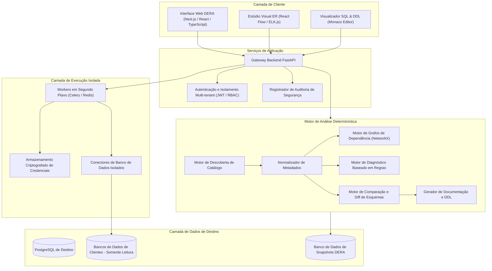
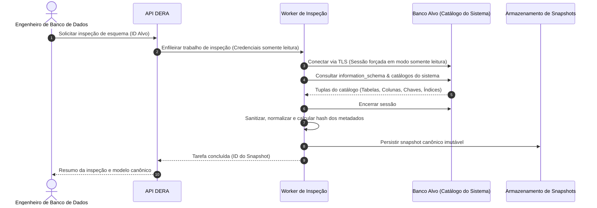
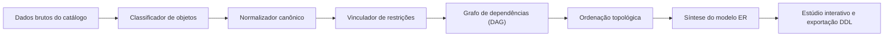
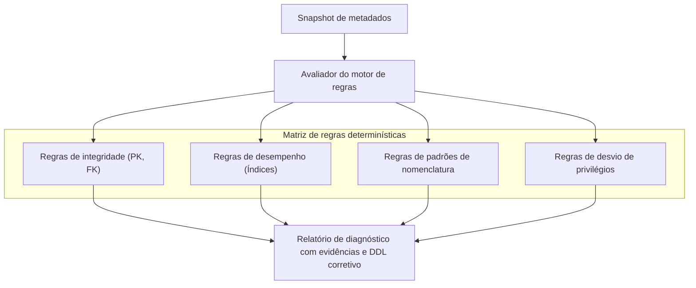
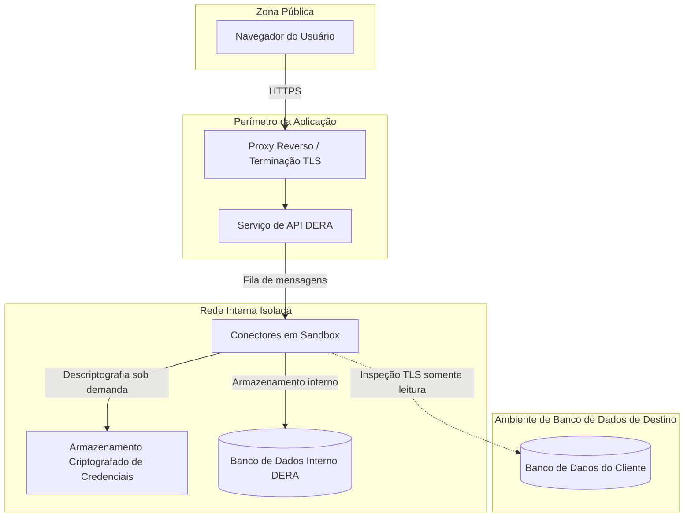
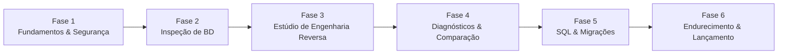

**Leia esta documentação em:** [English](../../README.md) | [Español](README.es.md) | [Français](README.fr.md) | [Deutsch](README.de.md) | [Português](README.pt.md) | [日本語](README.ja.md) | [한국어](README.ko.md) | [简体中文](README.zh-CN.md) | [العربية](README.ar.md) | [Русский](README.ru.md)

---

<div align="center">

# DERA

### Database Engineering & Reverse Analysis

**Compreenda Cada Esquema. Projete Cada Mudança.**

Uma plataforma determinística e de código aberto de engenharia reversa de bancos de dados para desenvolvedores, engenheiros de dados, arquitetos e equipes de engenharia.

Explore estruturas de banco de dados, visualize relacionamentos, analise esquemas, identifique riscos estruturais e gere documentação técnica — totalmente determinística, sem modelos de IA ou APIs externas de inferência de IA.

<br/>

[](https://github.com/krishanth7/dera/stargazers)
[](https://github.com/krishanth7/dera/forks)
[](https://github.com/krishanth7/dera/issues)
[](https://github.com/krishanth7/dera/blob/main/LICENSE)
[](https://github.com/krishanth7/dera/releases)
[](https://github.com/krishanth7/dera/actions/workflows/codeql.yml)
[](https://github.com/krishanth7/dera/graphs/contributors)
[](https://github.com/sponsors/krishanth7)

<br/>

[Visão geral](#-visão-geral) ·
[Recursos](#-recursos) ·
[Arquitetura](#-arquitetura) ·
[Pipelines visuais](#-pipelines-visuais) ·
[Segurança](#-princípios-de-segurança) ·
[Stack tecnológico](#-stack-tecnológico) ·
[Roteiro](#-roteiro-de-desenvolvimento) ·
[Contribuição](#-como-contribuir) ·
[Comunidade](#-comunidade)

</div>

---

## 🌍 Suporte a idiomas

O DERA oferece documentação abrangente em 10 idiomas internacionais. Utilize a tabela abaixo ou a barra de navegação superior para acessar a documentação localizada:

| Idioma | Código | Link para a documentação | Status |
|---|---|---|---|
| 🇬🇧 English | `en` | [English Primary (Root)](../../README.md) · [Synchronized Copy](README.en.md) | Referência principal |
| 🇪🇸 Español | `es` | [Documentación en Español](README.es.md) | Tradução completa |
| 🇫🇷 Français | `fr` | [Documentation en Français](README.fr.md) | Tradução completa |
| 🇩🇪 Deutsch | `de` | [Dokumentation auf Deutsch](README.de.md) | Tradução completa |
| 🇵🇹 Português | `pt` | [Documentação em Português](README.pt.md) | Tradução completa |
| 🇯🇵 日本語 | `ja` | [日本語ドキュメント](README.ja.md) | Tradução completa |
| 🇰🇷 한국어 | `ko` | [한국어 문서](README.ko.md) | Tradução completa |
| 🇨🇳 简体中文 | `zh-CN` | [简体中文文档](README.zh-CN.md) | Tradução completa |
| 🇸🇦 العربية | `ar` | [الوثائق باللغة العربية](README.ar.md) | Tradução completa |
| 🇷🇺 Русский | `ru` | [Документация на русском](README.ru.md) | Tradução completa |

---

## 📖 Visão geral

Bancos de dados relacionais modernos representam a espinha dorsal da infraestrutura de software, mas compreender esquemas complexos e em constante evolução pode ser um grande desafio. Sistemas corporativos frequentemente englobam centenas de tabelas, milhares de colunas, relacionamentos intrincados de chaves estrangeiras, índices, restrições, views e dependências cruzadas entre objetos.

Compreender e auditar essas estruturas manualmente consome tempo valioso e está suscetível a erros humanos.

**O DERA foi projetado para solucionar esse desafio com precisão.**

O DERA oferece um ambiente de trabalho seguro e unificado para explorar a arquitetura de bancos de dados, reconstruir relacionamentos entre entidades, avaliar riscos de modelagem e gerar documentação de engenharia através de algoritmos determinísticos.

### Nossa missão

Tornar a engenharia reversa de bancos de dados acessível, transparente, reproduzível e confiável para desenvolvedores, administradores de banco de dados e arquitetos de software.

### Nossa filosofia

- **Determinístico por projeto** — Análises reproduzíveis fundamentadas em teoria dos grafos e regras estáticas.
- **Estritamente sem IA generativa** — Sem LLMs, sem modelos de aprendizado de máquina e sem APIs externas de inferência de IA.
- **Privacidade em primeiro lugar** — Análise pura de metadados estruturais. Nenhum registro ou dado de linha de clientes é extraído por padrão.
- **Código aberto** — Engenharia transparente e colaborativa sob a permissiva licença MIT.
- **Focado no desenvolvedor** — Fluxos de trabalho construídos sob medida para engenheiros de software e DBAs.
- **Segurança prioritária** — Conexões forçadas em modo somente leitura, credenciais criptografadas e execução isolada.
- **Rigor técnico** — Diagnósticos baseados em evidências concretas em vez de explicações alucinadas.

---

## ✨ Recursos

A seguir, descrevemos as capacidades planejadas para a plataforma DERA. A disponibilidade corresponde a cada fase de desenvolvimento e versão publicada.

| Área de recursos | Status | Descrição |
|---|---|---|
| **Descoberta de bancos de dados** | Planejado | Extração nativa de metadados de tabelas, colunas, restrições e índices |
| **Núcleo de engenharia reversa** | Planejado | Modelagem canônica de esquemas, classificação de objetos e resolução de dependências |
| **Estúdio visual ER** | Planejado | Diagramas entidade-relacionamento interativos, layout automático, filtros e exportações |
| **Diagnósticos determinísticos** | Planejado | Avaliação de regras estáticas identificando chaves ausentes, índices redundantes e falhas |
| **Snapshots e comparador de esquemas** | Planejado | Snapshots versionados de esquemas e análise de impacto de mudanças estruturais |
| **Engenharia de desempenho SQL** | Planejado | Inspeção de consultas, visualização de planos de execução e recomendações de índices |
| **Gerador de documentação** | Planejado | Exportações automatizadas para Markdown, HTML, JSON, DDL SQL e esquemas vetoriais SVG |
| **Arquitetura de segurança** | Planejado | Controle de acesso baseado em funções, garantias de somente leitura e workers isolados |

### 🔍 Descoberta de bancos de dados

Inspecione motores de banco de dados compatíveis e extraia informações de catálogo:

- Bancos de dados, esquemas e extensões
- Tabelas, partições e views
- Colunas, tipos de dados, nulabilidade e valores padrão
- Chaves primárias, chaves estrangeiras e ações referenciais (`CASCADE`, `RESTRICT`)
- Restrições de unicidade, restrições check e restrições de exclusão
- Índices (B-tree, Hash, GIN, GiST), índices únicos e predicados de índices parciais
- Sequências, colunas de identidade e gatilhos (triggers)

### 🧬 Núcleo de engenharia reversa

Reconstrua modelos relacionais através de consultas nativas ao catálogo e algoritmos determinísticos:

- Representação canônica de esquema agnóstica de motor
- Normalização de metadados estruturais
- Construção de grafos acíclicos dirigidos (DAG) de dependências
- Mapeamento de relacionamentos de chaves estrangeiras simples e compostas
- Geração de snapshots imutáveis com assinatura criptográfica
- Reconstrução determinística de instruções SQL DDL

### 🕸️ Estúdio visual ER

Explore a topologia do esquema através de uma interface interativa entidade-relacionamento:

- Nós de tabela interativos exibindo colunas, tipos e restrições
- Conectores visuais de relacionamento com indicadores precisos de cardinalidade
- Algoritmos determinísticos de layout automático (hierárquicos e orientados a forças)
- Agrupamento por esquemas, etiquetas e subgrafos por domínio
- Busca interativa, filtragem por tipo e rastreamento de caminhos de dependência
- Exportação em alta resolução para formatos vetoriais SVG e imagens PNG

### 🛡️ Diagnósticos determinísticos de bancos de dados

Analise os metadados do esquema em relação a regras de engenharia configuráveis para detectar riscos de modelagem:

| Regra de diagnóstico | Categoria | Descrição |
|---|---|---|
| **Chave primária ausente** | Integridade | Identifica tabelas que não possuem chave primária declarada |
| **Índice potencialmente redundante** | Desempenho | Detecta prefixos de colunas sobrepostos ou índices duplicados |
| **Chave estrangeira sem índice** | Desempenho | Sinaliza colunas de chave estrangeira desprovidas de índice de suporte |
| **Antipadrões polimórficos** | Integridade | Identifica relacionamentos soltos sem restrições de integridade referencial |
| **Anomalias de nulabilidade e valores padrão** | Consistência | Alerta sobre colunas não-nulas sem definições padrão coerentes |
| **Auditoria de padrões de nomenclatura** | Padronização | Detecta inconsistências de caixa e desvios de diretrizes arquiteturais |
| **Desvios de privilégios** | Segurança | Destaca concessões excessivas de privilégios em objetos do catálogo |

*Os diagnósticos são recomendações fundamentadas em evidências emparelhadas com justificativas detalhadas e DDL de remediação.*

### 🔄 Comparador de esquemas e motor de diferenças

Compare snapshots de bancos de dados entre ambientes (desenvolvimento, homologação, produção) ou revisões de migração:

- Tabelas e colunas adicionadas, alteradas ou removidas
- Modificações de tipos de dados, tamanhos e nulabilidade
- Adições, remoções e alterações em definições de índices
- Modificações de restrições e mudanças em integridade referencial
- Classificação de mudanças incompatíveis (seguras vs. potencialmente destrutivas)
- Pré-visualização ordenada de scripts de migração com ordenação topológica

---

## 🧠 Zero IA. Pura engenharia.

O DERA é intencionalmente projetado sem inteligência artificial ou modelos de machine learning.

```text
┌───────────────────────────────────────────────────────────┐
│               ARQUITETURA ESTRITA SEM IA                  │
│                                                           │
│   ❌  Sem OpenAI, Anthropic Claude ou Google Gemini       │
│   ❌  Sem Groq, DeepSeek ou APIs de modelos hospedados    │
│   ❌  Sem LLMs locais (Ollama, vLLM, llama.cpp)           │
│   ❌  Sem alucinações não-determinísticas                 │
│                                                           │
│   ✅  Consultas nativas ao catálogo (information_schema)  │
│   ✅  Algoritmos matemáticos de grafos (NetworkX)         │
│   ✅  Analisadores sintáticos AST de SQL (SQLGlot)        │
│   ✅  Motores de regras estáticas reproduzíveis           │
│   ✅  Algoritmos matemáticos de diff de esquemas          │
└───────────────────────────────────────────────────────────┘
```

**Por que o DERA é determinístico:**
1. **Previsibilidade:** O mesmo snapshot de esquema e a mesma configuração de regras sempre produzirão diagnósticos idênticos.
2. **Auditabilidade:** Cada aviso, relacionamento e aresta do grafo baseia-se diretamente em dados concretos do catálogo.
3. **Soberania dos dados:** Os esquemas da sua empresa e seus metadados estruturais nunca saem da sua rede em direção a provedores terceiros de modelos de inferência.
4. **Desempenho e custo:** Zero latência de inferência, zero custo de tokens, zero limitação de taxa de requisições e total independência de serviços externos.

---

## 🏗️ Arquitetura

O DERA segue uma arquitetura modular concebida para oferecer manutenibilidade, extensibilidade e acesso seguro a bancos de dados.



---

## 🔬 Pipelines visuais

O DERA executa fluxos determinísticos e auditáveis para inspeção de metadados, síntese de relacionamentos e validação de segurança.

### 1. Fluxo de inspeção de banco de dados



### 2. Pipeline de engenharia reversa de esquemas



### 3. Pipeline de processamento de metadados e diagnósticos



### 4. Limites de segurança e isolamento



### 5. Ciclo de vida de desenvolvimento planejado



---

## 🔒 Princípios de segurança

Como o DERA se conecta a bancos de dados de missão crítica, a segurança representa o pilar fundamental de nossa arquitetura.

- **Modo somente leitura garantido:** As sessões de conexão forçam transações estritamente em modo somente leitura (`SET SESSION CHARACTERISTICS AS TRANSACTION READ ONLY`).
- **Nenhuma extração de dados de clientes:** As operações inspecionam exclusivamente os catálogos do sistema (`information_schema`, `pg_catalog`). Nenhum registro de aplicação é consultado ou armazenado.
- **Nenhum segredo em código:** As credenciais são criptografadas em repouso com AES-256-GCM e nunca são registradas em logs, exportadas ou versionadas.
- **Prevenção contra SSRF:** Os endereços e hosts de conexão são estritamente validados para evitar varreduras de rede interna ou acesso a metadados de serviços em nuvem.
- **Contas de banco de dados com privilégios mínimos:** Orientações detalhadas para provisionamento de papéis de auditoria somente leitura sem privilégios administrativos.
- **Rastreabilidade total:** Toda inspeção, exportação e modificação de configuração gera um registro de auditoria imutável.

*Para consultar os procedimentos completos de reporte e divulgação de vulnerabilidades, consulte [SECURITY.md](../../SECURITY.md).*

---

## 🛠️ Stack tecnológico

| Camada | Componente | Escolha tecnológica | Finalidade | Status |
|---|---|---|---|---|
| **Frontend** | Framework | Next.js, React, TypeScript | Aplicação web interativa | Planejado |
| | Estilos | Tailwind CSS | Sistema de design consistente e responsivo | Planejado |
| | Componentes UI | shadcn/ui | Componentes visuais acessíveis | Planejado |
| | Visualização ER | React Flow, ELK.js | Renderização de grafos e layout automático | Planejado |
| | Editor de código | Monaco Editor | Destaque sintático SQL e visualização DDL | Planejado |
| **Backend** | Framework API | Python 3.12+, FastAPI | Serviços de API assíncronos de alto desempenho | Planejado |
| | Inspeção de catálogo | SQLAlchemy, psycopg | Extração de metadados e gerenciamento de conexões | Planejado |
| | Analisador SQL | SQLGlot | Geração de AST de SQL agnóstico de banco | Planejado |
| | Processamento de grafos | NetworkX | Resolução de dependências e ordenação topológica | Planejado |
| | Fila de tarefas | Celery, Redis | Workers de inspeção assíncronos e isolados | Planejado |
| **Armazenamento** | Banco de dados DERA | PostgreSQL | Armazenamento de snapshots, sessões e logs de auditoria | Planejado |
| | Migrações | Alembic | Controle de versões do banco de dados DERA | Planejado |
| **DevOps e QA** | Contêineres | Docker, Docker Compose | Ambiente de desenvolvimento reproduzível e implantação | Planejado |
| | SAST e Segurança | CodeQL, Dependabot | Varredura estática de vulnerabilidades e dependências | Implementado |
| | Testes | Pytest, Playwright | Testes unitários no backend e testes E2E no frontend | Planejado |

---

## 🗄️ Compatibilidade de bancos de dados

O DERA foi projetado com uma arquitetura de conectores modulares para suportar bancos relacionais e distribuídos modernos:

| Motor de banco de dados | Status do conector | Fonte de catálogo | Cronograma alvo |
|---|---|---|---|
| **PostgreSQL** (v12 - v17) | Em desenvolvimento | `pg_catalog`, `information_schema` | Fase 2 (MVP) |
| **Supabase PostgreSQL** | Em desenvolvimento | Conector nativo de PostgreSQL | Fase 2 (MVP) |
| **MySQL** (v8.0+) | Planejado | `information_schema`, `performance_schema` | Fase 5 |
| **SQLite** (v3.35+) | Planejado | `sqlite_master`, comandos `PRAGMA` | Fase 5 |
| **MariaDB** (v10.5+) | Planejado | `information_schema` | Fase 5 |
| **Microsoft SQL Server** | Planejado | `sys.tables`, `INFORMATION_SCHEMA` | Fase 5 |
| **Oracle Database** | Em avaliação | Visualizações do dicionário de dados (`ALL_*`, `DBA_*`) | Avaliação futura |

---

## 🚀 Primeiros passos

O DERA encontra-se em fase de desenvolvimento arquitetural e estrutural. As instruções de implantação em produção serão publicadas conforme os marcos de lançamento forem atingidos.

### Pré-requisitos (Planejados)

- Python 3.12 ou mais recente
- Node.js LTS (v20+)
- PostgreSQL 15+
- Docker e Docker Compose
- Git

### Clonando o repositório

```bash
git clone https://github.com/krishanth7/dera.git
cd dera
```

### Ambiente de desenvolvimento local (Planejado)

```bash
# Preparar variáveis de ambiente
cp .env.example .env

# Iniciar o ambiente via Docker Compose
docker compose -f infrastructure/docker/docker-compose.dev.yml up --build
```

> **Nota:** A base de código está em desenvolvimento ativo. Acompanhe o progresso no [Roteiro de desenvolvimento](#-roteiro-de-desenvolvimento).

---

## 📁 Estrutura do repositório

```text
dera/
├── .github/
│   ├── ISSUE_TEMPLATE/           # Modelos estruturados de issues do GitHub
│   ├── workflows/                # Workflows do CodeQL, revisão de dependências e CI
│   ├── PULL_REQUEST_TEMPLATE.md  # Modelo padronizado de pull request
│   ├── dependabot.yml            # Configurações de atualização automática do Dependabot
│   └── FUNDING.yml               # Configuração de patrocínio do mantenedor
├── docs/
│   ├── README.md                 # Índice completo da documentação
│   ├── i18n/                     # Documentação multilíngue sincronizada
│   │   ├── README.en.md          # Cópia de referência sincronizada em inglês
│   │   ├── README.es.md          # Documentação em espanhol
│   │   ├── README.fr.md          # Documentação em francês
│   │   ├── README.de.md          # Documentação em alemão
│   │   ├── README.pt.md          # Documentação em português
│   │   ├── README.ja.md          # Documentação em japonês
│   │   ├── README.ko.md          # Documentação em coreano
│   │   ├── README.zh-CN.md       # Documentação em chinês simplificado
│   │   ├── README.ar.md          # Documentação em árabe (compatível com RTL)
│   │   └── README.ru.md          # Documentação em russo
│   ├── architecture/             # Especificações de arquitetura
│   ├── development/              # Guias de configuração e padrões de engenharia
│   ├── security/                 # Modelos de ameaças e práticas de segurança
│   └── contributing/             # Guias para colaboradores
├── CODE_OF_CONDUCT.md            # Código de Conduta Contributor Covenant
├── CONTRIBUTING.md               # Diretrizes detalhadas para contribuição
├── LICENSE                       # Licença MIT
├── README.md                     # Página principal do repositório
├── SECURITY.md                   # Política abrangente de segurança
└── .gitignore                    # Regras de exclusão do Git
```

---

## 🗺️ Roteiro de desenvolvimento

### Fase 1 — Fundamentos & Segurança
- [x] Estabelecer identidade oficial do projeto e licenciamento (MIT)
- [x] Configurar testes estáticos de segurança com CodeQL
- [x] Implementar Código de Conduta e Políticas de Segurança
- [x] Construir arquitetura de documentação internacional em 10 idiomas
- [ ] Inicializar estrutura monorepo da aplicação (`apps/web`, `apps/api`)
- [ ] Configurar ambiente de desenvolvimento Docker e integração contínua base

### Fase 2 — Motor de inspeção de banco de dados
- [ ] Implementar conector nativo de metadados para PostgreSQL
- [ ] Extrair tabelas, colunas, restrições, índices e views
- [ ] Construir modelo canônico de normalização de esquema
- [ ] Implementar armazenamento imutável e criptográfico de snapshots
- [ ] Adicionar garantias de conexão somente leitura e limites de tempo de consulta

### Fase 3 — Estúdio de engenharia reversa
- [ ] Desenvolver estúdio interativo entidade-relacionamento com React Flow
- [ ] Implementar algoritmos de layout hierárquico automatizado
- [ ] Adicionar filtros de esquema, busca e agrupamento por domínio
- [ ] Construir travessia e visualização de grafos de dependência (DAG)
- [ ] Suportar exportação de diagramas em alta resolução para SVG e PNG

### Fase 4 — Diagnósticos & Comparador de esquemas
- [ ] Implementar motor de diagnóstico determinístico baseado em regras
- [ ] Construir regras: Chave primária ausente, Índices redundantes, Chaves estrangeiras sem índice
- [ ] Implementar algoritmo de comparação de snapshots (Snapshot Diff)
- [ ] Gerar pré-visualizações estruturadas de migração com instruções DDL
- [ ] Suportar exportação de relatórios em Markdown, JSON e HTML

### Fase 5 — Engenharia avançada & Novos conectores
- [ ] Integrar análise AST de consultas SQL e métricas de complexidade com SQLGlot
- [ ] Desenvolver visualizador de plano de execução (`EXPLAIN ANALYZE`)
- [ ] Desenvolver conectores para bancos de dados MySQL e SQLite
- [ ] Implementar sequenciamento de migrações e ordenação de scripts DDL

### Fase 6 — Endurecimento para produção
- [ ] Realizar auditorias abrangentes de segurança e testes de invasão
- [ ] Executar testes de desempenho com esquemas massivos (mais de 1.000 tabelas)
- [ ] Validar isolamento multi-tenant e integridade dos registros de auditoria
- [ ] Publicar imagens oficiais de contêineres v1.0.0 e manuais de implantação

---

## 🧪 Estratégia de testes e qualidade

O DERA mantém rigor de engenharia por meio de testes automatizados e reproduzíveis:

- **Testes unitários:** Verificam o parsing de metadados, detecção de ciclos em grafos e regras de diagnóstico com dados sintéticos.
- **Testes de integração:** Avaliam os conectores contra instâncias em contêiner de PostgreSQL, MySQL e SQLite.
- **Verificação determinística:** Garante que snapshots idênticos de esquemas gerem rigorosamente as mesmas assinaturas de hash e diagnósticos.
- **Testes de segurança:** Varredura contínua de vulnerabilidades com CodeQL, análise de dependências e verificação de vazamento de credenciais.
- **Testes de ponta a ponta (E2E):** Testes automatizados com Playwright para validar a usabilidade, interação de diagramas e responsividade.

---

## 🤝 Como contribuir

Contribuições de desenvolvedores, especialistas em banco de dados, redatores técnicos e pesquisadores de segurança são muito bem-vindas.

Consulte atentamente nosso guia [CONTRIBUTING.md](../../CONTRIBUTING.md) e o [Código de Conduta](../../CODE_OF_CONDUCT.md) antes de enviar pull requests.

### Fluxo de trabalho

1. Faça um fork do repositório no GitHub.
2. Crie uma branch específica: `git checkout -b feat/nome-da-sua-feature`.
3. Siga o padrão de [Conventional Commits](../../CONTRIBUTING.md#commit-message-guidelines).
4. Adicione os testes unitários ou de integração pertinentes.
5. Certifique-se de que as verificações do CodeQL e os testes de documentação passem com sucesso.
6. Abra um pull request para a branch `main` para revisão dos mantenedores.

---

## 💬 Comunidade

- [GitHub Discussions](https://github.com/krishanth7/dera/discussions) — Tire dúvidas, proponha ideias e participe de discussões técnicas.
- [GitHub Issues](https://github.com/krishanth7/dera/issues) — Relate falhas ou envie solicitações de recursos.
- [GitHub Pull Requests](https://github.com/krishanth7/dera/pulls) — Envie contribuições de código e documentação.
- [Releases](https://github.com/krishanth7/dera/releases) — Acompanhe as notas oficiais de versão.

---

## ❤️ Apoie o projeto

O DERA é uma iniciativa independente de engenharia de software open-source. Você pode apoiar seu desenvolvimento contínuo:

- Adicionando uma estrela (Star) ao repositório no GitHub
- Compartilhando o projeto com sua rede profissional de engenharia
- Contribuindo com conectores, regras de diagnóstico ou melhorias na documentação
- [Patrocinando o projeto no GitHub Sponsors](https://github.com/sponsors/krishanth7)

---

## 📜 Licença

O DERA é distribuído sob a permissiva **[Licença MIT](../../LICENSE)**.

```text
Copyright (c) 2026 Krishanth
```

---

## 👨‍💻 Mantenedor

**Krishanth**  
Fundador e Mantenedor Principal

- GitHub: [@krishanth7](https://github.com/krishanth7)  
- Repositório: [github.com/krishanth7/dera](https://github.com/krishanth7/dera)  
- Contato: `krishanth.b.2008@gmail.com`

*O DERA é um projeto open-source independente mantido por Krishanth. O OVIC Labs é reconhecido como parte do ecossistema mais amplo de engenharia do mantenedor.*

---

<div align="center">

### DERA — Database Engineering & Reverse Analysis

**Compreenda Cada Esquema. Projete Cada Mudança.**

*Construído com precisão técnica, determinismo matemático e transparência de código aberto.*

© 2026 Colaboradores do DERA. Distribuído sob a Licença MIT.

[Voltar ao topo](#dera)

</div>
