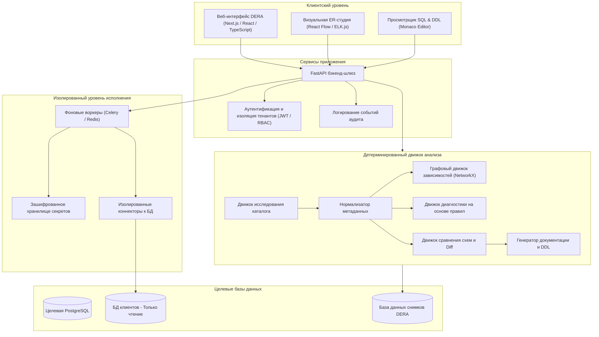
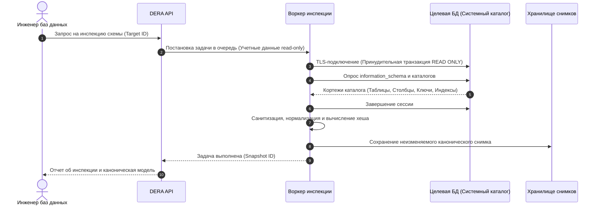
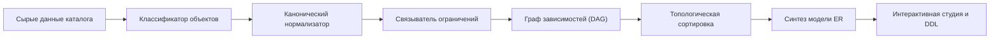
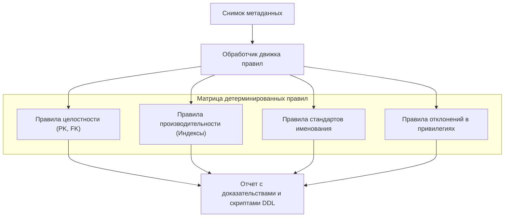
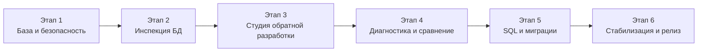

**Читать эту документацию на других языках:** [English](../../README.md) | [Español](README.es.md) | [Français](README.fr.md) | [Deutsch](README.de.md) | [Português](README.pt.md) | [日本語](README.ja.md) | [한국어](README.ko.md) | [简体中文](README.zh-CN.md) | [العربية](README.ar.md) | [Русский](README.ru.md)

---

<div align="center">

# DERA

### Database Engineering & Reverse Analysis

**Понимайте каждую схему. Проектируйте каждое изменение.**

Детерминированная платформа обратной разработки (reverse engineering) баз данных с открытым исходным кодом для разработчиков, инженеров баз данных, архитекторов и инженерных команд.

Исследуйте структуры баз данных, визуализируйте связи между сущностями, анализируйте схемы, выявляйте архитектурные риски и создавайте техническую документацию — полностью детерминированно, без использования моделей ИИ или внешних API инференса.

<br/>

[](https://github.com/krishanth7/dera/stargazers)
[](https://github.com/krishanth7/dera/forks)
[](https://github.com/krishanth7/dera/issues)
[](https://github.com/krishanth7/dera/blob/main/LICENSE)
[](https://github.com/krishanth7/dera/releases)
[](https://github.com/krishanth7/dera/actions/workflows/codeql.yml)
[](https://github.com/krishanth7/dera/graphs/contributors)
[](https://github.com/sponsors/krishanth7)

<br/>

[Обзор](#-обзор) ·
[Возможности](#-возможности) ·
[Архитектура](#-архитектура) ·
[Визуальные пайплайны](#-визуальные-пайплайны) ·
[Безопасность](#-принципы-безопасности) ·
[Технологический стек](#-технологический-стек) ·
[План развития](#-план-развития) ·
[Участие в проекте](#-участие-в-проекте) ·
[Сообщество](#-сообщество)

</div>

---

## 🌍 Поддержка языков

Проект DERA предоставляет подробную документацию на 10 международных языках. Воспользуйтесь таблицей ниже или верхней панелью навигации для перехода к локализованной версии:

| Язык | Код | Ссылка на документацию | Статус |
|---|---|---|---|
| 🇬🇧 English | `en` | [English Primary (Root)](../../README.md) · [Synchronized Copy](README.en.md) | Основной источник |
| 🇪🇸 Español | `es` | [Documentación en Español](README.es.md) | Полный перевод |
| 🇫🇷 Français | `fr` | [Documentation en Français](README.fr.md) | Полный перевод |
| 🇩🇪 Deutsch | `de` | [Dokumentation auf Deutsch](README.de.md) | Полный перевод |
| 🇵🇹 Português | `pt` | [Documentação em Português](README.pt.md) | Полный перевод |
| 🇯🇵 日本語 | `ja` | [日本語ドキュメント](README.ja.md) | Полный перевод |
| 🇰🇷 한국어 | `ko` | [한국어 문서](README.ko.md) | Полный перевод |
| 🇨🇳 简体中文 | `zh-CN` | [简体中文文档](README.zh-CN.md) | Полный перевод |
| 🇸🇦 العربية | `ar` | [الوثائق باللغة العربية](README.ar.md) | Полный перевод |
| 🇷🇺 Русский | `ru` | [Документация на русском](README.ru.md) | Полный перевод |

---

## 📖 Обзор

Современные реляционные базы данных являются фундаментом программной инфраструктуры, однако понимание незнакомой или непрерывно развивающейся схемы часто сопряжено со значительными трудностями. Корпоративные системы нередко насчитывают сотни таблиц, тысячи столбцов, запутанные внешние ключи, индексы, ограничения, представления и перекрестные зависимости объектов.

Анализ и аудит таких структур вручную отнимают колоссальное количество времени и подвержены человеческому фактору.

**DERA создана для эффективного решения этой задачи.**

DERA предоставляет единое, защищенное рабочее пространство для исследования архитектуры баз данных, реконструкции связей между сущностями, оценки структурных рисков и генерации инженерной документации на основе детерминированных алгоритмов.

### Наша миссия

Сделать обратную разработку баз данных доступной, прозрачной, воспроизводимой и надежной для каждого разработчика, администратора баз данных и системного архитектора.

### Наша философия

- **Детерминизм по определению (Deterministic by Design)** — Воспроизводимый анализ на основе теории графов и статических наборов правил.
- **Полное отсутствие генеративного ИИ** — Никаких LLM, моделей машинного обучения или внешних API инференса.
- **Приоритет конфиденциальности** — Анализ исключительно структурных метаданных каталога. Данные строк клиентов никогда не извлекаются и не сохраняются.
- **Открытый исходный код** — Прозрачная разработка под свободной лицензией MIT.
- **Ориентация на разработчика** — Практичные инструменты, спроектированные для реальных задач инженеров и DBA.
- **Безопасность превыше всего** — Принудительные сессии только для чтения, шифрование учетных данных и изолированное выполнение процессов.
- **Инженерная точность** — Диагностические выводы, основанные на фактах из системного каталога, а не на непредсказуемых галлюцинациях ИИ.

---

## ✨ Возможности

Ниже представлены планируемые возможности платформы DERA. Их доступность зависит от этапа разработки и конкретного релиза.

| Область функциональности | Статус | Описание |
|---|---|---|
| **Исследование баз данных** | Запланировано | Нативное извлечение метаданных таблиц, столбцов, ограничений и индексов |
| **Ядро обратной разработки** | Запланировано | Каноническое моделирование схем, классификация объектов и разрешение зависимостей |
| **Визуальная студия ER** | Запланировано | Интерактивные диаграммы сущностей и связей, автоматическая раскладка, фильтры и экспорт |
| **Детерминированная диагностика**| Запланировано | Оценка статических правил: поиск отсутствующих PK, избыточных индексов и ошибок именования |
| **Снимки и сравнение схем** | Запланировано | Версионированные снимки схем и анализ влияния структурных изменений |
| **Оптимизация запросов SQL** | Запланировано | Инспекция запросов, визуализация планов выполнения и рекомендации по индексам |
| **Генератор документации** | Запланировано | Автоматический экспорт в Markdown, HTML, JSON, SQL DDL и векторные схемы SVG |
| **Архитектура безопасности** | Запланировано | Ролевой контроль доступа (RBAC), строгий режим только для чтения и изолированные воркеры |

### 🔍 Исследование баз данных

Инспекция поддерживаемых СУБД и извлечение структурных данных из системных каталогов:

- Базы данных, схемы и установленные расширения
- Таблицы, партиции и представления (Views)
- Столбцы, типы данных, поддержка NULL и выражения значений по умолчанию
- Первичные ключи (PK), внешние ключи (FK) и ссылочные действия (`CASCADE`, `RESTRICT`)
- Ограничения уникальности (UNIQUE), проверочные ограничения (CHECK) и ограничения исключения
- Индексы (B-tree, Hash, GIN, GiST), уникальные индексы и предикаты частичных индексов
- Последовательности (Sequences), столбцы идентификаторов и триггеры

### 🧬 Ядро обратной разработки

Реконструкция моделей схем с использованием прямых запросов к каталогам и детерминированных алгоритмов:

- Каноническое представление схемы, не зависящее от конкретной СУБД
- Стандартизация и нормализация структурных метаданных
- Построение направленных ациклических графов (DAG) зависимостей
- Точное сопоставление простых и составных внешних ключей
- Создание неизменяемых криптографически подписанных снимков схем
- Детерминированная реконструкция операторов SQL DDL

### 🕸️ Визуальная студия ER

Интерактивное исследование топологии схемы через графический интерфейс сущностей и связей:

- Интерактивные узлы таблиц с отображением столбцов, типов и значков ограничений
- Наглядные соединители связей с точным обозначением кардинальности
- Детерминированные алгоритмы автоматического размещения (иерархические и силовые)
- Группировка по схемам, тегирование и выделение доменных подграфов
- Интерактивный поиск, фильтрация по типам и трассировка путей зависимостей
- Экспорт диаграмм в высоком разрешении в форматах SVG и PNG

### 🛡️ Детерминированная диагностика баз данных

Анализ метаданных схемы на основе настраиваемых инженерных правил для обнаружения архитектурных рисков:

| Правило диагностики | Категория | Описание |
|---|---|---|
| **Отсутствие первичного ключа** | Целостность | Выявление таблиц без явного ограничения первичного ключа |
| **Потенциально избыточный индекс**| Производительность | Обнаружение дублирующихся или перекрывающихся префиксов столбцов |
| **Внешний ключ без индекса** | Производительность | Оповещение о столбцах внешних ключей, не имеющих покрывающего индекса |
| **Полиморфные антипаттерны** | Целостность | Обнаружение неявных связей без объявленных ограничений ссылочной целостности |
| **Аномалии NULL и Default** | Согласованность | Предупреждение о столбцах NOT NULL без логичных значений по умолчанию |
| **Аудит соглашений об именах** | Стандартизация | Обнаружение неконсистентного регистра и отклонений от стандартов именования |
| **Отклонения в привилегиях** | Безопасность | Выявление избыточных прав доступа к объектам системного каталога |

*Все результаты диагностики являются доказательными рекомендациями, сопровождаемыми подробным обоснованием и корректирующим скриптом DDL.*

### 🔄 Сравнение схем и анализ изменений (Diff)

Сравнение снимков баз данных между контурами (dev, staging, prod) или ревизиями миграций:

- Добавленные, измененные и удаленные таблицы и столбцы
- Изменения типов данных, размерностей и возможности хранения NULL
- Создание, удаление и корректировка определений индексов
- Модификация ограничений и ссылочной целостности
- Классификация критических изменений (безопасные vs потенциально деструктивные)
- Генерация упорядоченного превью скриптов миграции с учетом графа зависимостей

---

## 🧠 Никакого ИИ. Только чистая инженерия.

DERA принципиально спроектирована без использования искусственного интеллекта и машинного обучения.

```text
┌───────────────────────────────────────────────────────────┐
│              СТРОГАЯ АРХИТЕКТУРА БЕЗ ИИ                   │
│                                                           │
│   ❌  Без OpenAI, Anthropic Claude или Google Gemini      │
│   ❌  Без Groq, DeepSeek и внешних API инференса          │
│   ❌  Без локальных LLM (Ollama, vLLM, llama.cpp)         │
│   ❌  Без недетерминированных галлюцинаций                │
│                                                           │
│   ✅  Прямые запросы к системным каталогам                │
│   ✅  Детерминированные графовые алгоритмы (NetworkX)     │
│   ✅  Строгие парсеры абстрактных синтаксических деревьев │
│   ✅  Воспроизводимые статические движки правил           │
│   ✅  Математические алгоритмы сравнения схем             │
└───────────────────────────────────────────────────────────┘
```

**Почему DERA детерминирована:**
1. **Предсказуемость:** Один и тот же снимок схемы и конфигурация правил всегда дают стопроцентно одинаковый результат.
2. **Аудируемость:** Каждое предупреждение, связь и ребро графа опираются на проверяемые факты из каталога.
3. **Суверенитет данных:** Схемы и метаданные вашей компании никогда не покидают периметр вашей сети.
4. **Производительность и экономия:** Нулевая задержка инференса, отсутствие расходов на токены и независимость от внешних облаков.

---

## 🏗️ Архитектура

DERA построена на основе модульного монолита, обеспечивающего удобство сопровождения, масштабируемость и абсолютную безопасность доступа к БД.



---

## 🔬 Визуальные пайплайны

DERA реализует прозрачные, аудируемые и детерминированные конвейеры для инспекции метаданных, построения связей и проверки безопасности.

### 1. Процесс инспекции базы данных



### 2. Пайплайн обратной разработки схем



### 3. Пайплайн обработки метаданных и диагностики



### 4. Периметр безопасности и сетевая изоляция

```mermaid
flowchart TD
    subgraph Public["Публичная зона"]
        WebUser["Браузер пользователя"]
    end

    subgraph DMZ["Периметр приложения"]
        ReverseProxy["Обратный прокси / TLS-терминация"]
        AppServer["API-сервер DERA"]
    end

    subgraph SecureNetwork["Внутренняя изолированная сеть"]
        WorkerPool["Коннекторы в песочнице"]
        SecretsMgr["Хранилище зашифрованных секретов"]
        InternalDB[(Внутренняя БД DERA)]
    end

    subgraph CustomerVPC["Сеть целевой базы данных"]
        TargetDB[(База данных клиента)]
    end

    WebUser -->|HTTPS| ReverseProxy
    ReverseProxy --> AppServer
    AppServer -->|Очередь сообщений| WorkerPool
    WorkerPool -->|Расшифровка по требованию| SecretsMgr
    WorkerPool -->|Внутреннее сохранение| InternalDB
    WorkerPool -.->|Инспекция по TLS (read-only)| TargetDB
```

### 5. Жизненный цикл разработки проекта



---

## 🔒 Принципы безопасности

Поскольку DERA подключается к критически важным базам данных, безопасность заложена в основу всей архитектуры.

- **Гарантированный режим только для чтения:** Сессии принудительно устанавливают транзакции только для чтения (`SET SESSION CHARACTERISTICS AS TRANSACTION READ ONLY`).
- **Нулевое извлечение пользовательских данных:** Запросы направляются исключительно к системным каталогам (`information_schema`, `pg_catalog`). Данные прикладных таблиц никогда не считываются.
- **Никаких секретов в открытом виде:** Учетные данные шифруются в покое с помощью алгоритма AES-256-GCM и никогда не попадают в логи, экспортные файлы или git-репозиторий.
- **Предотвращение атак SSRF:** Сетевые адреса тщательно валидируются для предотвращения сканирования внутренней инфраструктуры или доступа к метаданным облачных платформ.
- **Принцип наименьших привилегий:** Подробные инструкции по созданию изолированных учетных записей аудита без административных прав.
- **Неизменяемый аудит:** Каждая инспекция, экспорт или изменение конфигурации фиксируются в неизменяемом журнале аудита.

*Подробные правила ответственного раскрытия уязвимостей приведены в документе [SECURITY.md](../../SECURITY.md).*

---

## 🛠️ Технологический стек

| Уровень | Компонент | Выбранная технология | Назначение | Статус |
|---|---|---|---|---|
| **Фронтенд** | Фреймворк | Next.js, React, TypeScript | Интерактивное адаптивное веб-приложение | Запланировано |
| | Стилизация | Tailwind CSS | Согласованная дизайн-система | Запланировано |
| | UI-компоненты | shadcn/ui | Доступные стандартные компоненты | Запланировано |
| | Визуализация ER | React Flow, ELK.js | Рендеринг графов и автоматическая раскладка | Запланировано |
| | Редактор кода | Monaco Editor | Подсветка синтаксиса SQL и просмотр DDL | Запланировано |
| **Бэкенд** | API-фреймворк | Python 3.12+, FastAPI | Высокопроизводительные асинхронные сервисы | Запланировано |
| | Инспекция каталогов | SQLAlchemy, psycopg | Извлечение метаданных и управление пулом соединений | Запланировано |
| | Парсинг SQL | SQLGlot | Генерация независимого от СУБД AST SQL | Запланировано |
| | Анализ графов | NetworkX | Разрешение зависимостей и топологическая сортировка | Запланировано |
| | Очередь задач | Celery, Redis | Изолированные воркеры фонового сканирования | Запланировано |
| **Хранение данных**| База данных DERA | PostgreSQL | Хранение снимков, пользовательских сессий и логов | Запланировано |
| | Миграции | Alembic | Контроль версий собственной БД платформы DERA | Запланировано |
| **DevOps и QA** | Контейнеризация | Docker, Docker Compose | Воспроизводимая среда разработки и развертывания | Запланировано |
| | Статический анализ | CodeQL, Dependabot | Автоматический поиск уязвимостей и аудит зависимостей | Реализовано |
| | Тестирование | Pytest, Playwright | Бэкенд-тесты и сквозные браузерные тесты | Запланировано |

---

## 🗄️ Совместимость с базами данных

Платформа DERA спроектирована с модульной архитектурой коннекторов для работы с современными СУБД:

| СУБД | Статус коннектора | Источник каталога | Планируемый этап |
|---|---|---|---|
| **PostgreSQL** (v12 - v17) | В разработке | `pg_catalog`, `information_schema` | Этап 2 (MVP) |
| **Supabase PostgreSQL** | В разработке | Нативный коннектор PostgreSQL | Этап 2 (MVP) |
| **MySQL** (v8.0+) | Запланировано | `information_schema`, `performance_schema` | Этап 5 |
| **SQLite** (v3.35+) | Запланировано | `sqlite_master`, команды `PRAGMA` | Этап 5 |
| **MariaDB** (v10.5+) | Запланировано | `information_schema` | Этап 5 |
| **Microsoft SQL Server** | Запланировано | `sys.tables`, `INFORMATION_SCHEMA` | Этап 5 |
| **Oracle Database** | На рассмотрении | Представления словаря данных (`ALL_*`, `DBA_*`) | Будущая оценка |

---

## 🚀 Начало работы

DERA в настоящее время находится на этапе проектирования фундаментальной архитектуры. Руководства по развертыванию в production будут публиковаться по мере готовности релизных этапов.

### Системные требования (планируемые)

- Python 3.12 или выше
- Node.js LTS (v20+)
- PostgreSQL 15+
- Docker и Docker Compose
- Git

### Клонирование репозитория

```bash
git clone https://github.com/krishanth7/dera.git
cd dera
```

### Запуск локальной среды разработки (планируемый)

```bash
# Подготовка файла переменных окружения
cp .env.example .env

# Запуск стека через Docker Compose
docker compose -f infrastructure/docker/docker-compose.dev.yml up --build
```

> **Примечание:** Базовая кодовая база находится в стадии активной разработки. Следите за обновлениями в [Плане развития](#-план-развития).

---

## 📁 Структура репозитория

```text
dera/
├── .github/
│   ├── ISSUE_TEMPLATE/           # Шаблоны сообщений об ошибках и запросов
│   ├── workflows/                # CI-пайплайны, CodeQL и проверка зависимостей
│   ├── PULL_REQUEST_TEMPLATE.md  # Стандартный шаблон для Pull Request
│   ├── dependabot.yml            # Конфигурация обновлений Dependabot
│   └── FUNDING.yml               # Настройки спонсорской поддержки автора
├── docs/
│   ├── README.md                 # Главный индекс всей документации
│   ├── i18n/                     # Синхронизированная мультиязычная документация
│   │   ├── README.en.md          # Английская эталонная копия
│   │   ├── README.es.md          # Документация на испанском языке
│   │   ├── README.fr.md          # Документация на французском языке
│   │   ├── README.de.md          # Документация на немецком языке
│   │   ├── README.pt.md          # Документация на португальском языке
│   │   ├── README.ja.md          # Документация на японском языке
│   │   ├── README.ko.md          # Документация на корейском языке
│   │   ├── README.zh-CN.md       # Документация на китайском языке
│   │   ├── README.ar.md          # Документация на арабском языке (с поддержкой RTL)
│   │   └── README.ru.md          # Документация на русском языке
│   ├── architecture/             # Архитектурные спецификации
│   ├── development/              # Руководства по настройке и стандартам
│   ├── security/                 # Модели угроз и политики безопасности
│   └── contributing/             # Руководства для контрибьюторов
├── CODE_OF_CONDUCT.md            # Кодекс поведения Contributor Covenant
├── CONTRIBUTING.md               # Руководство по внесению вклада
├── LICENSE                       # Лицензия MIT
├── README.md                     # Главная страница репозитория
├── SECURITY.md                   # Комплексная политика безопасности
└── .gitignore                    # Правила игнорирования Git
```

---

## 🗺️ План развития

### Этап 1 — Фундамент и безопасность
- [x] Формирование официального описания проекта и лицензии (MIT)
- [x] Настройка статического анализа безопасности кода с помощью CodeQL
- [x] Разработка Кодекса поведения и Политики безопасности
- [x] Построение международной структуры документации на 10 языках
- [ ] Инициализация структуры монорепозитория (`apps/web`, `apps/api`)
- [ ] Настройка среды разработки Docker и базового конвейера CI

### Этап 2 — Движок инспекции баз данных
- [ ] Реализация нативного коннектора метаданных для PostgreSQL
- [ ] Извлечение таблиц, столбцов, ограничений, индексов и представлений
- [ ] Построение канонической нормализованной модели схемы
- [ ] Реализация неизменяемого хранилища снимков с контрольными суммами
- [ ] Гарантия режима только для чтения и защита от длительных запросов

### Этап 3 — Студия обратной разработки
- [ ] Создание интерактивной ER-студии на базе React Flow
- [ ] Реализация алгоритмов автоматического иерархического размещения
- [ ] Фильтрация по схемам, поиск и группировка по предметным областям
- [ ] Визуализация и обход направленных графов зависимостей (DAG)
- [ ] Экспорт схем в высоком разрешении в форматах SVG и PNG

### Этап 4 — Диагностика и сравнение схем
- [ ] Реализация детерминированного движка диагностики на правилах
- [ ] Создание правил: отсутствие PK, избыточные индексы, неиндексированные FK
- [ ] Реализация алгоритма выявления различий в снимках (Snapshot Diff)
- [ ] Формирование структурированного превью скриптов миграции в DDL
- [ ] Экспорт отчетов диагностики в форматах Markdown, JSON и HTML

### Этап 5 — Расширенная инженерия и новые коннекторы
- [ ] Интеграция SQLGlot для разбора AST запросов и оценки сложности
- [ ] Разработка визуализатора планов выполнения запросов (`EXPLAIN ANALYZE`)
- [ ] Разработка коннекторов для баз данных MySQL и SQLite
- [ ] Автоматическая генерация миграций DDL с правильным порядком зависимостей

### Этап 6 — Подготовка к эксплуатации в Enterprise
- [ ] Проведение комплексного аудита безопасности и тестов на проникновение
- [ ] Нагрузочное тестирование производительности на крупных схемах (1000+ таблиц)
- [ ] Проверка изоляции тенантов и целостности журналов аудита
- [ ] Выпуск официальных образов контейнеров v1.0.0 и руководств по эксплуатации

---

## 🧪 Стратегия тестирования и качества

DERA обеспечивает высокое качество разработки благодаря автоматизированным тестам:

- **Модульные тесты:** Проверка парсеров, отсутствия циклов в графах и правил диагностики на синтетических данных.
- **Интеграционные тесты:** Тестирование коннекторов на изолированных контейнерах PostgreSQL, MySQL и SQLite.
- **Детерминированная верификация:** Гарантия того, что одинаковые входные данные генерируют абсолютно идентичные хеши и выводы.
- **Тесты безопасности:** Непрерывный анализ CodeQL, проверка зависимостей на уязвимости и контроль отсутствия секретов.
- **Сквозные тесты (E2E):** Тестирование интерфейса в браузерах через Playwright для проверки удобства и интерактивности.

---

## 🤝 Участие в проекте

Мы приветствуем вклад разработчиков, специалистов по базам данных, технических писателей и исследователей безопасности со всего мира.

Перед отправкой изменений, пожалуйста, ознакомьтесь с [CONTRIBUTING.md](../../CONTRIBUTING.md) и [Кодексом поведения](../../CODE_OF_CONDUCT.md).

### Процесс разработки

1. Сделайте форк репозитория на GitHub.
2. Создайте тематическую ветку: `git checkout -b feat/your-feature-name`.
3. Оформляйте коммиты по стандарту [Conventional Commits](../../CONTRIBUTING.md#commit-message-guidelines).
4. Напишите необходимые модульные или интеграционные тесты.
5. Убедитесь в успешном прохождении проверок CodeQL и тестов документации.
6. Откройте Pull Request в ветку `main` для проверки мейнтейнерами.

---

## 💬 Сообщество

- [GitHub Discussions](https://github.com/krishanth7/dera/discussions) — Вопросы, идеи и обсуждение архитектуры баз данных.
- [GitHub Issues](https://github.com/krishanth7/dera/issues) — Сообщения об ошибках и предложения нового функционала.
- [GitHub Pull Requests](https://github.com/krishanth7/dera/pulls) — Внесение изменений в код и документацию.
- [Releases](https://github.com/krishanth7/dera/releases) — Отслеживание официальных версий и списков изменений.

---

## ❤️ Поддержка проекта

DERA — независимый открытый инженерный проект. Вы можете поддержать его развитие:

- Поставив звезду (Star) репозиторию на GitHub
- Рассказав о проекте в вашем профессиональном сообществе
- Разработкой новых коннекторов, правил диагностики или улучшением переводов
- [Оформив спонсорскую поддержку на GitHub Sponsors](https://github.com/sponsors/krishanth7)

---

## 📜 Лицензия

DERA распространяется под свободной лицензией **[MIT License](../../LICENSE)**.

```text
Copyright (c) 2026 Krishanth
```

---

## 👨‍💻 Мейнтейнер

**Krishanth**  
Основатель и ведущий мейнтейнер

- GitHub: [@krishanth7](https://github.com/krishanth7)  
- Репозиторий: [github.com/krishanth7/dera](https://github.com/krishanth7/dera)  
- Контактный email: `krishanth.b.2008@gmail.com`

*DERA — независимый проект с открытым исходным кодом, развиваемый Krishanth. OVIC Labs признается частью более широкой инженерной экосистемы автора.*

---

<div align="center">

### DERA — Database Engineering & Reverse Analysis

**Понимайте каждую схему. Проектируйте каждое изменение.**

*Создано с инженерной точностью, математическим детерминизмом и открытостью.*

© 2026 Участники DERA. Распространяется под лицензией MIT.

[В начало страницы](#dera)

</div>
