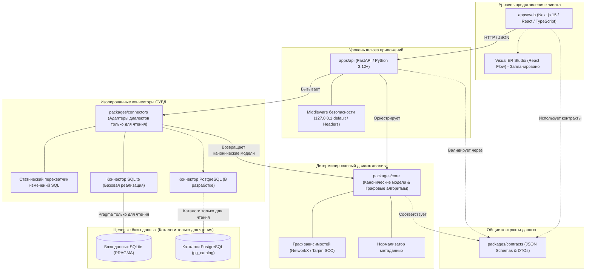

<!-- DERA:I18N_NAV:START -->
[English](../../README.md) | [Español](README.es.md) | [Français](README.fr.md) | [Deutsch](README.de.md) | [Português](README.pt.md) | [Italiano](README.it.md) | [日本語](README.ja.md) | [한국어](README.ko.md) | [简体中文](README.zh-CN.md) | **Русский**
<!-- DERA:I18N_NAV:END -->

---

<div align="center">

# DERA

### Database Engineering & Reverse Analysis

**Понимайте каждую схему. Проектируйте каждое изменение.**

Независимая детерминированная платформа с открытым исходным кодом для реверс-инжиниринга и проектирования баз данных, созданная для разработчиков, архитекторов баз данных и инженерных команд.

Исследуйте структуры баз данных, восстанавливайте связи между сущностями, оценивайте архитектурные риски и планируйте изменения схем — полностью детерминированно, без моделей искусственного интеллекта и внешних API машинного обучения.

<br/>

[](../../LICENSE)
[](https://github.com/krishanth7/dera/actions/workflows/ci.yml)
[](https://github.com/krishanth7/dera/actions/workflows/codeql.yml)
[](https://github.com/krishanth7/dera/actions/workflows/documentation.yml)
[](../../pyproject.toml)
[](../../tsconfig.json)
[-orange?style=for-the-badge)](#-%D1%81%D1%82%D1%80%D0%BE%D0%B3%D0%BE-%D0%B1%D0%B5%D0%B7-%D0%B8%D0%B8-%D0%B0%D1%80%D1%85%D0%B8%D1%82%D0%B5%D0%BA%D1%82%D1%83%D1%80%D0%B0)
[](../../CONTRIBUTING.md)

<br/>

[Обзор](#-обзор) ·
[Матрица функциональности](#-матрица-статуса-функциональности) ·
[Архитектура](#-обзор-архитектуры) ·
[Структура монорепозитория](#-структура-репозитория) ·
[Быстрый старт](#-быстрый-старт) ·
[Совместимость с СУБД](#-матрица-совместимости-с-субд) ·
[Принципы безопасности](#-принципы-безопасности) ·
[Навигация по документации](#-навигация-по-документации-для-разработчиков) ·
[Дорожная карта](#-основная-дорожная-карта) ·
[Участие в разработке](#-участие-в-разработке) ·
[Сообщество](#-сообщество)

</div>

---

## 🌍 Поддержка языков

DERA поддерживает синхронизированную документацию на 10 международных языках. Английский README служит официальным и авторитетным источником информации согласно нашему [Договору об обслуживании документации](../development/README_MAINTENANCE.md).

| Язык | Код | Ссылка на документацию | Статус |
|---|---|---|---|
| 🇬🇧 English | `en` | [English Primary (Root)](../../README.md) · [Synchronized Copy](README.en.md) | **Официальный авторитетный источник** |
| 🇪🇸 Español | `es` | [Documentación en Español](README.es.md) | Полный перевод |
| 🇫🇷 Français | `fr` | [Documentation en Français](README.fr.md) | Полный перевод |
| 🇩🇪 Deutsch | `de` | [Dokumentation auf Deutsch](README.de.md) | Полный перевод |
| 🇵🇹 Português | `pt` | [Documentação em Português](README.pt.md) | Полный перевод |
| 🇮🇹 Italiano | `it` | [Documentazione in Italiano](README.it.md) | Полный перевод |
| 🇯🇵 日本語 | `ja` | [日本語ドキュメント](README.ja.md) | Полный перевод |
| 🇰🇷 한국어 | `ko` | [한국어 문서](README.ko.md) | Полный перевод |
| 🇨🇳 简体中文 | `zh-CN` | [简体中文文档](README.zh-CN.md) | Полный перевод |
| 🇷🇺 Русский | `ru` | [Документация на русском](README.ru.md) | Полный перевод |

---

## 📖 Обзор

Современные реляционные базы данных являются фундаментом программной инфраструктуры. Однако понимание незнакомых, унаследованных или динамично развивающихся схем сопряжено со значительными инженерными сложностями:
- **Сложность схем:** Корпоративные базы данных часто состоят из сотен таблиц, тысяч столбцов и недокументированных связей по внешним ключам.
- **Архитектурный долг:** Циклические зависимости по внешним ключам, отсутствие первичных ключей, неиндексированные внешние ключи и избыточные индексы накапливаются годами.
- **Риски миграций:** Внесение изменений в схему без полного топологического графа создает угрозу эскалации блокировок, повреждения данных и каскадных нарушений ограничений.
- **Безопасность и конфиденциальность:** Организации не могут рисковать учетными данными или реальными строками данных, передавая их во внешние облачные сервисы ИИ.

**DERA спроектирован для решения этих проблем на основе математического детерминизма.**

DERA предоставляет модульную платформу с открытым исходным кодом, которая безопасно инспектирует каталоги реляционных СУБД, восстанавливает графы зависимостей, выявляет структурные риски и формирует предварительный просмотр миграций на базе строгих алгоритмов.

### Ключевые инженерные принципы

1. **Детерминированность по замыслу (Deterministic by Design):** Каждый снимок схемы, топологическая сортировка графа и диагностический вывод воспроизводимы и опираются на реляционную алгебру.
2. **Строго без ИИ (Strictly Non-AI):** Никакого генеративного ИИ, никаких больших языковых моделей (LLM), векторных баз данных или внешних API инференса.
3. **Безопасность только для чтения:** Гарантированный режим Read-Only на уровне соединения, статический AST-перехватчик деструктивных SQL-запросов и запросы только к каталогам метаданных.
4. **Нулевое извлечение пользовательских данных:** Чистая интроспекция метаданных (`information_schema`, `pg_catalog`, `sqlite_master`). Строки прикладных таблиц никогда не запрашиваются, не передаются и не сохраняются.
5. **Разделенная архитектура монорепозитория:** Четкие границы модулей, изолирующие алгоритмы графов, адаптеры СУБД, API-шлюз и графический интерфейс.
6. **Открытый исходный код и пермиссивная лицензия:** Независимое ПО под свободной [лицензией MIT](../../LICENSE).

---

## 🧠 Строго без ИИ: Архитектура

DERA намеренно спроектирован полностью без компонентов искусственного интеллекта или машинного обучения.

```text
┌───────────────────────────────────────────────────────────┐
│               СТРОГО БЕЗ ИИ: АРХИТЕКТУРА                  │
│                                                           │
│   ❌  Без OpenAI, Anthropic Claude или Google Gemini      │
│   ❌  Без Groq, DeepSeek или других внешних API моделей   │
│   ❌  Без локальных LLM (Ollama, vLLM, llama.cpp)         │
│   ❌  Без стохастических догадок и галлюцинаций ИИ        │
│   ❌  Без облачных векторных эмбеддингов или внешних RAG  │
│                                                           │
│   ✅  Прямые запросы к системным каталогам СУБД           │
│   ✅  Математические алгоритмы теории графов (Tarjan)     │
│   ✅  Синтаксический AST-анализ SQL-запросов (SQLGlot)    │
│   ✅  Воспроизводимые статические движки правил           │
│   ✅  Криптографические хэш-отпечатки (SHA-256)           │
└───────────────────────────────────────────────────────────┘
```

**Почему DERA детерминирован:**
- **Математическая проверяемость:** Каждая связь, предупреждение о цикле и диагностика подтверждаются конкретными записями в системных каталогах и точными алгоритмами.
- **Побайтовая воспроизводимость:** Проверка одного и того же снимка схемы всегда дает на 100% идентичный результат на любом компьютере и в любом CI-пайплайне.
- **Суверенитет корпоративных данных:** Структура и топология вашей базы данных никогда не покидают защищенную сеть компании.
- **Нулевые эксплуатационные расходы на ИИ:** Никаких расходов на токены, лимитов запросов и сетевых задержек инференса.

---

## 📊 Матрица статуса функциональности

DERA придерживается прозрачной отчетности, основанной исключительно на работающем коде, подтвержденном тестами:

| Возможность | Статус | Подтверждение реализации | Расположение в монорепозитории |
|---|:---:|---|---|
| **Канонические модели схем** | **Реализовано** | Канонические модели `Column`, `Table`, `ForeignKey`, `Index` | [`packages/core/src/dera/models.py`](../../packages/core/src/dera/models.py) |
| **Движок графа зависимостей** | **Реализовано** | Устойчивый к циклам DAG и топологическая сортировка (Tarjan SCC) | [`packages/core/src/dera/graph.py`](../../packages/core/src/dera/graph.py) |
| **Блокировщик мутаций (Read-Only)** | **Реализовано** | Статический AST-анализ блокирует опасный SQL (`DROP`, `ALTER` и др.) | [`packages/connectors/src/dera_connectors/base/`](../../packages/connectors/src/dera_connectors/base/connector.py) |
| **Интроспекция каталогов SQLite** | **Реализовано** | Определение таблиц, столбцов, PK, FK и индексов | [`packages/connectors/src/dera_connectors/sqlite/`](../../packages/connectors/src/dera_connectors/sqlite/connector.py) |
| **Инспекция каталогов PostgreSQL** | **В разработке** | Интеграционные тесты на эфемерном контейнере PostgreSQL | [`tests/integration/`](../../tests/integration/) |
| **Шлюз API и телеметрия** | **Реализовано** | Сервис FastAPI с привязкой к loopback и эндпоинтами проверки | [`apps/api/src/dera_api/main.py`](../../apps/api/src/dera_api/main.py) |
| **Базовый каркас Web Studio** | **Реализовано** | Базовый стек Next.js 15 TypeScript и карточка архитектуры | [`apps/web/src/app/page.tsx`](../../apps/web/src/app/page.tsx) |
| **Общие контракты данных** | **Реализовано** | Версионированные схемы JSON и DTO для сериализации | [`packages/contracts/schemas/`](../../packages/contracts/schemas/) |
| **Визуальный холст ER Studio** | Запланировано | Интерактивный визуальный холст на базе React Flow | Дорожная карта, Фаза 7 |
| **Детерминированная матрица правил** | Запланировано | Поиск отсутствующих PK, неиндексированных FK, избыточных индексов | Дорожная карта, Фаза 8 |
| **Движок Diff снимков схем** | Запланировано | Семантическое сопоставление снимков и предпросмотр DDL | Дорожная карта, Фаза 9 |
| **Анализатор производительности AST** | Запланировано | Расчет сложности запросов через SQLGlot и планы выполнения | Дорожная карта, Фаза 10 |

> **Условные обозначения статуса:**
> - **`Реализовано`** &mdash; Разработано, верифицировано и покрыто автоматическими тестами в CI.
> - **`В разработке`** &mdash; Активная разработка и интеграционное тестирование в текущем этапе.
> - **`Запланировано`** &mdash; Включено в 12-фазовую дорожную карту разработки.

---

## 🏗️ Обзор архитектуры

DERA организует компоненты в изолированные рабочие пространства согласно нашей [Спецификации архитектуры монорепозитория](../architecture/README_ARCHITECTURE.md):



### Текстовое описание архитектуры (Доступность)
- **Уровень представления клиента (`apps/web`):** Фронтенд на Next.js 15 TypeScript, взаимодействующий с API через JSON и содержащий интерактивный холст ER-диаграмм.
- **Уровень шлюза приложений (`apps/api`):** Бэкенд на FastAPI, по умолчанию привязанный к `127.0.0.1`, обеспечивающий мониторинг состояния, маршруты извлечения каталогов и middleware безопасности.
- **Общие контракты данных (`packages/contracts`):** Схемы JSON и интерфейсы TypeScript, фиксирующие единый канонический формат для таблиц, столбцов, индексов и снимков.
- **Детерминированный базовый движок (`packages/core`):** Библиотека на чистом Python, реализующая канонические модели, алгоритм Тарьяна, топологическую сортировку и нормализацию.
- **Изолированные коннекторы СУБД (`packages/connectors`):** Модульные адаптеры для чтения каталогов (`sqlite_master`, `pg_catalog`). Блокируют любые мутации SQL до их выполнения.
- **Целевые базы данных (Только для чтения):** Исследуемые базы данных. DERA подключается исключительно с непривилегированными учетными записями только для чтения.

Технические спецификации:
- [Архитектурный план и руководство](../architecture/README_ARCHITECTURE.md)
- [Границы модулей и правила зависимостей](../architecture/MODULE_BOUNDARIES.md)
- [Структура каталогов монорепозитория](../architecture/MONOREPO_STRUCTURE.md)
- [Архитектурное решение (ADR 0001)](../architecture/adr/0001-monorepo-architecture.md)

---

## 📁 Структура репозитория

Реальное расположение файлов и директорий в монорепозитории DERA:

```text
dera/
├── apps/
│   ├── api/                      # Бэкенд FastAPI и эндпоинты проверки состояния
│   │   ├── src/dera_api/         # Маршруты шлюза, middleware и схемы
│   │   └── pyproject.toml        # Спецификация пакета API
│   └── web/                      # Фронтенд Next.js 15 TypeScript
│       ├── src/                  # Маршрутизатор App, компоненты, клиент API
│       └── package.json          # Конфигурация рабочего пространства web
├── packages/
│   ├── core/                     # Канонические модели и обработка графов
│   │   └── src/dera_core/        # Модели схем, алгоритмы DAG, теория графов
│   ├── connectors/               # Адаптеры извлечения метаданных из СУБД
│   │   └── src/dera_connectors/  # Базовый коннектор, защита от мутаций, SQLite
│   └── contracts/                # Общие схемы JSON и контракты
│       └── schemas/              # Версионированные контракты API и снимков
├── tests/
│   ├── architecture/             # Тесты границ импортов AST и зависимостей
│   ├── integration/              # Интеграционные тесты на SQLite и PostgreSQL
│   ├── regression/               # Тесты детерминированности DAG и хэшей
│   └── unit/                     # Модульные тесты моделей, заголовков и готовности
├── scripts/
│   ├── ci/                       # Скрипты проверки CI (документация, i18n, PR)
│   └── development/              # Кроссплатформенный CLI-инструмент (dev.py)
├── docs/
│   ├── audit/                    # Аудиты репозитория, базовые отчеты и соответствие
│   ├── architecture/             # Архитектурный план, границы и ADRs
│   ├── development/              # Руководства по установке, команды и Git
│   ├── governance/               # Управление, мейнтейнеры, решения GAD и лицензии
│   ├── security/                 # Модель угроз, безопасность БД и уязвимости
│   ├── community/                # Сообщество, правила и триаж обращений
│   ├── roadmap/                  # 12-фазная генеральная дорожная карта
│   └── i18n/                     # Синхронизированная документация на 10 языках
├── .github/
│   ├── workflows/                # Корпоративный CI/CD, CodeQL и гейты качества
│   ├── ISSUE_TEMPLATE/           # Шаблоны YAML для сообщений об ошибках
│   ├── PULL_REQUEST_TEMPLATE/    # Специализированные шаблоны Pull Request
│   ├── CODEOWNERS                # Определение владельцев кода
│   └── PULL_REQUEST_TEMPLATE.md  # Стандартный шаблон квалификации PR
├── pyproject.toml                # Корневая конфигурация Python (PEP 621)
├── package.json                  # Корневая конфигурация npm
├── tsconfig.json                 # Строгая конфигурация TypeScript
├── Makefile                      # Стандартная автоматизация команд разработки
├── CONTRIBUTING.md               # Подробное руководство для контрибьюторов
├── SECURITY.md                   # Политика скоординированного раскрытия уязвимостей
└── LICENSE                       # Лицензия MIT
```

---

## 🚀 Быстрый старт

DERA включает единую кроссплатформенную утилиту (`scripts/development/dev.py`) для согласованной проверки, тестирования и запуска в Windows, Linux и macOS.

### Системные требования

| Инструмент | Минимальная версия | Рекомендуемая версия | Команда проверки |
|---|---|---|---|
| **Python** | `3.12+` | `3.12` или `3.13` | `python --version` |
| **Node.js** | `20.x LTS` | `20.x` или `22.x LTS` | `node --version` |
| **Git** | `2.30+` | Последняя стабильная | `git --version` |

### 1. Клонирование репозитория

```bash
git clone https://github.com/krishanth7/dera.git
cd dera
```

### 2. Настройка переменных окружения

Скопируйте шаблон безопасной конфигурации:

```bash
# Windows PowerShell
Copy-Item .env.example .env

# Linux / macOS
cp .env.example .env
```

### 3. Настройка виртуального окружения Python

```bash
# Linux / macOS
python3 -m venv .venv
source .venv/bin/activate
pip install -e ".[dev]"

# Windows PowerShell
python -m venv .venv
.venv\Scripts\Activate.ps1
pip install -e ".[dev]"
```

### 4. Установка зависимостей Node.js

```bash
npm install
```

### 5. Запуск полного набора проверок

Убедитесь, что все пакеты Python, компиляция TypeScript, тесты и ссылки в документации в порядке:

```bash
python scripts/development/dev.py all
```

**Ожидаемый результат:**
```text
Ran 32 tests in 0.25s
OK (skipped=2)
Validating 69 markdown documentation files...
SUCCESS: All 69 markdown documentation files are valid.
Validating 10 multilingual documentation files in i18n...
SUCCESS: All 10 language documentation files verified with valid navigation and parity.
[SUCCESS]: All development baseline checks passed successfully.
```

### 6. Справочник команд разработчика

| Задача | Кроссплатформенный CLI (`dev.py`) | GNU Make (UNIX / macOS) |
|---|---|---|
| **Запуск всех тестов** | `python scripts/development/dev.py test` | `make test` |
| **Проверка типов TypeScript** | `python scripts/development/dev.py typecheck` | `make typecheck` |
| **Компиляция байт-кода Python** | `python scripts/development/dev.py compile` | `make build` |
| **Проверка ссылок в документации** | `python scripts/development/dev.py validate-docs` | `make lint` |
| **Проверка названия PR / коммита** | `python scripts/development/dev.py validate-title "<title>"` | `make validate-title TITLE="..."` |
| **Запуск локального сервера API** | `python -m uvicorn dera_api.main:app --reload --port 8000` | `make dev-api` |
| **Запуск веб-интерфейса студии** | `npm run dev --workspace=apps/web` | `npm run dev --workspace=apps/web` |

Подробные инструкции смотрите в [Руководстве по началу работы](../development/GETTING_STARTED.md) и [Каталоге команд](../development/COMMANDS.md).

---

## 🗄️ Матрица совместимости с СУБД

DERA использует модульную архитектуру изолированных коннекторов. Уровни поддержки подтверждены реальным кодом и тестами:

| СУБД | Поддерживаемые версии | Статус коннектора | Механизм интроспекции | Мера защиты Read-Only |
|---|:---:|:---:|---|---|
| **SQLite** | 3.35+ | **Реализовано** | `sqlite_master`, `PRAGMA table_info`, `PRAGMA foreign_key_list` | Блокировка AST и `PRAGMA query_only = ON` |
| **PostgreSQL** | 12 – 17 | **В разработке** | `pg_catalog`, `information_schema` | `SET default_transaction_read_only = ON` и роли только для чтения |
| **Supabase PostgreSQL** | Cloud / Local | **В разработке** | Нативное извлечение каталогов PostgreSQL | Сессия Read-Only на уровне соединения и непривилегированные роли |
| **MySQL** | 8.0+ | Запланировано | `information_schema`, `performance_schema` | Транзакционный режим только для чтения |
| **MariaDB** | 10.5+ | Запланировано | `information_schema` | Транзакционный режим только для чтения |
| **Microsoft SQL Server** | 2019+ | Запланировано | `sys.tables`, `INFORMATION_SCHEMA` | Пользовательские права только для чтения |

> [!NOTE]
> Коннекторы в статусе **`В разработке`** тестируются на временных тестовых контейнерах в CI. Коннекторы в статусе **`Запланировано`** включены в Фазу 5 дорожной карты.

---

## 🔒 Принципы безопасности

Безопасность является фундаментальным приоритетом DERA. При взаимодействии с базами данных платформа применяет многоуровневую защиту:

1. **Статический перехватчик мутаций SQL:** Перед отправкой любого запроса в СУБД он проходит валидацию через парсер AST. Инструкции, содержащие `DROP`, `ALTER`, `TRUNCATE`, `INSERT`, `UPDATE`, `DELETE`, `GRANT`, `REVOKE`, моментально блокируются.
2. **Опрос только системных каталогов:** Анализ ограничивается метаданными (`information_schema`, `pg_catalog`, `sqlite_master`). Данные пользовательских строк таблиц никогда не запрашиваются.
3. **Привязка к Loopback по умолчанию:** Серверы разработки и API привязаны к `127.0.0.1`, исключая случайный доступ извне.
4. **Минимальные привилегии учетных записей:** DERA работает исключительно под непривилегированными ролями только для чтения.
5. **Никаких сохраненных секретов:** Пароли и ключи доступа никогда не сохраняются на диск, в Git или в системные логи.
6. **Ответственное раскрытие:** Уязвимости обрабатываются конфиденциально в соответствии с нашей [Политикой безопасности](../../SECURITY.md).

> [!NOTE]
> DERA придерживается строгих практик безопасности открытого кода (CodeQL, Bandit SAST, обнаружение секретов). Проект не заявляет о наличии коммерческих сертификатов (таких как SOC 2 или ISO 27001).

Специальные документы по безопасности:
- [**Политика безопасности баз данных**](../security/DATABASE_SECURITY.md) — Проверка каталогов и изоляция сессий.
- [**Стандарты безопасной разработки**](../security/SECURE_DEVELOPMENT.md) — Параметризация и проверки DevSecOps.
- [**Процесс реагирования на уязвимости**](../security/VULNERABILITY_RESPONSE.md) — 5-этапный триаж и закрытые бюллетени.
- [**Матрица модели угроз**](../security/model.md) — Анализ векторов атак и защитные меры.

---

## 📚 Навигация по документации для разработчиков

Полный реестр руководств и регламентов DERA:

| Направление | Ключевые материалы |
|---|---|
| **Архитектура** | [Архитектурный план](../architecture/README_ARCHITECTURE.md) · [Границы модулей](../architecture/MODULE_BOUNDARIES.md) · [Структура директорий](../architecture/MONOREPO_STRUCTURE.md) · [ADRs](../architecture/adr/0001-monorepo-architecture.md) |
| **Разработка** | [Руководство по старту](../development/GETTING_STARTED.md) · [Каталог команд](../development/COMMANDS.md) · [Настройка окружения](../development/ENVIRONMENT.md) · [Устранение неполадок](../development/TROUBLESHOOTING.md) |
| **Жизненный цикл документации** | [Договор об обслуживании](../development/README_MAINTENANCE.md) · [Технические стандарты](../development/README_GUIDELINES.md) |
| **Управление и руководство** | [Политика мейнтейнеров](../governance/MAINTAINERS.md) · [Решения по управлению](../governance/GOVERNANCE_DECISIONS.md) · [Сторонние лицензии](../governance/THIRD_PARTY_LICENSES.md) |
| **Безопасность** | [Политика безопасности](../../SECURITY.md) · [Безопасность БД](../security/DATABASE_SECURITY.md) · [Безопасная разработка](../security/SECURE_DEVELOPMENT.md) · [Реагирование на уязвимости](../security/VULNERABILITY_RESPONSE.md) |
| **Сообщество и триаж** | [Руководство для контрибьюторов](../../CONTRIBUTING.md) · [Руководство по обсуждениям](https://github.com/krishanth7/dera/discussions) · [Триаж задач](https://github.com/krishanth7/dera/issues) · [Кодекс поведения](../../CODE_OF_CONDUCT.md) |
| **Аудиты и контроль** | [Реестр аудитов](../audit/README.md) · [Аудит README Фазы 2.1](../audit/PHASE_2_1_README_AUDIT.md) · [Базовое состояние](../audit/BASELINE.md) |
| **Дорожная карта** | [Генеральная 12-фазная дорожная карта](../roadmap/README.md) |

---

## 🗺️ Основная дорожная карта

DERA реализует системную **12-фазную дорожную карту** для создания комплексной платформы обратной инженерии баз данных:

- [x] **Фаза 1: Фундамент репозитория и управление**
  - [x] Фаза 1.1: Полный аудит репозитория и базовое состояние
  - [x] Фаза 1.2: Структура корпоративного монорепозитория (`apps/`, `packages/`)
  - [x] Фаза 1.3: Стратегия веток Git, Conventional Commits и гейты PR
  - [x] Фаза 1.4: Профессиональный README, фирменный стиль и архитектурные схемы
  - [x] Фаза 1.5: Политика безопасности, отчеты об уязвимостях и регламент мейнтейнеров
  - [x] Фаза 1.6: Структурированные формы задач, правила обсуждений и сообщество (PR #20)
- [ ] **Фаза 2: Многоязычная документация и опыт разработчиков**
  - [x] Фаза 2.1: Официальный эталонный английский README и фундамент документации (PR #21)
  - [x] Фаза 2.2: Синхронизация документации на 9 международных языках (В разработке)
- [x] **Фаза 3: GitHub Actions, автоматизация CI/CD и DevSecOps**
- [ ] **Фаза 4: Бэкенд и инфраструктура платформы**
- [ ] **Фаза 5: Коннекторы баз данных и инспекция метаданных**
- [ ] **Фаза 6: Ядро обратной инженерии**
- [ ] **Фаза 7: Фронтенд и визуальная инженерная студия**
- [ ] **Фаза 8: Диагностика и интеллектуальный анализ схем**
- [ ] **Фаза 9: Сравнение схем и инженерия миграций**
- [ ] **Фаза 10: Анализ SQL и инструменты инженерии**
- [ ] **Фаза 11: Корпоративная безопасность, надежность и масштабное QA**
- [ ] **Фаза 12: Релиз, развертывание и развитие открытого сообщества**

Подробные описания этапов доступны в [Дорожной карте разработки](../roadmap/README.md).

---

## 🤝 Участие в разработке

Мы искренне приветствуем вклад разработчиков, администраторов баз данных, специалистов по безопасности и технических писателей со всего мира!

### Материалы для контрибьюторов

- **[Руководство для контрибьюторов](../../CONTRIBUTING.md):** Полный порядок участия и стандарты проекта.
- **[Рабочий процесс участия](../development/CONTRIBUTION_WORKFLOW.md):** Техническая инструкция по разработке, тестам и подаче PR.
- **[Стратегия ветвления](../development/BRANCHING_STRATEGY.md):** Trunk-based разработка и соглашения об именовании веток (`feat/...`, `fix/...`).
- **[Правила оформления коммитов](../development/COMMIT_CONVENTIONS.md):** Стандарт Conventional Commits 1.0.0 и связь с SemVer.
- **[Политика код-ревью](../development/CODE_REVIEW_POLICY.md):** Критерии рецензирования и утверждения владельцами кода.
- **[Кодекс поведения](../../CODE_OF_CONDUCT.md):** Стандарты профессионального общения и разрешения конфликтов.

---

## 💬 Сообщество

- [Обсуждения в GitHub](https://github.com/krishanth7/dera/discussions) — Вопросы, идеи и архитектурные дискуссии о реверс-инжиниринге СУБД.
- [Задачи в GitHub](https://github.com/krishanth7/dera/issues) — Сообщения об ошибках и предложения нового функционала.
- [Pull Requests в GitHub](https://github.com/krishanth7/dera/pulls) — Предложения по коду, тестам и документации.
- [Закрытые уведомления безопасности](https://github.com/krishanth7/dera/security/advisories/new) — Конфиденциальное сообщение об уязвимостях.
- [Решения по управлению](../governance/GOVERNANCE_DECISIONS.md) — Протоколы архитектурных и общественных решений.

---

## 📜 Лицензия

DERA распространяется под свободной пермиссивной **[лицензией MIT](../../LICENSE)**.

```text
Copyright (c) 2026 Krishanth
```

---

## 👨‍💻 Мейнтейнер

**Krishanth**  
Основатель и ведущий мейнтейнер

- GitHub: [@krishanth7](https://github.com/krishanth7)  
- Репозиторий: [github.com/krishanth7/dera](https://github.com/krishanth7/dera)  
- Контакт: `krishanth.b.2008@gmail.com`

*DERA — независимый проект с открытым исходным кодом, развиваемый Krishanth. OVIC Labs признается составной частью более широкой инженерной экосистемы создателя.*

---

<div align="center">

### DERA — Database Engineering & Reverse Analysis

**Понимайте каждую схему. Проектируйте каждое изменение.**

*Построено на математическом детерминизме, строгих инженерных принципах и открытости.*

© 2026 Контрибьюторы DERA. Распространяется под лицензией MIT.

[К началу страницы](#dera)

</div>
