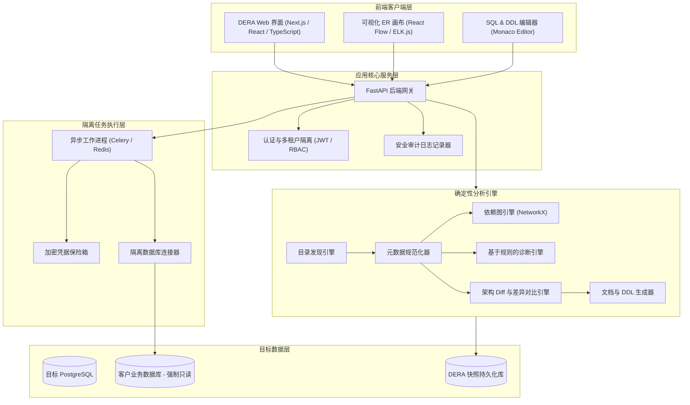
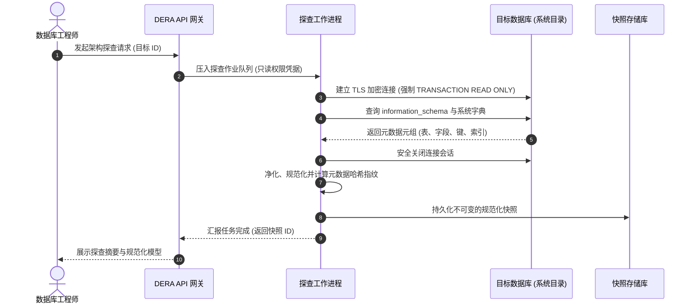
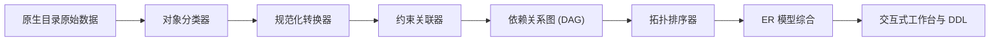
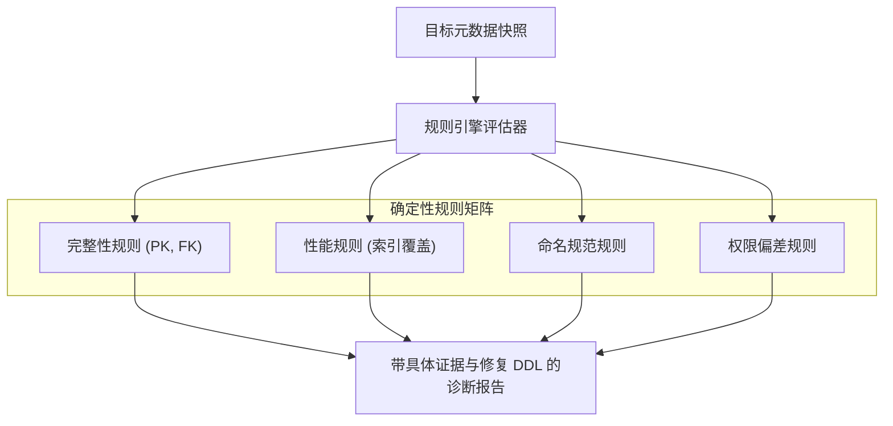
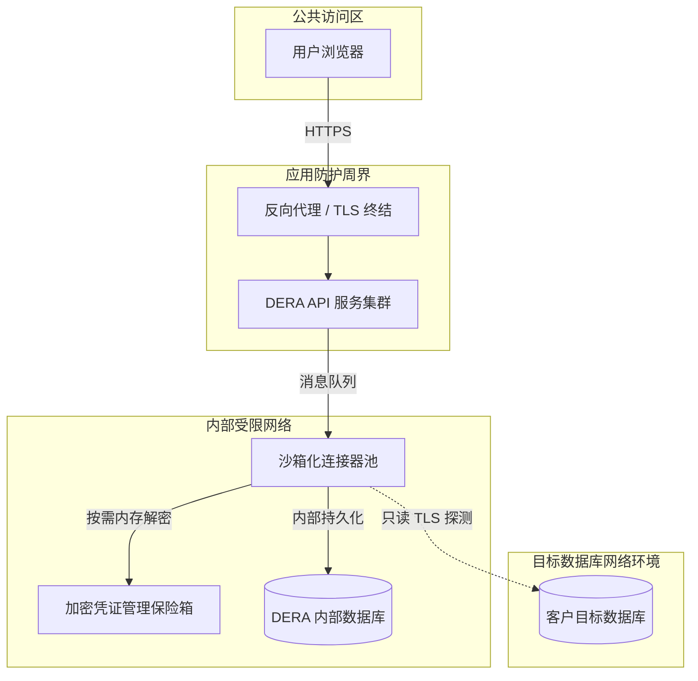
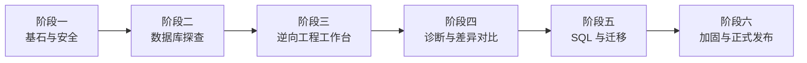

**阅读此语言的文档：** [English](../../README.md) | [Español](README.es.md) | [Français](README.fr.md) | [Deutsch](README.de.md) | [Português](README.pt.md) | [日本語](README.ja.md) | [한국어](README.ko.md) | [简体中文](README.zh-CN.md) | [العربية](README.ar.md) | [Русский](README.ru.md)

---

<div align="center">

# DERA

### Database Engineering & Reverse Analysis

**洞悉每一个架构。工程化每一次变更。**

面向开发者、数据库工程师、系统架构师及工程团队的企业级开源、确定性数据库逆向工程平台。

探索数据库结构、可视化实体关系、分析表结构、识别架构风险并自动生成工程文档 —— 纯粹确定性，不依赖任何 AI 大模型或外部 AI 推理 API。

<br/>

[](https://github.com/krishanth7/dera/stargazers)
[](https://github.com/krishanth7/dera/forks)
[](https://github.com/krishanth7/dera/issues)
[](https://github.com/krishanth7/dera/blob/main/LICENSE)
[](https://github.com/krishanth7/dera/releases)
[](https://github.com/krishanth7/dera/actions/workflows/codeql.yml)
[](https://github.com/krishanth7/dera/graphs/contributors)
[](https://github.com/sponsors/krishanth7)

<br/>

[项目概览](#-项目概览) ·
[核心功能](#-核心功能) ·
[系统架构](#-系统架构) ·
[可视化流水线](#-可视化流水线) ·
[安全准则](#-安全准则) ·
[技术栈](#-技术栈) ·
[开发路线图](#-开发路线图) ·
[参与贡献](#-参与贡献) ·
[社区交流](#-社区交流)

</div>

---

## 🌍 多语言文档支持

DERA 在全球范围内支持 10 种国际主流语言。您可以通过下表或顶部导航栏直接切换到相应语言的文档：

| 语言 | 标识码 | 文档链接 | 状态 |
|---|---|---|---|
| 🇬🇧 English | `en` | [English Primary (Root)](../../README.md) · [Synchronized Copy](README.en.md) | 主参考文档 |
| 🇪🇸 Español | `es` | [Documentación en Español](README.es.md) | 完整翻译 |
| 🇫🇷 Français | `fr` | [Documentation en Français](README.fr.md) | 完整翻译 |
| 🇩🇪 Deutsch | `de` | [Dokumentation auf Deutsch](README.de.md) | 完整翻译 |
| 🇵🇹 Português | `pt` | [Documentação em Português](README.pt.md) | 完整翻译 |
| 🇯🇵 日本語 | `ja` | [日本語ドキュメント](README.ja.md) | 完整翻译 |
| 🇰🇷 한국어 | `ko` | [한국어 문서](README.ko.md) | 完整翻译 |
| 🇨🇳 简体中文 | `zh-CN` | [简体中文文档](README.zh-CN.md) | 完整翻译 |
| 🇸🇦 العربية | `ar` | [الوثائق باللغة العربية](README.ar.md) | 完整翻译 |
| 🇷🇺 Русский | `ru` | [Документация на русском](README.ru.md) | 完整翻译 |

---

## 📖 项目概览

现代关系型数据库是软件基础设施的核心基石，但要完全理清一个不断演进且庞大陌生系统的架构往往极具挑战。企业级系统通常包含数百张数据表、数万个字段、错综复杂的外键关系、索引、约束、视图及对象间的跨层依赖。

人工调查和审计这些结构不仅耗费大量工程师精力，而且极易遗漏关键隐患。

**DERA 正是为解决这一严峻挑战而构建。**

DERA 依托严谨的确定性算法，提供了一个统一且高度安全的工作空间，用于探索数据库架构、重构实体关系、评估结构性隐患并生成规范的工程文档。

### 我们的使命

让数据库逆向工程对每一位软件工程师、数据库管理员（DBA）和系统架构师而言，都变得易于访问、透明、可复现且完全值得信赖。

### 核心设计哲学

- **天生确定性 (Deterministic by Design)** — 基于数学图论算法和静态规则，保证分析结果绝对可复现。
- **严禁生成式 AI** — 坚决不使用 LLM、机器学习模型或外部 AI 推理接口。
- **隐私至上** — 仅分析数据库系统元数据。默认绝不提取或存储任何客户业务数据行。
- **开源协作** — 基于宽松的 MIT 许可证，坚持透明工程与开放社区协作。
- **开发者为先** — 紧密贴合软件工程师和 DBA 的日常真实研发工作流。
- **安全为本** — 强制只读事务、凭据全程加密与隔离的沙箱工作进程。
- **工程严谨性** — 每一项诊断均建立在系统目录的铁证之上，彻底消除 AI 幻觉。

---

## ✨ 核心功能

以下列出 DERA 平台的规划功能矩阵。各项功能的交付将严格依照开发阶段和发布版本推进。

| 功能模块 | 状态 | 功能描述 |
|---|---|---|
| **数据库发现与探查** | 规划中 | 原生提取数据表、字段、约束及索引等系统目录元数据 |
| **逆向工程核心** | 规划中 | 规范化架构建模、对象智能分类与拓扑依赖解析 |
| **可视化 ER 工作台** | 规划中 | 交互式实体关系图、自动排版布局、条件过滤与图表导出 |
| **确定性诊断引擎** | 规划中 | 静态规则评估，精准检测主键缺失、冗余索引及命名缺陷 |
| **架构快照与差异比对**| 规划中 | 版本化架构快照存储与结构性变更影响面深度分析 |
| **SQL 性能工程** | 规划中 | 复杂查询审查、执行计划可视化与索引优化方案推荐 |
| **文档自动生成** | 规划中 | 自动化导出 Markdown、HTML、JSON、SQL DDL 及矢量 SVG |
| **企业安全架构** | 规划中 | 基于角色的权限控制 (RBAC)、只读强制保障与隔离执行容器 |

### 🔍 数据库发现与探查

全面检查受支持的数据库引擎，并提取关键的系统目录结构信息：

- 数据库、Schema 命名空间与安装的扩展插件
- 表、分区表与视图 (View)
- 字段名、数据类型、可空性 (Nullability) 及默认值表达式
- 主键 (PK)、外键 (FK) 以及级联动作 (`CASCADE`, `RESTRICT`)
- 唯一约束 (UNIQUE)、检查约束 (CHECK) 与排他约束
- 索引（B-tree、Hash、GIN、GiST）、唯一索引与部分索引条件
- 序列 (Sequence)、自增标识列与触发器 (Trigger)

### 🧬 逆向工程核心

运用原生目录查询与确定性算法，无损重建数据库逻辑模型：

- 独立于具体数据库引擎的规范化逻辑模型
- 结构化元数据标准化处理
- 构建有向无环图 (DAG) 以进行深度依赖分析
- 准确映射单列及复合外键关系网络
- 生成带有加密哈希签名的不可变架构快照
- 确定性反向还原完整的 SQL DDL 语句

### 🕸️ 可视化 ER 工作台

通过现代化交互式实体关系画布探索架构拓扑：

- 交互式数据表节点，清晰展示列名、类型与约束图标
- 带有基数（一对一、一对多）显式标记的关系连线
- 确定性自动图布局算法（层次化与力导向布局）
- 支持按 Schema 分组、业务域标签与子图过滤隔离
- 实时搜索、类型筛选与依赖关系高亮追踪
- 导出超高分辨率的 SVG 矢量图与 PNG 渲染图像

### 🛡️ 确定性数据库诊断引擎

依据可配置的工程规则矩阵对架构元数据展开全面审计，消除潜在设计隐患：

| 诊断规则 | 类别 | 规则说明 |
|---|---|---|
| **缺失主键** | 完整性 | 识别未声明显式主键约束的数据表 |
| **潜在冗余索引** | 性能 | 检测具有重叠列前缀或重复定义的冗余索引 |
| **未建索引的外键** | 性能 | 标出缺少合适索引覆盖支持的外键列 |
| **多态关联反模式** | 完整性 | 发现缺少外键约束支持的隐式松散多态关联 |
| **可空性与默认值异常**| 一致性 | 标出被设为 NOT NULL 却缺少合理默认值的字段 |
| **命名规范审计** | 标准化 | 识别大小写混乱及偏离团队架构规范的表名和字段 |
| **权限过度开放** | 安全性 | 标记系统目录对象上配置的过量越权访问权限 |

*所有诊断结果均为基于系统实证的建议，并附带详尽的技术原由与可执行的修复 DDL。*

### 🔄 架构快照与差异对比引擎

精确对比不同环境（开发、测试、生产）或不同版本间的数据库快照：

- 新增、修改和删除的数据表与字段
- 字段数据类型变更、长度调整与可空性变化
- 索引的新增、移除及定义属性变更
- 约束条件的调整与引用完整性变化
- 破坏性变更等级评定（安全变更 vs 潜在破坏性变更）
- 依据拓扑依赖关系生成按安全执行顺序排布的迁移变更脚本

---

## 🧠 绝无 AI。唯有纯粹工程。

DERA 严格奉行纯粹的计算机工程设计，坚决杜绝任何人工智能或机器学习技术。

```text
┌───────────────────────────────────────────────────────────┐
│                 严 格 的 非 AI 构 架 保 证                │
│                                                           │
│   ❌  不使用 OpenAI、Anthropic Claude 或 Google Gemini    │
│   ❌  不使用 Groq、DeepSeek 等任何托管大模型推理 API      │
│   ❌  不使用本地部署 LLM (Ollama, vLLM, llama.cpp)        │
│   ❌  彻底根绝非确定性的 AI 幻觉 (Hallucination)          │
│                                                           │
│   ✅  原生系统目录查询 (information_schema / pg_catalog)  │
│   ✅  严密的确定性图论算法 (NetworkX)                     │
│   ✅  精确的抽象语法树 SQL 解析器 (SQLGlot)               │
│   ✅  严格可复现的静态规则引擎                            │
│   ✅  形式化的数学架构差异对比算法                        │
└───────────────────────────────────────────────────────────┘
```

**为什么 DERA 必须是确定性的：**
1. **完全可预测：** 相同的快照数据与规则配置，在任何时间运行都必定输出完全一致的结果。
2. **彻底可审计：** 每一个告警、每一条关联关系和图上的每一条连线，都直接映射到底层系统目录的客观事实。
3. **数据主权安全：** 企业核心数据库结构与元数据绝不会被发送至任何第三方模型提供商。
4. **极致性能与零成本：** 零推理延迟、零 Token 账单、无 API 请求频率限制、完全免疫外部服务故障。

---

## 🏗️ 系统架构

DERA 采用模块化单体架构，专注于提供高可维护性、高扩展性与极具防御性的数据库安全连接。



---

## 🔬 可视化流水线

DERA 运转透明、可审计且可精确复现的处理流水线，完成元数据探查、关系建模与安全边界校验。

### 1. 数据库探查执行流程



### 2. 架构逆向工程处理流水线



### 3. 元数据诊断处理流水线



### 4. 安全边界与网络隔离架构



### 5. 软件工程规划生命周期



---

## 🔒 安全准则

由于 DERA 直接接入承载关键业务的数据库，安全性始终被作为第一优先级贯穿于架构之中。

- **强制只读事务:** 所有探测会话严格执行只读模式声明 (`SET SESSION CHARACTERISTICS AS TRANSACTION READ ONLY`)。
- **绝不读取用户行数据:** 探查操作仅查询系统目录元数据 (`information_schema`, `pg_catalog`)，坚决不触碰、不提取任何实际业务数据。
- **代码中绝无明文密钥:** 凭据使用 AES-256-GCM 算法静态加密保存，绝不打印至日志、绝不导出、绝不提交至代码仓库。
- **严格防御 SSRF 攻击:** 严格校验目标主机与 IP 地址，坚决防范针对内网敏感设施及云上元数据服务 (169.254.169.254) 的探测。
- **最小权限访问原则:** 提供详尽的手册，指导用户仅为 DERA 分配不具备任何管理权限的审计只读专用账号。
- **全方位审计日志:** 每一笔探查任务、每一次导出和所有配置变更，均生成不可篡改的安全审计流水。

*完整的安全漏洞披露流程与指引，请参阅 [SECURITY.md](../../SECURITY.md)。*

---

## 🛠️ 技术栈

| 分层 | 组件 | 技术选型 | 用途定位 | 状态 |
|---|---|---|---|---|
| **前端展现层** | 框架 | Next.js, React, TypeScript | 现代化响应式 Web 应用程序 | 规划中 |
| | 样式库 | Tailwind CSS | 一致且优雅的自适应界面设计系统 | 规划中 |
| | UI 组件库 | shadcn/ui | 高可访问性标准组件 | 规划中 |
| | 图形可视化 | React Flow, ELK.js | 交互式关系图谱与智能排版引擎 | 规划中 |
| | 代码编辑器 | Monaco Editor | SQL 语法高亮与 DDL 代码预览 | 规划中 |
| **后端服务层** | API 框架 | Python 3.12+, FastAPI | 高性能全异步 REST API 服务 | 规划中 |
| | 目录探查 | SQLAlchemy, psycopg | 元数据抽取与连接池管理 | 规划中 |
| | SQL 语法解析 | SQLGlot | 跨数据库引擎的 SQL AST 生成与解析 | 规划中 |
| | 图论算法 | NetworkX | 拓扑依赖排序与环路检测 | 规划中 |
| | 异步任务队列 | Celery, Redis | 隔离运行的异步探测工作进程 | 规划中 |
| **持久化存储** | DERA 数据存储 | PostgreSQL | 存储架构快照、用户会话与安全审计日志 | 规划中 |
| | 数据库迁移 | Alembic | DERA 自身数据库架构的版本演进管理 | 规划中 |
| **运维与测试** | 容器化 | Docker, Docker Compose | 100% 可复现的本地开发与生产部署镜像 | 规划中 |
| | 静态代码分析 | CodeQL, Dependabot | 自动化代码安全扫描与依赖漏洞告警 | 已实现 |
| | 质量测试体系 | Pytest, Playwright | 后端单元测试与前端端到端 UI 测试 | 规划中 |

---

## 🗄️ 数据库兼容性矩阵

DERA 采用高度模块化的插件式连接器架构，旨在支持当代各类主流关系型与分布式数据库：

| 数据库引擎 | 连接器状态 | 元数据源 | 计划交付版本 |
|---|---|---|---|
| **PostgreSQL** (v12 - v17) | 正在开发中 | `pg_catalog`, `information_schema` | 阶段二 (MVP) |
| **Supabase PostgreSQL** | 正在开发中 | PostgreSQL 原生连接器通道 | 阶段二 (MVP) |
| **MySQL** (v8.0+) | 规划中 | `information_schema`, `performance_schema` | 阶段五 |
| **SQLite** (v3.35+) | 规划中 | `sqlite_master`, `PRAGMA` 表结构命令 | 阶段五 |
| **MariaDB** (v10.5+) | 规划中 | `information_schema` | 阶段五 |
| **Microsoft SQL Server** | 规划中 | `sys.tables`, `INFORMATION_SCHEMA` | 阶段五 |
| **Oracle Database** | 技术评估中 | 数据字典视图 (`ALL_*`, `DBA_*`) | 未来版本规划 |

---

## 🚀 快速上手

DERA 目前正处于底层架构与核心能力的基础构建阶段。随各个里程碑版本发布后，我们将提供正式生产环境的安装手册。

### 运行环境准备（规划中）

- Python 3.12 或更高版本
- Node.js LTS (v20+)
- PostgreSQL 15+
- Docker 及 Docker Compose
- Git

### 克隆仓库

```bash
git clone https://github.com/krishanth7/dera.git
cd dera
```

### 本地开发环境启动（规划中）

```bash
# 复制并配置文件模板
cp .env.example .env

# 通过 Docker Compose 启动全套开发容器栈
docker compose -f infrastructure/docker/docker-compose.dev.yml up --build
```

> **注意：** 应用程序核心代码正在紧锣密鼓开发中，请关注 [开发路线图](#-开发路线图) 获取最新进度。

---

## 📁 仓库目录结构

```text
dera/
├── .github/
│   ├── ISSUE_TEMPLATE/           # 规范化 GitHub 议题模版
│   ├── workflows/                # CodeQL、依赖安全审计及持续集成流水线
│   ├── PULL_REQUEST_TEMPLATE.md  # 规范化合并请求模板
│   ├── dependabot.yml            # Dependabot 自动更新配置
│   └── FUNDING.yml               # 维护者赞助通道配置文件
├── docs/
│   ├── README.md                 # 完整文档索引导航中枢
│   ├── i18n/                     # 同步维护的多语言文档目录
│   │   ├── README.en.md          # 英文同步基准文档
│   │   ├── README.es.md          # 西班牙语完整文档
│   │   ├── README.fr.md          # 法语完整文档
│   │   ├── README.de.md          # 德语完整文档
│   │   ├── README.pt.md          # 葡萄牙语完整文档
│   │   ├── README.ja.md          # 日语完整文档
│   │   ├── README.ko.md          # 韩语完整文档
│   │   ├── README.zh-CN.md       # 简体中文完整文档
│   │   ├── README.ar.md          # 阿拉伯语完整文档（完美适配 RTL）
│   │   └── README.ru.md          # 俄语完整文档
│   ├── architecture/             # 系统架构技术规范书
│   ├── development/              # 本地搭建与研发编码规范
│   ├── security/                 # 威胁建模与安全开发手册
│   └── contributing/             # 贡献者指引指南
├── CODE_OF_CONDUCT.md            # Contributor Covenant 行为准则
├── CONTRIBUTING.md               # 贡献者指南详细说明
├── LICENSE                       # MIT 开源许可证
├── README.md                     # 项目仓库官方主页
├── SECURITY.md                   # 综合企业安全政策
└── .gitignore                    # Git 忽略配置规则
```

---

## 🗺️ 开发路线图

### 阶段一 — 基石与安全规范
- [x] 确立正式的项目定位与宽松的 MIT 许可证
- [x] 搭建 CodeQL 静态应用安全测试 (SAST) 自动化流水线
- [x] 制定行为准则与严格的企业级安全披露政策
- [x] 建立 10 种语言互通的国际化文档体系
- [ ] 初始化单体多包应用程序目录结构 (`apps/web`, `apps/api`)
- [ ] 配置 Docker 本地开发套件与基础 CI 流程

### 阶段二 — 数据库探查核心
- [ ] 研发 PostgreSQL 原生元数据提取连接器
- [ ] 探查提取数据表、字段、约束、索引与视图
- [ ] 建立引擎无关的标准架构规范化模型
- [ ] 实现具备防篡改校验哈希的不可变架构快照存储
- [ ] 构建只读会话强校验机制与查询超时防护网

### 阶段三 — 逆向工程工作室
- [ ] 基于 React Flow 打造交互式 ER 关系画布
- [ ] 研发自动分层排版布局算法
- [ ] 支持按 Schema 过滤、全文模糊搜索与业务域分组
- [ ] 构建有向无环依赖图 (DAG) 的遍历与可视化
- [ ] 支持导出高保真 SVG 矢量图与 PNG 图像

### 阶段四 — 确定性诊断与差异对比
- [ ] 研发纯确定性规则驱动的诊断引擎
- [ ] 交付内置核心规则：缺失主键、冗余索引、外键缺少索引支持
- [ ] 实现架构快照差异比较算法 (Snapshot Diff)
- [ ] 生成结构化的 DDL 迁移变更影响预览
- [ ] 导出 Markdown、JSON 和 HTML 格式的诊断审计报告

### 阶段五 — 高级工程功能与新引擎连接器
- [ ] 基于 SQLGlot 引入 SQL AST 查询解析与复杂度指标分析
- [ ] 构建查询执行计划可视化工具 (`EXPLAIN ANALYZE`)
- [ ] 研发 MySQL 和 SQLite 专用数据库连接器
- [ ] 研发基于依赖图顺序的智能 DDL 迁移生成器

### 阶段六 — 生产环境加固
- [ ] 开展全方位第三方安全审计与渗透测试
- [ ] 完成超大规模复杂 Schema（1,000+ 数据表）性能基准测试
- [ ] 严格验证多租户数据隔离机制与审计日志防篡改性
- [ ] 正式发布 v1.0.0 生产环境容器镜像与部署白皮书

---

## 🧪 测试与质量保证策略

DERA 依赖可重复的自动化测试体系保障企业级工程品质：

- **单元测试:** 使用合成元数据全量测试解析器、图论环路检测和所有诊断规则。
- **集成测试:** 启动真实的 PostgreSQL、MySQL、SQLite 容器实例检验连接器的鲁棒性。
- **确定性验证:** 严密保证相同的输入快照在任何时刻都能算出完全相同的哈希签名与诊断报告。
- **代码安全测试:** CodeQL 持续自动化分析、依赖组件已知漏洞扫描及密钥泄漏检测。
- **端到端测试 (E2E):** 使用 Playwright 在无头浏览器中验证图表交互性与跨分辨率自适应能力。

---

## 🤝 参与贡献

我们热烈欢迎来自全球的软件工程师、数据库专家、技术作家和安全研究人员参与共同建设。

提交 Pull Request 之前，请务必仔细阅读我们的 [CONTRIBUTING.md](../../CONTRIBUTING.md) 贡献指南与 [行为准则](../../CODE_OF_CONDUCT.md)。

### 标准贡献流程

1. 在 GitHub 上 Fork 本项目仓库。
2. 创建独立的特性分支：`git checkout -b feat/your-feature-name`。
3. 遵循 [Conventional Commits](../../CONTRIBUTING.md#commit-message-guidelines) 规范编写清晰的提交信息。
4. 编写对应的单元测试或集成测试用例。
5. 确保 CodeQL 静态检查与所有文档校验通过。
6. 向 `main` 分支提交 Pull Request，等待维护者审查合并。

---

## 💬 社区交流

- [GitHub Discussions](https://github.com/krishanth7/dera/discussions) — 提问答疑、创意碰撞与数据库工程技术研讨。
- [GitHub Issues](https://github.com/krishanth7/dera/issues) — 提交 Bug 反馈或申请新功能特性。
- [GitHub Pull Requests](https://github.com/krishanth7/dera/pulls) — 提交高质量的代码与文档贡献。
- [Releases](https://github.com/krishanth7/dera/releases) — 跟踪官方版本发布与更新日志。

---

## ❤️ 支持本项目

DERA 是由个人发起的独立开源软件工程项目。您可以通过以下方式支持它的长足演进：

- 在 GitHub 上为本项目点亮一颗星（Star）
- 将项目推荐给您身边的研发团队和技术同行
- 贡献新的数据库连接器、诊断规则或参与文档维护
- [通过 GitHub Sponsors 赞助支持维护者](https://github.com/sponsors/krishanth7)

---

## 📜 开源许可证

DERA 遵循自由宽松的 **[MIT 许可证](../../LICENSE)** 开放源代码。

```text
Copyright (c) 2026 Krishanth
```

---

## 👨‍💻 项目维护者

**Krishanth**  
创始人与首席维护者

- GitHub 主页: [@krishanth7](https://github.com/krishanth7)  
- 代码仓库: [github.com/krishanth7/dera](https://github.com/krishanth7/dera)  
- 联络邮箱: `krishanth.b.2008@gmail.com`

*DERA 是由 Krishanth 独立维护的开源技术项目。OVIC Labs 被认可为维护者更广泛工程生态系统的一部分。*

---

<div align="center">

### DERA — Database Engineering & Reverse Analysis

**洞悉每一个架构。工程化每一次变更。**

*以工程精确度、数学确定性与开源透明性精心铸就。*

© 2026 DERA 贡献者团队. Distributed under the MIT License.

[回到顶部](#dera)

</div>
