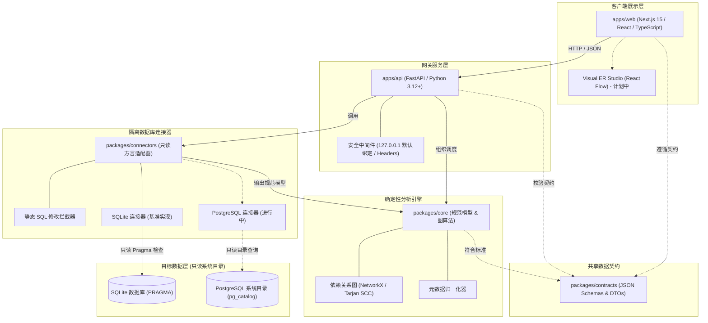

**阅读此语言的文档：** [English (Root)](../../README.md) | [Español](README.es.md) | [Français](README.fr.md) | [Deutsch](README.de.md) | [Português](README.pt.md) | [Italiano](README.it.md) | [日本語](README.ja.md) | [한국어](README.ko.md) | [简体中文](README.zh-CN.md) | [Русский](README.ru.md)

---

<div align="center">

# DERA

### Database Engineering & Reverse Analysis

**洞悉每个模式，掌控每次变更。**

面向软件工程师、数据库架构师和工程团队的独立开源、确定性数据库工程与逆向分析平台。

探索数据库结构、重建实体关系、评估结构性风险并安全规划模式变更 — 完全基于数学确定性，无需任何 AI 模型或外部推理 API。

<br/>

[](../../LICENSE)
[](https://github.com/krishanth7/dera/actions/workflows/ci.yml)
[](https://github.com/krishanth7/dera/actions/workflows/codeql.yml)
[](https://github.com/krishanth7/dera/actions/workflows/documentation.yml)
[](../../pyproject.toml)
[](../../tsconfig.json)
[-orange?style=for-the-badge)](#-严格无ai架构)
[](../../CONTRIBUTING.md)

<br/>

[项目概述](#-项目概述) ·
[功能状态矩阵](#-功能状态矩阵) ·
[架构总览](#-架构总览) ·
[代码库结构](#-代码库目录结构) ·
[快速开始](#-快速开始) ·
[数据库兼容性](#-数据库兼容性矩阵) ·
[安全原则](#-安全原则) ·
[文档导航](#-开发者文档导航) ·
[开发路线图](#-开发路线图) ·
[参与贡献](#-参与贡献) ·
[社区交流](#-社区交流)

</div>

---

## 🌍 多语言文档支持

DERA 维护着 10 种国际语言的同步文档。英文 README 是依据我们的 [文档维护规范协议](../development/README_MAINTENANCE.md) 制定的官方权威事实源。

| 语言 | 代码 | 文档链接 | 状态 |
|---|---|---|---|
| 🇬🇧 English | `en` | [English Primary (Root)](../../README.md) · [Synchronized Copy](README.en.md) | **官方权威事实源 (Authoritative)** |
| 🇪🇸 Español | `es` | [Documentación en Español](README.es.md) | 完整翻译 |
| 🇫🇷 Français | `fr` | [Documentation en Français](README.fr.md) | 完整翻译 |
| 🇩🇪 Deutsch | `de` | [Dokumentation auf Deutsch](README.de.md) | 完整翻译 |
| 🇵🇹 Português | `pt` | [Documentação em Português](README.pt.md) | 完整翻译 |
| 🇮🇹 Italiano | `it` | [Documentazione in Italiano](README.it.md) | 完整翻译 |
| 🇯🇵 日本語 | `ja` | [日本語ドキュメント](README.ja.md) | 完整翻译 |
| 🇰🇷 한국어 | `ko` | [한국어 문서](README.ko.md) | 完整翻译 |
| 🇨🇳 简体中文 | `zh-CN` | [简体中文文档](README.zh-CN.md) | 完整翻译 |
| 🇷🇺 Русский | `ru` | [Документация на русском](README.ru.md) | 完整翻译 |

---

## 📖 项目概述

现代关系型数据库是软件基础设施的核心支柱。然而，理解不熟悉、遗留或快速演进的复杂数据库模式是一个艰巨的工程挑战：
- **复杂模式：** 企业级数据库往往包含数百张表、数千个列以及未记录的隐式外键关系。
- **架构技术债务：** 循环外键依赖、缺失主键、未建立索引的外键以及冗余索引会随时间悄然积累。
- **变更与迁移风险：** 在缺乏完整拓扑关系图的情况下修改模式，极易引发锁升级、数据损坏和级联约束冲突。
- **数据隐私与安全：** 企业绝不能冒着泄露生产凭据或客户实际数据行的风险使用外部云端 AI 接口。

**DERA 专为通过数学确定性解决这些挑战而打造。**

DERA 提供了一个模块化的开源平台，能够安全检查关系型数据库系统目录、重建依赖关系图、评估结构性风险，并基于可重现的算法生成迁移预览。

### 核心工程原则

1. **确定性设计 (Deterministic by Design)：** 每一个模式快照、拓扑排序和诊断报告都完全可重现，并建立在严格的关系代数之上。
2. **纯粹无 AI (Strictly Non-AI)：** 绝无生成式 AI、无大语言模型 (LLM)、无向量数据库、无外部推理 API 依赖。
3. **只读安全连接：** 连接级别强制只读保护、AST 抽象语法树静态拦截危险修改操作，并仅查询系统元数据目录。
4. **零客户数据行提取：** 纯粹的元数据自省 (`information_schema`, `pg_catalog`, `sqlite_master`)。绝不提取、传输或存储业务数据行。
5. **解耦的 Monorepo 架构：** 核心图算法、隔离的数据库适配器、API 网关和可视化前端之间具备清晰的架构边界。
6. **开源宽松授权：** 基于宽松友好的 [MIT 许可证](../../LICENSE) 发布。

---

## 🧠 严格无 AI 架构

DERA 经过深思熟虑的设计，完全杜绝了人工智能和机器学习组件。

```text
┌───────────────────────────────────────────────────────────┐
│                    严格无 AI 确定性架构                   │
│                                                           │
│   ❌  不使用 OpenAI、Anthropic Claude 或 Google Gemini    │
│   ❌  不调用 Groq、DeepSeek 等第三方模型 API              │
│   ❌  不运行本地 LLM (Ollama, vLLM, llama.cpp)            │
│   ❌  杜绝概率猜测与大模型幻觉 (Hallucinations)           │
│   ❌  不使用云端向量嵌入与外部 RAG 检索                   │
│                                                           │
│   ✅  直接查询原生系统目录 (information_schema)           │
│   ✅  数学图论算法分析 (NetworkX / Tarjan SCC)            │
│   ✅  抽象语法树 (AST) SQL 解析器 (SQLGlot)               │
│   ✅  可验证且可重现的静态规则引擎                        │
│   ✅  加密哈希指纹追踪 (SHA-256)                          │
└───────────────────────────────────────────────────────────┘
```

**为什么 DERA 选择确定性设计：**
- **数学可审计性：** 每项关系判定、循环警告和诊断报告均附带系统目录凭证和确凿的图算法依据。
- **逐字节可重现性：** 在任何开发机或 CI 流水线上对同一快照执行分析，始终输出百分之百相同的结果。
- **企业数据主权：** 您的模式结构和拓扑信息绝不会发送给任何第三方模型供应商。
- **零运行开销：** 零 Token 计费、无 API 调用频率限制、无网络推理延迟。

---

## 📊 功能状态矩阵

DERA 坚持透明、求实的工程报告，所有功能状态均基于代码库中实际编写并经受自动化测试检验的代码：

| 能力模块 | 状态 | 实现凭据 | Monorepo 路径 |
|---|:---:|---|---|
| **模式核心模型** | **已实现** | 标准 `Column`, `Table`, `ForeignKey`, `Index` 规范模型 | [`packages/core/src/dera/models.py`](../../packages/core/src/dera/models.py) |
| **依赖关系图引擎** | **已实现** | 具备防循环特性的 DAG 及基于 Tarjan SCC 的拓扑排序 | [`packages/core/src/dera/graph.py`](../../packages/core/src/dera/graph.py) |
| **修改操作拦截器 (Read-Only)** | **已实现** | 基于 AST 静态分析并拦截修改操作 (`DROP`, `ALTER` 等) | [`packages/connectors/src/dera_connectors/base/`](../../packages/connectors/src/dera_connectors/base/connector.py) |
| **SQLite 系统目录自省** | **已实现** | 表、字段、PK、FK 及索引的自动化检测 | [`packages/connectors/src/dera_connectors/sqlite/`](../../packages/connectors/src/dera_connectors/sqlite/connector.py) |
| **PostgreSQL 目录检查** | **进行中** | 针对临时 PostgreSQL 容器的实时集成测试 | [`tests/integration/`](../../tests/integration/) |
| **API 网关与遥测** | **已实现** | 默认绑定本地环回接口并提供健康监测的 FastAPI 服务 | [`apps/api/src/dera_api/main.py`](../../apps/api/src/dera_api/main.py) |
| **Web 交互工作室底座** | **已实现** | Next.js 15 TypeScript 项目底座与架构看板卡片 | [`apps/web/src/app/page.tsx`](../../apps/web/src/app/page.tsx) |
| **共享数据契约** | **已实现** | 版本化 JSON Schema 架构与序列化 DTO | [`packages/contracts/schemas/`](../../packages/contracts/schemas/) |
| **可视化 ER 画布** | 计划中 | 基于 React Flow 的交互式架构图画布 | 路线图第 7 阶段 |
| **确定性规则矩阵** | 计划中 | 缺少主键、外键无索引、冗余索引等问题检测 | 路线图第 8 阶段 |
| **模式快照 Diff 引擎** | 计划中 | 模式语义快照比对与 DDL 变更预览 | 路线图第 9 阶段 |
| **SQL AST 性能分析器** | 计划中 | 基于 SQLGlot 的查询复杂度分析与执行计划可视化 | 路线图第 10 阶段 |

> **状态说明：**
> - **`已实现`** &mdash; 代码已合并，经过验证，CI 自动化测试全绿。
> - **`进行中`** &mdash; 当前里程碑正在进行开发与集成测试。
> - **`计划中`** &mdash; 已排入 12 阶段主开发路线图。

---

## 🏗️ 架构总览

DERA 依据我们的 [Monorepo 架构设计规范](../architecture/README_ARCHITECTURE.md) 将各项能力划分为高度解耦的工作区：



### 架构文字说明（无障碍支持）
- **客户端展示层 (`apps/web`):** Next.js 15 TypeScript 前端，通过 JSON 与 API 通信，并将提供交互式 ER 画布。
- **网关服务层 (`apps/api`):** 默认绑定 `127.0.0.1` 的 FastAPI 后端，提供服务健康度监控、系统目录提取路由和安全中间件。
- **共享数据契约 (`packages/contracts`):** 规定数据表、字段、索引、关联和快照规范标准的 JSON Schema 定义和 TypeScript 接口。
- **确定性核心引擎 (`packages/core`):** 纯 Python 核心库，实现规范领域模型、Tarjan 强连通分量算法、拓扑排序和元数据标准化。
- **隔离数据库连接器 (`packages/connectors`):** 安全查询系统目录 (`sqlite_master`, `pg_catalog`) 的插件式适配器，在执行前静态拦截任何写修改指令。
- **目标数据层（只读）：** 目标数据库。DERA 严格仅使用无特权的只读账号接入。

延伸阅读：
- [架构设计蓝图指南](../architecture/README_ARCHITECTURE.md)
- [模块边界与依赖规则](../architecture/MODULE_BOUNDARIES.md)
- [Monorepo 目录布局](../architecture/MONOREPO_STRUCTURE.md)
- [架构决策记录 (ADR 0001)](../architecture/adr/0001-monorepo-architecture.md)

---

## 📁 代码库目录结构

DERA Monorepo 真实的项目目录结构如下：

```text
dera/
├── apps/
│   ├── api/                      # FastAPI 后端服务及健康监控
│   │   ├── src/dera_api/         # 网关路由、中间件与模式定义
│   │   └── pyproject.toml        # API 打包规范
│   └── web/                      # Next.js 15 TypeScript 前端交互工作室
│       ├── src/                  # App 路由、组件和 API 客户端
│       └── package.json          # Web 工作区配置
├── packages/
│   ├── core/                     # 规范模式模型与图计算引擎
│   │   └── src/dera_core/        # 模式实体模型、DAG 算法和图论计算
│   ├── connectors/               # 针对各数据库的元数据提取适配器
│   │   └── src/dera_connectors/  # 基础连接器、变更防护与 SQLite 适配器
│   └── contracts/                # 共享 JSON 契约与序列化定义
│       └── schemas/              # 版本化的 API 与快照契约
├── tests/
│   ├── architecture/             # AST 导入边界与依赖合规测试
│   ├── integration/              # SQLite 及 PostgreSQL 真实系统目录测试
│   ├── regression/               # 确定性 DAG 排序与哈希回归测试
│   └── unit/                     # 实体模型、PR 标题及准备度单测
├── scripts/
│   ├── ci/                       # CI 校验脚本 (文档、国际化、PR 标题)
│   └── development/              # 跨平台开发统一 CLI 工具 (dev.py)
├── docs/
│   ├── audit/                    # 仓库审计、基线报告与完成度审计
│   ├── architecture/             # 架构蓝图、边界说明与决策记录
│   ├── development/              # 入门指南、命令手册与 Git 工作流
│   ├── governance/               # 项目治理、维护者规范与许可证
│   ├── security/                 # 威胁模型、数据库安全与漏洞响应
│   ├── community/                # 社区枢纽、讨论指南与 Issue 分类
│   ├── roadmap/                  # 12 阶段主开发路线图
│   └── i18n/                     # 同步维护的 10 种语言技术文档
├── .github/
│   ├── workflows/                # 企业级 CI/CD、CodeQL 与质量门禁
│   ├── ISSUE_TEMPLATE/           # 结构化 YAML 问题反馈模板
│   ├── PULL_REQUEST_TEMPLATE/    # 细分领域的 Pull Request 模板
│   ├── CODEOWNERS                # 代码所有权定义
│   └── PULL_REQUEST_TEMPLATE.md  # 标准 PR 合规校验模板
├── pyproject.toml                # 根 Python 项目配置 (PEP 621)
├── package.json                  # 根 npm 依赖配置
├── tsconfig.json                 # 严格模式 TypeScript 配置文件
├── Makefile                      # 常用操作快捷管理脚本
├── CONTRIBUTING.md               # 完整的贡献者工作手册
├── SECURITY.md                   # 漏洞报告与披露政策
└── LICENSE                       # MIT 许可证
```

---

## 🚀 快速开始

DERA 提供了统一的跨平台 CLI 脚本 (`scripts/development/dev.py`)，确保在 Windows、Linux 和 macOS 上具备完全一致的测试与运行体验。

### 环境准备

| 工具 | 最低版本 | 推荐版本 | 版本验证指令 |
|---|---|---|---|
| **Python** | `3.12+` | `3.12` 或 `3.13` | `python --version` |
| **Node.js** | `20.x LTS` | `20.x` 或 `22.x LTS` | `node --version` |
| **Git** | `2.30+` | 最新稳定版 | `git --version` |

### 1. 克隆代码库

```bash
git clone https://github.com/krishanth7/dera.git
cd dera
```

### 2. 初始化环境配置

复制安全的环境变量模板：

```bash
# Windows PowerShell
Copy-Item .env.example .env

# Linux / macOS
cp .env.example .env
```

### 3. 配置 Python 虚拟环境

```bash
# Linux / macOS
python3 -m venv .venv
source .venv/bin/activate
pip install -e ".[dev]"

# Windows PowerShell
python -m venv .venv
.venv\Scripts\Activate.ps1
pip install -e ".[dev]"
```

### 4. 安装 Node.js 依赖

```bash
npm install
```

### 5. 运行完整验证套件

一键验证所有 Python 模块编译、TypeScript 类型检查、自动化测试和文档链接有效性：

```bash
python scripts/development/dev.py all
```

**预期输出：**
```text
Ran 32 tests in 0.25s
OK (skipped=2)
Validating 69 markdown documentation files...
SUCCESS: All 69 markdown documentation files are valid.
Validating 10 multilingual documentation files in i18n...
SUCCESS: All 10 language documentation files verified with valid navigation and parity.
[SUCCESS]: All development baseline checks passed successfully.
```

### 6. 开发者常用命令手册

| 目标任务 | 跨平台 CLI (`dev.py`) | GNU Make (UNIX / macOS) |
|---|---|---|
| **运行所有测试** | `python scripts/development/dev.py test` | `make test` |
| **执行 TypeScript 类型检查** | `python scripts/development/dev.py typecheck` | `make typecheck` |
| **编译 Python 字节码** | `python scripts/development/dev.py compile` | `make build` |
| **校验全量文档链接** | `python scripts/development/dev.py validate-docs` | `make lint` |
| **验证提交 / PR 标题格式** | `python scripts/development/dev.py validate-title "<title>"` | `make validate-title TITLE="..."` |
| **启动本地 API 服务** | `python -m uvicorn dera_api.main:app --reload --port 8000` | `make dev-api` |
| **启动前端 Studio 工作室** | `npm run dev --workspace=apps/web` | `npm run dev --workspace=apps/web` |

更详细的入门指引请参考 [新手入门指南](../development/GETTING_STARTED.md) 和 [开发命令清单](../development/COMMANDS.md)。

---

## 🗄️ 数据库兼容性矩阵

DERA 遵循模块化的可插拔连接器架构。各项支持等级均基于实际可用代码与自动化测试：

| 数据库引擎 | 支持版本 | 连接器状态 | 元数据自省机制 | 只读安全保障机制 |
|---|:---:|:---:|---|---|
| **SQLite** | 3.35+ | **已实现** | `sqlite_master`, `PRAGMA table_info`, `PRAGMA foreign_key_list` | 静态 AST 拦截与 `PRAGMA query_only = ON` |
| **PostgreSQL** | 12 – 17 | **进行中** | `pg_catalog`, `information_schema` | `SET default_transaction_read_only = ON` 与只读账号角色 |
| **Supabase PostgreSQL** | 云端 / 本地 | **进行中** | 原生 PostgreSQL 系统目录提取 | 连接会话级别强制只读与非特权角色 |
| **MySQL** | 8.0+ | 计划中 | `information_schema`, `performance_schema` | 只读会话事务隔离机制 |
| **MariaDB** | 10.5+ | 计划中 | `information_schema` | 只读会话事务隔离机制 |
| **Microsoft SQL Server** | 2019+ | 计划中 | `sys.tables`, `INFORMATION_SCHEMA` | 只读用户专属权限配置 |

> [!NOTE]
> 标记为 **`进行中`** 的连接器会在 CI 流水线中针对临时容器持续运行测试；标记为 **`计划中`** 的连接器已排入路线图第 5 阶段。

---

## 🔒 安全原则

安全是 DERA 最为优先的工程基石。在与数据库架构交互的过程中，我们执行严密的深度防御策略：

1. **静态 SQL 变更拦截器：** 在向目标数据库发送任何 SQL 之前，查询会先经过 AST 语法树拦截器。包含 `DROP`, `ALTER`, `TRUNCATE`, `INSERT`, `UPDATE`, `DELETE`, `GRANT`, `REVOKE` 等修改指令的查询将被立即阻断。
2. **纯粹限定系统目录：** 检查范围严格限制在系统元数据目录 (`information_schema`, `pg_catalog`, `sqlite_master`)。绝不查询任何业务数据记录。
3. **默认绑定本地环回接口：** 开发服务和 API 接口默认仅绑定 `127.0.0.1`，防止在不知情的情况下暴露在公网上。
4. **最小权限数据库账户：** DERA 仅依靠无管理特权的普通只读账号运行，绝不索取任何多余权限。
5. **严禁凭据入库：** 任何密钥或凭据均不会写入磁盘、提交至 Git 或输出到运行日志中。
6. **负责任的漏洞披露：** 遵循严格的 [安全策略](../../SECURITY.md)，通过安全私密渠道接收并响应漏洞。

> [!NOTE]
> DERA 践行成熟的开源安全规范（包括 CodeQL、Bandit SAST、密钥防泄漏扫描等）。我们并未声明任何商业性第三方认证（如 SOC 2 或 ISO 27001）。

专门的安全规范文件：
- [**数据库安全规范**](../security/DATABASE_SECURITY.md) — 系统目录只读自省与凭据隔离。
- [**安全开发工程标准**](../security/SECURE_DEVELOPMENT.md) — 输入参数化防御与 CI 门禁。
- [**安全漏洞响应流程**](../security/VULNERABILITY_RESPONSE.md) — 五阶段响应机制与私密通报流程。
- [**威胁模型矩阵**](../security/model.md) — 攻击路径分析与防御措施。

---

## 📚 开发者文档导航

查阅 DERA 完整的文档体系：

| 领域 | 核心手册 |
|---|---|
| **系统架构** | [Monorepo 架构蓝图](../architecture/README_ARCHITECTURE.md) · [模块边界规则](../architecture/MODULE_BOUNDARIES.md) · [目录结构说明](../architecture/MONOREPO_STRUCTURE.md) · [架构决策记录](../architecture/adr/0001-monorepo-architecture.md) |
| **工程开发** | [快速入门指南](../development/GETTING_STARTED.md) · [开发命令清单](../development/COMMANDS.md) · [环境配置指南](../development/ENVIRONMENT.md) · [排错手册](../development/TROUBLESHOOTING.md) |
| **文档管理** | [文档维护规范协议](../development/README_MAINTENANCE.md) · [技术写作标准](../development/README_GUIDELINES.md) |
| **项目治理** | [维护者管理规范](../governance/MAINTAINERS.md) · [治理决议记录](../governance/GOVERNANCE_DECISIONS.md) · [第三方许可证清单](../governance/THIRD_PARTY_LICENSES.md) |
| **安全合规** | [安全合规政策](../../SECURITY.md) · [数据库安全规范](../security/DATABASE_SECURITY.md) · [安全开发标准](../security/SECURE_DEVELOPMENT.md) · [漏洞处理响应流程](../security/VULNERABILITY_RESPONSE.md) |
| **社区共建** | [贡献者完整指南](../../CONTRIBUTING.md) · [讨论区参与准则](https://github.com/krishanth7/dera/discussions) · [Issue 分类处理](https://github.com/krishanth7/dera/issues) · [行为准则](../../CODE_OF_CONDUCT.md) |
| **审计与验收** | [审计报告清单](../audit/README.md) · [2.1 阶段 README 审计](../audit/PHASE_2_1_README_AUDIT.md) · [项目代码基线](../audit/BASELINE.md) |
| **开发路线** | [12 阶段主开发路线图](../roadmap/README.md) |

---

## 🗺️ 开发路线图

DERA 正在按照系统化的 **12 阶段开发路线图** 稳步构建新一代数据库逆向分析平台：

- [x] **第 1 阶段：代码库基石与工程治理**
  - [x] 1.1 阶段：全仓库深度审计与技术基线确立
  - [x] 1.2 阶段：企业级 Monorepo 目录架构建立 (`apps/`, `packages/`)
  - [x] 1.3 阶段：Git 分支规范、Conventional Commits 语义化提交与 PR 门禁
  - [x] 1.4 阶段：专业级 README、品牌规范与系统架构图谱
  - [x] 1.5 阶段：安全政策、漏洞反馈响应体系与维护者治理
  - [x] 1.6 阶段：结构化 Issue 表单、讨论区治理与社区运维 (PR #20)
- [ ] **第 2 阶段：多语言技术文档与开发者体验**
  - [x] 2.1 阶段：官方权威英文 README 与核心文档基底 (PR #21)
  - [x] 2.2 阶段：9 种国际语言 README 同步更新 (进行中)
- [x] **第 3 阶段：GitHub Actions、CI/CD 自动化与 DevSecOps**
- [ ] **第 4 阶段：后端核心服务与平台基础设施**
- [ ] **第 5 阶段：数据库适配连接器与元数据自省**
- [ ] **第 6 阶段：逆向工程计算引擎内核**
- [ ] **第 7 阶段：可视化前端与图形化架构工作室**
- [ ] **第 8 阶段：智能结构诊断与规范检查**
- [ ] **第 9 阶段：模式差异比对与迁移工程引擎**
- [ ] **第 10 阶段：SQL 语法分析与性能工程工具**
- [ ] **第 11 阶段：企业级可靠性、安全加固与大规模 QA**
- [ ] **第 12 阶段：版本发布、部署运维与开源生态建设**

关于各里程碑的详细计划，请参阅 [开发路线图全文](../roadmap/README.md)。

---

## 🤝 参与贡献

我们真诚欢迎来自全球的软件工程师、数据库管理员、安全研究人员和技术写作者参与 DERA 的共建！

### 贡献者核心资料

- **[贡献指南](../../CONTRIBUTING.md):** 完整的参与准则与质量门禁要求。
- **[贡献工作流程](../development/CONTRIBUTION_WORKFLOW.md):** 本地开发、测试运行与 PR 提交全流程指导。
- **[分支管理策略](../development/BRANCHING_STRATEGY.md):** 基于主干的开发模式与分支命名准则 (`feat/...`, `fix/...`)。
- **[提交信息规范](../development/COMMIT_CONVENTIONS.md):** Conventional Commits 1.0.0 规范与版本号映射。
- **[代码审查规范](../development/CODE_REVIEW_POLICY.md):** 同行评审考核要点与 Code Owner 准入原则。
- **[社区行为准则](../../CODE_OF_CONDUCT.md):** 友善、包容的开源社区行为标准。

---

## 💬 社区交流

- [GitHub Discussions](https://github.com/krishanth7/dera/discussions) — 技术交流、构想探讨及数据库逆向工程话题探讨。
- [GitHub Issues](https://github.com/krishanth7/dera/issues) — 提交问题报告或发起功能提案。
- [GitHub Pull Requests](https://github.com/krishanth7/dera/pulls) — 提交代码、测试或文档改进贡献。
- [私密安全报告渠道](https://github.com/krishanth7/dera/security/advisories/new) — 负责任地通报潜在安全缺陷。
- [治理决议记录](../governance/GOVERNANCE_DECISIONS.md) — 查阅架构决策与社区管理决议。

---

## 📜 开源许可证

DERA 遵循自由宽松的 **[MIT 许可证](../../LICENSE)** 发布。

```text
Copyright (c) 2026 Krishanth
```

---

## 👨‍💻 项目维护者

**Krishanth**  
项目创始人 & 首席维护者

- GitHub: [@krishanth7](https://github.com/krishanth7)  
- 官方仓库: [github.com/krishanth7/dera](https://github.com/krishanth7/dera)  
- 联络邮箱: `krishanth.b.2008@gmail.com`

*DERA 是由 Krishanth 独立发起并维护的开源项目。OVIC Labs 被列为维护者广泛工程体系的重要组成部分。*

---

<div align="center">

### DERA — Database Engineering & Reverse Analysis

**洞悉每个模式，掌控每次变更。**

*立足于数学确定性、扎实的工程标准与完全透明的开源精神。*

© 2026 DERA 贡献者团队。基于 MIT 许可证分发。

[返回顶部](#dera)

</div>
