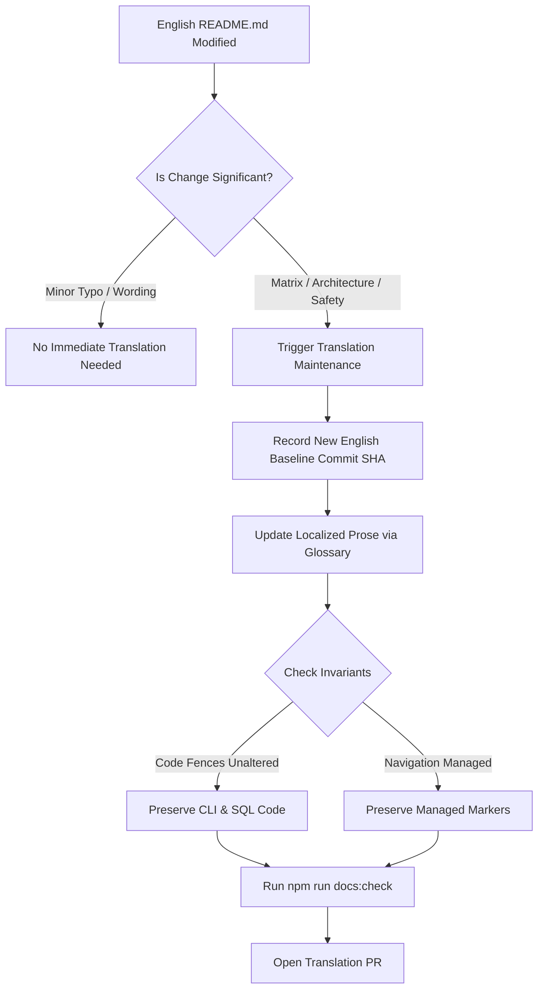

# DERA Multilingual Translation Maintenance Procedures

> **Project:** DERA — Database Engineering & Reverse Analysis  
> **Tagline:** Understand Every Schema. Engineer Every Change.  
> **Maintainer:** Krishanth (`krishanth7`)  
> **Parent Policy:** [`docs/i18n/TRANSLATION_POLICY.md`](TRANSLATION_POLICY.md)  
> **Terminology Reference:** [`docs/i18n/TERMINOLOGY.md`](TERMINOLOGY.md)  

---

## 1. Overview & Maintenance Objectives

DERA maintains **exactly ten official documentation languages** in [`docs/i18n/`](README.en.md):
`en`, `es`, `fr`, `de`, `pt`, `it`, `ja`, `ko`, `zh-CN`, `ru`.

As the platform evolves, technical documentation must remain synchronized across all ten languages without accumulating translation drift, inaccurate status claims, or broken code snippets.

This document defines the operational procedures for tracking English source revisions, detecting outdated translations, maintaining terminology consistency, and verifying translation quality before merging.

---

## 2. Source Revision Tracking & Triggers

### 2.1 English Baseline Tracking
The root English [`README.md`](../../README.md) is the canonical source of truth. Every translated README header records the specific English baseline commit SHA from which it was derived or synchronized:

```markdown
<!-- English Source Baseline: 80a33d8ae76c833ddeff8d6c9ded807333580454 -->
```

### 2.2 Synchronization Triggers
Translations must be audited and updated when:
1. **Capability Status Transitions:** A feature transitions from Planned to In Progress, or from In Progress to Implemented in the Feature Matrix.
2. **Database Engine Qualification:** A new database connector (e.g. MySQL, PostgreSQL) reaches Beta or Production Grade.
3. **Architecture Diagrams Updated:** A Mermaid flowchart or package boundary specification is modified in the English documentation.
4. **Minor or Major Releases:** Prior to tagging a new release (e.g. `v0.2.0`), all 9 translations undergo parity verification.

---

## 3. Translation Quality & Integrity Rules



### 3.1 Strict Invariant: Code & Identifier Preservation
Translators must **never** translate:
- Code fences (`bash`, `python`, `sql`, `typescript`, `json`)
- CLI command invocations (e.g., `python scripts/development/dev.py all`)
- Programming variables, class names, and package paths (e.g. `packages/core`, `Column`, `Table`)
- Database catalog table and column names (`sqlite_master`, `pg_catalog`, `information_schema`)
- Node identifiers in Mermaid diagrams (e.g., in `A[Start] --> B[Finish]`, `A` and `B` must remain unchanged)

### 3.2 Terminology Standardization
All translations must adhere to the standardized terminology matrix defined in [`docs/i18n/TERMINOLOGY.md`](TERMINOLOGY.md) to ensure consistent domain vocabulary across translations.

### 3.3 Handling Partially Outdated Content
If an English section undergoes extensive restructuring and a full localized translation is not immediately ready, translators should insert an advisory callout:

```markdown
> [!NOTE]
> This section is currently being synchronized with the authoritative English documentation. Please refer to [README.md](../../README.md) for the latest updates.
```

Never leave broken Markdown syntax, truncated sentences, or unclosed code blocks.

---

## 4. Local Verification for Translations

Before submitting a translation update, run the automated validation suite:

```bash
# 1. Verify 10-language navigation markers and manifest order
python scripts/docs/generate_language_navigation.py --check
python scripts/ci/validate_i18n.py

# 2. Run Markdown linting and link validation
npm run docs:check
```

Both checks must exit with code `0`.

---

## 5. Review & Integration Process

1. **Dedicated Pull Requests:** Submit translation updates on a dedicated branch with prefix `docs/` (e.g. `docs/update-french-readme`).
2. **Conventional Commit Title:** Use Conventional Commits (e.g., `docs(i18n): synchronize French README with commit 80a33d8`).
3. **Editorial Review:** The Internationalization Lead or bilingual maintainer reviews the PR for terminology adherence, tone, and formatting integrity before squash-merging to `main`.
