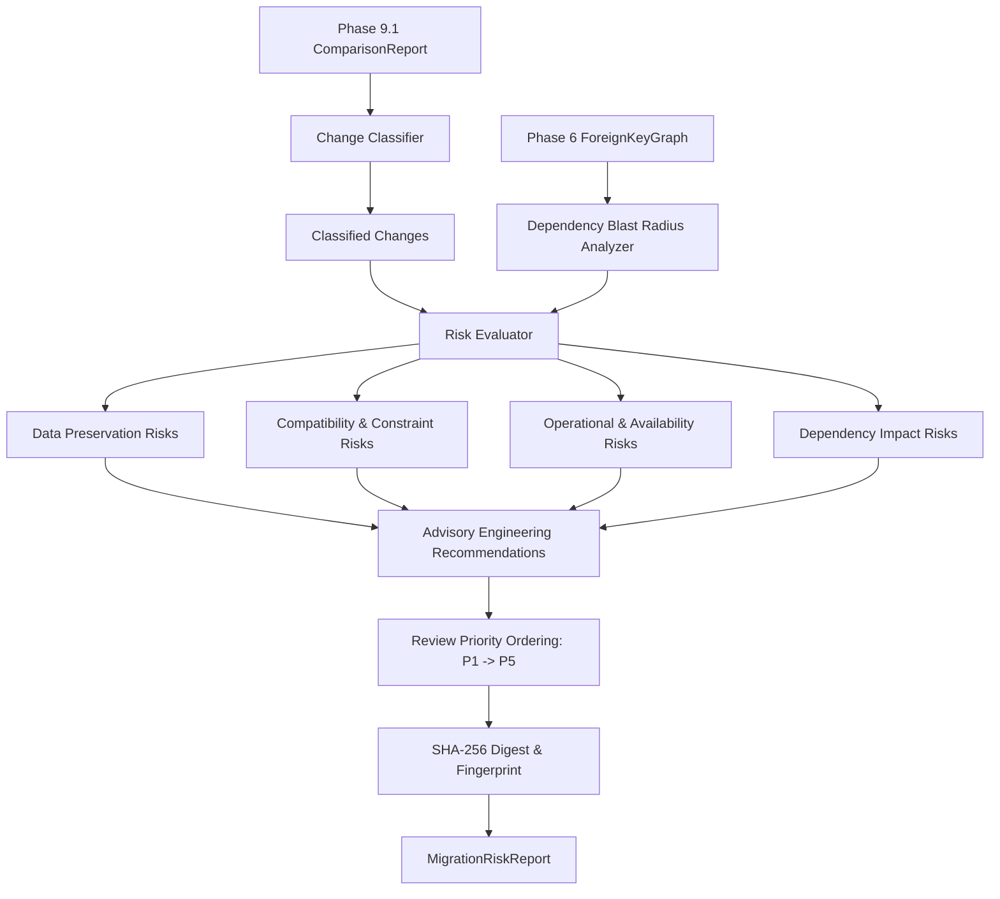

# DERA Migration Risk Analysis Architecture

**Phase:** 9.2 — Schema Change Classification & Migration Risk Analysis  
**Module:** `dera.migration`  
**Status:** Certified Read-Only, Deterministic  

---

## 1. Architectural Overview

The Migration Risk Analysis Engine consumes Phase 9.1 `ComparisonReport` records and Phase 6 `ForeignKeyGraph` dependency multigraphs to evaluate backward compatibility, potential data loss, operational locking caveats, and downstream dependency blast radius.

## 2. Invariants & Guarantees

1. **Zero AI / LLM / Probabilistic Inference:** Rules are 100% deterministic, grounded strictly in schema metadata.
2. **Read-Only Operation:** Zero SQL execution, zero customer database mutations.
3. **Conservative Risk Assignment:** Potential data loss is flagged with `CONDITIONAL` certainty unless demonstrated by execution context.
4. **No Premature Migrations:** DDL/DML script generation is deferred to Phase 9.3+.
