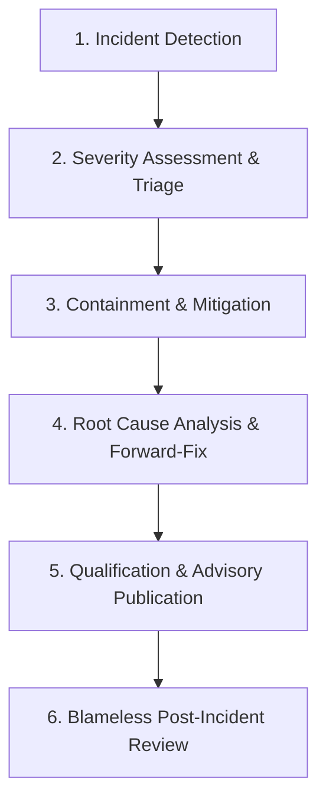

# DERA Release Incident Response Protocol

> **Project:** DERA — Database Engineering & Reverse Analysis  
> **Tagline:** Understand Every Schema. Engineer Every Change.  
> **Maintainer:** Bunga Krishanth (`@krishanth7`)  
> **Reference:** [docs/releases/README.md](README.md)  

---

## 1. Scope & Objectives

This protocol establishes the standardized procedure for detecting, assessing, containing, and resolving release-related anomalies, including:
- Tampered or corrupted release artifacts
- Accidental release publication
- Severe regressions discovered in production
- Zero-day vulnerabilities in release dependencies
- Secret or credential leakage in published packages

---

## 2. Incident Severity Classification

| Severity Level | Definition | Response SLA | Examples |
|---|---|:---:|---|
| **SEV-1 (Critical)** | Active security vulnerability, compromised artifact digest, credential leak, or complete data corruption hazard. | **< 2 hours** | Checksum mismatch on PyPI/npm, API key leaked in build, remote code execution in dependency. |
| **SEV-2 (High)** | Core introspector crashing on standard database schemas, broken installation on clean environments. | **< 6 hours** | `ImportError` on package install, failure connecting to supported PostgreSQL 16 dialect. |
| **SEV-3 (Medium)** | Non-critical feature regression, minor performance degradation, edge-case parser defect. | **< 24 hours** | Complex SQL view introspection timeout, formatting defect in generated schema contract. |
| **SEV-4 (Low)** | Typographical error in release notes, documentation link defect, cosmetic UI issue. | **< 3 business days** | Misspelled option in CLI help text, broken documentation anchor in release notes. |

---

## 3. Incident Response Workflow

### Step 1: Incident Detection
Incidents are surfaced via:
- Automated telemetry failures or integrity check alerts.
- Maintainer audit of published assets.
- Contributor or user issue filings via GitHub Issues or Security Advisories.

### Step 2: Severity Assessment & Triage
The lead maintainer (`@krishanth7`) assesses impact, confirms reproducibility, and assigns the appropriate SEV level.

### Step 3: Immediate Containment
- **For Package Defects:** Yank the version on PyPI or deprecate on npm to halt automated installations.
- **For GitHub Releases:** Mark the GitHub Release notes as `[WITHDRAWN — DO NOT USE]` and remove compromised asset links.
- **For Container Deployments:** Trigger container rollback to the preceding verified image tag.
- **For Credentials:** Immediately revoke and rotate any credentials suspected of exposure.

### Step 4: Root Cause Analysis & Forward-Fix
Develop a minimal, verified fix addressing the defect on a dedicated hotfix branch.
Verify fix against regression test suite (`tests/`).

### Step 5: Qualification & Advisory Publication
1. Run full qualification gate (`.github/workflows/release-qualification.yml`).
2. Publish corrected patch version (`vX.Y.Z+1`).
3. If the incident was security-related, publish a GitHub Security Advisory (GHSA) detailing impact, affected versions, and upgrade path.

### Step 6: Blameless Post-Incident Review
Within 5 business days of incident resolution, the maintainer documents:
- Timeline of events (detection to resolution).
- Root cause analysis (5 Whys).
- Impact assessment.
- Preventative engineering measures (e.g., additional CI gates, stricter linting, automated pre-flight checks).
- File report in `docs/audit/` as a permanent record.
