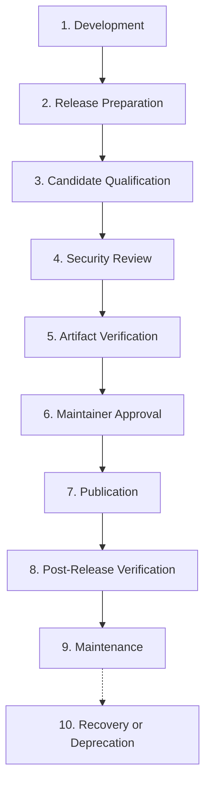

# DERA Release Lifecycle & Versioning Policy

> **Project:** DERA — Database Engineering & Reverse Analysis  
> **Tagline:** Understand Every Schema. Engineer Every Change.  
> **Maintainer:** Bunga Krishanth (`@krishanth7`)  
> **Reference:** [docs/releases/README.md](README.md)  

---

## 1. Ten-Stage Release Lifecycle

DERA defines a formal ten-stage lifecycle governing every software revision from initial branch development to post-release maintenance or deprecation.



### Stage 1: Development
Features, fixes, and architectural evolutions are merged into `main` via Conventional Commit PRs. Work in progress is designated with development version identifiers (`0.1.0-dev` / `0.1.0.dev1`).

### Stage 2: Release Preparation
A release branch or preparation PR is created (`release/vX.Y.Z`). Version declarations across Python and TypeScript workspaces are updated synchronously. `CHANGELOG.md` is updated moving changes from `[Unreleased]` into the target release section.

### Stage 3: Candidate Qualification
The automated qualification gate (`.github/workflows/release-qualification.yml`) is executed in dry-run mode against the target commit SHA. All unit, contract, database integration, and documentation tests must pass with 100% success.

### Stage 4: Security Review
Static security analysis (CodeQL, Bandit), dependency vulnerability scanning (Dependabot, Dependency Review), and secret scanning audits are reviewed. All High and Critical findings must be remediated or formally documented with an accepted risk sign-off.

### Stage 5: Artifact Verification
Distribution packages (wheels, sdist, npm tarballs) are built in isolated environments. SHA-256 digests are computed and validated against `SHA256SUMS.txt` and `manifest.json` using `scripts/release/verify_artifacts.py`.

### Stage 6: Maintainer Approval
The lead maintainer inspects the qualification report, test telemetry, artifact checksums, and release notes. Explicit written approval is recorded before triggering publication.

### Stage 7: Publication
The authorized release workflow publishes the signed Git tag, GitHub Release, and distribution artifacts to target package registries.

### Stage 8: Post-Release Verification
Automated and manual smoke tests verify package installability from published registries in clean environments across Linux, Windows, and macOS.

### Stage 9: Maintenance
The released version enters active maintenance. Patch releases are prepared on maintenance branches if regression or vulnerability fixes are required.

### Stage 10: Recovery or Deprecation
In the event of critical defects, security breaches, or version end-of-life, formal recovery procedures (advisories, yanked packages, or forward-fix releases) are executed according to [RELEASE_RECOVERY.md](RELEASE_RECOVERY.md).

---

## 2. Semantic Versioning Policy

DERA strictly adheres to the **Semantic Versioning 2.0.0** specification (`MAJOR.MINOR.PATCH[-PRERELEASE][+BUILD]`).

### Version Elements
- **MAJOR (`X.0.0`):** Incremented for backwards-incompatible API changes, breaking schema contract alterations, or fundamental architectural shifts.
- **MINOR (`0.Y.0`):** Incremented for new backwards-compatible capabilities, new database connector implementations, or significant performance enhancements.
- **PATCH (`0.0.Z`):** Incremented for backwards-compatible bug fixes, security patches, or documentation corrections.

### Pre-Release Identifiers
Pre-release versions denote non-final, engineering milestone releases:
- **Alpha (`-alpha.N`):** Early engineering preview; rapid iteration on core algorithms.
- **Beta (`-beta.N`):** Feature complete preview for external integration and testing.
- **Release Candidate (`-rc.N`):** Feature freeze candidate undergoing final qualification gates.
- **Development (`-dev`):** Unreleased in-flight working tree version on `main`.

### Historical Versioning Audit & Nonstandard Tag Policy
Existing tags in the repository history are preserved immutably:
- `v0.1.0-alpha.1`: Standard SemVer 2.0.0 alpha preview.
- `v0.1.0-alpha.2.0`: Historical nonstandard tag containing four dot-separated components. **Policy:** This tag is recorded and respected in historical documentation and Git references without rewriting history. Forward releases strictly enforce three core numeric segments (`MAJOR.MINOR.PATCH`).
- `v0.1.0-alpha.3`: Standard SemVer 2.0.0 alpha milestone.

---

## 3. Version Source of Truth & Monorepo Synchronization

To prevent version divergence across monorepo workspaces, DERA establishes a canonical source-of-truth model and deterministic translation between SemVer 2.0.0 (npm) and PEP 440 (Python).

### Canonical File Registry

| Workspace / Package | File Path | Format | Canonical Field |
|---|---|---|---|
| Monorepo Root | `package.json` | JSON | `version` |
| TypeScript Contracts | `packages/contracts/package.json` | JSON | `version` |
| TypeScript Connectors | `packages/connectors/package.json` | JSON | `version` |
| Python Core & Package | `pyproject.toml` | TOML | `[project] version` |
| Python Core Init | `packages/core/src/dera_core/__init__.py` | Python | `__version__` |
| Python Namespace Init | `packages/core/src/dera/__init__.py` | Python | `__version__` |
| Python Connectors Init | `packages/connectors/src/dera_connectors/__init__.py` | Python | `__version__` |

### PEP 440 vs SemVer 2.0.0 Mapping Strategy

Python build tooling (setuptools/pip) mandates PEP 440 compliance, whereas npm and Git tags enforce SemVer 2.0.0. DERA translates versions deterministically:

| Channel | SemVer 2.0.0 (`package.json`, Git tag) | PEP 440 (`pyproject.toml`, Python wheels) |
|---|---|---|
| **Development** | `0.1.0-dev` | `0.1.0.dev1` |
| **Alpha** | `0.1.0-alpha.1` | `0.1.0a1` |
| **Beta** | `0.1.0-beta.2` | `0.1.0b2` |
| **Release Candidate** | `0.1.0-rc.1` | `0.1.0rc1` |
| **Stable Release** | `0.1.0` | `0.1.0` |

Version synchronization across all seven files is automatically enforced by:

```bash
python scripts/release/validate_version.py --check-consistency
```
