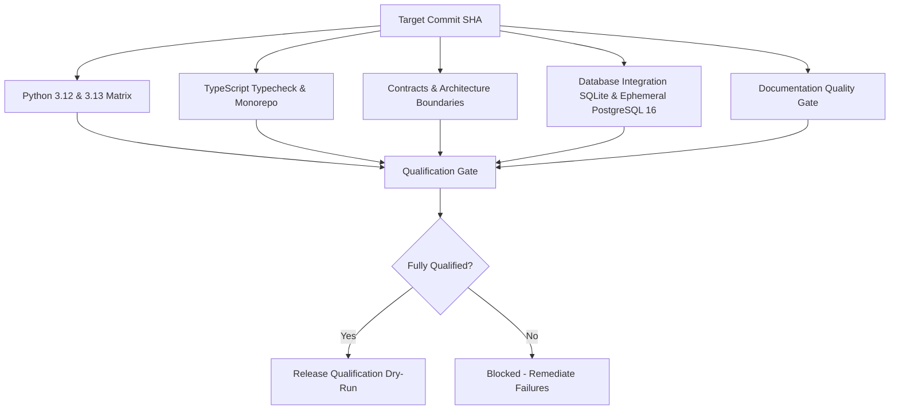

# DERA Release Qualification Framework & Security Gates

> **Project:** DERA — Database Engineering & Reverse Analysis  
> **Tagline:** Understand Every Schema. Engineer Every Change.  
> **Maintainer:** Bunga Krishanth (`@krishanth7`)  
> **Reference:** [docs/releases/README.md](README.md)  

---

## 1. Release Qualification Matrix

Qualification requirements vary by release tier. Every level enforces mandatory build validation, automated tests, and explicit maintainer approval.

| Qualification Requirement | Alpha (`-alpha.N`) | Beta (`-beta.N`) | Release Candidate (`-rc.N`) | Stable Release (`X.Y.Z`) |
|---|:---:|:---:|:---:|:---:|
| **Build Validation** | **Required** | **Required** | **Required** | **Required** |
| **Unit & Architecture Tests** | **Required** (100% pass) | **Required** (100% pass) | **Required** (100% pass) | **Required** (100% pass) |
| **TypeScript Monorepo Typecheck** | **Required** | **Required** | **Required** | **Required** |
| **Contract Invariants Verification** | **Required** | **Required** | **Required** | **Required** |
| **Database Integration (SQLite + Postgres)** | Recommended | **Required** | **Required** | **Required** |
| **Security SAST (Bandit + CodeQL)** | Risk-based | **Required** | **Required** (0 High/Critical) | **Required** (0 High/Critical) |
| **Dependency Vulnerability Review** | Advisory | **Required** | **Required** (0 Known CVEs) | **Required** (0 Known CVEs) |
| **Secret Scanning Audit** | **Required** (0 leaks) | **Required** (0 leaks) | **Required** (0 leaks) | **Required** (0 leaks) |
| **Artifact SHA-256 Checksum Validation** | **Required** | **Required** | **Required** | **Required** |
| **Machine-Readable Release Manifest** | Recommended | **Required** | **Required** | **Required** |
| **Documentation & i18n Quality Gate** | Advisory | Recommended | **Required** | **Required** |
| **Dry-Run Qualification Workflow** | Recommended | **Required** | **Required** | **Required** |
| **Maintainer Publication Authorization** | **Required** | **Required** | **Required** | **Required** |

---

## 2. Main CI Qualification Gates (Phase 3.1 Integration)

A release candidate must satisfy all qualification jobs executed on the exact target commit SHA:



- **Outdated / Cancelled Runs Prohibited:** A release candidate cannot rely on runs from prior commits or runs where mandatory checks were skipped or cancelled.
- **Fail-Fast Boundary:** Any failure in the test matrix immediately invalidates candidate qualification.

---

## 3. Security Release Gates (Phase 3.3 Integration)

Release engineering incorporates automated security gates to protect downstream users and eliminate supply-chain vulnerabilities:

1. **CodeQL Static Analysis:** Full scanning of Python, JavaScript/TypeScript, and GitHub Actions workflows. Any alert with severity `High` or `Critical` blocks release qualification.
2. **Bandit Python SAST:** Scans `packages/core/src` and `apps/api/src` for insecure patterns, SQL injection hazards, or unsafe deserialization.
3. **Dependency Scanning & Review:** Evaluates `package-lock.json` and Python dependencies against known GitHub Advisory Database CVEs.
4. **Secret Scanning:** All Git commits must be clean of API keys, tokens, certificates, or credentials.
5. **Least-Privilege Actions Permissions:** Qualification workflows must strictly run with:
   ```yaml
   permissions:
     contents: read
   ```
   No workflow job executing untrusted code or pull request qualification has write access to repository contents, tags, or releases.

---

## 4. Artifact Naming & Packaging Standards

DERA distribution artifacts conform to strict canonical naming conventions to enable automated verification and prevent distribution ambiguity:

| Distribution Type | Canonical Naming Pattern | Example |
|---|---|---|
| Python Wheel | `dera_core-<version>-py3-none-any.whl` | `dera_core-0.1.0rc1-py3-none-any.whl` |
| Python Source Distribution | `dera_core-<version>.tar.gz` | `dera_core-0.1.0rc1.tar.gz` |
| TypeScript Contracts | `dera-contracts-<version>.tgz` | `dera-contracts-0.1.0-rc.1.tgz` |
| Cryptographic Manifest | `SHA256SUMS.txt` | `SHA256SUMS.txt` |
| Machine-Readable Manifest | `manifest.json` | `manifest.json` |

---

## 5. Artifact Provenance & Reproducibility Assessment

### Supply-Chain Provenance
DERA evaluates release provenance against SLSA (Supply-chain Levels for Software Artifacts) framework principles:
- **Build Metadata:** Recorded in `manifest.json` including Git commit SHA, timestamp, builder operating system, and runtime engine versions.
- **GitHub Artifact Attestations:** Qualified releases utilize GitHub's cryptographic attestation mechanism (`actions/attest-build-provenance`) linking published hashes to the immutable workflow run and repository identity.

### Reproducible Build Safeguards
To maximize build determinism:
1. **Pinned Dependencies:** All development tooling versions are declared in `pyproject.toml` and locked in `package-lock.json`.
2. **Deterministic Timestamps:** Standard Python build tools (`build`, `wheel`) support `SOURCE_DATE_EPOCH` to eliminate non-deterministic file timestamp variances.
3. **Clean Environment Isolation:** Package builds execute in freshly provisioned ephemeral runner containers (`ubuntu-latest`).

---

## 6. Human Approval Boundary & Explicit Authorization

DERA maintains an uncompromised barrier between qualification and publication:

1. **Qualification Workflow (`release-qualification.yml`):**
   - Read-only permissions (`contents: read`).
   - Dry-run capability default.
   - Zero access to PyPI, npm, or GitHub release tokens.
2. **Publication Workflow (`release.yml`):**
   - Triggered strictly by signed Git tag push (`v*.*.*`) or manual maintainer dispatch with explicit tag argument.
   - Requires explicit authorization by lead maintainer (`@krishanth7`).
   - Requires evidence from a preceding successful qualification run.
   - Any publication attempt without qualification verification is immediately halted.
