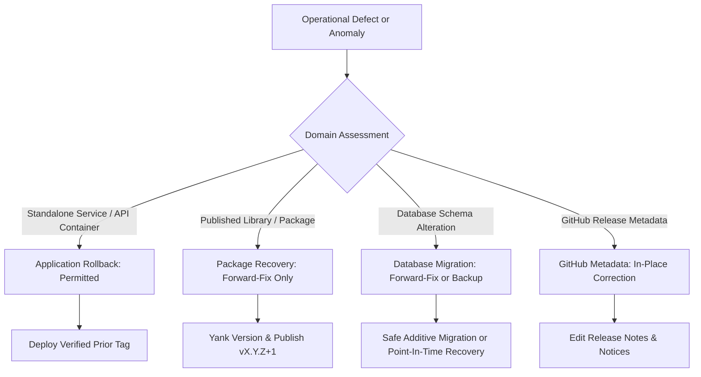

# DERA Rollback & Forward-Fix Strategy

> **Project:** DERA — Database Engineering & Reverse Analysis  
> **Tagline:** Understand Every Schema. Engineer Every Change.  
> **Maintainer:** Bunga Krishanth (`@krishanth7`)  
> **Reference:** [docs/releases/README.md](README.md)  

---

## 1. Architectural Strategy Overview

When software anomalies occur in production, teams face a critical choice: **rollback** (reverting to a prior known state) or **forward-fix** (expediting a corrective release).

Because DERA operates in complex database environments with strict data integrity requirements and immutable package registries, rollback strategies must be evaluated across distinct operational boundaries:



---

## 2. Recovery Domains & Decision Matrix

| Domain | Rollback Feasible? | Preferred Strategy | Core Justification & Constraints |
|---|:---:|:---:|---|
| **Application Services (`apps/api`, `apps/web`)** | **Yes** | **Rollback to Prior Tag** | Stateless containers can instantly be redeployed to a prior verified Docker image tag or deployment revision. |
| **Published Python Wheels / npm Packages** | **No** | **Forward-Fix (`vX.Y.Z+1`)** | Registries (PyPI, npm) forbid overwriting or republishing existing versions. Version history is immutable. |
| **GitHub Releases & Git Tags** | **Partial** | **Withdraw & Patch** | Deleting public tags breaks downstream clones and cached builds. Mark release withdrawn and issue replacement tag. |
| **Database Schema Migrations** | **Rarely** | **Forward-Fix Migration** | Destructive migrations (drop table, type conversion, table partition) cannot be reversed without data loss. |

---

## 3. Application Service Rollback Protocol

For deployed web applications and API gateways (`dera-api`, `dera-web`):
1. **Health Metric Trigger:** Sustained 5xx error spikes, unhandled exceptions, or database connection pool exhaustion.
2. **Container Rollback:**
   ```bash
   # Revert service deployment to previous verified immutable image digest
   docker stop dera-api-service
   docker run -d --name dera-api-service dera/api:0.1.0-alpha.3
   ```
3. **Traffic Rerouting:** In container orchestrators (Kubernetes / ECS), update the deployment replica set to the preceding revision:
   ```bash
   kubectl rollout undo deployment/dera-api-deployment
   ```
4. **Verification:** Confirm `/health` and `/ready` endpoints return HTTP 200 and healthy status payloads.

---

## 4. Package Registry Forward-Fix Protocol

Because public package registries enforce immutable versioning:
1. **Do Not Attempt Force-Push or Republish:** Any attempt to publish a different archive under an existing tag will fail with `HTTP 400 Bad Request` or `HTTP 409 Conflict`.
2. **Yank Affected Version:**
   ```bash
   # On PyPI, yanking warns users without breaking existing lockfiles
   # On npm, deprecate the affected package
   npm deprecate @dera/contracts@0.1.0-rc.1 "Critical defect in schema validation; upgrade to 0.1.0-rc.2"
   ```
3. **Expedite Patch Version:**
   - Commit the targeted fix to `main`.
   - Bump version to next patch or pre-release number (e.g. `0.1.0-rc.2`).
   - Run complete qualification suite via `.github/workflows/release-qualification.yml`.
   - Publish qualified replacement.

---

## 5. Database Schema Migration Recovery

As a database engineering platform, DERA explicitly acknowledges the hazards of naive schema rollback:

### The Fallacy of "Down Migrations"
Traditional down migrations (`ALTER TABLE users DROP COLUMN email`) cause irreversible data loss if production transactions occurred while the migration was active.

### Safe Database Recovery Principles
1. **Additive Schema Changes:** Always perform schema evolutions in backwards-compatible phases (expand-contract pattern).
2. **Forward-Fix Migrations:** If a schema change contains a defect, write a forward corrective migration (`V004__fix_indexes.sql`) rather than attempting to roll backwards.
3. **Point-In-Time Recovery (PITR):** In the event of catastrophic data corruption, restore the database from the pre-migration snapshot/WAL log to a separate recovery instance, verify data integrity, and cut over deliberately.
