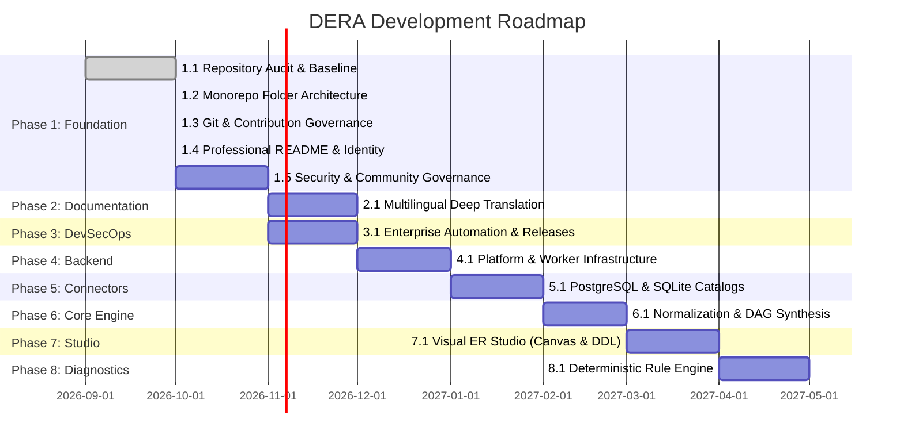

# DERA Master Development Roadmap

> **Project:** DERA — Database Engineering & Reverse Analysis  
> **Maintainer:** Krishanth ([@krishanth7](https://github.com/krishanth7))  
> **Tagline:** Understand Every Schema. Engineer Every Change.  
> **Status:** Active Foundational Engineering (Phase 1)  

---

## 1. Architectural Strategy & Phased Progression

DERA is engineered as an open-source, deterministic database reverse-engineering and schema intelligence platform. To ensure long-term stability, strict security, and maintainable software architecture, development follows a structured **12-Phase Roadmap**.

---

## 2. Comprehensive 12-Phase Status Matrix

| Phase | Milestone Name | Status | Key Deliverables & Focus Areas |
|---|---|---|---|
| **Phase 1** | **Repository Foundation & Governance** | **Completed** | Monorepo structure, PEP 621 packaging, Git branching, Conventional Commits, PR qualification gates, community operations (PR #20). |
| **Phase 2** | **Multilingual Documentation** | **In Progress** | Authoritative English README (Phase 2.1 completed, PR #21), 9 international translations (Phase 2.2 completed, PR #22), unified 10-language navigation system (Phase 2.3 in progress). |
| **Phase 3** | **GitHub Actions & DevSecOps** | **Implemented** | Automated CI qualification gate, CodeQL scanning, Bandit SAST, matrix testing (Python 3.12/3.13), secret detection. |
| **Phase 4** | **Backend & Platform Infrastructure** | Planned | FastAPI gateway endpoints, loopback default bindings, configuration management, health telemetry. |
| **Phase 5** | **Database Connectors & Metadata Inspection** | Experimental | Read-only catalog extraction for PostgreSQL (`pg_catalog`) and SQLite (`sqlite_master`), query mutation guards. |
| **Phase 6** | **Reverse Engineering Core Engine** | Experimental | Canonical models (`Column`, `Table`, `ForeignKey`, `Index`), schema snapshot generation, cycle-resistant DAG graphs. |
| **Phase 7** | **Frontend & Visual Engineering Studio** | Planned | Next.js 15 web studio, React Flow ERD canvas, interactive relationship filtering, and high-res SVG export. |
| **Phase 8** | **Diagnostics & Schema Intelligence** | Planned | Deterministic rules detecting missing primary keys, redundant indexes, unindexed foreign keys, and naming flaws. |
| **Phase 9** | **Schema Comparison & Migration Engineering** | Planned | Snapshot diffing, breaking change classification, and dependency-ordered DDL migration previews. |
| **Phase 10** | **SQL Analysis & Engineering Tools** | Planned | Engine-agnostic SQL parsing (SQLGlot), AST complexity scoring, and execution plan visualizer (`EXPLAIN ANALYZE`). |
| **Phase 11** | **Enterprise Security, Reliability & QA** | Planned | Enforced read-only session controls, tenant isolation, large-schema stress testing (1,000+ tables). |
| **Phase 12** | **Release, Deployment & Open-Source Growth** | Planned | Containerized deployment images, Helm charts, published Python/TypeScript packages, community showcases. |

---

## 3. Detailed Phase Breakdown

### Phase 1 — Repository Foundation & Governance
- [x] **Sub-phase 1.1:** Complete repository audit, asset inventory, and baseline verification ([`docs/audit/`](../audit/README.md)).
- [x] **Sub-phase 1.2:** Monorepo architecture establishment (`packages/core`, `packages/connectors`, `packages/contracts`, `apps/api`, `apps/web`) and cross-platform developer CLI ([`docs/architecture/`](../architecture/README.md)).
- [x] **Sub-phase 1.3:** Git branching strategy, Conventional Commits standard, PR title validation, CODEOWNERS, and review policies ([`docs/development/`](../development/README.md)).
- [x] **Sub-phase 1.4:** Professional README, transparent capability matrix, verified badges, and visual architecture diagrams.
- [x] **Sub-phase 1.5:** Formal security policy, vulnerability disclosure workflows, and community governance ([`docs/security/`](../security/README.md), [`docs/governance/`](../governance/README.md)).
<<<<<<< HEAD
- [x] **Sub-phase 1.6:** GitHub issue forms, Discussions guide, pull request templates, and community operations ([`docs/community/`](../community/README.md), [`docs/audit/PHASE_1_COMPLETION.md`](../audit/PHASE_1_COMPLETION.md)) (Completed Phase 1).
=======
- [x] **Sub-phase 1.6:** Structured issue forms, discussions governance, specialized PR templates, and community operations ([`docs/audit/`](../audit/README.md), pending review in PR #20).
>>>>>>> 94e552e (docs(devex): improve getting started instructions and roadmap alignment)

### Phase 2 — Multilingual Documentation & Developer Experience
- [x] **Sub-phase 2.1:** Authoritative English README, truth-in-documentation matrix, architecture visualization, and documentation lifecycle contract ([`docs/development/README_MAINTENANCE.md`](../development/README_MAINTENANCE.md), PR #21).
- [x] **Sub-phase 2.2:** Synchronize 9 international README translations (`es`, `fr`, `de`, `pt`, `it`, `ja`, `ko`, `zh-CN`, `ru`) in [`docs/i18n/`](../i18n/), replacing Arabic with Italian in the official 10-language matrix (PR #22).
- [x] **Sub-phase 2.3 (In Progress):** Ten-Language Documentation Navigation System with canonical manifest (`languages.json`), deterministic generator (`scripts/docs/generate_language_navigation.py`), and CI validation.

### Phase 3 — GitHub Actions & DevSecOps
- [x] CodeQL semantic security analysis for Python and JavaScript/TypeScript.
- [x] Multi-platform matrix testing on Python 3.12 and Python 3.13.
- [x] Ephemeral PostgreSQL service containers for live dialect integration testing.
- [x] Architectural boundary enforcement and Bandit AST static security analysis.
- [x] Pull request title and readiness automated qualification gates.

### Phase 4 — Backend & Platform Infrastructure
- [x] Foundation FastAPI gateway structure with loopback security defaults (`apps/api`).
- [ ] Asynchronous task orchestration for long-running catalog extraction jobs.
- [ ] Secure credential encryption at rest using AES-256-GCM.
- [ ] Structured health and telemetry endpoints (`/health`, `/ready`, `/api/v1/meta`).

### Phase 5 — Database Connectors & Metadata Inspection
- [x] Read-only query mutation guard preventing data modification (`DROP`, `ALTER`, `TRUNCATE`, `INSERT`, etc.).
- [x] SQLite schema discovery implementation (`packages/connectors/src/dera_connectors/sqlite/`).
- [ ] Native PostgreSQL catalog connector (`pg_catalog`, `information_schema`).
- [ ] MySQL and MariaDB catalog introspection (`information_schema`, `performance_schema`).
- [ ] Microsoft SQL Server connector (`sys.tables`, `INFORMATION_SCHEMA`).

### Phase 6 — Reverse Engineering Core Engine
- [x] Engine-agnostic canonical schema models (`Column`, `Table`, `ForeignKey`, `Index`).
- [x] Cycle-resistant dependency graph processing (NetworkX / Tarjan's SCC algorithm).
- [ ] Canonical schema snapshot serialization and cryptographic hashing.
- [ ] Topological table ordering for deterministic DDL reconstruction.

### Phase 7 — Frontend & Visual Engineering Studio
- [x] Next.js strict TypeScript workspace setup (`apps/web`).
- [ ] Interactive React Flow entity-relationship diagram canvas.
- [ ] Auto-layout algorithms (hierarchical and force-directed).
- [ ] Domain grouping, search, and type-based filtering.
- [ ] High-resolution SVG and PNG export capabilities.

### Phase 8 — Diagnostics & Schema Intelligence
- [ ] Deterministic static rule engine without generative AI.
- [ ] Integrity rules: Missing primary keys, polymorphic anti-patterns.
- [ ] Performance rules: Redundant overlapping indexes, unindexed foreign keys.
- [ ] Standardization rules: Case consistency, naming convention compliance.

### Phase 9 — Schema Comparison & Migration Engineering
- [ ] Semantic snapshot comparison (Snapshot Diff Engine).
- [ ] Structural change impact analysis (breaking vs. non-breaking).
- [ ] Dependency-ordered migration DDL script generation.

### Phase 10 — SQL Analysis & Engineering Tools
- [ ] SQL parsing and AST inspection via SQLGlot.
- [ ] Transpilation between SQL dialects.
- [ ] Execution plan visualization and cost analysis.

### Phase 11 — Enterprise Security, Reliability & QA
- [ ] Least-privilege database account provisioning guides.
- [ ] Large-schema benchmark verification (1,000+ tables, 10,000+ columns).
- [ ] Automated security regression suites.

### Phase 12 — Release, Deployment & Open-Source Growth
- [ ] Automated semantic version tagging (`vX.Y.Z`).
- [ ] Official container images published to GitHub Container Registry (GHCR).
- [ ] Helm charts and Docker Compose production templates.
- [ ] Contributor recognition and community showcase.
