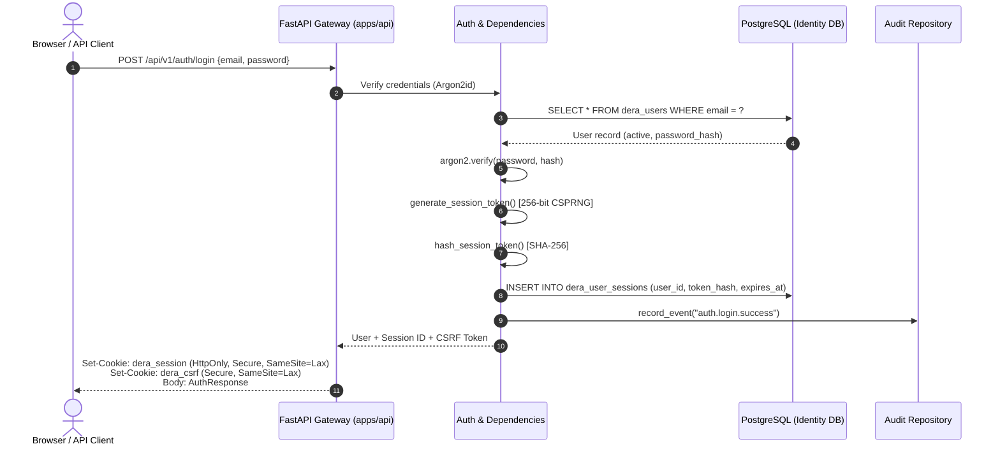
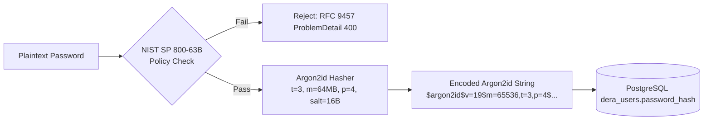

# DERA Authentication Architecture

**Project:** DERA — Database Engineering & Reverse Analysis  
**Repository:** [https://github.com/krishanth7/dera](https://github.com/krishanth7/dera)  
**Maintainer:** Bunga Krishanth  
**Development Phase:** 4 — Backend & Platform Infrastructure  
**Milestone:** 4.4 — Authentication, Authorization & Role-Based Access Control (RBAC)  
**Standard:** NIST SP 800-63B, OWASP ASVS v4.0.3 Level 2, RFC 9457  
**License:** [MIT License](../../LICENSE)  

---

## 1. Architectural Mission & Invariants

DERA's platform identity and authentication architecture establishes an authoritative, deterministic, and auditable foundation for verifying user identity, managing browser and API sessions, and enforcing strict multi-tenant workspace isolation.

### Core Architectural Invariants

1. **Zero AI Integration:** No authentication or access-control decision depends on machine-learning models, LLMs, or non-deterministic heuristics.
2. **Platform Identity Isolation:** The internal platform identity database (`dera_users`, `dera_user_sessions`, `dera_workspaces`, `dera_workspace_memberships`, `dera_security_audit_events`) is completely distinct and isolated from external customer database engines.
3. **Defense-in-Depth:** Authentication requires cryptographically random opaque tokens, server-side SHA-256 token hashing, Argon2id password hashing, and Double-Submit CSRF defenses on cookie-authenticated requests.
4. **Least Privilege & Tenant Boundary:** Every workspace resource mutation and query strictly resolves the authenticated actor, validates active membership, and verifies explicit permissions.

---

## 2. Authentication Protocol Evaluation & Selection

Before finalizing the Phase 4.4 implementation, multiple authentication paradigms were systematically evaluated against DERA's engineering requirements:

| Strategy | Architecture | Pros | Cons | Verdict |
| :--- | :--- | :--- | :--- | :--- |
| **Server-Managed Opaque Sessions** | 256-bit CSPRNG hex token stored as SHA-256 hash in PostgreSQL; distributed via Secure, HttpOnly cookie & Bearer header. | Immediate server-side revocation, immune to stale token claims, minimal payload size, zero client-side secret exposure. | Requires fast indexed database lookup per authenticated request. | **SELECTED (Authoritative)** |
| **Stateless JSON Web Tokens (JWT)** | Signed asymmetric/symmetric claims token (RS256/EdDSA/HS256) evaluated statelessly. | No session table lookup required for identity verification. | Cannot immediately revoke compromised tokens without distributed blocklists (defeating statelessness), vulnerable to algorithm confusion and claim staleness. | **REJECTED** |
| **External OIDC Identity Providers** | Delegated OAuth2/OIDC (e.g. GitHub/Google SSO). | Reduces password handling risk; enterprise federation. | Introduces external third-party network dependencies for local offline engineering workflows. | **DEFERRED (Phase 7+)** |

### Selected Architecture: Server-Managed Opaque Sessions

DERA selects **Server-Managed Opaque Sessions** with Dual-Transport support:
1. **Browser Clients:** Issued a Secure, HttpOnly `dera_session` cookie accompanied by a client-readable `dera_csrf` cookie. State-changing requests (`POST`, `PUT`, `PATCH`, `DELETE`) require the `X-CSRF-Token` header.
2. **Programmatic / API Clients:** Can supply the opaque session token directly via the standard HTTP `Authorization: Bearer <session_token>` header, bypassing CSRF cookie checks while maintaining full session revocation capabilities.

---

## 3. Cryptographic Storage & Password Hashing

DERA mandates **Argon2id** (`argon2-cffi`), the modern winner of the Password Hashing Competition (PHC) and recommended standard by OWASP and NIST SP 800-63B.

### Argon2id Parameters

- **Type:** Argon2id (resistant against both GPU side-channel and memory-tradeoff attacks).
- **Time Cost ($t$):** 3 iterations.
- **Memory Cost ($m$):** 65,536 KiB (64 MiB).
- **Parallelism ($p$):** 4 parallel lanes.
- **Salt:** 16 bytes of cryptographically secure random bytes generated per hash by the OS CSPRNG (`os.urandom`).
- **Hash Length:** 32 bytes (256 bits).

### NIST SP 800-63B Password Validation Rules

1. **Length:** Minimum 12 characters, maximum 128 characters (mitigating denial-of-service via oversized Argon2 hashing).
2. **Composition:** No arbitrary character-class rules (special characters, numbers, uppercase mandatory rules are avoided in accordance with NIST guidance to encourage long passphrases and password managers).
3. **Compromised Password Checking:** In-memory Bloom filter/blocklist check against top common compromised passwords (`password123`, `admin123456`, `qwertyuiop`, etc.).
4. **Zero Reversible Encryption:** Passwords are never encrypted with reversible keys; only one-way memory-hard hashing is permitted.
5. **Zero Logging:** Passwords and plaintext session tokens are strictly stripped and masked from structured application logs, error payloads, and audit events.

---

## 4. Email Syntax & Conservative Normalization

Email identities represent unique platform principals. In accordance with modern identity best practices:
- **Case-Insensitive Domain & Local Comparison:** The local-part and domain-part are converted to lowercase.
- **Preservation of Plus-Addressing:** Sub-addressing tags (e.g. `user+dev@example.com` vs `user@example.com`) are **strictly preserved** as distinct accounts to prevent accidental identity collision or unauthorized account hijacking.
- **Preservation of Dots:** Dots within local parts (`first.last@domain.com`) are preserved.
- **Syntax Validation:** Conservative regex enforcing standard RFC 5322 syntax with length capped at 254 characters (RFC 5321).

---

## 5. Session Management Lifecycle

### Session Token Specifications

- **Format:** 64-character lowercase hexadecimal string (32 bytes / 256 bits generated via `secrets.token_hex(32)`).
- **Database Storage:** Sessions are stored strictly as SHA-256 hexadecimal digests (`token_hash`) in `dera_user_sessions`. If the database is compromised, active session secrets cannot be recovered.
- **Lifetime:** Default expiration of 86,400 seconds (24 hours), configurable via `DERA_AUTH_SESSION_LIFETIME_SECONDS`.
- **Immediate Revocation:** Logout explicitly stamps `revoked_at = NOW()` and deletes cookies.
- **All-Device Invalidation (`logout-all`):** Sets `revoked_at = NOW()` on all active sessions associated with `user_id`.
- **Account Disablement:** If `dera_users.status != 'active'`, all session lookups immediately abort with `403 Forbidden` (`ACCOUNT_DISABLED`), regardless of session token validity.

---

## 6. Security Event Auditing

Security-critical operations emit immutable records into `dera_security_audit_events`:
- `auth.register.success`
- `auth.register.duplicate_attempt`
- `auth.login.success`
- `auth.login.failure`
- `auth.logout.success`
- `auth.logout_all.success`
- `workspace.create.success`
- `workspace.member.add`
- `workspace.member.update_role`
- `workspace.member.remove`

Audit records capture `actor_user_id`, `workspace_id`, `target_type`, `target_id`, `request_id`, `ip_address`, and sanitized metadata without credentials.
