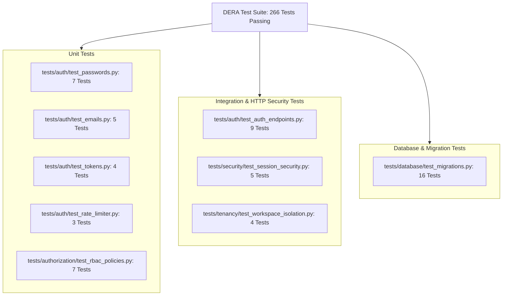

# DERA Authentication & Authorization Security Testing

**Project:** DERA — Database Engineering & Reverse Analysis  
**Repository:** [https://github.com/krishanth7/dera](https://github.com/krishanth7/dera)  
**Maintainer:** Bunga Krishanth  
**Security Standard:** OWASP ASVS v4.0.3 Verification Testing  
**License:** [MIT License](../../LICENSE)  

---

## 1. Overview & Test Automation Strategy

DERA maintains automated unit, integration, tenancy isolation, and session security test suites verifying all identity boundaries under deterministic, isolated conditions.



---

## 2. Test Suites Summary

| Test Module | Coverage Scope | Test Count | Status |
| :--- | :--- | :---: | :---: |
| `tests/auth/test_passwords.py` | Argon2id hashing, verification, NIST 12-128 char limits, compromised password rejection, empty input rejection. | 7 | **PASS** |
| `tests/auth/test_emails.py` | Conservative email normalization, syntax validation, case-folding, preservation of plus-addressing tags and dots. | 5 | **PASS** |
| `tests/auth/test_tokens.py` | 256-bit CSPRNG hex generation, SHA-256 token hashing, CSRF generation, constant-time compare. | 4 | **PASS** |
| `tests/auth/test_rate_limiter.py` | Sliding-window attempt counting, lockout thresholds, window resets, cache isolation. | 3 | **PASS** |
| `tests/authorization/test_rbac_policies.py` | Centralized `has_permission` matrix, default-deny evaluation, `validate_role_transition`, `validate_owner_removal`. | 7 | **PASS** |
| `tests/auth/test_auth_endpoints.py` | Registration, duplicate email rejection (409), login, invalid credentials (401), rate limiting (429), logout, CSRF verification (403), logout-all. | 9 | **PASS** |
| `tests/security/test_session_security.py` | Expired session rejection, revoked session rejection, disabled account immediate rejection (403), random token rejection, token hash storage. | 5 | **PASS** |
| `tests/tenancy/test_workspace_isolation.py` | Multi-workspace isolation, cross-tenant read blocking (403), cross-tenant mutation blocking (403), viewer permission denial, last owner protection. | 4 | **PASS** |
| `tests/database/test_migrations.py` | Alembic revisions `001_platform_metadata` and `002_identity_and_workspaces`, offline upgrade/downgrade, metadata inspection. | 16 | **PASS** |

---

## 3. Execution Commands

### Running Individual Test Suites

```bash
# Password security unit tests
python -m unittest tests/auth/test_passwords.py

# Email normalization unit tests
python -m unittest tests/auth/test_emails.py

# Token generation & hashing tests
python -m unittest tests/auth/test_tokens.py

# Centralized RBAC policy engine tests
python -m unittest tests/authorization/test_rbac_policies.py

# Authentication endpoints integration tests
python -m unittest tests/auth/test_auth_endpoints.py

# Session security & revocation tests
python -m unittest tests/security/test_session_security.py

# Multi-tenant workspace isolation tests
python -m unittest tests/tenancy/test_workspace_isolation.py
```

### Full Repository Qualification Suite

```bash
# Execute entire test suite with JUnit and JSON telemetry output
python scripts/ci/test_reporter.py --test-dir tests/
```
