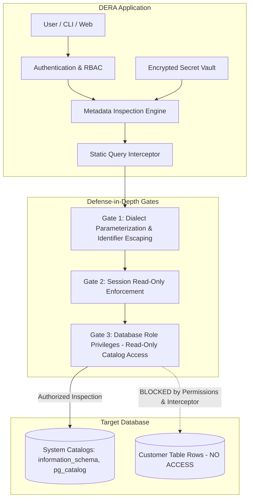

# Database Security & Access Policy

**Project:** DERA — Database Engineering & Reverse Analysis  
**Repository:** [https://github.com/krishanth7/dera](https://github.com/krishanth7/dera)  
**Policy Status:** Active Engineering Standard  
**Maintainer:** [Krishanth](https://github.com/krishanth7)  
**Parent Policy:** [SECURITY.md](../../SECURITY.md)  
**License:** [MIT License](../../LICENSE)  

---

## 1. Security Overview

Database reverse engineering requires connecting directly to enterprise and production database instances to inspect schemas, analyze relationships, and verify constraints.

Because databases store critical business assets, DERA enforces a **defense-in-depth security model** anchored in least-privilege access, static mutation prevention, zero customer data extraction, and strict credential isolation.



---

## 2. Read-Only Access & Privilege Separation

### 2.1 Why Transaction-Level Read-Only Is Not Sufficient Alone
A common misconception in database tooling is that executing `SET TRANSACTION READ ONLY` is sufficient to protect a database. In enterprise environments, this assumption is hazardous because:
1. **Transaction Mode Can Be Cleared:** If an attacker or flawed SQL query executes `SET TRANSACTION READ WRITE` or starts a new transaction without the flag, protections are bypassed.
2. **Catalog Mutation in Some Engines:** Certain DDL commands or administrative functions can execute outside standard transactional rollbacks or in auto-commit mode.
3. **Information Leakage via Functions:** Read-only mode does not prevent execution of user-defined functions (UDFs) that might trigger external network calls, write to filesystem, or leak sensitive data.

### 2.2 Database User Role Privileges (Primary Defense)
**The database user account provided to DERA must be provisioned with the absolute minimum privileges required to inspect system catalogs.**

#### PostgreSQL Least-Privilege Provisioning Example
```sql
-- 1. Create a dedicated read-only inspection role
CREATE ROLE dera_inspector WITH LOGIN PASSWORD 'STRONG_RANDOMLY_GENERATED_PASSWORD' NOSUPERUSER NOCREATEDB NOCREATEROLE NOREPLICATION;

-- 2. Grant CONNECT on the specific target database
GRANT CONNECT ON DATABASE production_db TO dera_inspector;

-- 3. Grant USAGE on schemas to be analyzed
GRANT USAGE ON SCHEMA public TO dera_inspector;

-- 4. Grant SELECT exclusively on system catalogs (or default catalog access)
-- In PostgreSQL, standard roles have read access to information_schema and pg_catalog by default.
-- DO NOT grant SELECT on application data tables.
```

DERA connectors must verify connection credentials and validate catalog read permissions upon initial connection establishment.

---

## 3. Credential Lifecycle & Secret Protection

Database credentials (hostnames, ports, usernames, passwords, TLS certificates) are highly sensitive assets that must never be compromised.

### 3.1 Strict Credential Invariants
- **Zero Hardcoded Secrets:** No default passwords, static tokens, or test credentials may exist in source code.
- **Zero Secrets in Git:** All local credentials must reside in untracked `.env` files or system environment variables.
- **Zero Secrets in Browser Bundles:** The frontend application (`apps/web`) must never receive raw database passwords or connection strings. All database queries execute via the backend API (`apps/api`).
- **Zero Secrets in Logs:** Logging formatters must automatically scrub connection strings, passwords, and authorization headers (`Authorization: Bearer ***`).
- **Zero Secrets in Exported Artifacts:** Schema snapshots, JSON exports, ER diagrams, and markdown documentation generated by DERA must strip connection strings and credentials before saving or sharing.

### 3.2 Encryption at Rest & In-Memory Handling
- Connection credentials stored by DERA must be encrypted at rest using authenticated symmetric encryption (**AES-256-GCM**).
- Plaintext secrets must remain in memory only for the duration of the active metadata extraction session.
- Once a connection session terminates, credential buffers must be overwritten and garbage-collected.

---

## 4. Metadata Handling & Scope Boundaries

### 4.1 What Metadata DERA Inspects
DERA is strictly a **metadata inspection engine**. Permitted inspection objects include:
- Schema names and namespaces
- Table, view, materialized view, and foreign table definitions
- Column names, ordinal positions, SQL data types, nullability, and default values
- Primary keys, unique constraints, foreign keys, and referential actions (`CASCADE`, `SET NULL`, `RESTRICT`)
- Check constraints and table comments
- Index definitions, uniqueness flags, and indexed column sequences

### 4.2 Zero Customer Row-Data Extraction
**DERA inspection routines must never issue `SELECT *` or unrestricted record-scanning queries against customer application tables.**

All reverse-engineering algorithms must operate strictly on metadata retrieved from system catalogs (e.g., `information_schema`, `pg_catalog`, `sqlite_master`, `mysql.schema`).

### 4.3 Sensitivity of Schema Metadata
Schema metadata itself contains sensitive structural intelligence:
- Table and column names expose business domain models, proprietary algorithms, and internal naming conventions.
- Security-sensitive column names (e.g., `password_hash`, `ssn`, `api_token`) reveal where sensitive data resides in the schema.
- Schema snapshots and generated diagrams must be treated with the same data governance protections as business documentation.

---

## 5. Query Safety & Execution Defense

To ensure that queries issued by DERA cannot be exploited or cause performance degradation, all connectors must comply with the following engineering standards:

### 5.1 Parameterization & Identifier Escaping
- User-supplied inputs (schema names, table filters) must always be parameterized:
  ```python
  # Safe parameterized query against catalog
  query = """
      SELECT table_name, column_name, data_type 
      FROM information_schema.columns 
      WHERE table_schema = $1 AND table_name = $2
  """
  ```
- Database object identifiers (table or schema names interpolated into queries where parameterization is unsupported by the engine) must be validated against strict alphanumeric regex and safely escaped according to engine dialect (e.g., `"identifier"` for PostgreSQL/SQLite, `` `identifier` `` for MySQL).

### 5.2 Static Mutation Interception
Connectors must implement static query inspection before dispatching any SQL command to a database. Any query containing mutating keywords (`DROP`, `TRUNCATE`, `ALTER`, `INSERT`, `UPDATE`, `DELETE`, `GRANT`, `REVOKE`, `CREATE`, `REPLACE`) must be rejected and logged as a security violation.

### 5.3 Query Timeouts & Resource Constraints
- **Statement Timeout:** All metadata queries must enforce an explicit statement execution timeout (default: 30 seconds) to prevent long-running locks or query runaway.
- **Connection Timeout:** Network connection attempts must time out within 10 seconds.
- **Resource Limits:** Connection pools must be strictly capped per tenant to avoid exhausting database connection capacity.

### 5.4 Sanitized Error Messages
Database driver error messages often embed connection strings, IP addresses, or internal database version details. DERA must sanitize error outputs before returning them to client applications, logging raw diagnostic details securely on the server.

---

## 6. Network Security & SSRF Mitigation

Database connectors initiate outbound TCP connections to user-specified database hosts. To mitigate Server-Side Request Forgery (SSRF) and network probing:
1. **Prohibit Cloud Metadata IP Addresses:** Connections to cloud metadata endpoints (e.g., `169.254.169.254`, `metadata.google.internal`) must be rejected at the API validation layer.
2. **Prohibit Unauthorized Loopback:** In multi-tenant cloud deployments, connections targeting `127.0.0.1`, `localhost`, or internal container networks must be blocked unless explicitly authorized in local development mode.
3. **TLS Encryption in Transit:** Database connectors must support and default to TLS-encrypted connections (`sslmode=require` or `sslmode=verify-full`) when communicating across networks.
