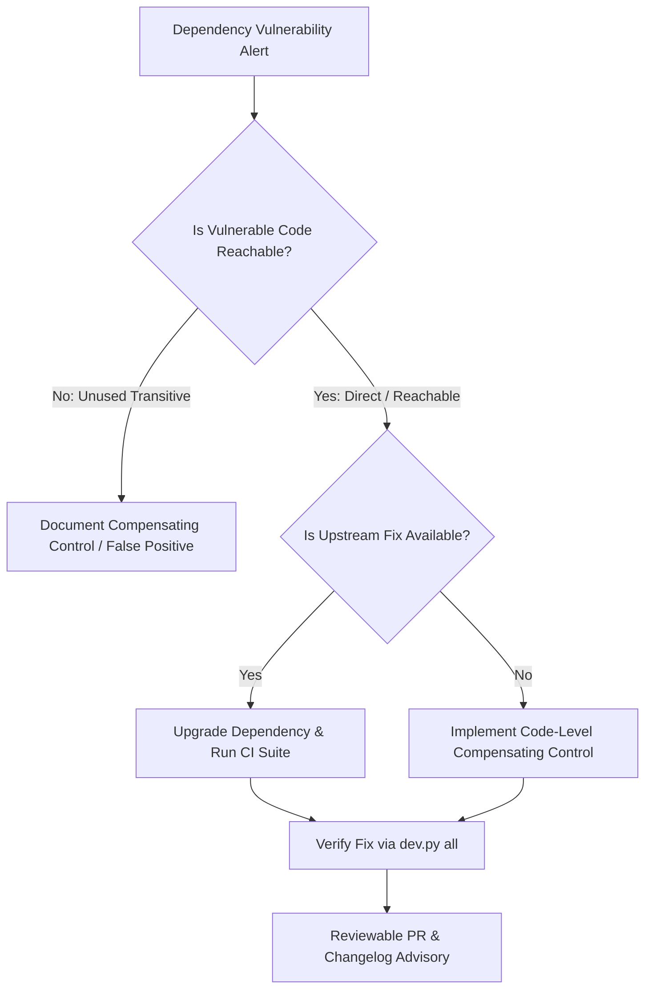

# DERA Dependency Security & Vulnerability Policy

> **Project:** DERA — Database Engineering & Reverse Analysis  
> **Repository:** [https://github.com/krishanth7/dera](https://github.com/krishanth7/dera)  
> **Maintainer:** Bunga Krishanth (`@krishanth7`)  
> **Security Contact:** `krishanth.b.2008@gmail.com`  
> **Standard:** Deterministic, Evidence-Based, Software Supply-Chain Protection  

---

## 1. Overview & Policy Objective

As a database reverse-engineering platform that connects directly to client database catalogs, **DERA** depends on third-party libraries across Python (backend services, API, AST parsers, mathematical graph models) and TypeScript/Node.js (web visualizer, schema contracts).

This policy establishes the formal requirements for:
1. Detecting known vulnerabilities in third-party dependencies.
2. Assessing real-world exploitability within DERA's runtime context.
3. Defining remediation targets and responsibilities.
4. Handling false positives, no-fix advisories, and temporary risk acceptance.

---

## 2. Severity Classification & Remediation Targets

DERA aligns vulnerability severity ratings with the Common Vulnerability Scoring System (CVSS v3.1 / v4.0) while incorporating **reachability analysis** to prioritize real threats over theoretical library risks.

| Severity | CVSS Score Range | Description & Context | Initial Triage Target | Remediation Target |
|---|---|---|---|---|
| **Critical** | 9.0 – 10.0 | Direct remote code execution (RCE), unauthenticated bypass, or credential exfiltration in reachable code. | Within **48 hours** | Target within **7 calendar days** |
| **High** | 7.0 – 8.9 | Significant privilege escalation, SQL injection vector, or denial-of-service in accessible endpoints. | Within **7 calendar days** | Target within **14 calendar days** |
| **Medium** | 4.0 – 6.9 | Limited denial-of-service, timing side-channels, or vulnerabilities requiring local access/uncommon configs. | Within **14 calendar days** | Target within **30 calendar days** |
| **Low** | 0.1 – 3.9 | Theoretical vulnerabilities, minor information leaks, or dev-only tooling alerts. | Within **30 calendar days** | Scheduled for next minor release |

> *Note:* Target timeframes represent operational engineering objectives and best-effort maintainer commitments, not legally binding contractual warranties.

---

## 3. Dependency Triage Framework

When a security scanner (`pip-audit`, `npm audit`, Dependabot, or GitHub Dependency Review) raises a vulnerability alert, maintainers execute a four-stage assessment:

### 3.1 Reachability & Exposure Assessment
1. **Direct vs. Transitive:** Determine whether the vulnerable dependency is imported directly by DERA packages (`packages/core`, `apps/api`, `packages/contracts`, `apps/web`) or pulled transitively.
2. **Production vs. Development:** Vulnerabilities in development-only tooling (e.g., test runners, linters, documentation generators) do not affect production Docker images or distributed packages, and are triaged under lowered severity.
3. **Execution Path Validation:** Confirm whether DERA's codebase invokes the specific vulnerable class, function, or parser routine identified in the advisory.

### 3.2 Fix Availability & Remediation Actions
1. **Direct Version Bump:** If a safe patch version is available from upstream maintainers without breaking changes, upgrade via `pyproject.toml` or `package.json` and update lockfiles (`npm install` / `pip install -e .`).
2. **Package Overrides:** In Node.js monorepo environments, use the `overrides` field in `package.json` to force transitive dependencies to secure versions (e.g., `katex>=0.18.2` override).
3. **Compensating Controls:** If no upstream patch exists:
   - Sanitize or restrict inputs before passing them to the affected library.
   - Restrict execution to localhost/read-only mode.
   - Replace the affected library with a secure alternative.

---

## 4. Risk Acceptance & Reassessment

In rare circumstances where an advisory has no upstream patch, the affected code path is demonstrably unreachable, and replacing the package would cause significant breaking regressions:

1. **Documentation:** Maintainers record the rationale, compensating controls, and scanner suppression rules in the repository risk register (`docs/audit/RISK_REGISTER.md`).
2. **Quarterly Reassessment:** All accepted risks are reviewed quarterly to verify if upstream maintainers have released a fixed version.
3. **Zero Critical Suppression:** Unpatched Critical vulnerabilities with verified remote reachability are never accepted; the vulnerable feature or connector must be disabled until resolved.

---

## 5. Lockfile & Supply-Chain Integrity

To guarantee reproducible and untampered builds:
- **Lockfile Enactment:** All Node.js dependencies must be pinned in [`package-lock.json`](../../package-lock.json) (v3 format). Pull requests that introduce unexpected lockfile churn without `package.json` justification are rejected.
- **Ignore Scripts:** Production installation runs under `npm ci --ignore-scripts` to eliminate malicious post-install lifecycle script execution.
- **Trusted Registries:** Dependencies must be fetched exclusively from official public registries (`pypi.org`, `registry.npmjs.org`). Zero untrusted third-party package indexes are allowed.
