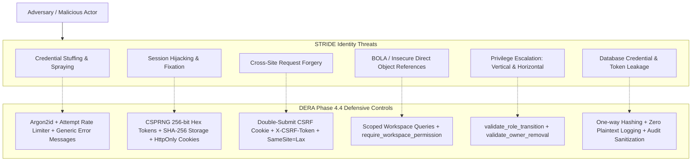

# DERA Identity & Access Threat Model

**Project:** DERA — Database Engineering & Reverse Analysis  
**Repository:** [https://github.com/krishanth7/dera](https://github.com/krishanth7/dera)  
**Maintainer:** Bunga Krishanth  
**Methodology:** STRIDE / OWASP ASVS v4.0.3 Level 2  
**License:** [MIT License](../../LICENSE)  

---

## 1. Executive Summary

This document formalizes the threat model for DERA's Phase 4.4 platform authentication, session management, and multi-tenant workspace authorization infrastructure.

---

## 2. Threat Analysis & Defensive Matrix

| Threat Category | Description | Impact | DERA Mitigations | Verification Test |
| :--- | :--- | :--- | :--- | :--- |
| **Credential Stuffing & Password Spraying** | Automated brute-force attacks against the login endpoint using leaked credential lists. | Account takeover, credential compromise. | Sliding window rate limiting (`auth_rate_limiter`) bounded per IP+Email; generic `INVALID_CREDENTIALS` messages; Argon2id memory hardness ($m=64\text{MB}$). | `tests/auth/test_auth_endpoints.py::test_login_rate_limiting` |
| **User Enumeration** | Timing attacks or different error messages for registered vs non-existent accounts. | Target reconnaissance and credential targeting. | Identical `401 Unauthorized` responses and equal-cost verification timing for existing vs non-existent accounts. | `tests/auth/test_auth_endpoints.py::test_login_invalid_credentials` |
| **Session Fixation** | Forcing a predefined session token onto a user before authentication. | Session hijacking upon victim login. | New, random 256-bit session token generated on every successful login; previous ambient cookies discarded. | `tests/auth/test_auth_endpoints.py::test_register_success` |
| **Session Hijacking (XSS)** | Stealing active session tokens via malicious JavaScript injection. | Full account impersonation. | `HttpOnly` flag on `dera_session` cookie blocks all JavaScript access; CSP security headers middleware. | `tests/security/test_session_security.py::test_cookie_attributes_and_security_flags` |
| **Cross-Site Request Forgery (CSRF)** | Forcing malicious state-changing requests via ambient browser cookies. | Unauthorized logout, workspace resource mutation. | Double-submit CSRF cookie (`dera_csrf`) and `X-CSRF-Token` header validation on `POST`, `PUT`, `PATCH`, `DELETE`. | `tests/auth/test_auth_endpoints.py::test_logout_csrf_protection` |
| **Broken Object-Level Authorization (BOLA)** | Accessing or mutating another tenant's workspace or members by guessing UUIDs. | Cross-tenant data leakage or corruption. | `require_workspace_permission` strictly checks membership in the URL-specified workspace; queries are scoped by `workspace_id`. | `tests/tenancy/test_workspace_isolation.py::test_cross_workspace_member_access_denied` |
| **Vertical Privilege Escalation** | An Editor or Viewer attempting to perform Admin/Owner operations. | Unauthorized administrative actions. | Default-deny centralized permission engine (`has_permission`); route-level dependency checks. | `tests/tenancy/test_workspace_isolation.py::test_viewer_cannot_perform_admin_operations` |
| **Horizontal Privilege Escalation** | An Admin promoting a user to Owner or modifying another Owner. | Takeover of workspace ownership. | `validate_role_transition` blocks non-Owners from promoting to Owner or modifying Owner accounts. | `tests/authorization/test_rbac_policies.py::test_admin_cannot_promote_to_owner` |
| **Last-Owner Removal / Orphaned Workspaces** | Removing or demoting the last remaining active Owner of a workspace. | Workspace rendered unmanageable. | `validate_owner_removal` requires `active_owner_count > 1` before allowing Owner demotion or removal. | `tests/tenancy/test_workspace_isolation.py::test_cannot_remove_last_workspace_owner` |
| **Token Theft from Database Backup** | Database dumps or SQL injection exposing stored sessions. | Offline session reuse and platform impersonation. | Session tokens are stored strictly as one-way SHA-256 hashes (`token_hash`). | `tests/security/test_session_security.py::test_token_hash_stored_in_db` |
