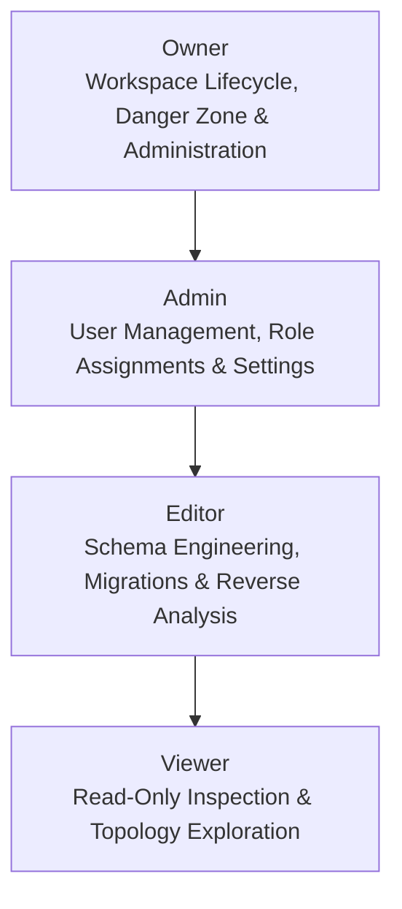

# DERA Role-Based Access Control (RBAC) Policy

**Project:** DERA — Database Engineering & Reverse Analysis  
**Repository:** [https://github.com/krishanth7/dera](https://github.com/krishanth7/dera)  
**Maintainer:** Bunga Krishanth  
**Security Reference:** NIST SP 800-162, OWASP ASVS Access Control  
**License:** [MIT License](../../LICENSE)  

---

## 1. Overview & Principles

DERA enforces a centralized, deterministic, default-deny Role-Based Access Control (RBAC) model. Access decisions are strictly evaluated within the scope of an explicit tenant **Workspace**.

### Fundamental Principles

1. **Default-Deny:** In the absence of an explicit permission mapping, access is categorically denied.
2. **Explicit Workspace Scope:** Users have zero global privileges across customer databases or other workspaces. A user must be an active member of the target workspace.
3. **Deterministic Evaluation:** Authorization policies are evaluated through statically typed enums (`WorkspaceRole`, `Permission`) without runtime reflection or heuristic inference.
4. **Owner Safeguards:** Workspaces must have at least one active Owner. Attempting to demote or remove the last Owner triggers a domain violation (`OWNER_SAFEGUARD_VIOLATION`).

---

## 2. Workspace Roles Hierarchy

DERA defines four standard workspace roles:



| Role | Scope & Responsibility |
| :--- | :--- |
| **Owner** | Ultimate administrative control over the workspace. Manages billing/lifecycle, workspace deletion, ownership transfer, and member role assignment up to Owner. |
| **Admin** | Workspace administration and team management. Invites members, updates roles (up to Admin), removes members (excluding Owners), and updates workspace metadata. |
| **Editor** | Active database engineering operations. Can inspect schemas, execute reverse analysis, view topologies, and create migration drafts. |
| **Viewer** | Read-only access to workspace resources, schema diagrams, and metadata reports. |

---

## 3. Centralized Permission Registry

Permissions are defined as fine-grained, namespaced action tokens:

```python
class Permission(StrEnum):
    WORKSPACE_READ = "workspace:read"
    WORKSPACE_UPDATE = "workspace:update"
    WORKSPACE_DELETE = "workspace:delete"
    MEMBER_READ = "member:read"
    MEMBER_INVITE = "member:invite"
    MEMBER_UPDATE_ROLE = "member:update_role"
    MEMBER_REMOVE = "member:remove"
    AUDIT_READ = "audit:read"
```

### Role-to-Permission Matrix

| Permission | Owner | Admin | Editor | Viewer |
| :--- | :---: | :---: | :---: | :---: |
| `workspace:read` | ✅ | ✅ | ✅ | ✅ |
| `workspace:update` | ✅ | ✅ | ❌ | ❌ |
| `workspace:delete` | ✅ | ❌ | ❌ | ❌ |
| `member:read` | ✅ | ✅ | ✅ | ✅ |
| `member:invite` | ✅ | ✅ | ❌ | ❌ |
| `member:update_role` | ✅ | ✅ | ❌ | ❌ |
| `member:remove` | ✅ | ✅ | ❌ | ❌ |
| `audit:read` | ✅ | ✅ | ❌ | ❌ |

---

## 4. Administrative Role Escalation Safeguards

To prevent horizontal and vertical privilege escalation, member role modifications enforce strict guardrails:

```python
def validate_role_transition(
    actor_role: WorkspaceRole,
    target_current_role: WorkspaceRole,
    new_role: WorkspaceRole,
) -> None:
    # 1. Non-Owners cannot assign Owner role
    if new_role == WorkspaceRole.OWNER and actor_role != WorkspaceRole.OWNER:
        raise PermissionDeniedError("Only workspace owners can promote members to owner.")

    # 2. Non-Owners cannot modify an existing Owner's role
    if target_current_role == WorkspaceRole.OWNER and actor_role != WorkspaceRole.OWNER:
        raise PermissionDeniedError("Only workspace owners can modify owner memberships.")

    # 3. Admins cannot promote members above Admin
    if actor_role == WorkspaceRole.ADMIN and new_role not in {
        WorkspaceRole.ADMIN,
        WorkspaceRole.EDITOR,
        WorkspaceRole.VIEWER,
    }:
        raise PermissionDeniedError("Admins cannot assign roles higher than admin.")
```

---

## 5. Owner Safeguards (Preventing Ownerless Workspaces)

When removing a member or demoting an Owner, the system verifies that the target workspace retains at least one other active Owner:

```python
def validate_owner_removal(
    target_role: WorkspaceRole,
    active_owner_count: int,
) -> None:
    if target_role == WorkspaceRole.OWNER and active_owner_count <= 1:
        raise PermissionDeniedError("Cannot remove or demote the last remaining workspace owner.")
```
