# DERA Security Architecture & Policies

**Project:** DERA — Database Engineering & Reverse Analysis  
**Repository:** [https://github.com/krishanth7/dera](https://github.com/krishanth7/dera)  
**Maintainer:** Krishanth  
**Security Contact:** `krishanth.b.2008@gmail.com`  
**Reporting URL:** [https://github.com/krishanth7/dera/security/advisories/new](https://github.com/krishanth7/dera/security/advisories/new)  
**License:** [MIT License](../../LICENSE)  

---

## 1. Overview

Because **DERA** connects directly to enterprise databases to reverse-engineer schemas, discover relationships, and visualize topologies, security and database integrity are paramount architectural concerns.

DERA enforces a **defense-in-depth security model** built on:
- Least-privilege, read-only metadata catalog access.
- Static SQL mutation interception.
- Zero customer row-data extraction.
- Strictly deterministic, non-AI execution with zero cloud inference transmission.
- Loopback-by-default network binding.

```mermaid
flowchart TD
    SEC[DERA Security Architecture]
    POLICY[Root Security Policy: SECURITY.md]
    ARCH[System Security Architecture: SECURITY_ARCHITECTURE.md]
    DEP_SEC[Dependency Security Policy: DEPENDENCY_SECURITY_POLICY.md]
    TRIAGE[Vulnerability Triage: VULNERABILITY_TRIAGE.md]
    LEAK[Secret Exposure Response: SECRET_EXPOSURE_RESPONSE.md]
    SUPPLY[Supply Chain Security: SUPPLY_CHAIN_SECURITY.md]
    DB_SEC[Database Security & Access: DATABASE_SECURITY.md]
    DEV_SEC[Secure Development Standards: SECURE_DEVELOPMENT.md]
    RESP[Vulnerability Response Workflow: VULNERABILITY_RESPONSE.md]
    THREAT[Threat Model Matrix: model.md]

    SEC --> POLICY
    SEC --> ARCH
    SEC --> DEP_SEC
    SEC --> TRIAGE
    SEC --> LEAK
    SEC --> SUPPLY
    SEC --> DB_SEC
    SEC --> DEV_SEC
    SEC --> RESP
    SEC --> THREAT
```

---

## 2. Security Documentation Index

| Document | Scope & Focus | Key Principles |
|---|---|---|
| [**SECURITY_ARCHITECTURE.md**](SECURITY_ARCHITECTURE.md) | Comprehensive security architecture & threat mitigation specification | Trust boundaries, read-only enforcement, credential handling, zero-AI assurance, attack surface analysis. |
| [**SECURITY.md**](../../SECURITY.md) | Official project security policy & disclosure rules | Supported versions table, GitHub private advisory reporting, CVSS severity ratings, responsible disclosure. |
| [**DEPENDENCY_SECURITY_POLICY.md**](DEPENDENCY_SECURITY_POLICY.md) | Third-party dependency security & vulnerability policy | CVSS severity thresholds, reachability analysis, SLA remediation targets, lockfile integrity rules. |
| [**VULNERABILITY_TRIAGE.md**](VULNERABILITY_TRIAGE.md) | Operational vulnerability triage & coordinated disclosure | 5-stage triage lifecycle, reproduction validation, private patch forks, researcher acknowledgment templates. |
| [**SECRET_EXPOSURE_RESPONSE.md**](SECRET_EXPOSURE_RESPONSE.md) | Secret leak containment & incident response playbook | Cardinal principle, immediate token revocation, credential rotation, history sanitization with git-filter-repo. |
| [**SUPPLY_CHAIN_SECURITY.md**](SUPPLY_CHAIN_SECURITY.md) | Software supply-chain protection & action pinning architecture | Immutable commit SHA action pinning, npm ci --ignore-scripts, non-root Docker execution (UID 10001). |
| [**DATABASE_SECURITY.md**](DATABASE_SECURITY.md) | Database connection & catalog access standards | Why `READ ONLY` transactions alone are insufficient, database role provisioning, credential lifecycle, query safety. |
| [**SECURE_DEVELOPMENT.md**](SECURE_DEVELOPMENT.md) | Secure development lifecycle & coding standards | Pydantic input validation, SQL parameterization, sanitized error handling, DevSecOps CI gates (Bandit, CodeQL). |
| [**VULNERABILITY_RESPONSE.md**](VULNERABILITY_RESPONSE.md) | Operational incident response workflow | 5-stage triage workflow, CVSS scoring guidelines, private security forks, coordinated disclosure timelines. |
| [**model.md**](model.md) | Architectural threat modeling matrix | Threat categories, potential attack vectors, mitigation mechanisms, SSRF prevention. |

---

## 3. Reporting a Vulnerability

If you discover a security vulnerability in DERA, please disclose it responsibly via GitHub Private Vulnerability Reporting:
👉 **[Report a Security Vulnerability](https://github.com/krishanth7/dera/security/advisories/new)**

Alternatively, email the maintainer directly at `krishanth.b.2008@gmail.com`.
