# DERA Security Architecture & Policies

**Project:** DERA — Database Engineering & Reverse Analysis  
**Repository:** [https://github.com/krishanth7/dera](https://github.com/krishanth7/dera)  
**Maintainer:** Krishanth  
**Security Contact:** `krishanth.b.2008@gmail.com`  
**Reporting URL:** [https://github.com/krishanth7/dera/security/advisories/new](https://github.com/krishanth7/dera/security/advisories/new)  
**License:** [MIT License](../../LICENSE)  

---

## 1. Overview

Because **DERA** connects directly to enterprise databases to reverse-engineer schemas, discover relationships, and visualize topologies, security and database integrity are paramount architectural concerns.

DERA enforces a **defense-in-depth security model** built on:
- Least-privilege, read-only metadata catalog access.
- Static SQL mutation interception.
- Zero customer row-data extraction.
- Strictly deterministic, non-AI execution with zero cloud inference transmission.
- Loopback-by-default network binding.

```mermaid
flowchart TD
    SEC[DERA Security Architecture]
    POLICY[Root Security Policy: SECURITY.md]
    ARCH[System Security Architecture: SECURITY_ARCHITECTURE.md]
    DEP_SEC[Dependency Security Policy: DEPENDENCY_SECURITY_POLICY.md]
    TRIAGE[Vulnerability Triage: VULNERABILITY_TRIAGE.md]
    LEAK[Secret Exposure Response: SECRET_EXPOSURE_RESPONSE.md]
    SUPPLY[Supply Chain Security: SUPPLY_CHAIN_SECURITY.md]
    DB_SEC[Database Security & Access: DATABASE_SECURITY.md]
    DEV_SEC[Secure Development Standards: SECURE_DEVELOPMENT.md]
    RESP[Vulnerability Response Workflow: VULNERABILITY_RESPONSE.md]
    AUTH[Auth Architecture: AUTHENTICATION_ARCHITECTURE.md]
    SESS[Session Management: SESSION_MANAGEMENT.md]
    RBAC[RBAC Policy: RBAC_POLICY.md]
    TENANT[Tenant Isolation: TENANT_ISOLATION.md]
    CSRF[CSRF Protection: CSRF_PROTECTION.md]
    ID_THREAT[Identity Threat Model: IDENTITY_THREAT_MODEL.md]
    AUDIT_EV[Security Audit Events: SECURITY_AUDIT_EVENTS.md]
    AUTH_TEST[Auth Testing Guide: AUTH_TESTING.md]
    THREAT[Threat Model Matrix: model.md]

    SEC --> POLICY
    SEC --> ARCH
    SEC --> AUTH
    SEC --> SESS
    SEC --> RBAC
    SEC --> TENANT
    SEC --> CSRF
    SEC --> ID_THREAT
    SEC --> AUDIT_EV
    SEC --> AUTH_TEST
    SEC --> DEP_SEC
    SEC --> TRIAGE
    SEC --> LEAK
    SEC --> SUPPLY
    SEC --> DB_SEC
    SEC --> DEV_SEC
    SEC --> RESP
    SEC --> THREAT
```

---

## 2. Security Documentation Index

| Document | Scope & Focus | Key Principles |
|---|---|---|
| [**AUTHENTICATION_ARCHITECTURE.md**](AUTHENTICATION_ARCHITECTURE.md) | Platform identity & authentication architecture | NIST SP 800-63B, Argon2id hashing, server-managed sessions, conservative email validation. |
| [**SESSION_MANAGEMENT.md**](SESSION_MANAGEMENT.md) | Opaque session tokens & browser cookie controls | 256-bit CSPRNG hex tokens, SHA-256 database storage, HttpOnly/Secure/SameSite cookies, single/global revocation. |
| [**RBAC_POLICY.md**](RBAC_POLICY.md) | Centralized role-based access control engine | Default-deny policy, Owner/Admin/Editor/Viewer role hierarchy, escalation prevention, owner safeguards. |
| [**TENANT_ISOLATION.md**](TENANT_ISOLATION.md) | Multi-tenant workspace data boundaries | URL-scoped workspaces, `require_workspace_permission`, zero cross-tenant query leakage. |
| [**CSRF_PROTECTION.md**](CSRF_PROTECTION.md) | Double-Submit CSRF cookie & header defense | Signed/high-entropy Double-Submit tokens, constant-time compare, state-changing method protection. |
| [**IDENTITY_THREAT_MODEL.md**](IDENTITY_THREAT_MODEL.md) | Identity STRIDE threat modeling & mitigations | Credential stuffing, session hijacking, BOLA, privilege escalation mitigations. |
| [**SECURITY_AUDIT_EVENTS.md**](SECURITY_AUDIT_EVENTS.md) | Forensic security event logging | Immutable event logging in PostgreSQL, zero secret leakage, correlation tracking. |
| [**AUTH_TESTING.md**](AUTH_TESTING.md) | Security test automation & verification guide | Unit, integration, session security, and negative authorization test matrix. |
| [**SECURITY_ARCHITECTURE.md**](SECURITY_ARCHITECTURE.md) | Comprehensive security architecture & threat mitigation specification | Trust boundaries, read-only enforcement, credential handling, zero-AI assurance, attack surface analysis. |
| [**SECURITY.md**](../../SECURITY.md) | Official project security policy & disclosure rules | Supported versions table, GitHub private advisory reporting, CVSS severity ratings, responsible disclosure. |
| [**DEPENDENCY_SECURITY_POLICY.md**](DEPENDENCY_SECURITY_POLICY.md) | Third-party dependency security & vulnerability policy | CVSS severity thresholds, reachability analysis, SLA remediation targets, lockfile integrity rules. |
| [**VULNERABILITY_TRIAGE.md**](VULNERABILITY_TRIAGE.md) | Operational vulnerability triage & coordinated disclosure | 5-stage triage lifecycle, reproduction validation, private patch forks, researcher acknowledgment templates. |
| [**SECRET_EXPOSURE_RESPONSE.md**](SECRET_EXPOSURE_RESPONSE.md) | Secret leak containment & incident response playbook | Cardinal principle, immediate token revocation, credential rotation, history sanitization with git-filter-repo. |
| [**SUPPLY_CHAIN_SECURITY.md**](SUPPLY_CHAIN_SECURITY.md) | Software supply-chain protection & action pinning architecture | Immutable commit SHA action pinning, npm ci --ignore-scripts, non-root Docker execution (UID 10001). |
| [**DATABASE_SECURITY.md**](DATABASE_SECURITY.md) | Database connection & catalog access standards | Why `READ ONLY` transactions alone are insufficient, database role provisioning, credential lifecycle, query safety. |
| [**SECURE_DEVELOPMENT.md**](SECURE_DEVELOPMENT.md) | Secure development lifecycle & coding standards | Pydantic input validation, SQL parameterization, sanitized error handling, DevSecOps CI gates (Bandit, CodeQL). |
| [**VULNERABILITY_RESPONSE.md**](VULNERABILITY_RESPONSE.md) | Operational incident response workflow | 5-stage triage workflow, CVSS scoring guidelines, private security forks, coordinated disclosure timelines. |
| [**model.md**](model.md) | Architectural threat modeling matrix | Threat categories, potential attack vectors, mitigation mechanisms, SSRF prevention. |
| [**CONNECTOR_THREAT_MODEL.md**](CONNECTOR_THREAT_MODEL.md) | Phase 5.6 cross-connector STRIDE threat model | 18 threat vectors, least privilege, read-only transaction limits, SSRF mitigations, residual risk analysis. |
| [**CONNECTOR_SECURITY_ARCHITECTURE.md**](CONNECTOR_SECURITY_ARCHITECTURE.md) | Phase 5.6 defense-in-depth connector architecture | 5-layer enforcement model, mandatory pipeline execution order, engine hardening specifications. |
| [**READ_ONLY_ENFORCEMENT.md**](READ_ONLY_ENFORCEMENT.md) | Read-only SQL query validation & allowlists | Static lexical analysis, comment stripping, literal placeholder immunity, query registry. |
| [**NETWORK_DESTINATION_POLICY.md**](NETWORK_DESTINATION_POLICY.md) | SSRF egress protection & DNS rebinding defense | Prohibited hostnames, cloud metadata blocking, dangerous port filters, destination IP pinning. |
| [**SQLITE_FILESYSTEM_ISOLATION.md**](SQLITE_FILESYSTEM_ISOLATION.md) | SQLite storage isolation & traversal guards | Path canonicalization, approved root containment, symlink escape checks, read-only URI generation. |
| [**CONNECTOR_CREDENTIALS.md**](CONNECTOR_CREDENTIALS.md) | Database credential encapsulation & masking | Ephemeral resolution, repr safety, recursive diagnostic scrubbing, zero log leakage. |
| [**CONNECTOR_TIMEOUTS.md**](CONNECTOR_TIMEOUTS.md) | Centralized timeout budgets & deadline tracking | Monotonic deadline propagation across multi-query inspections, sub-budget clamping. |
| [**CONNECTOR_CANCELLATION.md**](CONNECTOR_CANCELLATION.md) | Cooperative cancellation management | Hierarchical cancellation tokens, driver interrupt callbacks, transaction rollback. |
| [**CONNECTOR_RESOURCE_LIMITS.md**](CONNECTOR_RESOURCE_LIMITS.md) | Resource safety bounds & DoS defense | 50k row limit, 1,024-char identifier cap, 1MB definition cap, 100k entity cap, non-retryable error rules. |
| [**CONNECTOR_TENANT_ISOLATION.md**](CONNECTOR_TENANT_ISOLATION.md) | Multi-tenant workspace data segregation | Pre-execution workspace matching, tenant-scoped storage roots, cryptographic object ID binding. |
| [**CONNECTOR_AUDIT_LOGGING.md**](CONNECTOR_AUDIT_LOGGING.md) | Structured security audit telemetry | Immutable security audit events, status classification, duration tracking, credential redaction. |
| [**CONNECTOR_TESTING.md**](CONNECTOR_TESTING.md) | Connector security testing & verification guide | Unit, adversarial, network, filesystem, tenant isolation, and cross-engine regression matrix. |

---

## 3. Reporting a Vulnerability

If you discover a security vulnerability in DERA, please disclose it responsibly via GitHub Private Vulnerability Reporting:
👉 **[Report a Security Vulnerability](https://github.com/krishanth7/dera/security/advisories/new)**

Alternatively, email the maintainer directly at `krishanth.b.2008@gmail.com`.
