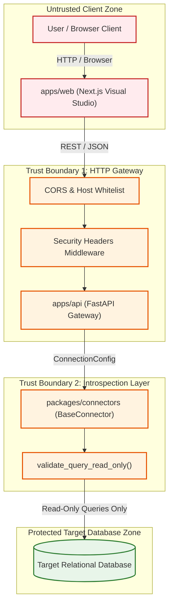

# DERA Security Architecture & Threat Defense Specification

> **Project:** DERA — Database Engineering & Reverse Analysis  
> **Maintainer:** Krishanth  
> **Security Contact:** `krishanth.b.2008@gmail.com`  
> **Status:** Active Security Specification  
> **Last Verified:** 2026-10-26 (Commit `e550fdd`)  

---

## 1. Security Architecture Principles

Because DERA connects directly to database catalogs to reverse-engineer schemas, security, integrity, and operational safety are foundational requirements.

DERA enforces a **defense-in-depth model** governed by four architectural invariants:
1. **Absolute Read-Only Introspection:** Introspection adapters are barred from executing DDL or DML mutations.
2. **Metadata-Only Processing:** DERA inspects database structures (tables, columns, indexes, constraints) without querying or storing customer application data.
3. **Strict Non-AI Determinism:** DERA never transmits schema structures, column names, or queries to third-party generative AI, LLM, or cloud inference services.
4. **Credential Isolation:** Database credentials remain strictly on the backend and are never exposed to browser clients.

---

## 2. Classification of Security Controls

To maintain transparency and auditability, DERA distinguishes between **Implemented Controls**, **Documented Design Principles**, and **Planned Controls**:

| Security Control | Implementation Status | Enforcement Mechanism |
|---|---|---|
| **Static SQL Mutation Interception** | **Implemented** | Regex validation in [`BaseConnector.validate_query_read_only()`](../../packages/connectors/src/dera_connectors/base/connector.py) blocking `DROP`, `ALTER`, `TRUNCATE`, `INSERT`, `UPDATE`, `DELETE`, `GRANT`, `REVOKE`. |
| **Session Read-Only Directives** | **Implemented (SQLite)** | SQLite URI `mode=ro` and `PRAGMA query_only = ON;`. (PostgreSQL session read-only in development). |
| **OWASP Defensive HTTP Headers** | **Implemented** | `SecurityHeadersMiddleware` appends `X-Content-Type-Options: nosniff`, `X-Frame-Options: DENY`, `X-XSS-Protection: 1; mode=block`, and `Referrer-Policy`. |
| **Loopback Binding Default** | **Implemented** | `ApiSettings` binds API server to `127.0.0.1` by default to avoid unintended LAN/WAN exposure. |
| **Credential Masking in Logs** | **Implemented** | `ConnectionConfig.safe_dict()` strips passwords from dictionary and string serialization. |
| **Automated Dependency Auditing** | **Implemented** | GitHub Actions workflows (`dependency-review.yml`, `codeql.yml`, `bandit.yml`) scan pull requests automatically. |
| **Pinned GitHub Action SHAs** | **Implemented** | Third-party GitHub Actions pinned to immutable 40-character commit hashes to mitigate supply chain tampering. |
| **Least-Privilege Database Roles** | **Documented Design Principle** | Documented guidance recommending dedicated read-only database accounts (`SELECT` on `information_schema` only). |
| **AES-256-GCM Secret Encryption at Rest** | **Planned (Phase 5)** | Database connection secrets stored in local vaults encrypted via AES-256-GCM. |
| **Multi-Tenant Workspace Isolation** | **Planned (Future)** | Multi-user account isolation and cryptographic tenant separation. |

> **Compliance Notice:** DERA does not claim formal certification or compliance with ISO 27001, SOC 2, PCI-DSS, or HIPAA. Organizations deploying DERA should independently audit connector configurations against their internal security baselines.

---

## 3. Trust Boundaries & Attack Surface Analysis

---

## 4. Threat Model & Mitigation Matrix

### 4.1 Threat: Accidental Database Modification
- **Vector:** An introspection script or user command attempts to execute a destructive query (`DROP TABLE`, `ALTER TABLE`).
- **Mitigation:** Two independent layers of defense:
  1. Static regex query inspection in `BaseConnector.validate_query_read_only()` intercepts mutating statements prior to execution.
  2. Database session configuration (`PRAGMA query_only = ON;`, `SET TRANSACTION READ ONLY;`) instructs the engine to abort mutations.

### 4.2 Threat: Credential Leakage in Client Bundles
- **Vector:** Database passwords or connection URIs bundled into frontend JavaScript code.
- **Mitigation:**
  - `apps/web` has zero database driver dependencies and accepts no database passwords into client state.
  - Connection parameters are held strictly in server-side configuration.
  - Architectural boundary tests verify that `apps/web` contains no references to backend database connection secrets.

### 4.3 Threat: Data Exfiltration via External Inference APIs
- **Vector:** Database schema structures or table names transmitted to external AI APIs (e.g. OpenAI, Anthropic, Gemini).
- **Mitigation:**
  - Automated AST scanning in `tests/architecture/test_module_boundaries.py` scans all Python files on every CI run to guarantee zero imports of AI or LLM packages.
  - Explicit architectural policy barring probabilistic inference.

### 4.4 Threat: Supply Chain Attack via CI Actions
- **Vector:** Compromised third-party GitHub Action dependencies executing malicious code during build pipelines.
- **Mitigation:**
  - All third-party GitHub Actions are pinned to full 40-character immutable commit SHAs.
  - GitHub Actions permissions are strictly scoped using `permissions: contents: read`.

---

## 5. Vulnerability Disclosure & Incident Handling

If you discover a potential security flaw in DERA:
1. **Do not create a public GitHub Issue.**
2. Disclose privately via GitHub: 👉 **[Submit a Security Advisory](https://github.com/krishanth7/dera/security/advisories/new)**
3. Or email the maintainer directly at: `krishanth.b.2008@gmail.com`.

For full operational response timelines and CVSS triage workflows, see [Vulnerability Response Policy](VULNERABILITY_RESPONSE.md).

---

## 6. Related Security Documentation

- [Security Documentation Hub](README.md)
- [Database Security & Connection Standards](DATABASE_SECURITY.md)
- [Secure Development Guidelines](SECURE_DEVELOPMENT.md)
- [Threat Model Matrix](model.md)
- [Vulnerability Response Workflow](VULNERABILITY_RESPONSE.md)
