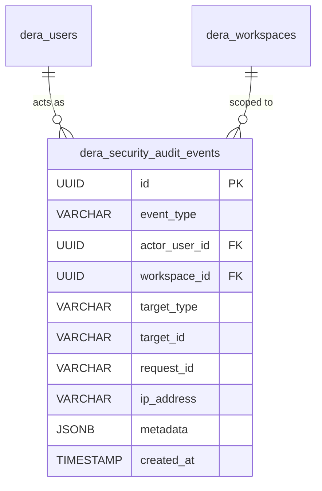

# DERA Security Audit Events Architecture

**Project:** DERA — Database Engineering & Reverse Analysis  
**Repository:** [https://github.com/krishanth7/dera](https://github.com/krishanth7/dera)  
**Maintainer:** Bunga Krishanth  
**Security Reference:** NIST SP 800-92, OWASP ASVS Logging & Audit Controls  
**License:** [MIT License](../../LICENSE)  

---

## 1. Overview & Non-Repudiation

Security-critical platform events are deterministically captured in the PostgreSQL database table `dera_security_audit_events`. Audit records provide forensic traceability for authentication attempts, session revocations, workspace modifications, and membership role transitions.



---

## 2. Audit Event Schema

```sql
CREATE TABLE dera_security_audit_events (
    id UUID PRIMARY KEY DEFAULT gen_random_uuid(),
    event_type VARCHAR(64) NOT NULL,
    actor_user_id UUID REFERENCES dera_users(id) ON DELETE SET NULL,
    workspace_id UUID REFERENCES dera_workspaces(id) ON DELETE SET NULL,
    target_type VARCHAR(64),
    target_id VARCHAR(128),
    request_id VARCHAR(64),
    ip_address VARCHAR(45),
    metadata JSONB,
    created_at TIMESTAMP WITH TIME ZONE NOT NULL DEFAULT NOW()
);

CREATE INDEX ix_dera_security_audit_events_event_type ON dera_security_audit_events(event_type);
CREATE INDEX ix_dera_security_audit_events_workspace_id ON dera_security_audit_events(workspace_id);
CREATE INDEX ix_dera_security_audit_events_actor_user_id ON dera_security_audit_events(actor_user_id);
CREATE INDEX ix_dera_security_audit_events_created_at ON dera_security_audit_events(created_at);
```

---

## 3. Catalog of Security Audit Events

| Event Identifier | Description | Actor | Target | Key Metadata Logged |
| :--- | :--- | :--- | :--- | :--- |
| `auth.register.success` | A new user successfully registered. | Newly created user | `user` | None |
| `auth.register.duplicate_attempt` | Registration failed due to an existing registered email. | Anonymous | `user` | Normalized email attempted |
| `auth.login.success` | User successfully authenticated with valid password. | Authenticated user | `session` | None (zero credentials logged) |
| `auth.login.failure` | Failed login attempt due to bad password or non-existent email. | Anonymous | `user` | Normalized email attempted |
| `auth.logout.success` | Active session terminated by user. | Authenticated user | `session` | Session UUID |
| `auth.logout_all.success` | All sessions revoked across devices. | Authenticated user | `user` | `revoked_sessions_count` |
| `workspace.create.success` | New workspace provisioned with initial Owner. | Authenticated user | `workspace` | Workspace slug, initial role |
| `workspace.member.add` | New member invited/added to a workspace. | Workspace Admin/Owner | `user` | Assigned role |
| `workspace.member.update_role` | Member's role updated. | Workspace Admin/Owner | `user` | Previous role, new role |
| `workspace.member.remove` | Member removed from workspace. | Workspace Admin/Owner | `user` | Former role |

---

## 4. Privacy & Sanitization Safeguards

1. **Zero Secret Persistence:** Plaintext passwords, Argon2 hashes, raw session tokens, and CSRF secrets are strictly barred from the `metadata` JSONB column.
2. **Immutable Audit Records:** The audit repository provides write-only `record_event` operations. No public application endpoints exist for mutating or deleting audit logs.
3. **Correlation ID Tracking:** Every audit event captures the HTTP `request_id` (from the distributed tracing header `X-Request-ID`) allowing full request trace correlation across application logs and database records.
