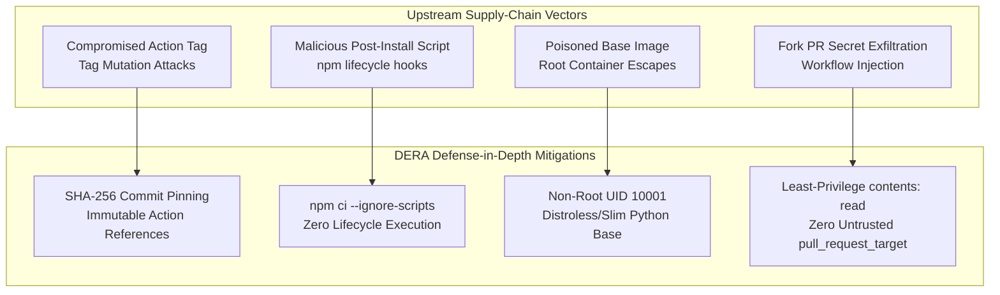

# DERA Software Supply-Chain Security Architecture

> **Project:** DERA — Database Engineering & Reverse Analysis  
> **Repository:** [https://github.com/krishanth7/dera](https://github.com/krishanth7/dera)  
> **Maintainer:** Bunga Krishanth (`@krishanth7`)  
> **Engineering Standard:** SLSA-Aligned, Deterministic, Least-Privilege DevSecOps  

---

## 1. Executive Summary

Modern software applications are increasingly targeted through compromised upstream dependencies, malicious build scripts, and poisoned continuous integration actions.

**DERA — Database Engineering & Reverse Analysis** secures its software supply chain across four critical layers:
1. **GitHub Actions Infrastructure:** Immutable pinning, minimal permissions, and zero untrusted script execution.
2. **Third-Party Package Ecosystems:** Lockfile integrity, disabled install-lifecycle scripts, and automated vulnerability scanning.
3. **Container Image Distribution:** Multi-stage builds, pinned official base images, and unprivileged non-root execution.
4. **Source Code & PR Qualification:** Strict Conventional Commits, readiness checks, AST validation, and AST-level read-only SQL enforcement.

---

## 2. Supply-Chain Threat Modeling



---

## 3. GitHub Actions Supply-Chain Hardening

### 3.1 Action Pinning Policy
- **Third-Party Actions:** Any action not published directly under the official `actions/` or `github/` organizations must be pinned to a full 40-character immutable commit SHA, accompanied by an inline comment documenting the upstream semantic version:
  ```yaml
  uses: docker/setup-buildx-action@f87e5991a6d7451dcb8d9637bfbc97413f497069 # v4.4.1
  uses: docker/build-push-action@c3c9e263c25d99ce0380d002d59b67737d91b0dc # v7.4.0
  ```
- **Official GitHub Actions:** Actions maintained directly by GitHub (`actions/checkout`, `actions/setup-python`, `actions/setup-node`, `github/codeql-action`) are vetted and managed via Dependabot's automated `github-actions` ecosystem.

### 3.2 Permission Boundaries
- **Default Read-Only:** Every workflow declares explicit top-level permissions:
  ```yaml
  permissions:
    contents: read
  ```
- **Job-Level Isolation:** Elevated write permissions are restricted strictly to jobs requiring them:
  - `security-events: write` — only for CodeQL SARIF uploads.
  - `packages: write` — only for release Docker container publication.
- **Zero `pull_request_target`:** Pull requests from forks execute strictly under standard unprivileged `pull_request` runners with read-only tokens, eliminating token theft vectors.

---

## 4. Package Ecosystem Protection

### 4.1 Node.js & TypeScript
- **Lockfile Enforcement:** Dependency versions are locked in [`package-lock.json`](../../package-lock.json) (v3 format).
- **Script Execution Prevention:** Continuous integration and container builds install dependencies exclusively via:
  ```bash
  npm ci --ignore-scripts
  ```
  This prevents malicious npm packages from executing shell commands or compiling unauthorized native binaries during installation.
- **Security Overrides:** Direct and transitive dependencies with known advisories are pinned via `overrides` in `package.json` until upstream packages release patched minor versions.

### 4.2 Python Ecosystem
- **Standard Compliant Packaging:** Direct dependencies are declared in [`pyproject.toml`](../../pyproject.toml) following PEP 517 / PEP 621 standards.
- **Deterministic Verification:** Tested against Python 3.12 and Python 3.13 LTS matrix runners without system package contamination.
- **Automated Audit:** Scanned via `pip-audit` to detect published CVEs in direct and transitive packages.

---

## 5. Container Hardening & Provenance

- **Pinned Slim Base:** Uses official, minimal base image `python:3.13-slim`.
- **Multi-Stage Build Isolation:** Development build tools (compiler, header files) in stage 1 are discarded; only compiled artifacts are copied to stage 2.
- **Non-Root Execution:** The container runtime executes strictly as non-root user `dera` with system UID/GID `10001`:
  ```dockerfile
  RUN groupadd -g 10001 dera && \
      useradd -u 10001 -g dera -s /bin/false -m -d /app dera
  USER dera:dera
  ```
- **Attack Surface Reduction:** Strips `.git`, tests, and development configuration via [`.dockerignore`](../../.dockerignore).
