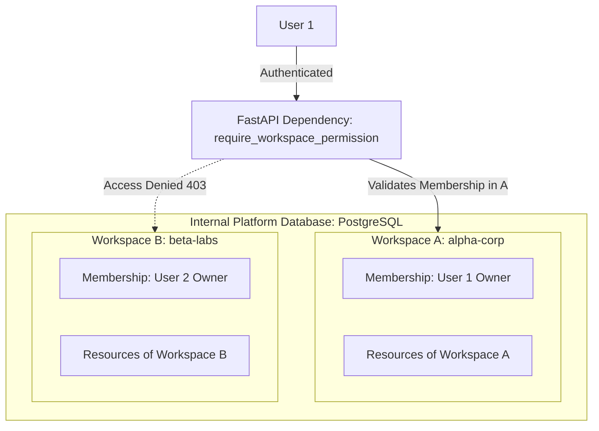

# DERA Multi-Tenant Workspace Isolation

**Project:** DERA — Database Engineering & Reverse Analysis  
**Repository:** [https://github.com/krishanth7/dera](https://github.com/krishanth7/dera)  
**Maintainer:** Bunga Krishanth  
**Security Reference:** OWASP ASVS v4.0.3 Multi-Tenancy & Access Control  
**License:** [MIT License](../../LICENSE)  

---

## 1. Overview & Isolation Philosophy

DERA implements a **logical multi-tenant architecture** where all platform assets (users, workspaces, memberships, future database topologies, and reverse engineering jobs) are partitioned by explicit **Workspace Boundaries**.



---

## 2. Multi-Tenant Data Model

Every resource within DERA belongs to an explicit workspace. Foreign key constraints enforce strict referential integrity with cascading deletes only where appropriate:

```sql
-- Workspace Entity
CREATE TABLE dera_workspaces (
    id UUID PRIMARY KEY DEFAULT gen_random_uuid(),
    name VARCHAR(255) NOT NULL,
    slug VARCHAR(64) NOT NULL UNIQUE,
    status VARCHAR(32) NOT NULL DEFAULT 'active',
    created_at TIMESTAMP WITH TIME ZONE NOT NULL DEFAULT NOW(),
    updated_at TIMESTAMP WITH TIME ZONE NOT NULL DEFAULT NOW()
);

-- Workspace Membership (Tenant Bridge)
CREATE TABLE dera_workspace_memberships (
    id UUID PRIMARY KEY DEFAULT gen_random_uuid(),
    workspace_id UUID NOT NULL REFERENCES dera_workspaces(id) ON DELETE CASCADE,
    user_id UUID NOT NULL REFERENCES dera_users(id) ON DELETE CASCADE,
    role VARCHAR(32) NOT NULL DEFAULT 'viewer',
    status VARCHAR(32) NOT NULL DEFAULT 'active',
    created_at TIMESTAMP WITH TIME ZONE NOT NULL DEFAULT NOW(),
    updated_at TIMESTAMP WITH TIME ZONE NOT NULL DEFAULT NOW(),
    CONSTRAINT uq_workspace_user UNIQUE (workspace_id, user_id)
);
```

---

## 3. Boundary Enforcement Strategy

DERA avoids broad, unrestricted database queries by applying workspace filters at the repository and dependency injection layers:

### Reusable Dependency Injection (`require_workspace_permission`)

```python
def require_workspace_permission(
    required_permission: Permission,
) -> Callable[..., Coroutine[Any, Any, WorkspaceMembership]]:
    async def dependency(
        slug: str,
        current_user: Annotated[User, Depends(get_current_user)],
        db_session: Annotated[AsyncSession, Depends(get_db_session)],
    ) -> WorkspaceMembership:
        ws_repo = WorkspaceRepository(db_session)
        member_repo = MembershipRepository(db_session)

        workspace = await ws_repo.get_by_slug(slug)
        if not workspace:
            raise WorkspaceAccessDeniedError("Workspace not found or access denied.")

        membership = await member_repo.get_membership(workspace.id, current_user.id)
        if not membership or membership.status != "active":
            raise WorkspaceAccessDeniedError("You are not an active member of this workspace.")

        if not has_permission(WorkspaceRole(membership.role), required_permission):
            raise PermissionDeniedError(
                f"Role '{membership.role}' lacks required permission '{required_permission}'."
            )

        return membership

    return dependency
```

### Invariants Enforced

1. **No Ambient Tenant Context:** The workspace identifier (`slug` or `workspace_id`) must be explicitly present in the request route.
2. **Membership Verification:** A user cannot query or mutate workspace data unless their membership is explicitly verified in the database.
3. **Safe Error Masking:** When a workspace does not exist or the user has no membership, a uniform `403 Forbidden` (`WORKSPACE_ACCESS_DENIED`) is returned, avoiding workspace existence disclosure to unauthorized actors.
4. **Negative Multi-Tenant Test Matrix:** Test suite `tests/tenancy/test_workspace_isolation.py` rigorously verifies that members of Workspace A cannot read members, alter roles, or perform operations in Workspace B.
