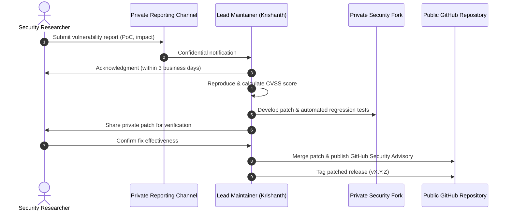

# Vulnerability Response & Incident Disclosure Process

**Project:** DERA — Database Engineering & Reverse Analysis  
**Repository:** [https://github.com/krishanth7/dera](https://github.com/krishanth7/dera)  
**Policy Status:** Active Operational Standard  
**Maintainer:** [Krishanth](https://github.com/krishanth7)  
**Parent Policy:** [SECURITY.md](../../SECURITY.md)  
**Reporting Channel:** [https://github.com/krishanth7/dera/security/advisories/new](https://github.com/krishanth7/dera/security/advisories/new)  
**Direct Security Email:** `krishanth.b.2008@gmail.com`  

---

## 1. Overview & Objectives

This document establishes the step-by-step operational process for receiving, triaging, investigating, patching, and disclosing security vulnerabilities affecting DERA.

Our primary objectives are:
- Minimizing user risk through rapid, coordinated remediation.
- Ensuring confidential, safe communication with security researchers.
- Publishing transparent, accurate public security advisories once fixes are deployed.



---

## 2. Intake & Confidential Reporting

### 2.1 Primary Intake Channel
Researchers should submit security reports privately through GitHub's built-in private advisory mechanism:
👉 **[Submit a Security Report](https://github.com/krishanth7/dera/security/advisories/new)**

*Why GitHub Advisories?* This allows encrypted, collaborative discussion, private patch staging, and automated CVE assignment in a single secure environment.

### 2.2 Secondary Intake Channel
If GitHub private reporting is unavailable or inaccessible:
- **Email:** `krishanth.b.2008@gmail.com`
- **Subject:** `[SECURITY] DERA Vulnerability Report: <Component / Brief Title>`
- **Encryption:** GPG encrypted emails are supported upon request.

### 2.3 Information Required
To facilitate rapid triage, please include:
1. Affected version, commit hash, or package name.
2. Affected component (e.g., PostgreSQL connector, API auth middleware, graph engine).
3. Detailed description of the vulnerability and attack vector.
4. Step-by-step proof of concept (PoC) or reproduction script.
5. Observed impact vs expected behavior.
6. Suggested remediation (if identified).

---

## 3. Five-Stage Response Workflow

### Stage 1: Intake & Acknowledgment (Target: ≤ 3 Business Days)
- Maintainer receives confidential report.
- Maintainer verifies report completeness and sends formal acknowledgment to reporter.
- An internal tracking ticket or private advisory draft is created.

### Stage 2: Triage & CVSS Severity Assessment (Target: ≤ 5 Business Days)
- Maintainer recreates the reported issue in an isolated, non-production test environment.
- Determine whether the report constitutes a genuine security vulnerability, a functional bug, or expected behavior.
- Calculate preliminary severity using the **Common Vulnerability Scoring System (CVSS v3.1)**:

| Severity Level | CVSS v3.1 Base Score | Typical Scenario |
|---|---|---|
| **Critical** | 9.0 – 10.0 | Remote Code Execution (RCE), unauthenticated cross-tenant credential extraction |
| **High** | 7.0 – 8.9 | Privilege escalation, bypass of read-only query interception, database token exposure |
| **Medium** | 4.0 – 6.9 | Information disclosure of schema metadata without credential compromise |
| **Low** | 0.1 – 3.9 | Minor configuration issues, non-sensitive error leakage |

### Stage 3: Remediation in Private Security Fork
- A temporary private security fork is provisioned via the GitHub Advisory workspace.
- The maintainer (and invited reporter, if collaborating) develops the fix.
- Requirements for the fix:
  - Minimal surgical change addressing the root cause.
  - Automated security regression test reproducing the original issue and asserting the fix.
  - Validation across all supported Python (3.12, 3.13) and TypeScript environments.
  - Zero performance regression.

### Stage 4: Verification & Reporter Validation
- The reporter is invited to review the pull request in the private advisory workspace.
- The reporter confirms whether the patch fully resolves the vulnerability without side effects.

### Stage 5: Coordinated Disclosure & Release Publication
- A coordinated disclosure date is agreed upon with the reporter (typically within 14 to 30 days of report receipt).
- The patch is merged to `main` via Conventional Commit:
  ```text
  fix(security): resolve credential leakage in catalog inspection [GHSA-xxxx-xxxx-xxxx]
  ```
- A new patch version is tagged and released.
- The GitHub Security Advisory is published publicly with appropriate credit to the reporter (unless anonymity is requested).

---

## 4. Responsible Disclosure Guidelines

We ask security researchers to adhere to responsible disclosure principles:
- **No Public Disclosure:** Do not publish details or PoC code publicly before an official advisory and patched release have been issued.
- **Safety First:** Test only against local environments or systems you own and are authorized to test.
- **No Data Damage:** Avoid destructive commands, denial of service, or modifying third-party databases.
- **Good Faith:** Researchers who act in good faith and follow this policy will not be pursued with legal action by the maintainers.

---

## 5. Post-Incident Review & Continuous Improvement

Following the resolution of any High or Critical severity incident:
1. **Root Cause Analysis (RCA):** Maintainers conduct an RCA to understand systemic factors that contributed to the vulnerability.
2. **Static Analysis Rule Addition:** If feasible, write a custom Bandit rule, Ruff check, or CodeQL query to prevent recurrence of similar weakness patterns.
3. **Documentation Update:** Update [DATABASE_SECURITY.md](DATABASE_SECURITY.md) or [SECURE_DEVELOPMENT.md](SECURE_DEVELOPMENT.md) if architectural guidelines require refinement.
