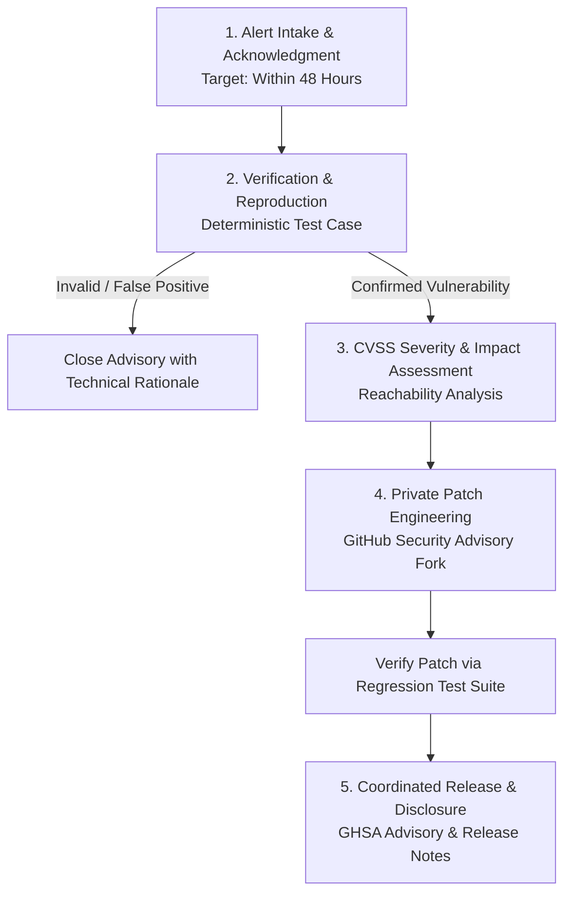

# DERA Vulnerability Triage & Coordinated Disclosure Procedure

> **Project:** DERA — Database Engineering & Reverse Analysis  
> **Repository:** [https://github.com/krishanth7/dera](https://github.com/krishanth7/dera)  
> **Maintainer:** Bunga Krishanth (`@krishanth7`)  
> **Security Contact:** `krishanth.b.2008@gmail.com`  
> **Policy:** Private Disclosure, Responsible Coordination, Transparent Resolution  

---

## 1. Vulnerability Intake Channels

DERA accepts security vulnerability disclosures exclusively through private, encrypted channels:

1. **GitHub Private Vulnerability Reporting (Primary):**  
   Reporters submit findings via **[Report a Security Vulnerability](https://github.com/krishanth7/dera/security/advisories/new)**. This creates a confidential GitHub Security Advisory (GHSA) workspace visible only to repository maintainers and the reporter.
2. **Direct Maintainer Contact (Fallback):**  
   If GitHub Private Reporting is unavailable, reports may be emailed directly to maintainer **Bunga Krishanth** at `krishanth.b.2008@gmail.com` with the subject line `[SECURITY] DERA Vulnerability Report`.
3. **Automated Scanner Alerts:**  
   CodeQL static analysis, Dependabot dependency alerts, and secret scanning alerts are routed directly to the maintainer's security dashboard.

> ⚠️ **Public Issue Notice:** Never open a public GitHub issue, discussion, or pull request for an unpatched vulnerability. Public disclosures endanger production database users and will be deleted immediately.

---

## 2. Five-Stage Triage Workflow



### Stage 1: Intake & Acknowledgment (Within 48 Hours)
- The maintainer logs the report in the internal security queue.
- An acknowledgment is sent to the researcher confirming receipt and providing a point of contact.

### Stage 2: Verification & Technical Reproduction
- Maintainers construct an isolated, deterministic test case based on the report.
- The report is categorized:
  - **Confirmed Vulnerability:** Flaw is reproducible and creates an exploitable security boundary violation.
  - **False Positive / Non-Issue:** Flaw is theoretical, unreachable, or represents documented intended behavior (e.g. CLI flags operating locally on user-provided file paths).
  - **Documentation Gap:** Issue arises from unclear security guidance rather than software defect.

### Stage 3: CVSS Severity & Impact Assessment
- Severity is scored using CVSS v3.1 / v4.0 metrics:
  - Attack Vector (Network, Local, Physical)
  - Attack Complexity (Low, High)
  - Privileges Required (None, Low, High)
  - User Interaction (None, Required)
  - Impact on Confidentiality, Integrity, and Availability
- Scope evaluation: Determine whether the issue impacts database credentials, tenant isolation, or execution integrity.

### Stage 4: Private Patch Development
- Maintainers create a private fork directly within the GitHub Security Advisory workspace.
- The patch is implemented alongside permanent regression tests in `tests/security/` or `tests/integration/`.
- Code changes are peer-reviewed privately without triggering public CI builds.

### Stage 5: Coordinated Release & Publication
- A patch release is tagged and published (`vX.Y.Z`).
- The GitHub Security Advisory is published, requesting a CVE identifier where appropriate.
- Credit and attribution are formally given to the reporting security researcher (unless anonymity is requested).

---

## 3. Communication Templates

### Acknowledgment Template
```text
Subject: Re: [SECURITY] DERA Vulnerability Report - Receipt Acknowledged

Hello [Researcher Name],

Thank you for responsibly disclosing this finding to DERA — Database Engineering & Reverse Analysis.

We have received your report regarding [brief topic] and assigned it internal tracking ID [SEC-YYYY-XXXX].
Our security maintainers are currently reviewing the submission and attempting reproduction. We will follow
up with technical findings and an initial assessment within 48 to 72 hours.

Best regards,
Bunga Krishanth
DERA Maintainer
```

### Resolution & Disclosure Notice Template
```text
Subject: Re: [SECURITY] DERA Vulnerability Report - Patch Released (GHSA-xxxx-xxxx-xxxx)

Hello [Researcher Name],

We have resolved the vulnerability reported under [SEC-YYYY-XXXX] with the release of DERA version [vX.Y.Z].
The coordinated GitHub Security Advisory has been scheduled for publication.

We would like to acknowledge your contribution in the advisory credits and release notes. Please confirm
how you would like your name or handle to appear.

Thank you for helping keep the database engineering community secure!

Best regards,
Bunga Krishanth
DERA Maintainer
```
