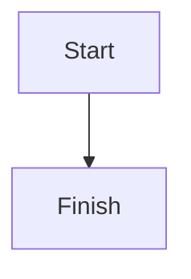

# Valid Test Documentation

## 1. Overview
This is a valid documentation fixture with [Local Anchor Link](#2-architecture-overview).

## 2. Architecture Overview
This section describes architecture.

```text
Valid text code fence.
```


